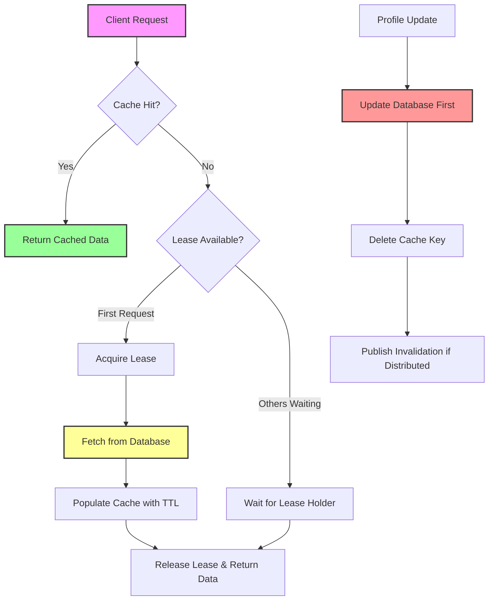

| Difficulty | Channel | Tags |
|---|---|---|
| beginner | backend | redis, memcached, cache-invalidation |

Picture this: billions of requests flooding in every second, each one desperate for a user's profile. One wrong cache invalidation and databases collapse under pressure. This exact nightmare became reality for Facebook (Meta), whose memcache layer served over a billion users across dozens of clusters [1]. What they discovered would forever change how engineers think about cache invalidation at scale.

---

> ### Real-World Case — Facebook (Meta)
>
> Facebook's memcache layer stored profile and social-graph data for over a billion users across multiple regions and dozens of clusters. It handled billions of requests per second and trillions of cached objects, with MySQL as the source of truth and a read-heavy workload where a small drop in hit rate could overwhelm the databases.
>
> | | |
> |---|---|
> | **Challenge** | When a user updated their profile or social data, Facebook had to invalidate every cached copy of that object across clusters and regions. Racing writes and reads could leave a stale value in cache indefinitely, and a hot key being invalidated could trigger a thundering herd of database reads. |
> | **Solution** | Facebook used a look-aside cache and deliberately deleted the key on write instead of writing the new value into cache, because delete is order-independent under concurrent updates. A daemon called mcsqueal tailed the MySQL commit log and broadcast invalidations to every memcache cluster in the region. On a cache miss, memcached issued a 64-bit lease token to only one client to fetch from the database and repopulate the key; a concurrent delete invalidated the lease, preventing a stale set, while other clients retried briefly instead of stampeding the database. |
> | **Outcome** | The system sustained billions of requests per second and trillions of items for more than a billion users, with roughly a 99% cache hit rate that cut database read load by about 100x. The lease mechanism eliminated both stale sets and thundering-herd overloads that plain delete-on-write could not handle. |
> | **Lesson** | Write-through 'set' on update is deceptively dangerous: concurrent database writes and cache writes can reorder and leave permanently stale data. Delete-on-write is safer, but it creates its own races, so at scale you still need coordination—leases for stale sets and a log-tailing invalidation pipeline. Memcached's simplicity is a strength, but the invalidation layer becomes your responsibility. |

---

## Hook — When a 1% Drop Means Disaster

For most applications, a cache miss is an inconvenience. For systems serving billions of users, it is catastrophic. Every request that bypasses cache hits the source of truth - and at Facebook's scale, that meant MySQL would be instantly overwhelmed. The stakes could not be higher: with roughly 99% cache hit rate, the memcache layer cut database read load by about 100x [1]. A tiny regression in hit rate would multiply database traffic a hundredfold. This reality forces every engineering team to confront an uncomfortable truth - cache invalidation is not an optimization, it is a matter of survival.

## Problem — The Impossible Choice Between Speed and Freshness

Building on this pressure, developers face a fundamental tension: caches exist to make reads fast, but they introduce staleness. When a user updates their profile, every cached copy across distributed nodes becomes outdated. The naive approach seems obvious - delete the cached entry on write. However, this creates two insidious problems. First, between deletion and the next read populating fresh data, other requests may still see stale values or worse, trigger a stampede of simultaneous cache misses [1][2]. Second, in a distributed system with multiple cache nodes, coordinating deletions becomes nearly impossible without additional mechanisms. Many developers think 'just set a short TTL' is the answer, but TTL alone cannot guarantee consistency the moment data changes. You need a strategy that balances freshness, performance, and availability.

## Real-World Case — Facebook's Battle Against Thundering Herds

This is precisely the battle Facebook fought. As documented in their NSDI '13 presentation, Facebook's memcache layer stored profile and social-graph data for over a billion users across multiple regions and dozens of clusters [1]. The workload was overwhelmingly read-heavy, handling billions of requests per second and trillions of cached objects, with MySQL as the source of truth. The team discovered that plain delete-on-write was insufficient - it led to stale sets and thundering-herd overloads when popular keys expired or were invalidated. Their solution was the lease mechanism: when a cache miss occurs, only the first requester gets a lease to populate the cache from the database, while others wait for that result [1]. This elegant approach eliminated both stale data from concurrent writes and the database overload from thundering herds. The impact was staggering - sustaining billions of requests per second with ~99% hit rate and reducing database load by ~100x [1].

## Deep Dive — Redis vs Memcached: Trade-offs That Matter

This leads to the critical question every team must answer: which caching technology fits the invalidation strategy? Memcached, the original in-memory key-value store, prioritizes simplicity and raw speed for pure caching workloads [3][7]. It has no built-in persistence and no complex data structures, making it lightweight with lower memory overhead [3]. Redis takes a different approach - it is an in-memory data structure store with persistence options, pub/sub messaging, and support for lists, sets, sorted sets, and more [4][5]. For cache invalidation specifically, Redis shines with pub/sub for distributed invalidation across nodes, allowing coordinated updates without manual polling [5]. Memcached requires manual coordination across nodes, making distributed invalidation more complex to implement correctly [3][7]. Moreover, HTTP caching principles remind us that cache control is nuanced - different strategies (no-store, no-cache, max-age) serve different consistency needs [6]. The trade-off is clear: choose Memcached for simple, high-throughput caching where occasional staleness via TTL is acceptable; choose Redis when you need sophisticated invalidation patterns, durability, or richer data structures. There is no universally correct answer - only the right answer for your consistency requirements.

## Workflow — A Practical Invalidation Strategy

So how do you implement this in practice? The workflow below illustrates a robust approach combining write-through patterns with intelligent invalidation. First, on read, check cache (cache-aside pattern) - if hit, return immediately [2]. If miss, fetch from database, populate cache with appropriate TTL, return to client. Second, on write/update, use write-through: update the database first (source of truth), then invalidate or update the cache [2]. Deleting the key on update prevents stale reads rather than attempting to update in place - a safer default that avoids race conditions. Third, for distributed systems, consider pub/sub for cache invalidation messages across nodes (Redis excels here) or adopt a lease mechanism inspired by Facebook to prevent thundering herds [1][5]. Finally, monitor cache hit rates religiously - as Facebook proved, small drops have exponential consequences [1]. The diagram below visualizes this flow.

## Code Example — Implementing Cache Invalidation

Theory only goes so far. Here is a practical implementation showing write-through caching with Redis, including cache invalidation on update and a simple lease-like protection against thundering herds. Note the defensive patterns: updating the database first, then deleting from cache; using TTL as a safety net; and tracking in-flight requests to coalesce duplicates.

## Lessons Learned — What to Do Differently Tomorrow

After examining Facebook's journey and the trade-offs, several lessons stand out. First, cache invalidation is harder than caching itself - budget time for it in design reviews. Second, hit rate is your north star metric; instrument it and alert on drops [1]. Third, choose tools based on requirements: Memcached for simplicity and speed, Redis for complex invalidation and features [3][5][7]. Fourth, never rely solely on TTL for consistency when immediate invalidation matters - combine strategies [2][6]. Fifth, prevent thundering herds with leases or request coalescing, especially for expensive or popular keys [1]. Most importantly, remember the "so what?" - if your system serves at scale, a small cache miss rate increase can cascade into database failure. Start tomorrow by auditing your invalidation strategy: do you delete on write? Do you have herd protection? Do you monitor hit rates? These questions might save you from a 3 AM pager alert.

---

## Cache Read with Lease Protection and Write Invalidation Flow

<strong>Original Interview Question</strong>

**Q:** You're building a user profile service that caches frequently accessed profiles. How would you implement cache invalidation when a user updates their profile, and what trade-offs would you consider between Redis and Memcached?

**A:** Implement write-through caching with TTL-based expiration. On profile update, invalidate the cache by deleting the key and writing new data to both the database and cache. Redis offers pub/sub for automatic distributed invalidation, while Memcached requires manual coordination across nodes.

## Conclusion

The billion-request cache crisis taught a humbling lesson: speed without freshness is dangerous, but freshness at scale is brutally hard. Facebook's lease mechanism proved that elegant solutions to distributed problems often come from rethinking the naive approach [1]. For any team building cache-heavy systems, the path forward is clear - measure hit rates religiously, choose the right tool for consistency needs (Memcached for simplicity, Redis for sophistication) [3][5], delete on write rather than update in place, and protect against thundering herds. The next time a pager goes off at 3 AM over stale data, remember: cache invalidation is not a detail to handle later - it is the difference between a blip and a database meltdown. Start auditing your invalidation strategy tomorrow; your future self will thank you.

---

## References

1. [Facebook (Meta) incident report - Scaling Memcache at Facebook (NSDI '13)](https://www.usenix.org/conference/nsdi13/technical-sessions/presentation/nishtala) — article
2. [Wikipedia - Cache invalidation](https://en.wikipedia.org/wiki/Cache_invalidation) — documentation
3. [Wikipedia - Memcached](https://en.wikipedia.org/wiki/Memcached) — documentation
4. [GitHub - Redis](https://github.com/redis/redis) — documentation
5. [Wikipedia - Redis](https://en.wikipedia.org/wiki/Redis) — documentation
6. [RFC 7234 - Hypertext Transfer Protocol (HTTP/1.1): Caching](https://datatracker.ietf.org/doc/html/rfc7234) — documentation
7. [GitHub - memcached/memcached](https://github.com/memcached/memcached) — documentation
8. [DigitalOcean - How To Implement Caching Strategies With Redis](https://www.digitalocean.com/community/tutorials/how-to-implement-caching-strategies-with-redis) — blog

---

**Author:** Satishkumar Dhule — [GitHub](https://github.com/satishkumar-dhule) · [LinkedIn](https://linkedin.com/in/satishkumar-dhule) · [Website](https://satishkumar-dhule.github.io)
