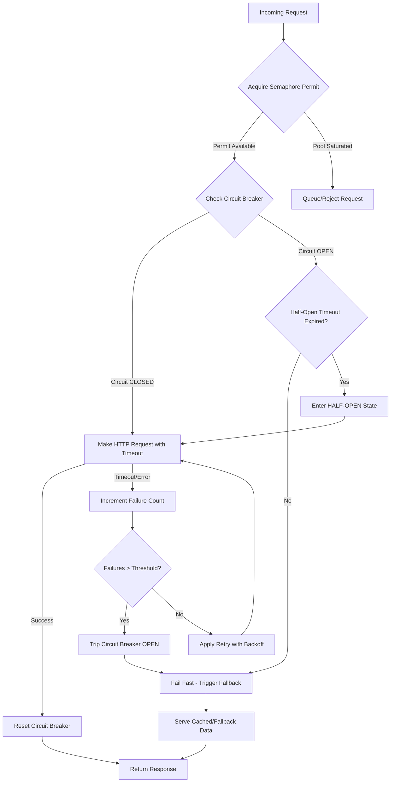

| Difficulty | Channel | Tags |
|---|---|---|
| advanced | backend | asyncio, aiohttp, concurrency |

It started with something so innocuous, so seemingly trivial, that nobody thought to worry about it. A tiny bookmark service. Yet in 2012, a slow dependency inside Netflix's bookmark service began causing timeouts of up to 30 seconds [1]. Since every request to Netflix's API called the bookmark service and threads blocked waiting for responses, the API threads were exhausted within 60 seconds, bringing down the entire Netflix API - not because of a critical service, but because of bookmarks. This is the cautionary tale that would forever change how developers think about failure.

---

> ### Real-World Case — Netflix
>
> In 2012, a slow dependency in Netflix's bookmark service began causing timeouts of up to 30 seconds. Since every request to Netflix's API called the bookmark service and threads blocked waiting for responses, the API threads were exhausted within 60 seconds, bringing down the entire Netflix API - not because of a critical service, but because of bookmarks.
>
> | | |
> |---|---|
> | **Challenge** | Prevent cascading failures in a high-volume distributed microservices architecture where a slow or failing dependency can exhaust all threads/connection resources and bring down the entire system. Need graceful degradation under high load and timeouts. |
> | **Solution** | Netflix built Hystrix, implementing the circuit breaker pattern with thread pool isolation per dependency (bulkheads), timeouts, fallbacks, and health metrics. When a dependency showed high error rates/latency, the circuit breaker tripped, short-circuiting requests and returning fallbacks instead of waiting for timeouts, releasing pressure on the failing system. |
> | **Outcome** | The incident led to building Hystrix which became the industry standard for resilience. It prevented cascading failures by isolating failures to individual dependencies, allowing the rest of the system to remain healthy with graceful degradation (serving cached/fallback data) while failing dependencies recovered. The pattern was widely adopted across the industry. |
> | **Lesson** | Every unchecked dependency is a liability in distributed systems - it's not if a dependency will fail, but when. Isolation (thread pools/semaphores), circuit breakers, timeouts, and fallbacks are essential for fault tolerance at scale. |

---

## Hook — The Smallest Thing Can Bring Down The Biggest System

Picture this: thousands of users are streaming their favorite shows, completely unaware that behind the scenes, a seemingly harmless microservice is about to bring the entire platform to its knees. What makes this scenario so terrifying is not complexity, but simplicity. Many developers assume that if a dependency is non-critical, its failure poses little risk. However, as Netflix learned the hard way, in a synchronous, thread-blocking architecture, there are no 'non-critical' dependencies. Every call is a potential point of failure. You might think that adding a timeout would solve the issue, but without isolation and graceful degradation, timeouts only mask the problem until resources are exhausted. This is exactly why resilience engineering exists - and it all traces back to understanding how connection pools behave under pressure.

## Problem — When Threads Become Your Bottleneck

To understand the scale of the disaster, you must first understand the architecture. In a thread-per-request model, each incoming API call consumes a thread until the response returns. When a downstream service slows down, those threads don't fail immediately - they wait. And they wait for the full timeout duration. This creates a resource exhaustion problem: as more threads block on slow dependencies, fewer threads remain to serve new requests. Consequently, the system enters a death spiral. For developers working with async frameworks today like aiohttp [2], the mechanics differ from traditional thread pools, but the core principle remains identical. Whether using OS threads or coroutines, you have finite concurrency limits. You can only make so many concurrent outbound requests at once. Moreover, without controls in place, a slow dependency can still saturate your connection pool, causing cascading failures across your entire system. The question becomes not 'if' this will happen, but 'when' it will happen under load.

## Real-World Case — Netflix's Bookmark Catastrophe

In 2012, Netflix experienced exactly this scenario [1]. A slow dependency in the bookmark service began causing timeouts of up to 30 seconds. Since every request to Netflix's API called the bookmark service and threads blocked waiting for responses, API threads were exhausted within 60 seconds. The result was catastrophic - the entire Netflix API went down, all because of bookmarks. The impact was severe enough that it forced Netflix to rethink its approach to distributed systems entirely. This incident directly led to the creation of Hystrix [3], which became the industry standard for resilience. Hystrix prevented cascading failures by isolating failures to individual dependencies, allowing the rest of the system to remain healthy with graceful degradation (serving cached/fallback data) while failing dependencies recovered. The pattern was so revolutionary that it influenced resilience libraries across nearly every major tech stack. The lesson is brutal but clear: isolation and fallback strategies are not luxuries - they are requirements for any distributed system at scale.

## Deep Dive — The Three Pillars of Graceful Degradation

Building on Netflix's hard-earned lesson, modern connection pool managers rely on three core mechanisms working in harmony. First, **concurrency control** is paramount. Using a semaphore [4] to limit maximum concurrent connections prevents your pool from overwhelming downstream services or exhausting local resources. This is especially critical in async environments where you might otherwise fire off thousands of coroutines simultaneously. Second, **intelligent retries with exponential backoff** [5] help handle transient failures. Rather than hammering a recovering service with immediate retries, exponential backoff increases delays between attempts, giving the dependency time to recover. However, indiscriminate retries can make things worse - this is why retry budgets and jitter are essential in production. Third, and most importantly, the **circuit breaker pattern** [6] provides failure isolation. When a dependency fails repeatedly past a threshold, the circuit breaker 'opens' and fails fast without making network calls. After a timeout period, it enters a 'half-open' state to test if the service has recovered. If successful, it closes and resumes normal operation. Together, these three pillars transform a brittle, cascading-failure-prone system into one that degrades gracefully. You don't need the bookmarks service to work perfectly to stream content - you just need a sensible fallback.

## Workflow — Orchestrating Resilient Requests

So how do these pieces fit together in practice? The workflow is a careful dance of checks, limits, and fallbacks. Step one: **Acquire a permit** from the semaphore, ensuring you never exceed your maximum concurrent connections. Step two: **Check the circuit breaker state**. If the circuit is open and not yet ready to test, fail fast with a clear error or trigger fallback logic. Step three: **Attempt the request** with properly configured timeouts. As noted in HTTP best practices [7], you should always set both connection and total timeouts to avoid hanging indefinitely. Step four: **Handle outcomes** - on success, reset the circuit breaker failure count; on failure (timeouts, connection errors, or server errors), increment failure counters and potentially trip the circuit breaker. Step five: **Apply graceful degradation** - if all else fails, serve cached data, return default values, or provide a degraded but functional response. This entire flow is visualized below, showing how requests flow through these protection mechanisms before reaching the downstream service.

## Code Example — Building a Production-Ready Connection Pool Manager

Now comes the moment of truth - translating these concepts into working code. The example below demonstrates a ConnectionPoolManager for aiohttp [2] that implements semaphore-based limiting, circuit breaker logic, and timeout handling. Pay close attention to how each mechanism protects against the exact scenario that felled Netflix. The circuit breaker state is tracked across requests, the semaphore prevents unbounded concurrency, and timeouts ensure no request hangs forever. This is not a toy example - it mirrors patterns used in production systems handling millions of requests daily.

## Lessons Learned — Building for Failure, Not Perfection

After studying Netflix's catastrophe and the patterns born from it, several critical lessons emerge. First, **assume everything fails**. Dependencies will slow down, networks will partition, and services will go down at the worst possible time. Design for failure from day one, not as an afterthought. Second, **fail fast, degrade gracefully**. It's far better to return a cached response in 200ms than to wait 30 seconds and return a 500 error. Your users would rather see slightly stale data than an error page. Third, **isolate failures ruthlessly**. One bad dependency should never take down your entire system. Circuit breakers exist specifically for this purpose [6]. Fourth, **set timeouts on everything**. As emphasized in HTTP semantics and client best practices [7], every network call needs both connect and total timeouts. Fifth, **monitor and tune**. Track circuit breaker states, pool saturation, timeout rates, and fallback usage. These metrics will tell you when your protections are kicking in - and when they need adjustment. Most importantly, remember: resilience is not about preventing all failures. It's about containing them, recovering quickly, and ensuring your system remains usable even when parts of it are broken.

---

## Resilient Connection Pool Request Flow

<strong>Original Interview Question</strong>

**Q:** How would you implement a connection pool manager for aiohttp that handles graceful degradation under high load and connection timeouts?

**A:** Implement a connection pool manager for aiohttp using a semaphore to limit concurrent connections, exponential backoff for retrying failed requests, and circuit breaker pattern to gracefully degrade under high load and connection timeouts.

## Conclusion

The bookmarks that broke Netflix serve as a humbling reminder: in distributed systems, there are no insignificant dependencies. The difference between a minor hiccup and a total outage often comes down to a few defensive patterns - concurrency limits, circuit breakers, and timeouts. You don't need to predict every failure to build resilient systems; you need to contain them when they inevitably occur. Start small: add timeouts to your HTTP calls today, implement a semaphore to cap concurrency, and consider circuit breakers for your critical dependencies. Because when the pager goes off at 3 AM, graceful degradation won't just save your uptime - it might just save your sanity.

---

## References

1. [Netflix incident report - Circuit Breakers](https://vamsilabs.netlify.app/systemdesign/circuit-breakers) — article
2. [aiohttp Documentation](https://docs.aiohttp.org/) — documentation
3. [Hystrix - Latency and Fault Tolerance for Distributed Systems](https://github.com/Netflix/Hystrix) — documentation
4. [asyncio - Synchronization Primitives (Semaphore)](https://docs.python.org/3/library/asyncio-sync.html#asyncio.Semaphore) — documentation
5. [Exponential Backoff and Jitter](https://aws.amazon.com/blogs/architecture/exponential-backoff-and-jitter/) — blog
6. [CircuitBreaker pattern - Martin Fowler](https://martinfowler.com/bliki/CircuitBreaker.html) — blog
7. [MDN - HTTP Timeout Concepts](https://developer.mozilla.org/en-US/docs/Web/HTTP/Guides/Timeouts) — documentation
8. [Python asyncio Documentation](https://docs.python.org/3/library/asyncio.html) — documentation

---

**Author:** Satishkumar Dhule — [GitHub](https://github.com/satishkumar-dhule) · [LinkedIn](https://linkedin.com/in/satishkumar-dhule) · [Website](https://satishkumar-dhule.github.io)
