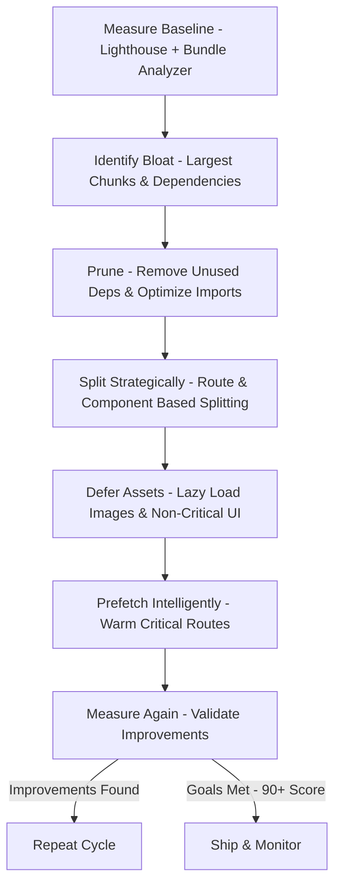

| Difficulty | Channel | Tags |
|---|---|---|
| intermediate | frontend | lighthouse, bundle, lazy-loading |

Ever wondered how some websites feel instantaneous, whilst others leave you staring at a blank screen for what feels like an eternity? For the logged-out users visiting Netflix.com, this wasn't a hypothetical question. In an effort to improve first-load performance for users on varied devices and slower connections, the Netflix team took a hard look at their logged-out desktop homepage. What they found was a hefty JavaScript bundle weighing in at around 300kB that shipped React and its supporting client-side libraries to every user, regardless of if they needed it. The result of their ruthless optimization? Load times and Time-to-Interactive decreased by a whopping 50% on the logged-out desktop homepage, with their JavaScript bundle shrinking by 200kB after switching from client-side React to vanilla JavaScript with React retained server-side [1]. This is the story of how a few architectural decisions can be the difference between a frustrated user, or a delighted one.

---

> ### Real-World Case — Netflix
>
> Netflix's logged-out desktop homepage at Netflix.com was shipping a large JavaScript bundle (about 300kB) that included React and supporting client-side libraries. The team was focused on improving first-load performance for users on varied devices and slower connections.
>
> | | |
> |---|---|
> | **Challenge** | Heavy client-side JavaScript (including React hydration code and utility libraries) was driving up Time to Interactive and hurting perceived performance on the landing/signup experience. |
> | **Solution** | Netflix moved interaction and DOM manipulation to vanilla JavaScript in the browser while still using React server-side for initial HTML rendering. They also implemented prefetching of HTML, CSS, and JavaScript (including React assets for future navigations). |
> | **Outcome** | Loading and Time-to-Interactive decreased by 50% on the logged-out desktop homepage; JavaScript bundle size reduced by 200kB by switching from React and other client-side libraries to vanilla JS (React retained server-side); prefetching reduced Time-to-Interactive by 30% for future navigations. |
> | **Lesson** | You don't have to use a framework on the client to get great UX - strategically using server rendering for HTML structure and lightweight vanilla JS for interactions can yield massive performance wins, and prefetching is critical for SPA-like flows. |

---

## Hook — The Price Of Every Kilobyte

In the world of the web, every kilobyte has a cost. Not a monetary cost to the user, but a cost of time. On a 3G connection, every extra 100KB can be the difference between a user sticking around, or abandoning the page entirely. The stakes are even higher for companies at Netflix's scale, where even a fraction of a percent in abandonment equates to millions of dollars in lost revenue. However, this isn't a problem exclusive to tech giants. You may have found yourself in a similar predicament, tasked with improving a Lighthouse performance score from 65 to 90+, staring down the barrel of a 2.1MB bundle with a Time to Interactive of 4.2s. The question is no longer if these bundles are a problem, but how to surgically cut them down to size.

## Problem — Death By A Thousand Dependencies

Building on the cost of every kilobyte, the true killer for modern web applications is often bloat. It is incredibly easy to fall into the trap of reaching for a third-party library to solve a problem, only to find that it brings its own massive dependency tree along for the ride. Moreover, with the convenience of bundlers, developers can accidentally ship entire libraries to users for a singular function. This bloat directly impacts core web vitals, specifically Largest Contentful Paint (LCP), Total Blocking Time (TBT), and Time to Interactive (TTI). The more JavaScript that needs to be downloaded, parsed, compiled and executed before a page becomes interactive, the worse all of these metrics become. Many developers think that lazy loading is a luxury for later, however, for performance critical pages, it is a necessity. The real challenge lies within the strategy. Where do you cut? What can be deferred? And most importantly, how can you do this without breaking the user experience?

## Real-World Case — Netflix's 300KB Heist

This is where Netflix provides the perfect example of performance focused ingenuity. With their logged-out desktop homepage acting as a first impression to millions of potential subscribers, their team identified that the page was shipping around 300kB of JavaScript, a large chunk of which was React and supporting client-side libraries [1]. Rather than simply minifying and hoping for the best, they made the bold architectural decision to move React rendering to the server for this specific page, shipping vanilla JavaScript to the client where it was only needed. The results were staggering. Loading and Time-to-Interactive decreased by 50% on the logged-out desktop homepage, whilst the JavaScript bundle size was reduced by 200kB by switching from React and other client-side libraries to vanilla JS (with React retained server-side) [1]. Furthermore, they implemented prefetching, reducing Time-to-Interactive by an additional 30% for future navigations [1]. This wasn't a micro-optimization, this was a calculated trade-off. Sometimes, the best way to optimize your framework usage, is to not use it at all for the initial experience.

## Deep Dive — Splitting The Bundle, One Chunk At A Time

Whilst not every team has the resources to move rendering to the server, the principles that Netflix utilized are applicable to any React application. The first and most impactful of these principles is code splitting. Instead of shipping your entire application in one gargantuan bundle, you can split it up into smaller chunks that are loaded on demand [2]. This can be achieved through route-based splitting, only loading the code for the page that a user is currently visiting, or component-based splitting, deferring heavy components such as data visualizations, modals or rich text editors until they are actually needed [2]. Furthermore, tree shaking allows modern bundlers to eliminate dead code, however this is only effective when using ES Modules [3]. You might think that dynamically importing a component is enough, but bundler configuration is key. Moreover, third party libraries are often the largest offenders. Tools such as webpack-bundle-analyzer allow you to visualize your bundle composition, shining a spotlight onto the dependencies that are inflating your bundle size [4]. However, with all of these optimizations comes a trade-off. Excessive code splitting can lead to too many network requests, creating waterfall loading patterns. This is exactly where prefetching and careful chunking comes into play, a tactic that Netflix heavily utilized to keep their future navigations lightning fast [1].

## Workflow — Your Path From 65 To 90+

Now that the theory has been established, it's time for action. To achieve a Lighthouse score jump akin to what the industry strives for, follow this battle tested workflow. Refer to the diagram below for a visual representation of this process. First, measure and analyze. Before making any changes, use Lighthouse to establish a baseline, and pair this with a bundle analyzer to identify your largest chunks [4][5]. You may be surprised to find that a single charting library is responsible for a majority of your bundle. Secondly, prune the excess. Remove unused dependencies, audit your imports to ensure that you are only importing what you need (e.g. importing a single lodash function as opposed to the entirety of the library), and ensure that your bundler is configured for optimal tree shaking [3][4]. Thirdly, split strategically. Implement route based code splitting for your page components, and component based splitting for any heavy, non-critical UI elements [2]. Fourthly, defer non-essential assets. Lazy load images, videos, and iframes that are below the fold, utilizing the native loading='lazy' attribute wherever possible [6]. Fifthly, prefetch intelligently. For routes that a user is highly likely to navigate to next, utilize prefetching or preloading to warm the cache, drastically improving subsequent navigations, just as Netflix did [1]. Finally, measure and iterate. Rerun Lighthouse after every major change. Performance optimization is not a one and done task, it is a cycle of measurement, optimization and validation.

## Code Example — Splitting A React Application

With the workflow in mind, let's take a look at a production ready implementation of code splitting within a React application. This directly combats the bloated bundle size, deferring heavy components until they are needed by the user.

## Lessons Learned — Battle Scars To Avoid

After analyzing Netflix's incredible feat, there are a plethora of lessons to take back to your own codebase. First and foremost, question your defaults. Just because a library is popular, does not mean that it is necessary for your initial render. Sometimes, the most performant solution is to swap a framework for vanilla JavaScript for critical paths, as Netflix proved [1]. Secondly, measure before you optimize. Without a bundle analyzer and Lighthouse, you are just guessing as to what is slowing your application down [4][5]. Thirdly, pruning and splitting are a team effort. Encourage your teams to audit dependencies during code review. A new dependency added today, is technical debt for your bundle size tomorrow. Be cautious of over-splitting, as too many chunks can cause network contention, especially on slower connections. Finally, remember that performance is a feature. It impacts accessibility, SEO, conversion rates and most importantly, user retention. So the next time you are about to import an entire icon library for one icon, stop and ask yourself, is there a lighter way to do this? Your users, and your Lighthouse score, will thank you for it.

---

## From 65 To 90+ Performance Optimization Workflow

<strong>Original Interview Question</strong>

**Q:** You're tasked with improving a React app's Lighthouse performance score from 65 to 90+. The bundle size is 2.1MB and Time to Interactive is 4.2s. What specific steps would you take to optimize the bundle and implement lazy loading?

**A:** Implement code splitting with React.lazy() and Suspense, analyze bundle composition with webpack-bundle-analyzer to identify largest chunks, remove unused dependencies and optimize imports, add dynamic imports for heavy components and third-party libraries, implement route-based splitting for better initial load times, and utilize tree shaking with proper ES module configuration.

## Conclusion

The story of Netflix's 300KB heist serves as a humbling reminder that the answer to bloated bundles isn't always more powerful hardware, it's more intelligent architecture. By questioning the need for client side JavaScript, strategically splitting code, and prefetching for the future, the difference between a 4 second wait and an instant experience can be achieved. So tomorrow, before writing any new code, take a look at your bundle. Find that one massive dependency, split one route, or lazy load one component. That small change may just be the first step towards your very own performance heist, and your users will reap the rewards.

---

## References

1. [Netflix incident report](https://medium.com/dev-channel/a-netflix-web-performance-case-study-c0bcde26a9d9) — article
2. [MDN - Code splitting](https://developer.mozilla.org/en-US/docs/Glossary/Code_splitting) — documentation
3. [MDN - Tree shaking](https://developer.mozilla.org/en-US/docs/Glossary/Tree_shaking) — documentation
4. [webpack - Bundle analysis](https://webpack.js.org/guides/code-splitting/#bundle-analysis) — documentation
5. [web.dev - Lighthouse performance scoring](https://web.dev/performance-scoring/) — documentation
6. [MDN - Lazy loading](https://developer.mozilla.org/en-US/docs/Web/Performance/Lazy_loading) — documentation
7. [React Docs - Code Splitting](https://react.dev/reference/react/lazy) — documentation
8. [web.dev - Reduce JavaScript payloads with code splitting](https://web.dev/reduce-javascript-payloads-with-code-splitting/) — documentation

---

**Author:** Satishkumar Dhule — [GitHub](https://github.com/satishkumar-dhule) · [LinkedIn](https://linkedin.com/in/satishkumar-dhule) · [Website](https://satishkumar-dhule.github.io)
