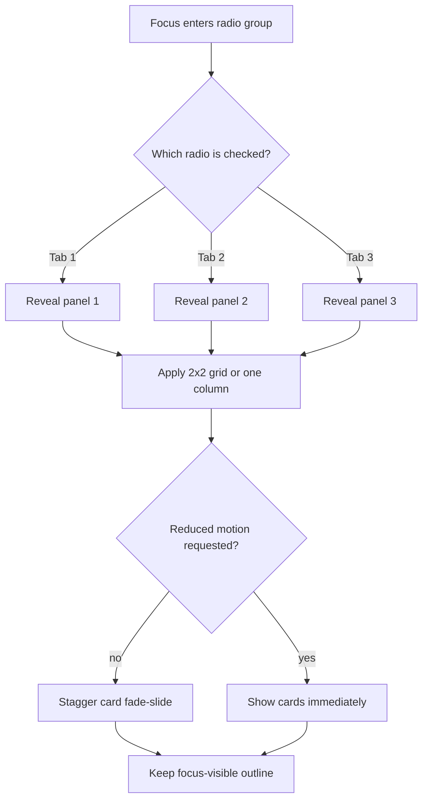

| Difficulty | Channel | Tags |
|---|---|---|
| beginner | frontend | css, flexbox, grid, animations |

A service team opens a pull request with a few dozen lines of CSS and deletes an entire JavaScript module. The tabs switch, the cards stagger into view, and the keyboard still works. Then the review lands: the GOV.UK Design System, maintained by the Government Digital Service, will not ship it [1]. The design system behind hundreds of UK government services treats accessibility as a legal requirement, so a clever radio-input pattern must survive screen readers, no-JavaScript fallbacks, and years of maintenance—not just a polished demo [1]. What follows is why the most elegant CSS tab panel you can build may still be the wrong component to ship.

---

> ### Real-World Case — GOV.UK Design System (Government Digital Service)
>
> GOV.UK's design system powers hundreds of UK government services where accessibility is legally required. Teams repeatedly asked why its Tabs component ships JavaScript when the radio-input plus label CSS-only pattern could eliminate the dependency entirely. In 2024 a service team raised the question directly in the design system's public GitHub discussion.
>
> | | |
> |---|---|
> | **Challenge** | The CSS-only radio/label tab pattern looks keyboard-accessible, but it changes the semantics: assistive technology announces a radio group rather than a tablist, and ARIA state cannot be updated without JavaScript. GOV.UK also needed deep-linkable tabs, browser history support, and a usable no-JavaScript fallback across services. |
> | **Solution** | The maintainers investigated the exact radio-input CSS technique and deliberately kept the JavaScript-enhanced tabs component with real links and ARIA. When JavaScript is unavailable, or on small screens, all tab panels render sequentially as anchor-linked sections. In GOV.UK Frontend v5.5.0 they removed up/down arrow key bindings after screen-reader testing showed those keys interfered with navigation. |
> | **Outcome** | CSS-only tabs were rejected for the design system. The JavaScript tabs remain, with a progressive-enhancement fallback that exposes all content without JavaScript. The v5.5.0 change fixed screen-reader arrow-key behavior, though the team still flags tabs as a component needing more user research. |
> | **Lesson** | CSS-only is not automatically more accessible. For stateful widgets like tabs, correct semantics, ARIA state updates, and focus management may require JavaScript. Use the radio/label toggle only for non-critical progressive enhancement, and always provide a no-JS fallback that exposes the content. |

---

## Hook — The Demo That Looked Unbeatable

The demo is genuinely impressive. Three tabs. Four cards per panel. A crisp 2×2 grid on desktop, a single column on mobile, and a 16:9 media well that never jumps. No JavaScript anywhere. Even the entrance animation respects `prefers-reduced-motion`.

Every box in the brief is ticked. Then a reviewer asks the inconvenient question: when the radio changes, what does a screen reader announce? The room goes quiet.

That silence is the real beginning of this story. A component is not finished when it looks right; it is finished when its meaning survives the browser, the keyboard, and the assistive technology.

## Problem — When “No JavaScript” Becomes a Trap

The appeal of CSS-only tabs is easy to understand. One fewer dependency means no bundle, no hydration, and no event listeners. A native radio group handles selection and arrow-key movement for free [8]. If CSS never loads, every panel stays readable. On paper, it looks like a clean win.

However, tabs are not just boxes that swap places. They are a navigation contract. Native radios solve state selection, but they announce “radio,” not “tab.” There is no built-in tab count, no selected-tab announcement, and no reliable focus transfer to the newly revealed panel [8]. The `:checked` selector can reveal content [3], but it cannot explain that the content changed.

Consequently, the visual problem is easy while the accessible state machine is hard. A CSS-only version also struggles to keep the selected tab in the URL, which means a support agent cannot send a colleague a link to the exact policy section being discussed.

⚠️ **Watch Out:** Hiding every unselected panel with `display: none` does not create a tab relationship. It only removes content from the accessibility tree until CSS decides to show it.

## Real-World Case — GOV.UK Design System (Government Digital Service)

GOV.UK did not encounter this as a thought experiment. The public Tabs discussion has been running since 2018 and has collected more than 80 replies [1]. Teams kept asking why a component used across government services needed JavaScript when radio inputs and labels could remove the dependency entirely. In 2024, the question surfaced again in that public thread [1].

The design system’s answer was not a rejection of CSS. It was a rejection of unproven semantics. Before a Tabs component can ship, GOV.UK expects it to handle keyboard operation, visible focus, tab labels, selected state, total tab count, current tab position, arrow-key switching, graceful no-JavaScript behavior, and a bookmarkable selected tab [1]. Those requirements are a product spec disguised as a checklist.

Therefore, CSS-only tabs were rejected. The JavaScript implementation stayed, with progressive enhancement that exposes all content when JavaScript is unavailable [2]. Version 5.5.0 fixed screen-reader arrow-key behavior, but the team still flags Tabs as a component that needs more user research [1].

The plot twist is uncomfortable: the cleverest demo lost to the least glamorous requirement—shareable, announced state.

## Deep Dive — Radios, State, and the Accessibility Tax

Separate layout from interaction, and the trade-offs become clearer. The CSS can make a beautiful grid. The browser’s native controls can manage selection. What CSS cannot do is invent the missing tab semantics.

| Requirement | CSS-only radios | Enhanced tabs |
| --- | --- | --- |
| Zero runtime JavaScript | ✅ | ❌ |
| Native form semantics | ✅ | Custom ARIA required |
| Tab announcement and current position | ❌ Inconsistent | ✅ When implemented |
| Shareable selected-tab URL | ❌ | ✅ |
| No-JavaScript fallback | ✅ If authored well | ✅ Links and panels |
| Maintenance surface | HTML and CSS | HTML, CSS, JS, and tests |

On the visual side, the CSS is straightforward. CSS Grid creates the 2×2 card layout with `repeat(2, minmax(0, 1fr))` and collapses to one column at the mobile breakpoint [7]. `aspect-ratio: 16 / 9` reserves media space before an image loads, which prevents a layout jump [4]. Motion sits behind `@media (prefers-reduced-motion: no-preference)` [5], so the animation is opt-in rather than forced on people who ask for less movement.

The stagger is easy to get wrong. A hard-coded `nth-child` delay works for exactly four cards. A custom property such as `--i` lets the generator assign delays without writing four nearly identical rules.

Focus is a separate contract. `:focus-visible` ensures the ring appears for keyboard users without punishing mouse clicks [6]. Because the real radio is visually hidden, `:has()` lets the visible label inherit the focus style when its radio has focus [9].

Here is the subtle trap: `nth-of-type` must count only the radio inputs, and the labels must follow the radios in the same container for sibling combinators to work. Add another input or move a panel outside the wrapper, and the state rules can quietly break.

💡 **Insight:** The radio group is excellent at state and merely adequate at tab semantics. That distinction is the whole design decision.

## Workflow — Building the Panel in Seven Moves

Here is the build order that keeps the pattern honest.

1. **Define the content contract.** Decide how many tabs exist and how many cards each panel holds. The selectors and animation delays depend on that shape.
2. **Place every radio first.** Use a shared `name` and unique `id` values. Keep all radios as siblings before the labels and panels.
3. **Add the labels.** Each label points to one radio with `for`. The visible tab row is made of labels, not buttons.
4. **Add the panels.** Wrap each card set in a section. Keep panels after the radios so `~` selectors can reach them.
5. **Connect state.** Show exactly one panel with `:checked` selectors [3]. Do not rely on a single `:not(:checked)` rule that hides every panel.
6. **Lay out the cards.** Use a two-column grid, a one-column mobile breakpoint, and `aspect-ratio: 16 / 9` media wells [4][7].
7. **Add motion and prove the edge cases.** Gate animation behind reduced-motion preferences [5], keep focus-visible outlines [6], then test with CSS disabled, JavaScript disabled, reduced motion enabled, 400% zoom, and a screen reader.

The diagram below traces the state flow from radio focus to panel visibility, including the reduced-motion branch.

[Diagram: Radio-to-Panel CSS State Flow]

The seventh move is not optional. A CSS-only component can pass the happy path and fail the moment a user relies on announcement rather than sight.

## Code Example — A Build-Time Generator for CSS-Only Tabs

To get zero runtime JavaScript without copying markup by hand, move the repetition to build time. The Node script below emits static `tabs.html` and `tabs.css` files. The browser receives markup and styles only; the generator stops in CI.

```javascript
import { writeFileSync } from 'node:fs';

const tabs = [
  ['Overview', ['Tokens', 'Contrast', 'Spacing', 'Type']],
  ['Components', ['Buttons', 'Forms', 'Tabs', 'Cards']],
  ['Patterns', ['Search', 'Checkout', 'Errors', 'Empty']]
];

const radios = tabs.map((_, i) => `<input class='tabs__radio' type='radio' name='docs' id='tab-${i}' aria-controls='panel-${i}'${i ? '' : ' checked'}>`).join('');
const labels = tabs.map(([label], i) => `<label class='tabs__label' for='tab-${i}' id='tab-label-${i}'>${label}</label>`).join('');
const panels = tabs.map(([, cards], i) => `
  <section class='tabs__panel' id='panel-${i}' aria-labelledby='tab-label-${i}'>
    ${cards.map((title, j) => `
      <article class='card' style='--i:${j}'>
        <div class='card__image' aria-hidden='true'></div>
        <h3 class='card__title'>${title}</h3>
        <p class='card__meta'>Updated today</p>
      </article>`).join('')}
  </section>`).join('');

const html = `<div class='tabs' role='radiogroup' aria-label='Documentation sections'>
  ${radios}
  <div class='tabs__list'>${labels}</div>
  <div class='tabs__panels'>${panels}</div>
</div>`;

const css = `
  .tabs__radio { position: absolute; inline-size: 1px; block-size: 1px; clip-path: inset(50%); }
  .tabs__list { display: flex; gap: .25rem; border-block-end: 1px solid #b1b4b6; }
  .tabs__label { padding: .75rem 1rem; cursor: pointer; font-weight: 600; }
  .tabs__panels { padding-block-start: 1.5rem; }
  .tabs__panel { display: none; grid-template-columns: repeat(2, minmax(0, 1fr)); gap: 1.5rem; }
  .tabs__radio:nth-of-type(1):checked ~ .tabs__panels > .tabs__panel:nth-child(1),
  .tabs__radio:nth-of-type(2):checked ~ .tabs__panels > .tabs__panel:nth-child(2),
  .tabs__radio:nth-of-type(3):checked ~ .tabs__panels > .tabs__panel:nth-child(3) { display: grid; }
  .tabs__radio:nth-of-type(1):checked ~ .tabs__list .tabs__label:nth-child(1),
  .tabs__radio:nth-of-type(2):checked ~ .tabs__list .tabs__label:nth-child(2),
  .tabs__radio:nth-of-type(3):checked ~ .tabs__list .tabs__label:nth-child(3) { box-shadow: inset 0 -3px 0 #0b0c0c; }
  .card { border: 1px solid #b1b4b6; border-radius: .5rem; overflow: hidden; }
  .card__image { aspect-ratio: 16 / 9; background: linear-gradient(135deg, #dbeafe, #fce7f3); }
  .card__title { margin: 1rem 1rem .25rem; }
  .card__meta { margin: 0 1rem 1rem; color: #505a5f; }
  .tabs:has(.tabs__radio:nth-of-type(1):focus-visible) .tabs__label:nth-child(1),
  .tabs:has(.tabs__radio:nth-of-type(2):focus-visible) .tabs__label:nth-child(2),
  .tabs:has(.tabs__radio:nth-of-type(3):focus-visible) .tabs__label:nth-child(3) { outline: 3px solid #ffdd00; outline-offset: 2px; }
  @media (max-width: 48rem) { .tabs__panel { grid-template-columns: 1fr; } }
  @media (prefers-reduced-motion: no-preference) {
    .card { animation: fade-slide .3s ease-out both; animation-delay: calc(var(--i) * 70ms); }
  }
  @keyframes fade-slide { from { opacity: 0; transform: translateY(10px); } to { opacity: 1; transform: none; } }
`;

writeFileSync('tabs.html', html);
writeFileSync('tabs.css', css);
```

The generator starts with tab data, then emits three structural pieces in the order the CSS expects: radios, labels, and panels. Each radio gets a shared `name`, a unique `id`, and an `aria-controls` pointer to its panel. Labels follow the radios, which makes the sibling selectors possible.

The CSS rules do the real work. Each `:checked` selector reveals the matching panel, while every other panel stays `display: none` [3]. The grid template handles the 2×2 desktop layout and collapses at 48rem [7]. The media well keeps a fixed 16:9 shape [4].

The animation block is deliberately conditional. Cards only animate when the user has not requested reduced motion [5], and the `--i` custom property feeds a per-card delay. The focus rules use `:has()` so the hidden radio’s focus state is projected onto the visible label [9], and `:focus-visible` keeps the ring meaningful [6].

What ships is static HTML and CSS. The Node process stops in CI. One caveat remains: this is a radio-group pattern, not a full ARIA tabs replacement. That honesty is the point.

## Lessons Learned — What to Ship Tomorrow

The lesson is not that CSS-only tabs are useless. It is that “no JavaScript” is not automatically “more accessible.” GOV.UK kept its JavaScript tabs because the component’s responsibilities extended far beyond showing and hiding panels [1][2].

- **Treat semantics as a feature.** A component that looks like tabs but announces radios has a different user experience.
- **Test the announcement, not just the pixels.** Keyboard operation is necessary but not sufficient.
- **Design the no-JavaScript fallback.** Exposing every panel is often better than hiding content behind a broken control.
- **Guard motion at the source.** Put animation behind `prefers-reduced-motion: no-preference`, not behind a JavaScript class toggle [5].
- **Keep focus visible.** A hidden input is still a focusable input; the visible label must show where focus went [6].
- **Decide based on consequence.** A documentation page can accept radio semantics. A legally mandated public service usually cannot.

Tomorrow, before deleting a JavaScript dependency, write down everything it actually does. If it manages semantics, focus, URL state, and screen-reader announcements, CSS is not replacing a dependency. It is replacing behavior.

🔥 **Memorable insight:** Pure CSS can move pixels; it cannot guarantee meaning.

---

## Radio-to-Panel CSS State Flow



<details>
<summary><strong>Original Interview Question</strong></summary>

**Q:** Build a CSS-only tab panel for a design-system docs page. Use radio inputs to switch tabs (no JavaScript). Desktop: a 2x2 grid of cards under each tab; mobile: single column. Each card has a fixed 16:9 image area, a title, and a short meta line. Add a subtle entrance animation with a stagger and keep focus-visible outlines; ensure prefers-reduced-motion is respected?

**A:** Use a set of radio inputs with a shared `name` attribute and corresponding `` elements for each tab section. The `:checked` state of each radio controls visibility of its associated panel via adjacent sibling selectors. Each panel renders a 2×2 card grid on desktop and collapses to a single column on mobile. Cards use `aspect-ratio: 16/9` for fixed image containers, with a title and meta line below.

</details>

## Conclusion

GOV.UK’s decision is a useful mirror for every team that wants to delete a dependency. The CSS-only pattern earns a place in bounded documentation pages where radio semantics are acceptable and the content is not the only route to completing a task. It does not earn a place in a public service where tabs are navigation and every state change must be announced [1][2]. Build the 2×2 grid. Add the 16:9 media wells. Respect reduced motion and keep focus-visible. Then ask the question the demo cannot answer: what does the user hear when the panel changes? If the answer is vague, the JavaScript was never the real dependency.

---

## References

1. [GOV.UK Design System (Government Digital Service) incident report](https://github.com/alphagov/govuk-design-system/discussions/6045) — article
2. [Tabs – GOV.UK Design System](https://design-system.service.gov.uk/components/tabs/) — documentation
3. [CSS :checked pseudo-class – MDN Web Docs](https://developer.mozilla.org/en-US/docs/Web/CSS/:checked) — documentation
4. [CSS aspect-ratio property – MDN Web Docs](https://developer.mozilla.org/en-US/docs/Web/CSS/aspect-ratio) — documentation
5. [prefers-reduced-motion media query – MDN Web Docs](https://developer.mozilla.org/en-US/docs/Web/CSS/@media/prefers-reduced-motion) — documentation
6. [CSS :focus-visible pseudo-class – MDN Web Docs](https://developer.mozilla.org/en-US/docs/Web/CSS/:focus-visible) — documentation
7. [CSS Grid Layout – MDN Web Docs](https://developer.mozilla.org/en-US/docs/Web/CSS/CSS_grid_layout) — documentation
8. [HTML input radio element – MDN Web Docs](https://developer.mozilla.org/en-US/docs/Web/HTML/Element/input/radio) — documentation
9. [CSS :has() pseudo-class – MDN Web Docs](https://developer.mozilla.org/en-US/docs/Web/CSS/:has) — documentation

---

**Author:** Satishkumar Dhule — [GitHub](https://github.com/satishkumar-dhule) · [LinkedIn](https://linkedin.com/in/satishkumar-dhule) · [Website](https://satishkumar-dhule.github.io)
