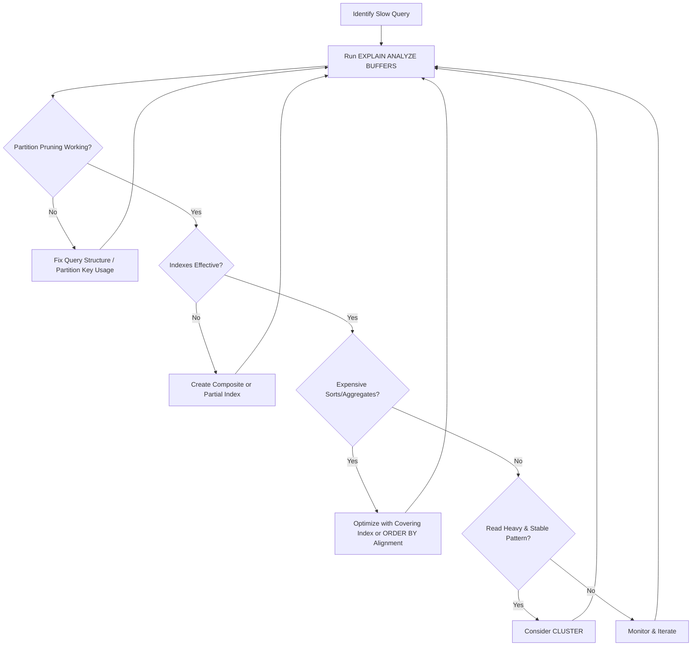

| Difficulty | Channel | Tags |
|---|---|---|
| intermediate | database | explain, query-plan, partitioning |

Picture this: your database is growing faster than your team can keep up with. What worked yesterday is grinding to a halt today, and your users are starting to notice. This exact scenario played out at Instagram, where by 2012 they were serving over 30 million users and hundreds of millions of photos [1]. Even with horizontal partitioning and sharding in place, poorly optimized queries were creating bottlenecks. For developers facing similar growth, the question isn't if this will happen, but when - and how to stop it before it spirals out of control.

---

> ### Real-World Case — Instagram
>
> By 2012, Instagram was growing rapidly with over 30 million users and hundreds of millions of photos. Their PostgreSQL database was handling massive read/write loads, and as data grew into the hundreds of millions of rows across sharded schemas, poorly optimized queries were causing performance bottlenecks even with their horizontal partitioning/sharding strategy in place.
>
> | | |
> |---|---|
> | **Challenge** | They needed to ensure queries remained fast at scale despite having data distributed across thousands of logical shards/schemas. Even with partitioning/sharding, queries filtering by certain patterns could still result in scanning large amounts of data if not optimized properly, causing slow response times for users. |
> | **Solution** | Instagram implemented several strategies including: using EXPLAIN ANALYZE to diagnose query plans, creating partial indexes on frequently filtered columns (e.g., indexing only rows where media_count >= 100 for tag lookups), carefully choosing shard keys (user_id) to co-locate related data, and generating globally unique time-sortable IDs inside PostgreSQL using PL/pgSQL that encoded shard information. They also used their sharded architecture with schemas to distribute data across many logical shards. |
> | **Outcome** | These optimizations allowed Instagram to scale to over 10,000 likes per second at peak with Postgres as their foundation. Their partial index approach eliminated expensive sorts over large result sets - for example, reducing queries that previously had to sort through 15,000 rows to just looking up from a much smaller indexed set of high-count tags, dramatically improving query performance at massive scale. |
> | **Lesson** | Even with partitioning/sharding, you must verify query plans with EXPLAIN ANALYZE, use targeted indexes (including partial indexes for skewed data distributions), and design your partition/shard keys to match your query patterns. The combination of proper data distribution and query optimization is essential for performance at scale. |

---

## Hook — The Pager That Never Sleeps

Every engineer that has dealt with scale knows the feeling. The dashboards look normal at first glance, but latency is slowly creeping up. CPU usage is spiking at peak hours, and the once blazingly fast queries are now taking seconds to return results. For teams running PostgreSQL at massive scale, partitioning is often the first line of defense against this growth. However, as Instagram discovered, partitioning alone is not a silver bullet [1]. Without proper query optimization, even the best partitioning strategy can fail under immense pressure.

## Problem — When Good Partitioning Goes Bad

Partitioning a table of 100M+ rows by date seems like the perfect solution on the surface. It should allow PostgreSQL to skip irrelevant chunks of data entirely through partition pruning. But in practice, many developers discover a harsh truth: the query planner does not always prune as expected. There are several culprits that can break this optimization. For example, if the query uses functions on the partition key, mismatched data types, or incorrect query patterns, PostgreSQL may be forced to scan every single partition [2]. Moreover, even if pruning is working correctly, a missing or ineffective index can lead to expensive sequential scans within each pruned partition. On top of this, operations like sorting, grouping, or filtering on non-partitioned columns can create massive overhead. These issues compound quickly, transforming what should be millisecond queries into multi-second nightmares.

## Real-World Case — Instagram's Battle With Scale

The scale of Instagram's challenge cannot be understated. By 2012, their PostgreSQL infrastructure was handling hundreds of millions of photos and massive read/write loads across sharded schemas [1]. Their growth demanded solutions that could support over 10,000 likes per second at peak while maintaining performance. The engineering team at Instagram found that their partial index approach was the key to their survival. Specifically, they eliminated expensive sorts over large result sets by reducing queries that previously had to sort through 15,000 rows down to looking up from a much smaller indexed set of high-count tags [1]. This optimization allowed them to scale to astronomical levels while still using PostgreSQL as their foundation. The lesson here is clear: at scale, smart indexing paired with partitioning is far more powerful than partitioning alone.

## Deep Dive — Reading The Tea Leaves With EXPLAIN

So how can developers diagnose these issues before they reach Instagram's scale? The answer lies within PostgreSQL's EXPLAIN plan [2]. Specifically, there are three areas to focus on when debugging slow partitioned queries. First, check for partition pruning by looking for the 'Append' or 'Partiti...' nodes in the plan - if all partitions are being scanned, pruning is failing. Second, examine index utilization. Look for 'Index Scan' vs 'Seq Scan' operations, and pay close attention to the estimated versus actual row counts [2]. A massive discrepancy here often indicates stale statistics or missing indexes. Third, watch for expensive operations like 'Sort', 'HashAggregate', or 'Nested Loop' on large datasets. These are often the real killers, especially when operating on millions of rows. For this, composite indexes on (partition_key, filter_columns) can be transformative [3]. Furthermore, for workloads with heavy read patterns, clustering the table using an index can physically reorder data to match access patterns, improving cache locality [4]. However, clustering is expensive and should only be used strategically on tables with predictable access patterns.

## Workflow — Diagnosing and Optimizing Step By Step

With the theory in mind, how should a developer approach this problem systematically? The workflow starts with reproduction and measurement. First, capture the problematic query and run it with EXPLAIN (ANALYZE, BUFFERS) to get actual execution times and I/O statistics [2]. Second, verify partition pruning by inspecting which partitions are being accessed. If pruning fails, investigate the query structure and ensure the partition key is used directly without functions or implicit casts [2]. Third, analyze index usage within the pruned partitions. If sequential scans are occurring on large partitions, a composite index covering the WHERE clause should be considered [3]. Fourth, tackle expensive sorts and aggregations. Often, creating an index that can satisfy the ORDER BY clause or covering index for the entire query can eliminate sorts entirely [3]. Fifth, evaluate physical ordering through CLUSTER if the access pattern is stable and the table isn't heavily written to [4]. Finally, test and measure again. Optimization is an iterative process, and what works today may need to evolve as data patterns change. This entire flow is visualized below, showcasing how each step feeds into the next to systematically eliminate bottlenecks.

## Code Example — Putting It All Into Practice

Theory means nothing without implementation. The following example demonstrates how to diagnose and optimize a query against a 100M row events table partitioned by date. Each step is annotated to showcase not just what to do, but why it matters.

## Lessons Learned — Scaling Smarter, Not Just Bigger

The journey from Instagram's growing pains to a performant solution reveals several key takeaways. First, partitioning is a great foundation, but it's not enough at scale - indexing strategy is equally, if not more, important [1][3]. Second, always measure with EXPLAIN (ANALYZE, BUFFERS). Estimates can be deceiving, and only real execution data reveals the truth [2]. Third, partial and composite indexes can be game changers. Instagram's partial index approach proved that sometimes, indexing less data (but the right data) is far more effective than indexing everything [1]. Fourth, avoid premature clustering. While powerful for read-heavy workloads, CLUSTER locks the table and requires maintenance, so it should be reserved for stable, predictable access patterns [4]. Finally, scalability is iterative. What works for 30 million users may need adjustment for the next order of magnitude. The goal isn't perfection, but building systems that can evolve. For developers facing these challenges, the best time to optimize is before the pager goes off at 3 AM.

---

## PostgreSQL Partitioned Query Optimization Workflow

<strong>Original Interview Question</strong>

**Q:** You have a PostgreSQL table with 100M rows partitioned by date. A query filtering on a specific date range is still slow. What would you check in the EXPLAIN plan and how would you optimize it?

**A:** Check partition pruning effectiveness, index utilization patterns, and expensive sort operations. Create composite indexes on (date, filtered_columns) and evaluate clustering strategies for optimal data access.

## Conclusion

The story of Instagram's PostgreSQL scaling challenges serves as a powerful reminder: partitioning is just the beginning of the battle. At scale, success comes from reading EXPLAIN plans, creating smart composite indexes, and understanding the trade-offs between different optimization strategies. The next time a query slows down on a massive partitioned table, resist the urge to scale vertically first. Instead, follow the diagnostic workflow outlined here - verify pruning, examine indexes, eliminate sorts, and optimize surgically. With these tools in hand, developers can keep PostgreSQL performing at peak even as data grows into the hundreds of millions of rows.

---

## References

1. [Instagram Engineering: Handling growth with Postgres](https://instagram-engineering.com/handling-growth-with-postgres-5-tips-from-instagram-d5d7e7ffdfcb) — blog
2. [PostgreSQL Documentation: Using EXPLAIN](https://www.postgresql.org/docs/current/using-explain.html) — documentation
3. [PostgreSQL Documentation: Indexes](https://www.postgresql.org/docs/current/indexes.html) — documentation
4. [PostgreSQL Documentation: CLUSTER](https://www.postgresql.org/docs/current/sql-cluster.html) — documentation
5. [PostgreSQL Documentation: Table Partitioning](https://www.postgresql.org/docs/current/ddl-partitioning.html) — documentation
6. [MDN Web Docs: Database Indexing Concepts](https://developer.mozilla.org/en-US/docs/Glossary/Index) — documentation
7. [Wikipedia: Query Optimization](https://en.wikipedia.org/wiki/Query_optimization) — documentation
8. [DigitalOcean: How To Use EXPLAIN to Optimize SQL Queries](https://www.digitalocean.com/community/tutorials/how-to-use-explain-to-optimize-sql-queries) — blog

---

**Author:** Satishkumar Dhule — [GitHub](https://github.com/satishkumar-dhule) · [LinkedIn](https://linkedin.com/in/satishkumar-dhule) · [Website](https://satishkumar-dhule.github.io)
