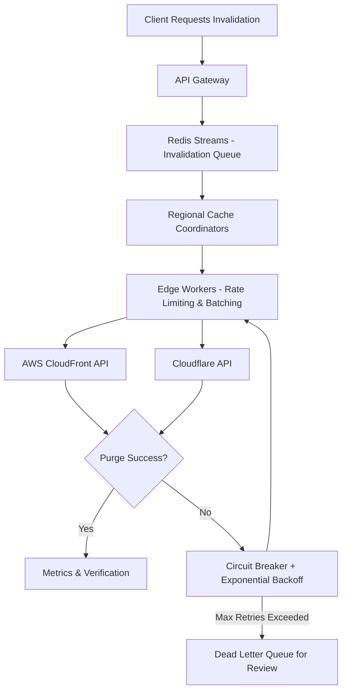

| Difficulty | Channel | Tags |
|---|---|---|
| intermediate | system-design | edge, caching, purging |

Picture this: a breaking news clip has just gone viral across the globe. Within seconds, millions of viewers are desperately refreshing their streams to watch it, only to be met with hours-old, stale footage. For a global streaming giant, this nightmare isn't hypothetical, it's revenue evaporating by the millisecond. This exact brand of scale is one that Netflix knows all too well. For their global streaming service serving over 240M+ users, Netflix needed to maintain low-latency access to cached data across four AWS regions through their EVCache distributed caching system [1]. Now with 400M operations a second and roughly 2 trillion items to account for, a cache going stale isn't an eyesore, it's a system-wide catastrophe [1]. This is the multi-region, high throughput battle that any distributed system must be equipped to fight.

---

> ### Real-World Case — Netflix
>
> Netflix needed to maintain low-latency access to cached data across multiple AWS regions (four regions) for their global streaming service serving 240M+ users. Their EVCache distributed caching system handles 400M operations/sec and manages ~2 trillion items (14.3 PB), requiring cross-region replication while minimizing database recomputation costs.
>
> | | |
> |---|---|
> | **Challenge** | How to replicate cache mutations across regions with low latency while avoiding Kafka overload (don't replicate large values), handling regional failovers, and keeping replication costs efficient without sacrificing availability. |
> | **Solution** | EVCache uses client-initiated replication: apps send mutations to local EVCache; metadata (key/TTL/timestamp, no value) goes to Kafka; cross-region replication readers pull from Kafka, fetch latest values locally, and call replication writers in target regions via REST to write to destination EVCache. Implemented batch compression (35% bandwidth reduction) and switched from NLB to Eureka DNS for service discovery (50% transfer cost reduction). |
> | **Outcome** | Cross-region replication achieved p99 latency of ~400ms for the highest-volume replicated cache; system handles 30M replication events globally and 400M overall operations/sec across 200 Memcached clusters and 22k instances; maintains seamless failover across 4 regions with minimal latency. |
> | **Lesson** | For global cache consistency, sending metadata over a pub-sub system and fetching fresh values on-demand at the replication layer avoids replicating large payloads through the message bus; client-initiated, topology-aware replication gives flexibility and better load distribution than server-initiated approaches. |

---

## Hook — The Race Against Time

Every millisecond counts. In the world of global content delivery, the gap between 'updated' and 'served' is a ticking time bomb. You might think that changing a piece of content is as simple as pressing a button, however, the moment that button is pressed is only the beginning. Across continents, undersea cables, and thousands of edge nodes, old cached copies of your content are still sitting idly, waiting to be served to an unsuspecting user [2]. The question isn't 'can we update the origin?', it's 'can we kill every single cached copy globally before the next request reaches it?'. With SLAs demanding propagation in under 5 seconds whilst handling 10,000 concurrent invalidations per second, this race against time is one that only the most battle hardened systems can finish.

## Problem — Death By A Thousand Stale Caches

Building on the race against time, it's time to face the true adversary: scale. For developers working with a single region, cache invalidation can be solved with a simple purge call. However, the second that service expands globally, a plethora of issues begin to spawn. First, there is latency. A purge request made from a single orchestrator must reach every regional CDN provider and every edge node that could be housing stale data, all whilst fighting the laws of physics [2]. Moreover, throughput begins to stack. At 10,000 invalidations per second, firing individual API calls to providers such as CloudFront or Cloudflare would instantly hit rate limits, balloon costs, and create network congestion [3][4]. Most devastating of all however, is consistency. Partial failures are inevitable. If only 90% of regions purge successfully within 5 seconds, a portion of your global userbase is now served broken or stale content. These are not hypothetical annoyances, they are the exact cracks that are exploited the hardest during high traffic events. If this feels overwhelming, you are not alone. These are the scars that are earned through scale.

## Real-World Case — Netflix

This exact crisis was one that Netflix was forced to solve at a scale that is almost incomprehensible. As noted within their global caching architecture, Netflix needed to maintain low-latency access to cached data across multiple AWS regions (four regions) for their global streaming service [1]. To do this, their EVCache distributed caching system handles an absurd 400M operations/sec, manages roughly ~2 trillion items equating to 14.3 PB of data, and is required to replicate changes across regions whilst minimizing costly database recomputation [1]. The results of this gargantuan feat speak for themselves. Cross-region replication achieved a p99 latency of ~400ms for the highest-volume replicated cache, the system handles 30M replication events globally alongside 400M overall operations/sec across 200 Memcached clusters and 22k instances, all whilst maintaining seamless failover across the 4 regions with minimal latency [1]. This proves one thing to be true. At Netflix's scale, 'eventual' is not good enough, cross-region coordination must be precise, measurable, and resilient in order to keep the stream online for hundreds of millions of viewers.

## Deep Dive — Batching, Queues, and Controlled Consistency

Now that the stakes have been established, it's time to break down the strategy. Contrary to popular belief, the goal for a system of this caliber isn't to purge every single edge node individually at the exact same nanosecond. Instead, it's to trade absolute, instantaneous global locking for controlled, verifiable propagation with a hard deadline [2]. This is heavily inspired by the HTTP caching semantics defined within RFC 7234, which heavily relies off of validators and cache control directives to dictate staleness [2]. To uphold this, batching is king. CDN providers allow for batch invalidation requests, allowing up to hundreds of paths to be purged within a single API call [3][4]. To handle the firehose of 10,000 invalidations/sec, these batches must be funneled through a distributed, durable queue. Utilizing a tool such as Redis Streams with consumer groups allows for each regional coordinator to consume jobs in parallel, scaling horizontally with demand [6]. From there, edge compute, such as Cloudflare Workers, can act as regional arbiters. These workers can apply regional cache headers, enforce rate limits, and fire the batched requests to their respective providers [4]. Finally, to satisfy the 5 second SLA, an aggressive TTL is your insurance policy. A short, `Cache-Control: max-age=2, must-revalidate` allows for a 2 second window of potential staleness to be tolerated, creating a massive buffer for the purge pipeline to complete its propagation and be verified [2][5]. This combination of batching, durable queues, edge coordination, and short TTLs is the difference between a 'best effort' purge, and a guaranteed one.

## Workflow — From API Call To Global Purge

With all of the moving parts established, it's time to follow the journey from start to finish. Every purge starts with a request, however, from there, it's a relay race against the clock. First, the Invalidation API Gateway will receive the purge request and normalize the paths to be purged. Secondly, these paths are chunked into optimal batch sizes (commonly around 100 paths per batch) and enqueued into a regional-first Redis Streams queue to prevent cross-region chatter from bottlenecking the pipeline [6]. Thirdly, the Edge Workers and Regional Cache Coordinators begin consuming these batches, applying any region specific rules and firing batched purge calls to CDN Providers such as AWS CloudFront and Cloudflare [3][4]. Fourth, every provider call is tracked, being wrapped with retry logic, exponential backoff with jitter, and a circuit breaker to fail fast in the event of an outage [7]. Lastly, verification comes into play. Health checks and reconciliation jobs will monitor for any failed batches, sending them to a Dead Letter Queue for manual review whilst ensuring that the regional TTL window (2 seconds) is more than enough time for any successful propagation to be completed, all whilst keeping within the 5 second global SLA. Referencing the diagram below, this is the exact flow of data that allows for precision at scale.

## Code Example — A Battle-Tested Purge Orchestrator

Theory will only get so far. To truly understand how to weaponize this architecture, take a look at a simplified, production inspired orchestrator. This snippet demonstrates batched purging against Cloudflare, whilst utilizing exponential backoff with jitter and circuit breaker esque failure tracking. This is the exact type of defensive engineering that is used to prevent a provider outage from cascading into a global stale cache event.

## Lessons Learned — Scars To Carry Forward

The 5 second race is a ruthless one, and no system finishes it unscathed. The first lesson to carry forward is to batch or be billed to ruin. Individual purge calls will never be viable at 10,000/sec, and batching is by far the greatest cost and throughput optimization that can be made [3][4]. Secondly, never trust a provider on the first try. With rate limits and intermittent failures being inevitable, exponential backoff with jitter, coupled with a circuit breaker and a Dead Letter Queue, are not 'nice to haves', they are necessities [7]. Thirdly, short TTLs are your insurance policy. You may be able to achieve near instantaneous purges, however, designing around a 2 second `max-age` with revalidation creates breathing room for your distributed pipeline and prevents a single network partition from breaking your SLA [2][5]. Fourth, observe, don't guess. Much like Netflix observes their 30M replication events globally to maintain their p99 targets [1], you must have health checks, metrics, and verifiability for your purges. If you cannot measure your propagation time, you cannot guarantee your 5 second SLA. Most importantly however, plan for partial failure. The goal isn't perfection, it's graceful degradation. A system that can identify failed regions, retry them, and still serve correct content within its TTL window will always be more resilient than one that attempts to lock the globe atomically. So, tomorrow, don't ask 'how fast can I purge everything?', ask 'how do I guarantee correctness within 5 seconds when everything goes wrong?' That is the difference between a hobby cache, and a global one.

---

## Global Multi-Region Cache Purging Flow

<strong>Original Interview Question</strong>

**Q:** How would you design a multi-region CDN cache purging system that guarantees content propagation within 5 seconds while handling 10,000 concurrent invalidations per second?

**A:** Implement Cloudflare API + AWS CloudFront with distributed invalidation queue, edge compute coordination, and 2-second TTL. Use batch invalidation, exponential backoff, and regional cache headers for 5-second SLA.

## Conclusion

The 5 second race will never get easier. As content becomes more dynamic and audiences become more global, the gap between an update and a stale cache will only become more expensive. The secret isn't to eliminate failure, it's to design around it. By batching aggressively, coordinating through durable queues and edge workers, respecting provider limits, and utilizing short TTLs as an insurance policy, any team can achieve verifiable propagation at scale. Take a page out of Netflix's book [1], measure your p99 purge time, plan for partial failure, and weaponize observability. The next time that breaking news goes viral, you won't be refreshing the page praying for old content to disappear, you'll be watching it disappear exactly on time.

---

## References

1. [Netflix incident report - Global Caching at Netflix](https://www.infoq.com/articles/netflix-global-cache) — article
2. [RFC 7234 - Hypertext Transfer Protocol (HTTP/1.1): Caching](https://datatracker.ietf.org/doc/html/rfc7234) — documentation
3. [AWS CloudFront - Invalidating files (web distributions)](https://docs.aws.amazon.com/AmazonCloudFront/latest/DeveloperGuide/Invalidation.html) — documentation
4. [Cloudflare Cache - Purge cache](https://developers.cloudflare.com/cache/how-to/purge-cache/) — documentation
5. [MDN Web Docs - Cache-Control](https://developer.mozilla.org/en-US/docs/Web/HTTP/Headers/Cache-Control) — documentation
6. [Redis Documentation - Streams](https://redis.io/docs/latest/develop/data-types/streams/) — documentation
7. [DigitalOcean Community - How To Implement the Circuit Breaker Pattern in Node.js](https://www.digitalocean.com/community/tutorials/how-to-implement-circuit-breaker-pattern-in-node-js) — blog
8. [Wikipedia - Content Delivery Network](https://en.wikipedia.org/wiki/Content_delivery_network) — documentation

---

**Author:** Satishkumar Dhule — [GitHub](https://github.com/satishkumar-dhule) · [LinkedIn](https://linkedin.com/in/satishkumar-dhule) · [Website](https://satishkumar-dhule.github.io)
