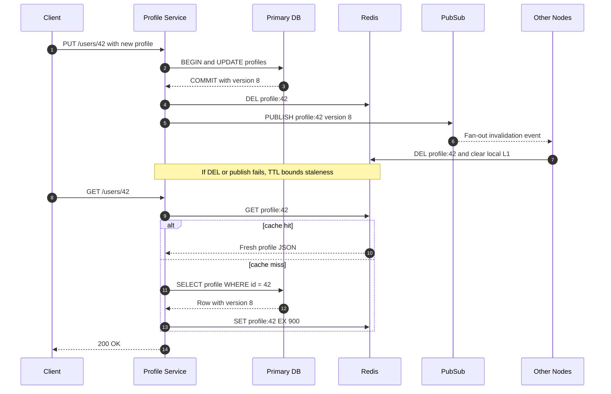

| Difficulty | Channel | Tags |
|---|---|---|
| beginner | backend | redis, memcached, cache-invalidation |

On September 23, 2010, Facebook went dark for roughly 2.5 hours—its worst outage in more than four years—and the culprit was not a database crash, but a cache-repair loop that would not stop [1]. A bad configuration value was treated as invalid, every client tried to fix it, and the resulting flood overwhelmed the database tier. For anyone building a user profile service today, the lesson is uncomfortable: cache invalidation is not a cleanup detail. It is a correctness and availability system, and Redis or Memcached choices only matter after you understand the failure modes.

---

> ### Real-World Case — Facebook (Meta)
>
> In September 2010, Facebook experienced one of its worst outages in four years, with the site down for over 4 hours and affecting millions of users globally.
>
> | | |
> |---|---|
> | **Challenge** | An automated cache invalidation system was interpreting a bad configuration value as invalid. Every client tried to 'fix' it by deleting cached entries and re-querying the database cluster, triggering a feedback loop that overwhelmed the databases with hundreds of thousands of queries per second. |
> | **Solution** | The fix required taking the site offline to break the feedback loop, correcting the bad configuration in the persistent store, and later re-architecting the configuration/caching system to be more resilient to feedback loops and transient spikes. This incident informed how Facebook designed their memcached-based caching layer to handle invalidation at massive scale. |
> | **Outcome** | Over 4 hours of downtime for hundreds of millions of users; database cluster overwhelmed by hundreds of thousands of queries/second; Facebook had to go offline entirely to recover. The incident drove major changes to their caching and configuration systems. |
> | **Lesson** | Cache invalidation is dangerous at scale - naive 'delete and re-query' invalidation can create stampedes/feedback loops. At Facebook scale, invalidation strategy, idempotency, backpressure/circuit breakers, and separating cache from authoritative sources matter more than just 'making it fast'. |

---

## Hook — The Night the Cache Fought Back

Picture a profile service at 1:00 a.m., serving 50,000 reads per second while a single `UPDATE profiles` statement waits behind a lock. The on-call engineer sees a familiar dashboard: a 94% cache hit rate, p99 latency under 20 ms, and a database that is comfortably bored. Then a deploy changes how one cache key is written. Within minutes, the hit rate collapses, database CPU pins at 100%, and every retry makes the problem worse.

That is the moment cache invalidation stops being a line in a code review and becomes an availability incident. A stale display name is embarrassing. A cache invalidation loop can take down the entire product. The scariest part? The code can look perfectly reasonable right up until traffic arrives.

## Problem — When 'Fresh' Data Is a Lie

That scenario is not hypothetical at scale. A cache is a copy of data whose freshness must be managed, and invalidation is the process of replacing or removing entries that are no longer valid [2]. For a user profile service, the data is deceptively simple: name, avatar, bio, preferences, maybe a privacy flag. The hard part is not storing it. The hard part is coordinating every copy of it.

Most teams begin with a sensible plan: write to the database, update the cache, and let a TTL expire the entry. Then reality introduces concurrent writers, multiple service instances, partial network failures, and readers that repopulate the cache at exactly the wrong moment. A read that misses the cache can fetch an old database row while a write is still committing. A write that updates the cache before the database commits can publish a value that never existed. A delete that happens too early can be undone by a concurrent read. Each edge case is small; together they create stale data, thundering herds, and cascading failures [5][10].

The core challenge is therefore not choosing Redis or Memcached. It is designing a protocol that keeps the database authoritative while keeping the cache useful. Get that wrong, and the cache becomes a distributed source of lies.

## Real-World Case — Facebook's Configuration Cache Feedback Loop

Facebook's 2010 outage is the industrial-scale version of that failure. On September 23, 2010, the company reported that an automated system designed to verify configuration values in its cache had caused one of its worst outages in more than four years [1]. The system was supposed to replace invalid cached values with fresh values from the persistent store. That works for a transient cache problem. It fails badly when the persistent store itself contains a value that the system interprets as invalid.

Facebook had changed the persistent copy of a configuration value, and every client interpreted it as invalid. Every client then tried to repair it by querying a database cluster. That cluster was quickly overwhelmed by hundreds of thousands of queries per second. Worse, when a database query failed, the client treated the failure as another invalid cache value and deleted the corresponding key. The result was a feedback loop: database failures created more cache deletions, which created more database queries. Facebook had to stop all traffic to the cluster, take the site offline, and let the databases recover before slowly admitting users back [1].

The outage lasted roughly 2.5 hours, and the company turned off the auto-correction system while it redesigned the approach [1]. The lesson is not that Facebook chose the wrong cache product. The lesson is that an invalidation mechanism with unbounded retries can turn a bad value into a self-sustaining outage.

## Deep Dive — Redis vs. Memcached and the Invalidation Trade-offs

Understanding why that loop spun out of control starts with the two caching patterns teams most often mix up. Cache-aside keeps the cache out of the write path: the application reads from the cache, falls back to the database on a miss, and fills the cache. Write-through updates the cache and the database together on every write, which can improve read latency but doubles the number of systems that can fail. Both patterns need a freshness policy, and HTTP caching formalizes the same idea through expiration and validation rules [5][6].

For profile updates, the safest default is usually write to the database, commit, then delete the cache key. Deleting instead of updating avoids a subtle race: a slow writer can overwrite a newer cached value with an older one. The next read rebuilds the entry from the database. A TTL of 5 to 30 minutes acts as a backstop for missed invalidations, but it is a staleness bound, not a consistency guarantee [2].

The Redis versus Memcached decision comes after that protocol is clear. Redis offers Pub/Sub, optional persistence, and richer data structures, which makes it attractive when invalidation events must fan out across services [3][7]. Memcached is a simpler, high-performance key-value cache with no built-in Pub/Sub and no persistence, so distributed invalidation requires coordination outside the cache [4][8]. Managed services expose similar trade-offs; AWS ElastiCache, for example, offers both engines but not the same feature set [9].

| Dimension | Redis | Memcached |
|---|---|---|
| Distributed invalidation | Pub/Sub and Streams; delivery semantics still need care [7] | No built-in Pub/Sub; coordinate manually [8] |
| Persistence | Optional snapshots and append-only persistence [3] | In-memory only [4] |
| Data structures | Strings, hashes, lists, sets, sorted sets, streams [3] | Simple key-value items [4] |
| Scaling model | Cluster mode, replicas, more operational surface [3] | Simple horizontal sharding [4] |
| Best fit | Invalidation fan-out, leaderboards, sessions, rate limits | Pure caching with predictable hot keys |

💡 Insight: Redis Pub/Sub is a notification mechanism, not a durable queue. If a subscriber is disconnected when the message is published, that invalidation can be lost, which is why TTL and version checks still matter [3][7].

🔥 Hot take: If your invalidation logic depends on every subscriber being online forever, you do not have a cache strategy. You have a hope strategy.

The trade-off is not 'fast versus slow.' It is 'which failure modes can your product tolerate?' A social feed can tolerate a few seconds of stale likes. A permissions cache cannot tolerate a stale admin flag. Profile data usually sits in between, which is why versioning and observability matter as much as raw throughput.

## Workflow — A Safe Profile Invalidation Sequence

With the failure modes mapped, the safe update path becomes a sequence of small, boring guarantees. The Mermaid sequence diagram below shows the write path, the invalidation fan-out, and the read path that repairs the cache after a miss.

1. **Validate and authorize the update.** Never let a cache concern bypass domain rules; the database remains the source of truth.
2. **Commit the profile change with a monotonically increasing version.** The version is the fence that lets consumers reject out-of-order invalidation events.
3. **Delete the cache key after the commit succeeds.** Do not write the new value into the cache from the update path unless the write is version-checked; a concurrent read can otherwise race you.
4. **Publish an invalidation event containing the user ID and version.** Redis Pub/Sub is a good fit for low-latency fan-out, with the caveat that delivery is best-effort [3][7].
5. **Invalidate local caches on every node.** Shared Redis keys and in-process caches have different lifetimes; treat both as copies, not truths.
6. **Rebuild on the next read with request coalescing.** A single-flight lock or short-lived lock prevents a hot key from stampeding the database after invalidation [10].
7. **Keep a TTL as the final backstop and measure the system.** Track hit rate, p99 latency, database QPS, invalidation lag, and the rate of stale-read reports.

⚠️ Watch Out: Facebook's incident shows that error handling can become the outage. Bound retries, add circuit breakers, and never let a failed invalidation trigger an unbounded repair loop [1]. If the cache is unavailable, decide explicitly whether to serve stale data, read from the database with load shedding, or fail fast.

## Code Example — Implementing Safe Profile Invalidation

The workflow becomes concrete in the service code below. It uses a cache-aside read path and invalidates after the database commit, with a version field and a TTL as safety nets.

## Lessons Learned — Designing for Staleness, Failure, and Recovery

Facebook's postmortem ended with a system redesign; your takeaway can be smaller and just as important.

- **The database is the source of truth.** The cache is an optimization with a freshness contract. Write it down, test it, and alert when it is violated [2].
- **Delete after commit, not before.** A delete before the commit opens a window for a reader to repopulate the old value.
- **Use TTLs as a damage cap.** Five to thirty minutes is reasonable for profiles, but TTL does not replace invalidation; it only bounds the blast radius [5].
- **Version your writes.** A version or updated_at fence lets consumers discard out-of-order events and makes debugging possible.
- **Choose Redis for coordination, Memcached for simplicity.** Redis Pub/Sub and persistence help with fan-out and recovery; Memcached is often enough for pure, simple caching [3][4][8].
- **Prevent feedback loops.** Bound retries, add circuit breakers, and use single-flight rebuilds so a cache miss cannot become a database DDoS [1][10].
- **Measure the cache like a product.** Hit rate alone is vanity. Track stale reads, invalidation lag, p99 latency, and database load.

🎯 Key Point: TTL is a staleness bound, not a consistency guarantee. Invalidation is a protocol, not a method call.

The memorable version you can share with your team: Facebook did not go down because a cache was slow. It went down because a cache-repair loop was allowed to amplify failure. Design your profile service so that a missed invalidation is boring, a Redis outage is survivable, and a bad value cannot recruit the entire fleet into a retry storm.

---

## Profile Update and Cache Invalidation Flow

<strong>Original Interview Question</strong>

**Q:** You're building a user profile service that caches frequently accessed profiles. How would you implement cache invalidation when a user updates their profile, and what trade-offs would you consider between Redis and Memcached?

**A:** Implement write-through caching with TTL-based expiration. On profile update, invalidate the cache by deleting the key and writing new data to both the database and cache. Redis offers pub/sub for automatic distributed invalidation, while Memcached requires manual coordination across nodes.

## Conclusion

Facebook had to take its entire site offline to break a feedback loop that its own cache-repair system kept feeding [1]. Most teams cannot afford that kind of recovery, but every team can afford the smaller disciplines that prevent it: commit before invalidating, delete instead of blindly overwriting, version every write, bound every retry, and keep a TTL as the last line of defense. Do those five things tomorrow, and your profile service will be faster to recover than to fail. The next time a cache key goes missing, the goal is not to prove the cache is fast. It is to prove the system is still honest.

---

## References

1. [Facebook (Meta) incident report](https://engineering.fb.com/2010/09/23/uncategorized/more-details-on-today-s-outage/) — article
2. [Cache invalidation — Wikipedia](https://en.wikipedia.org/wiki/Cache_invalidation) — documentation
3. [Redis — Wikipedia](https://en.wikipedia.org/wiki/Redis) — documentation
4. [Memcached — Wikipedia](https://en.wikipedia.org/wiki/Memcached) — documentation
5. [RFC 9111: HTTP Caching](https://datatracker.ietf.org/doc/html/rfc9111) — documentation
6. [MDN: HTTP caching](https://developer.mozilla.org/en-US/docs/Web/HTTP/Guides/Caching) — documentation
7. [Redis source code repository](https://github.com/redis/redis) — documentation
8. [Memcached source code repository](https://github.com/memcached/memcached) — documentation
9. [Amazon ElastiCache for Redis documentation](https://docs.aws.amazon.com/AmazonElastiCache/latest/red-ug/WhatIs.html) — documentation
10. [Cache stampede — Wikipedia](https://en.wikipedia.org/wiki/Cache_stampede) — documentation

---

**Author:** Satishkumar Dhule — [GitHub](https://github.com/satishkumar-dhule) · [LinkedIn](https://linkedin.com/in/satishkumar-dhule) · [Website](https://satishkumar-dhule.github.io)
