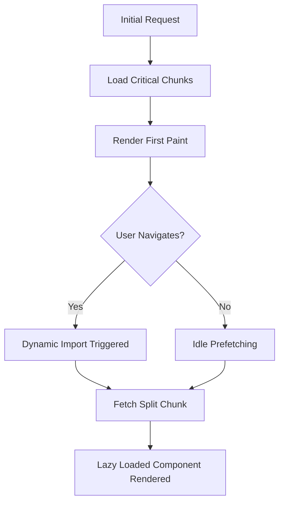

| Difficulty | Channel | Tags |
|---|---|---|
| intermediate | frontend | lighthouse, bundle, lazy-loading |

What if the first thing a visitor saw wasn't your product, but a spinning loading wheel? For millions of users visiting Netflix's logged-out homepage, that exact scenario was a reality. This was no isolated annoyance, but a performance bottleneck that pushed the team to re-evaluate their client-side architecture [1]. The consequences of that decision would go on to teach the entire web community a lesson about bundle sizes, and set a precedent for the code splitting techniques that developers rely on to this day.

---

> ### Real-World Case — Netflix
>
> For Netflix's logged-out desktop homepage at Netflix.com, the page relied heavily on client-side JavaScript (including React and utility libraries), leading to slow loading on slower networks and poor Time-to-Interactive metrics.
>
> | | |
> |---|---|
> | **Challenge** | Reduce JavaScript bundle size and improve Time-to-Interactive (TTI)/loading performance for the logged-out homepage without breaking the critical path to signup. |
> | **Solution** | The team server-rendered the homepage HTML with React (keeping React on the server) but shipped minimal vanilla JavaScript to the client for essential interactivity. They also implemented prefetching of HTML/CSS/JS (including React for subsequent signup flows) during idle time on the landing page to accelerate future navigations. |
> | **Outcome** | Loading and Time-to-Interactive decreased by 50% on the logged-out desktop homepage; JavaScript bundle size reduced by ~200 kB by moving from client-side React/utility libraries to vanilla JS on the client (with React still used server-side); prefetching reduced Time-to-Interactive by 30% for future navigations. |
> | **Lesson** | Not every page needs a full client-side framework bundle. For simple, mostly static pages, server rendering with minimal vanilla JS can yield massive performance gains, and strategic prefetching can optimize subsequent navigations. |

---

## Hook — The 4.2 Second Stare Down

Picture this: your CEO is ecstatic about a brand new landing page, marketing has just started a campaign, and traffic is about to skyrocket. However, with every second of load time, potential users are slipping through your fingers. Research has shown that the Time to Interactive metric is directly correlated with user retention [7], and for a content platform, that first impression is the gate to the entire catalog. For teams sitting at a Lighthouse score of 65 with a 2.1MB bundle and a 4.2s Time to Interactive, this isn't a number on a report, it's lost eyeballs. The question isn't if this needs to be fixed, it's how far teams are willing to go to trim the fat.

## Problem — Death By A Thousand Dependencies

Many developers think that importing a UI library, a utility library, and a data fetching wrapper is harmless. However, with modern bundlers, these imports stack up far quicker than anticipated, creating gargantuan JavaScript payloads. This bloat comes at a cost, as JavaScript is not only downloaded, but parsed, compiled, and executed by the user's device [6]. For users on slower networks or lower powered devices, this parsing time can be exponentially larger than download time. Therefore, the real problem isn't the size of the bundle, it's the amount of *unnecessary* JavaScript being shipped to the client on the very first request. Before any splitting can begin, teams must learn to distinguish between code that is critical for the initial render, and code that can wait.

## Real-World Case — Netflix

In the case of Netflix's logged-out desktop homepage, the page was heavily reliant on client-side JavaScript, including React and various utility libraries. This architecture was incredibly powerful for a logged in experience, however, it was far too heavy for a cold, unauthenticated visit [1]. By migrating large portions of this page from client-side React and utility libraries over to vanilla JavaScript, all whilst still utilizing React server-side, the team was able to achieve a reduction of ~200 kB in JavaScript bundle size. Moreover, this change resulted in a 50% decrease in both loading and Time to Interactive on the logged-out desktop homepage. To take this a step further, prefetching was implemented, reducing Time to Interactive by an additional 30% for future navigations [1]. This wasn't a micro-optimization, it was a calculated sacrifice of client-side abstraction for raw performance, and it paid off immensely.

## Deep Dive — The Art Of Selective Shipping

This leads to the core philosophy behind performance optimization: ship only what is needed, when it is needed. The first step to achieving this is visibility, as you cannot trim what you cannot see. Tools such as bundle analyzers allow developers to visualize their chunks and locate their heaviest dependencies [3]. From here, the technique of code splitting can be utilized, allowing a bundler to split code into smaller chunks that can be loaded dynamically [2]. For React applications specifically, this is most often achieved through React.lazy() paired with Suspense [4], allowing components to be imported only when they are rendered. However, a common plot twist occurs here: not all splitting is created equal. Route-based splitting is phenomenal for initial load times, whereas component-based splitting is best utilized for heavy, non-critical widgets (such as charts or modals). On top of this, ensuring that a build is configured to allow for tree shaking, the process of eliminating unused exports from modules [5], can prevent libraries from bloating a bundle with code that will never be executed. The trade-off is added complexity, however, for performance critical pages, this complexity is the cost of entry.

## Workflow — Trimming The Bundle Step By Step

Building on these concepts, optimizing an application such as the scenario provided (from a 65 to a 90+ Lighthouse score) becomes a systematic process rather than a guessing game. First, analyze: use a bundle analyzer to identify the largest offenders and determine if any dependencies can be replaced with lighter alternatives [3]. Second, configure: verify that the project is using ES Modules to allow for tree shaking to take effect [5]. Third, strategize: plan out split points, prioritizing route-based splits for top level pages, and component-based splits for any exceptionally heavy components. Fourth, implement: utilize dynamic imports alongside React.lazy() and Suspense to load these splits [2][4]. Fifth, optimize the surrounding experience: compress assets, optimize images, and implement prefetching or caching strategies where applicable, taking a page out of Netflix's book [1]. Finally, measure: run Lighthouse after each change to ensure that the optimizations are moving the needle in the right direction. The diagram below visualizes this exact flow, showcasing how critical code is loaded on the initial request whilst the rest is deferred for later.

## Code Example — Putting Theory Into Practice

With the workflow established, it's time to see this in action. The following example showcases route-based code splitting within a React application, complete with a fallback for loading states. Pay close attention to the dynamic imports, as this is the key that allows the bundler to create separate chunks for each route. This exact pattern is scalable, allows for error boundaries to be added on top, and directly combats the issue of shipping an entire application on the first page load [2][4].

## Lessons Learned — The Cost Of Convenience

After dissecting this journey, there are a few battle scars to take away. First, convenience has a price tag, and importing an entire library for a single utility function is often that price tag. Second, performance is a feature, not an afterthought. Much like Netflix proved, a 50% improvement in Time to Interactive is more than a statistic, it's the difference between a user staying, or bouncing [1]. Third, measure, don't guess. A bundle analyzer will always be a developer's most honest critic [3]. Most importantly, however, is the trade-off: code splitting adds architectural complexity. It is overkill for tiny applications, however, for any application scaling past a certain size, it goes from a 'nice to have' to a necessity. If this feels overwhelming, you are not alone. Start small, split a single route, measure the difference, and build momentum from there. That one change alone could be the first step to taking your Lighthouse score from 65 to 90+.

---

## Selective Loading & Code Splitting Flow

<strong>Original Interview Question</strong>

**Q:** You're tasked with improving a React app's Lighthouse performance score from 65 to 90+. The bundle size is 2.1MB and Time to Interactive is 4.2s. What specific steps would you take to optimize the bundle and implement lazy loading?

**A:** Implement code splitting with React.lazy() and Suspense, analyze bundle composition with webpack-bundle-analyzer to identify largest chunks, remove unused dependencies and optimize imports, add dynamic imports for heavy components and third-party libraries, implement route-based splitting for better initial load times, and utilize tree shaking with proper ES module configuration.

## Conclusion

The lesson from Netflix is not to abandon abstraction, it's to be selective with it. Every kilobyte shipped to the client has a price, and for users on the other side of a slow network, that price is steep. So tomorrow, don't refactor the entire application at once. Analyze the bundle, pick one heavy route, split it, and measure. That single act of selective shipping could be what takes your application from a loading wheel, to an experience worth staying for.

---

## References

1. [Netflix incident report](https://medium.com/dev-channel/a-netflix-web-performance-case-study-c0bcde26a9d9) — article
2. [MDN - JavaScript modules](https://developer.mozilla.org/en-US/docs/Web/JavaScript/Guide/Modules) — documentation
3. [webpack-bundle-analyzer GitHub Repository](https://github.com/webpack-contrib/webpack-bundle-analyzer) — documentation
4. [React - Code Splitting](https://react.dev/reference/react/lazy) — documentation
5. [MDN - Tree shaking](https://developer.mozilla.org/en-US/docs/Glossary/Tree_shaking) — documentation
6. [MDN - Critical rendering path](https://developer.mozilla.org/en-US/docs/Web/Performance/Critical_rendering_path) — documentation
7. [Wikipedia - Web performance](https://en.wikipedia.org/wiki/Web_performance) — documentation
8. [MDN - Lazy loading](https://developer.mozilla.org/en-US/docs/Web/Performance/Lazy_loading) — documentation

---

**Author:** Satishkumar Dhule — [GitHub](https://github.com/satishkumar-dhule) · [LinkedIn](https://linkedin.com/in/satishkumar-dhule) · [Website](https://satishkumar-dhule.github.io)
