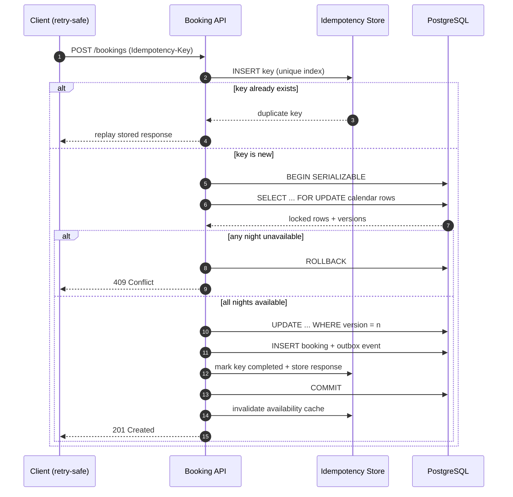

| Difficulty | Channel | Tags |
|---|---|---|
| intermediate | database | acid, isolation-levels, mvcc |

At 11:58 p.m. on a holiday weekend, two guests on different continents tap Reserve on the same listing within milliseconds of each other. Both see a confirmation spinner, both get charged, and only one of them has a bed. Airbnb's payments team learned that the hardest part of preventing that outcome is not the database lock — it is making a retried request behave as if it happened exactly once [1]. What follows is the design journey from that failure mode to a booking pipeline that stays correct under load.

---

> ### Real-World Case — Airbnb
>
> Airbnb's payments platform handles charges for reservations across many microservices. Because a guest can double-click "Book" and mobile clients retry aggressively after timeouts, the same reservation/payment request can arrive multiple times, so the platform needed to execute it exactly once without sacrificing availability.
>
> | | |
> |---|---|
> | **Challenge** | Prevent duplicate booking and payment operations and race conditions in a distributed SOA where a network call can time out after the downstream charge has already succeeded, while keeping latency low enough for checkout. |
> | **Solution** | Airbnb built Orpheus, an idempotency library embedded in its payments services. Each request carries a client-generated idempotency key; the pre-RPC phase takes a database row-level lock on that key as an expiring lease and records intent, the RPC phase calls the payment processor with no database work, and the post-RPC phase records the outcome. Idempotency state is read and written only on the sharded master database, never on replicas, to avoid replica lag replaying a charge; the tables are sharded by the high-cardinality idempotency key. |
> | **Outcome** | Airbnb reported five nines (99.999%) of payment consistency after Orpheus launched, while annual payment volume doubled. |
> | **Lesson** | The critical correctness boundary is the database row lock plus a durable idempotency record; reading that state from a lagging replica can reintroduce the exact double-write you are trying to prevent. Strong consistency on a narrow key, sharded for scale, beats routing the critical write through read replicas. |

---

## Hook — The Booking That Should Never Have Existed

The deploy looked fine. Error rates were flat, dashboards were green, and then support tickets started arriving in pairs: two guests, one property, two confirmation emails.

Here is the sequence that causes it. A guest taps Reserve on slow hotel Wi-Fi. The request reaches the booking service, the charge is authorized, and the response is lost on the way back. The mobile client does what mobile clients are designed to do — it retries [7]. A second request arrives, sees availability that has not been updated yet, and books the same nights for a different guest.

Now the stakes stop being abstract. One guest arrives to a locked door. Refunds are issued. Support costs spike. The listing owner loses trust in the platform, and finance spends a week reconciling charges that should never have existed.

Many developers reach for a bigger lock at this point. That instinct is understandable, and it is also incomplete. The real fix has two halves: make retries harmless, then make the availability decision atomic [6]. Miss either half and the bug returns — usually during the busiest weekend of the year.

## Problem — When Check-Then-Act Becomes Check-Then-Oops

At its core, a double booking is a check-then-act race. Your code asks whether these nights are free, gets a yes, and then writes a booking. Between the read and the write, another transaction can do exactly the same thing. In a single-threaded script this never happens. In a service handling thousands of requests per second across multiple pods, it happens constantly.

The naive fix is a database transaction around both statements. That helps, but only if the isolation level and the locks actually cover the rows you read. Under Read Committed, a plain SELECT does not prevent another transaction from changing the same rows before your UPDATE lands. Under a replica-based read path, the problem gets worse: your availability check may be reading a snapshot that is hundreds of milliseconds stale [3].

There is a second, sneakier failure mode. Even a perfectly correct booking transaction can run twice. Mobile clients retry after timeouts. Load balancers retry on 502s. Users double-tap. Message queues redeliver. Without an idempotency layer, the second execution is a brand-new booking, not a duplicate of the first [6].

Consequently, teams face two distinct questions that are easy to conflate:

- Did the same request execute more than once?
- Did two different requests both win the same inventory?

The first is a request identity problem. The second is a concurrency control problem. Production systems need answers to both, and the answers live in different layers of the stack.

## Real-World Case — Airbnb and the Orpheus Idempotency Framework

In 2019, Airbnb's payments platform confronted exactly this pair of problems as the company moved to a service-oriented architecture [1]. Charges for a single reservation touched multiple microservices, and a guest could double-click Book while mobile clients retried aggressively after timeouts. The same reservation and payment request could therefore arrive several times, and the platform had to execute it exactly once without sacrificing availability.

The team built Orpheus, a general-purpose idempotency library used across payment services [1]. Every new request carries a unique idempotency key, and retries reuse that key. Internally, Orpheus splits a request into three phases: pre-RPC, the RPC itself, and post-RPC. The key and its lifecycle state are persisted before the remote call, which gives the system a durable record to reconcile against if a process crashes mid-flight [1].

One detail is worth pausing on. The team deliberately read and wrote idempotency records against the master database rather than a replica. A few seconds of replication lag was enough to let a retry slip past the duplicate check and charge a guest twice [1]. That decision trades a little read scalability for financial correctness — usually the right call when the cost of a bug is a refund and a support escalation.

The results were concrete: five nines (99.999%) of payment consistency after Orpheus launched, while annual payment volume doubled [1]. That is the transformation story in one sentence. But notice what Orpheus does not do: it does not decide whether a property is available. It makes duplicate requests harmless. The inventory decision still needs its own atomic guard, which is where the database design comes in.

## Deep Dive — Isolation Levels, MVCC, and the Two Guards

Building on that separation, the deep dive splits into two layers: request-level idempotency and row-level concurrency control.

**Request-level idempotency.** An operation is idempotent when repeating it produces the same observable result as running it once [6]. HTTP formalizes this for methods like PUT and DELETE [7], but a POST /bookings call is not idempotent by default. The standard production pattern is an idempotency key supplied by the client, stored in a table with a unique index, and committed in the same transaction as the business write. If the key already exists, the server replays the stored response instead of executing again.

**Row-level concurrency control.** For inventory, two families of techniques matter:

- Pessimistic locking: SELECT ... FOR UPDATE takes row locks so competing transactions queue up [8].
- Optimistic concurrency: read a version number, then update with WHERE version = n and check the affected row count [4].

SERIALIZABLE isolation sits above both. In PostgreSQL, SERIALIZABLE is implemented with Serializable Snapshot Isolation (SSI), which uses MVCC snapshots and detects dangerous read-write dependencies, aborting one transaction with a serialization failure [5]. MVCC means readers do not block writers and writers do not block readers [3], which is exactly why availability checks stay fast even while bookings are committing.

Here is the trade-off table most teams wish they had seen earlier:

| Strategy | Best for | Cost | Failure mode to plan for |
|---|---|---|---|
| Read Committed + no locks | Low-contention reads | Cheapest | Classic double booking |
| SELECT ... FOR UPDATE | Hot, short critical sections | Lock waits, deadlocks | Timeout storms on popular listings |
| Optimistic version check | Low-contention writes | Retry loops | Retry amplification under load |
| SERIALIZABLE (SSI) | Multi-row invariants | Abort + retry | Serialization failures at peak |
| Idempotency key table | Any retried write | Extra write per request | Unbounded key growth, hot shard |

⚠️ Watch Out: SERIALIZABLE is not a magic switch. If your retry logic treats a serialization failure as a hard error, you have simply converted a race condition into a 500. Retries with jittered exponential backoff are part of the design, not an afterthought.

There is a subtle twist here. Locking more rows feels safer, but it can reduce availability. A single hot property — say, a beachfront villa on New Year's Eve — can serialize hundreds of requests behind one row lock. Consequently, mature systems combine row locks with short transactions, circuit breakers, and a queue or waiting-room pattern for extreme hotspots. The goal is not zero contention; it is bounded contention with predictable latency.

💡 Insight: the availability calendar should be the source of truth for the booking decision. Read replicas are excellent for rendering search results, but they should never authorize a write [3].

## Workflow — The Exactly-Once Booking Path

The sequence diagram below tells the story end to end. It is worth reading as a defensive checklist rather than a happy path.

1. The client generates an idempotency key once per booking attempt and reuses it for every retry.
2. The API inserts the key into an idempotency table with a unique index. If the insert conflicts, the request is a duplicate; the server returns the stored response or asks the client to retry later.
3. The transaction opens at SERIALIZABLE isolation.
4. The service locks every calendar row in the requested range with SELECT ... FOR UPDATE, ordered consistently to reduce deadlocks.
5. The service validates row count, availability flags, and version numbers. A missing calendar row is a failure, not an assumption of availability.
6. Each night is flipped to unavailable with an optimistic version check, the booking row is inserted, and an outbox event is written for downstream consumers.
7. The idempotency record is marked completed with the response body, then the transaction commits. Cache invalidation for the property happens after commit, never before.

🎯 Key Point: the idempotency record and the booking commit together. If they live in separate transactions, a crash between them reopens the exact hole you were trying to close.

One more operational detail matters at scale: shard the idempotency table by key, not by user. Airbnb's write-up notes that the idempotency workload can become a scaling bottleneck and that sharding by key is how teams keep it manageable [1]. The same lesson applies to booking systems with millions of daily attempts.

## Code Example — Implementing the Two Guards in Python

The following example uses PostgreSQL and psycopg 3. It is intentionally compact, but every block maps to a production concern: request identity, locking, validation, optimistic checks, and retry.

Notice the ordering. The idempotency claim happens first inside the same transaction, so a concurrent duplicate blocks on the unique index instead of racing ahead. The calendar rows are locked before validation, so no other transaction can flip a night between the check and the write. The version check on each UPDATE is a second guard that catches any path that bypasses the lock. Finally, serialization failures and deadlocks are retried with jittered backoff rather than surfaced to the guest.

The code is illustrative, not copy-paste infrastructure. In a real system you would also add a request hash check to reject key reuse with a different payload, a TTL or archival job for old idempotency keys, metrics for lock wait time, and a dead-letter path for requests that exhaust retries.

⚠️ Watch Out: never store the idempotency key in a cache only. A cache eviction during a retry is indistinguishable from a brand-new request, and the guest gets charged twice.

## Lessons Learned — What Survives Contact With Production

Here is the short list of lessons that survive contact with production.

- **Treat retries as normal traffic, not exceptions.** Mobile networks, load balancers, and message brokers will duplicate requests. Design for at-most-once execution and safe replay [1][6].
- **Use two guards, not one.** Idempotency protects request identity; row locks and version checks protect inventory. They solve different problems and fail in different ways.
- **Keep the critical section tiny.** Do the availability check, the flip, and the booking insert in one short transaction. Move emails, analytics, and third-party calls to an outbox consumer after commit.
- **Read the master for correctness-critical checks.** Replica lag is small in milliseconds and enormous in consequences [1][3].
- **Retry deliberately.** Only retry serialization failures and deadlocks, use jitter, cap attempts, and emit a metric when the cap is hit [5][8].
- **Model the calendar explicitly.** One row per property per night is boring, queryable, and easy to lock. A single JSON blob of blackout dates is a race condition waiting to happen.
- **Load-test the hot property.** A synthetic test that hammers one listing with 500 concurrent requests will teach you more than a month of code review.

🔥 Hot Take: most double-booking bugs are not database bugs. They are missing-identity bugs. Teams spend weeks tuning isolation levels while the real culprit is a client that generates a fresh request ID on every retry.

The memorable insight to share with your team is this: correctness at scale comes from making duplicates boring. Once a repeated request is harmless and an inventory decision is atomic, high availability stops being in tension with consistency — it becomes the natural result of a small, well-guarded critical section.

---

## Exactly-Once Booking Flow

<strong>Original Interview Question</strong>

**Q:** You're building a booking system for Airbnb where multiple users can reserve the same property simultaneously. How would you design the transaction handling to prevent double bookings while maintaining high availability?

**A:** Use SERIALIZABLE isolation with optimistic concurrency control. Implement row-level locks on property availability tables, use MVCC snapshot reads for checking availability, and apply application-level validation to ensure atomic booking operations.

## Conclusion

Airbnb's journey from duplicate charges to five nines of payment consistency is a reminder that booking systems fail in pairs: the same request arrives twice, and two different requests win the same night [1]. Tomorrow, audit your own write path for those two questions. Does every retried request carry a stable idempotency key, and does your availability decision lock the exact rows it read? If the answer to either is no, you already know where the next 2 a.m. page is coming from. Start with the smaller fix — add the idempotency table and commit it with the booking — then tighten the inventory transaction. Your future on-call self will thank you.

---

## References

1. [Airbnb incident report](https://medium.com/airbnb-engineering/avoiding-double-payments-in-a-distributed-payments-system-2981f6b070bb) — article
2. [ACID — Wikipedia](https://en.wikipedia.org/wiki/ACID) — documentation
3. [Snapshot isolation — Wikipedia](https://en.wikipedia.org/wiki/Snapshot_isolation) — documentation
4. [Optimistic concurrency control — Wikipedia](https://en.wikipedia.org/wiki/Optimistic_concurrency_control) — documentation
5. [PostgreSQL transaction isolation documentation](https://www.postgresql.org/docs/current/transaction-iso.html) — documentation
6. [Idempotence — Wikipedia](https://en.wikipedia.org/wiki/Idempotence) — documentation
7. [RFC 9110: HTTP Semantics](https://datatracker.ietf.org/doc/html/rfc9110) — documentation
8. [Two-phase locking — Wikipedia](https://en.wikipedia.org/wiki/Two-phase_locking) — documentation
9. [PostgreSQL source repository](https://github.com/postgres/postgres) — documentation
10. [Amazon DynamoDB: Working with items and conditional writes](https://docs.aws.amazon.com/amazondynamodb/latest/developerguide/WorkingWithItems.html) — documentation
11. [Understanding Database Sharding — DigitalOcean](https://www.digitalocean.com/community/tutorials/understanding-database-sharding) — blog

---

**Author:** Satishkumar Dhule — [GitHub](https://github.com/satishkumar-dhule) · [LinkedIn](https://linkedin.com/in/satishkumar-dhule) · [Website](https://satishkumar-dhule.github.io)
