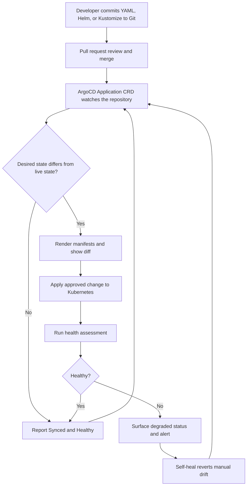

| Difficulty | Channel | Tags |
|---|---|---|
| beginner | devops | argocd, flux, declarative |

At Adobe, a deployment queue could stretch long enough for an engineer to finish a meeting, refill coffee, and still watch the spinner [1]. The company's internal delivery platform had grown to thousands of services and tens of thousands of environments, and every manual step added friction, risk, and drift [1]. That is the hidden tax of imperative operations: the cluster slowly becomes its own undocumented source of truth. The fix is not a faster kubectl command — it is a different contract between Git and Kubernetes.

---

> ### Real-World Case — Adobe
>
> Adobe's internal delivery platform, Moonbeam (CaaS), relied on fragile, queue-based deployment workflows that became increasingly hard to scale, secure, and operate. As the company grew to thousands of services and tens of thousands of environments, manual intervention and configuration drift created persistent deployment pain.
>
> | | |
> |---|---|
> | **Challenge** | Move a massive legacy estate away from imperative, queue-driven deployments toward a governed GitOps model where Git is the single source of truth, and keep thousands of microservices continuously reconciled across a huge multi-environment footprint without drift or manual toil. |
> | **Solution** | Adobe built Flex on Kubernetes and the Argo ecosystem: Argo CD provides declarative delivery and continuous reconciliation from Git, while Argo Workflows, Argo Events, and Argo Rollouts handle orchestration, event-driven automation, and progressive delivery. They defined applications and infrastructure declaratively (manifests/Helm/Kustomize), enabled automated reconciliation so running environments continuously converge on approved Git state, and wrapped the platform in self-service onboarding, secrets management, RBAC, and migration tooling rather than relying on mandates. |
> | **Outcome** | Flex now manages over 6,000 services across nearly 50,000 environments, including roughly 19,000 production environments and 3,300+ production services. Adobe migrated or decommissioned 10,400 pipelines across 100+ engineering teams, onboarded 3,000+ developers, cut deployment queue times significantly, and unexpectedly retired about 80% of previously identified services as stale or duplicate—yielding substantial cost savings and better platform hygiene. |
> | **Lesson** | Declarative GitOps is not just 'YAML instead of kubectl'—the real win is a continuously reconciled control loop that eliminates drift and makes rollbacks and audits trivial. But the technology is only half the battle: Adobe's biggest regret was underinvesting in migration tooling, and the surprising payoff was discovering and deleting enormous amounts of abandoned infrastructure once everything had to be declared in Git. |

---

## Hook — The Queue That Made Thousands of Engineers Wait

It starts with a simple question: what is actually running in production? For a small team, the answer might live in a shell script, a wiki page, and one engineer's memory. For Adobe, the answer had to span 6,000 services and nearly 50,000 environments [1]. At that scale, every deployment queue, every manual hotfix, and every undocumented kubectl edit becomes a future incident.

The stakes are not abstract. Slow deploys block product teams, configuration drift creates outages, and stale services quietly burn budget. If your cluster can change without a Git commit, you do not have a deployment process — you have a rumor. That uncomfortable question is exactly where the GitOps story begins.

## Problem — When the Cluster Becomes the Source of Truth

Most teams begin with imperative commands because they are immediate and legible. You run kubectl apply, see the pod start, and move on [5]. The trouble appears later, when the same environment is rebuilt, handed to another team, or patched during an incident. Suddenly nobody can explain why production has a resource limit that staging does not, or why a hotfix survived three releases.

This is configuration drift, and it compounds silently. Manual changes bypass review, break auditability, and make rollbacks a guessing game. The cluster becomes a pet: unique, fragile, and expensive to reproduce. GitOps proposes a blunt alternative: if a change is not in Git, it does not belong in the cluster [6]. That sounds strict until you remember how much time teams lose reconstructing what happened during an outage.

Sound familiar? The problem is rarely a lack of Kubernetes knowledge. It is a lack of a reliable authority for what production should look like.

## Real-World Case — Adobe's Moonbeam Platform

Adobe did not adopt GitOps because it was fashionable; Moonbeam, the company's internal container-as-a-service delivery platform, was buckling under fragile, queue-based deployment workflows [1]. As the estate grew to thousands of services and tens of thousands of environments, manual intervention and configuration drift turned every deployment into a coordination problem [1].

The migration was not a side project. Adobe moved or decommissioned 10,400 pipelines across more than 100 engineering teams and onboarded over 3,000 developers [1]. The resulting platform, Flex, now manages more than 6,000 services across nearly 50,000 environments, including roughly 19,000 production environments and 3,300+ production services [1]. Deployment queue times fell significantly, but the plot twist was the cleanup: about 80% of previously identified services turned out to be stale or duplicate and were retired, producing substantial cost savings and better platform hygiene [1].

GitOps did more than automate deploys. It made the inventory honest — and that honesty exposed waste nobody had budgeted for.

## Deep Dive — Declarative Versus Imperative GitOps

Building on Adobe's experience, the core distinction is less about tooling and more about where authority lives. In a declarative model, you commit the desired state — YAML manifests, Helm charts, or Kustomize overlays — and a controller continuously reconciles the live cluster toward that state [3][4][10]. ArgoCD implements this through an Application custom resource that points at a Git repository, path, destination cluster, and namespace [2][3].

In an imperative model, you issue commands such as kubectl create, edit, or delete, and the cluster changes because you said so in that moment [5]. Both approaches can work, but they fail differently. Declarative systems make drift visible because the controller constantly compares desired and actual state [9]. Imperative systems hide drift because the last command is not necessarily the current truth.

The trade-off is real: declarative setups demand discipline around repository structure, secrets, and promotion workflows, while imperative commands remain useful for debugging and emergencies. The question is not whether kubectl is evil; it is whether production state should depend on someone remembering to run it.

| Dimension | Declarative (Git + ArgoCD) | Imperative (kubectl) |
| --- | --- | --- |
| Source of truth | Git commit | Terminal history and memory |
| Drift detection | Continuous reconciliation | None by default |
| Rollback | git revert, then sync | Re-run an older command |
| Audit trail | Pull requests and commit history | Shell history, if preserved |
| Best fit | Repeatable environments and teams | One-off debugging and emergencies |

A second nuance is sync policy. Auto-sync tells ArgoCD to apply changes when Git moves; self-heal tells it to revert manual cluster edits [7]. A three-minute health check interval is a common starting point because it catches drift quickly without hammering the API server. However, auto-sync without guardrails can be dangerous: a bad manifest merged to main becomes a bad production state quickly. That is why pull-request review, policy checks, and progressive delivery matter as much as the sync button.

## Workflow — From Git Commit to Healthy Cluster

The workflow starts long before ArgoCD runs. First, a developer opens a pull request with the desired change: a new image tag, a resource limit, or a Helm value. Second, reviewers approve and merge it, making Git the official record. Third, the ArgoCD Application controller detects the new commit and renders the manifests. Fourth, it compares the rendered output with the live cluster and shows a diff. Fifth, if auto-sync is enabled, it applies the change and runs health assessments. Sixth, if someone later edits the cluster manually, self-healing reverts that drift on the next reconciliation [7].

The diagram below turns this into a loop: Git is the input, the Application CRD is the contract, and reconciliation is the heartbeat.

1. Commit the desired state to a reviewed branch.
2. Merge to the tracked branch — never kubectl apply directly to production.
3. Let ArgoCD render and diff the manifests.
4. Apply only when the diff matches the intended change.
5. Assess health, then alert on degraded states.
6. Revert unauthorized drift automatically.
7. Promote the same commit through environments instead of rebuilding each one.

🎯 Key Point: The deployment unit is the commit, not the command. That shift is what makes rollback, audit, and collaboration feel like normal software work instead of cluster archaeology.

## Code Example — Wiring Auto-Sync and Self-Healing

The commands below show a minimal but production-shaped ArgoCD setup. They register a repository, create an Application with automated sync, enable pruning and self-healing, tighten the reconciliation interval to three minutes, and then demonstrate the loop with a Git push [2][7].

The important detail is what is missing: no kubectl apply against the workload namespace. The cluster is changed by ArgoCD, not by a human running commands from a laptop. Read the code top to bottom as a sequence: connect the source, declare the destination, tune reconciliation, trigger through Git, then verify health.

⚠️ Watch Out: Auto-prune can delete resources that are absent from Git. Make sure backups and review policies exist before enabling it in production.

💡 Insight: The three-minute interval is not a magic number. It is a starting point that balances fast drift detection against API server load; tune it to the criticality of the workload.

## Lessons Learned — Drift, Rollbacks, and the Cost of Stale Services

Here is the thing though: GitOps is not a magic wand. Many teams enable auto-sync and assume drift is solved, then discover that secrets, generated manifests, and emergency hotfixes still need a deliberate policy. Battle scars show up in predictable places. A repository with no promotion strategy becomes a merge-conflict factory. Auto-prune without backups can delete resources faster than anyone can restore them. Self-heal without observability can mask a human mistake instead of surfacing it.

| Practice | Why it matters |
| --- | --- |
| Small, reviewed commits | Keeps rollbacks cheap and diffs understandable |
| Progressive delivery | Limits blast radius before full sync |
| Separate app and platform configuration | Reduces coupling across teams |
| Automated pruning with safeguards | Prevents orphaned resources, but needs backups |
| Regular inventory reviews | Adobe's 80% retirement stat shows stale services hide in plain sight [1] |

The counterintuitive lesson from Adobe is that automation's biggest win may be visibility, not speed. Once every desired state lives in Git, teams can finally see what they own, what is duplicated, and what should disappear [1]. Flux and ArgoCD both implement the same core reconciliation loop, so the tool choice matters less than the operating model [8]. Kubernetes controllers taught the industry this pattern years ago: observe, diff, act, repeat [9]. GitOps simply extends that loop to the entire delivery platform.

🔥 Hot Take: A platform that deploys faster but still hides its inventory is not mature. It is just failing at a higher velocity.

---

## GitOps Reconciliation Loop

<strong>Original Interview Question</strong>

**Q:** You're setting up GitOps for a microservices deployment. How would you configure ArgoCD to automatically sync changes from your Git repository to Kubernetes, and what's the difference between declarative and imperative approaches in this context?

**A:** I'd configure ArgoCD by setting up a Git repository containing Kubernetes manifests or Helm charts, creating an Application CRD that points to the Git repository, enabling auto-sync with a health check interval of 3 minutes, and implementing self-healing to automatically revert any manual changes. The declarative approach involves defining the desired state in Git through YAML manifests, Helm charts, or Kustomize configurations, where ArgoCD continuously reconciles the actual state with the desired state. In contrast, the imperative approach uses kubectl commands to make direct changes to the cluster, bypassing the Git repository as the single source of truth.

## Conclusion

Adobe's journey from fragile deployment queues to a Git-driven platform is the story in miniature: scale does not break systems all at once; it breaks them one undocumented change at a time [1]. The next step is deliberately small. Pick one service, put its manifests in Git, create an ArgoCD Application, enable auto-sync with self-healing, and watch what happens when someone edits the cluster by hand. The memorable insight is simple: if production can change without a commit, you are not practicing GitOps — you are practicing archaeology. Make Git the source of truth, and every deployment becomes a story you can retrace.

---

## References

1. [Adobe incident report](https://www.cncf.io/case-studies/adobe/) — article
2. [Argo CD Documentation](https://argo-cd.readthedocs.io/en/stable/) — documentation
3. [Argo CD Application Specification](https://argo-cd.readthedocs.io/en/stable/user-guide/application-specification/) — documentation
4. [Kubernetes Declarative Object Management](https://kubernetes.io/docs/tasks/manage-kubernetes-objects/declarative-config/) — documentation
5. [Kubernetes Imperative Object Management](https://kubernetes.io/docs/tasks/manage-kubernetes-objects/imperative-command/) — documentation
6. [OpenGitOps Principles](https://opengitops.dev/) — documentation
7. [Argo CD Automated Sync Policy](https://argo-cd.readthedocs.io/en/stable/user-guide/auto_sync/) — documentation
8. [Flux Documentation](https://fluxcd.io/flux/) — documentation
9. [Kubernetes Controllers](https://kubernetes.io/docs/concepts/architecture/controller/) — documentation
10. [Helm Documentation](https://helm.sh/docs/) — documentation

---

**Author:** Satishkumar Dhule — [GitHub](https://github.com/satishkumar-dhule) · [LinkedIn](https://linkedin.com/in/satishkumar-dhule) · [Website](https://satishkumar-dhule.github.io)
