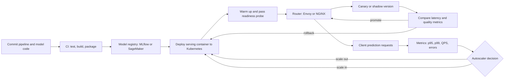

| Difficulty | Channel | Tags |
|---|---|---|
| beginner | devops | mlops, deployment |

The deployment pipeline flashed green, the model was live, and the pager stayed quiet — for about six minutes. Then the inference latency graph bent upward like a hockey stick, and the team discovered the uncomfortable truth that every ML platform eventually learns: shipping a model and serving a model are two different disciplines. Uber ran headfirst into that distinction when Michelangelo, its machine-learning platform, had to translate every new Spark model into a custom protobuf format before it could answer a single online prediction request [1]. The fix cut native Spark model load times from 8x–44x slower than the custom format to just 2x–3x — a 4x–15x speedup — and kept p95 latency under 5ms on some of the highest-traffic models in the world [1].

---

> ### Real-World Case — Uber
>
> Uber's Michelangelo platform served thousands of production models, most built on Apache Spark MLlib, but its original architecture used a custom protobuf model format and a forked Spark just for online scoring. This made every new transformer a platform-engineering project and blocked data scientists from bringing arbitrary Spark pipelines or externally trained models into production.
>
> | | |
> |---|---|
> | **Challenge** | Uber wanted to adopt native Spark ML pipeline serialization as the single model representation so training and serving artifacts stayed consistent and interoperable. But Spark's standard load path was built for batch clusters, not millisecond-latency online serving: loading a Spark MLlib model meant spinning up a local Spark session, using sc.textFile and distributed Parquet reads for tiny metadata files, and running Spark SQL's Catalyst optimizer per request. Model load time was 8x-44x slower than Uber's custom protobuf format, which broke deployment agility and health checks in its multi-tenant serving fleet. |
> | **Solution** | Uber separated the deployment artifact from the serving runtime path. It kept native Spark PipelineModel serialization for portability, added an OnlineTransformer trait with a lightweight scoreInstance(Map) API that bypasses Catalyst, and patched Spark internals: Java I/O instead of sc.textFile for metadata, direct ParquetUtil.read instead of sparkSession.read.parquet, and coalesced tree-ensemble files to avoid many small slow reads. A local SparkContext is created only during model load and stopped afterward so its cleaner cannot interfere with live inference. |
> | **Outcome** | Native Spark model load time dropped from 8x-44x slower than the custom protobuf format to 2x-3x, a 4x-15x speedup over stock Spark loading, making standard Spark representation viable for online serving. The approach ran in production for over a year, and Michelangelo's online clusters served p95 latency under 5ms without Cassandra features and under 10ms with them, with the highest-traffic models exceeding 250,000 predictions per second. |
> | **Lesson** | Deployment and serving are not the same contract: a portable, standard training/deployment artifact can be operationally correct yet catastrophically wrong for runtime inference. The winning pattern is to keep one serialization format for train/serve consistency, then build a separate lightweight serving path and tune model-loading costs, because in autoscaled multi-tenant serving, model load time is a latency and availability concern, not just a startup detail. |

---

## Hook — The Green Deploy That Almost Broke Production

The deploy was green. The model had passed every offline test, the artifact was signed, and the release notes went out. Then real traffic arrived — not the tidy batch job the model was trained for, but thousands of concurrent requests, each expecting an answer in milliseconds.

That is the moment the difference between model deployment and model serving stops being a vocabulary debate and becomes an incident. Deployment is the journey that gets an artifact into an environment safely. Serving is the runtime that keeps that artifact fast, available, and correct while the world hammers it.

Many teams treat the two as one checkbox. They wire a model into a container, push it to a cluster, and call it production-ready. But a model that deploys successfully can still serve catastrophically. The gap between those two outcomes is where budgets, customer trust, and on-call sanity get tested.

So here is the uncomfortable question: if your model went live tomorrow and traffic doubled, would you know which part of your system would break first?

## Problem — When Deployment Success Masks Serving Failure

The confusion usually starts with language. A job posting says 'ML deployment engineer,' a dashboard says 'model serving,' and a vendor says 'deploy and serve in one click.' The words blur, so the responsibilities blur too.

Deployment answers a release question: how does this artifact get from a notebook to a trusted environment reproducibly, with approvals, tests, and a way back? Serving answers a runtime question: how does that artifact turn a request into a prediction inside a latency budget, at the right version, without falling over?

When teams skip the distinction, the failures become predictable:

- A model is deployed with no readiness gate, so the load balancer sends traffic before weights finish loading.
- Autoscaling watches CPU, but the real bottleneck is GPU memory or request queue depth.
- Rollback means redeploying an old container, which takes minutes while the incident burns.
- A/B tests are run by hand-editing YAML, with no consistent traffic split or metric attribution.

The stakes are not abstract. A slow recommendation model costs revenue. A stale fraud model lets bad transactions through. A serving outage during a launch can erase the credibility of an entire ML program. MLOps as a discipline exists precisely because the lifecycle does not end when the artifact is stored [10].

⚠️ Watch Out: The most dangerous moment in an ML release is the window between 'container started' and 'model ready.' If your readiness probe only checks that the process is alive, you have automated the delivery of latency spikes.

## Real-World Case — Uber's Michelangelo Platform

Uber's Michelangelo platform is one of the clearest examples of deployment and serving pulling in different directions. The platform served thousands of production models, most built on Apache Spark MLlib. But its original architecture used a custom protobuf model format and a forked version of Spark just for online scoring [1][8].

That design worked — until it became a workflow bottleneck. Every new transformer turned into a platform-engineering project. Data scientists could not bring arbitrary Spark pipelines or externally trained models into production without asking the platform team to rebuild the path. The deployment pipeline was mature; the serving layer was the constraint.

The fix was to make the standard Spark representation viable for online serving. Native Spark model load time dropped from 8x–44x slower than the custom protobuf format to 2x–3x — a 4x–15x speedup over stock Spark loading [1]. The approach ran in production for over a year. Michelangelo's online clusters served p95 latency under 5ms without Cassandra features and under 10ms with them, while the highest-traffic models exceeded 250,000 predictions per second [1].

That is the lesson in numbers: serving performance is not a footnote to deployment. It is the product surface. A platform can ship models perfectly and still fail if the runtime cannot load them fast enough to answer real requests.

## Deep Dive — Two Lifecycles, One System

Building on Uber's experience, the cleanest mental model is a separation of concerns — not necessarily a separation of teams.

Deployment owns the artifact lifecycle:

- CI/CD: pipelines run tests, build images, and sign artifacts before anything reaches production [10].
- Infrastructure: Terraform and Kubernetes define the environment, while MLflow tracks experiments, metrics, and lineage [7].
- Release strategy: canary, shadow, and blue-green rollouts decide who sees which version.
- Rollback: a fast, tested path back to a known-good artifact.

Serving owns the request lifecycle:

- Runtime API: FastAPI, gRPC, or a dedicated model server exposes prediction endpoints.
- Model loading and versioning: TensorFlow Serving, TorchServe, and BentoML each solve artifact loading differently [4][5][6].
- Routing: Envoy or NGINX directs traffic, splits versions, and enforces timeouts [13].
- Autoscaling: Kubernetes HPA or a custom controller reacts to the metric that actually predicts saturation [3].
- Observability: latency percentiles, error rate, queue depth, and prediction drift.

Here is the trade-off table that matters more than any architecture diagram:

| Decision | Optimize for latency | Optimize for throughput |
| --- | --- | --- |
| Batch size | Small, often 1–8 | Large, often 32–256 |
| Runtime | Purpose-built server with warm pools | Queue plus batching layer |
| Scaling signal | p95/p99 latency and queue wait | GPU utilization and backlog |
| Versioning | Immutable snapshots, instant switch | Shared weights and memory pooling |
| Cost profile | Higher idle cost | Higher tail-latency risk |

Latency and throughput pull in opposite directions. A real-time fraud check might need sub-50ms p99, so you keep models warm and batches tiny. A nightly embedding job can tolerate seconds, so you maximize GPU utilization and batch aggressively. The mistake is choosing one posture for every model on the platform.

Cold starts deserve their own warning. A container that boots in 200ms can still take 30 seconds to load a 5GB model. If readiness only checks that the process is alive, traffic arrives during the worst possible window. That is why warm-up belongs in the serving contract, not in a runbook.

💡 Insight: Versioning is another place where the two disciplines diverge. Deployment thinks in releases; serving thinks in routes. A single release can contain multiple servable versions, and a route can shift traffic between them. Treat the model version as a first-class request attribute, not a hidden environment variable.

## Workflow — From Commit to Calm Autoscaling

Here is the workflow that keeps the two disciplines honest. The diagram accompanying this section shows the full path from a data scientist's commit to a scaled serving fleet.

1. Package: CI trains, validates, and packages the model with its preprocessing code and dependencies.
2. Register: the artifact lands in a model registry such as MLflow, SageMaker, or an internal store, with a version, metrics, and lineage [7][11].
3. Deploy: a Kubernetes controller rolls out the serving container, but does not send it traffic yet [2].
4. Warm: the container loads weights, runs a synthetic request, and only then flips readiness to true.
5. Route: the load balancer sends a small canary slice or shadow traffic to the new version [13].
6. Scale: HPA or a custom autoscaler watches latency, queue depth, and GPU pressure — not just CPU [3].
7. Observe and decide: if p95 latency and error rate stay inside budget, ramp traffic; otherwise roll back to the previous immutable version.

The subtle step is number four. Warm-up is not a nice-to-have; it is the bridge between deployment success and serving success. A deployment that is technically complete but not yet warm is a trap waiting for a traffic spike.

🎯 Key Point: Scale on the signal that saturates first. For CPU-bound services that might be CPU. For transformer inference it is often GPU memory, batch queue depth, or time-to-first-token. Autoscaling the wrong metric is just expensive optimism.

## Code Example — A Versioned Serving Layer With a Real Readiness Gate

Here is a compact FastAPI serving layer that implements the versioned routing and readiness gate described above. It is intentionally small, but the shape mirrors what production teams run behind a model server.

The important parts are the lifespan warm-up, the readiness check, and the request-level version header. Together they turn deployment from a hopeful push into a controlled handoff.

```python
import time
from contextlib import asynccontextmanager
from typing import Dict

from fastapi import FastAPI, Header, HTTPException
from pydantic import BaseModel

class PredictRequest(BaseModel):
    features: list[float]

class ModelRegistry:
    def __init__(self) -> None:
        self._models: Dict[str, object] = {}

    def load(self, version: str) -> None:
        # Production code would pull artifacts from a registry and warm the graph.
        self._models[version] = {"version": version, "warmed_up": True}

    def get(self, version: str) -> object:
        if version not in self._models:
            raise KeyError(version)
        return self._models[version]

    def ready(self) -> bool:
        return bool(self._models)

registry = ModelRegistry()

@asynccontextmanager
async def lifespan(app: FastAPI):
    # Warm the default model before the pod reports ready.
    registry.load("v1")
    yield

app = FastAPI(lifespan=lifespan)

@app.get("/healthz")
def healthz():
    return {"status": "ok"}

@app.get("/readyz")
def readyz():
    # Readiness gates traffic until at least one model is loaded.
    return {"status": "ready" if registry.ready() else "warming"}

@app.post("/predict")
def predict(payload: PredictRequest, x_model_version: str = Header(default="v1")):
    started = time.perf_counter()
    try:
        model = registry.get(x_model_version)
    except KeyError:
        raise HTTPException(status_code=404, detail=f"unknown model version: {x_model_version}")

    # Replace with a real inference call, e.g. model.predict(payload.features).
    score = sum(payload.features) / max(len(payload.features), 1)
    elapsed_ms = (time.perf_counter() - started) * 1000
    return {
        "version": model["version"],
        "score": score,
        "latency_ms": round(elapsed_ms, 3),
    }
```

The lifespan handler runs before the application starts accepting traffic, which is where model loading belongs. The readiness endpoint gives the orchestrator a real signal instead of a false sense of security. The version header makes canary and rollback configuration rather than redeployment. Finally, the latency measurement is deliberately local — in production you would emit it to a metrics system and track p95 and p99, not just the average.

## Lessons Learned — What to Change Tomorrow

The journey from Uber's protobuf bottleneck to a healthy serving layer offers a few durable lessons.

- Deployment is a pipeline; serving is a runtime. Test them separately, staff them deliberately, and measure them with different metrics.
- Readiness must mean 'the model can answer,' not 'the process started.' A warm-up request is cheaper than an incident review.
- Scale on the resource that saturates first. CPU-based autoscaling for GPU inference is a classic and expensive mistake.
- Make versions addressable at request time. Canary, shadow, and rollback should be routing decisions, not redeployments.
- Track p95 and p99, never only averages. Averages hide the users who are having the worst day.

🔥 Hot Take: Most 'model serving' problems are actually release-engineering problems wearing a runtime costume. Teams often need better readiness gates and version routing more than they need a fancier inference engine.

If this feels overwhelming, you are not alone. The fix is usually smaller than it looks: start with one model, add a real readiness probe, expose the version, and measure the right percentile. Then repeat.

---

## Deployment-to-Serving Pipeline



<details>
<summary><strong>Original Interview Question</strong></summary>

**Q:** Explain the key differences between model serving and model deployment in ML systems, including specific technologies, scaling considerations, and real-world implementation patterns?

**A:** Deployment encompasses CI/CD pipelines, infrastructure setup, and monitoring using tools like Kubernetes, MLflow, and SageMaker. Serving focuses on runtime inference APIs with frameworks like TensorFlow Serving, TorchServe, or BentoML, handling request routing, model versioning, and autoscaling. Key trade-offs include latency vs throughput, batch vs real-time inference, and cold start optimization.

</details>

## Conclusion

Uber's Michelangelo story is not really about protobuf. It is about a platform with a mature deployment story and a serving layer that became the bottleneck for every new model [1]. The moment the team treated model representation as a serving concern — and measured load time, p95 latency, and throughput — the path from notebook to production widened.

So what should you do differently tomorrow? Pick one model and trace its journey from registry to request. Ask three questions: What proves it is ready to receive traffic? Which metric triggers scale-out? How fast can traffic move back to the previous version? If any answer is vague, you have found the boundary where deployment ends and serving begins.

The memorable insight: a successful deploy is not the finish line. It is the starting gun.

---

## References

1. [Uber incident report](https://www.uber.com/us/en/blog/michelangelo-machine-learning-model-representation/) — article
2. [Kubernetes Deployments](https://kubernetes.io/docs/concepts/workloads/controllers/deployment/) — documentation
3. [Horizontal Pod Autoscaling](https://kubernetes.io/docs/tasks/run-application/horizontal-pod-autoscale/) — documentation
4. [TensorFlow Serving](https://github.com/tensorflow/serving) — documentation
5. [TorchServe](https://github.com/pytorch/serve) — documentation
6. [BentoML](https://github.com/bentoml/BentoML) — documentation
7. [MLflow](https://github.com/mlflow/mlflow) — documentation
8. [Apache Spark](https://github.com/apache/spark) — documentation
9. [KServe](https://github.com/kserve/kserve) — documentation
10. [MLOps](https://en.wikipedia.org/wiki/MLOps) — documentation
11. [Amazon SageMaker Documentation](https://docs.aws.amazon.com/sagemaker/) — documentation
12. [Load Balancing (Computing)](https://en.wikipedia.org/wiki/Load_balancing_(computing)) — documentation

---

**Author:** Satishkumar Dhule — [GitHub](https://github.com/satishkumar-dhule) · [LinkedIn](https://linkedin.com/in/satishkumar-dhule) · [Website](https://satishkumar-dhule.github.io)
