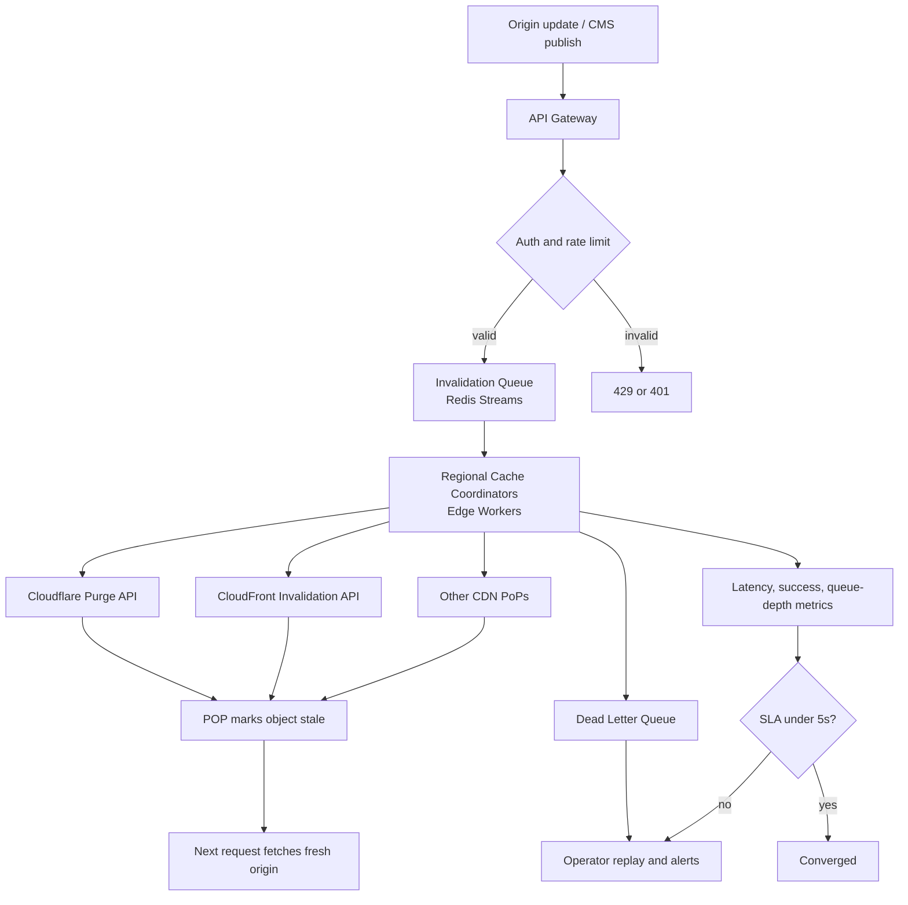

| Difficulty | Channel | Tags |
|---|---|---|
| intermediate | system-design | edge, caching, purging |

At 10:42 a.m., a pricing update lands in an origin database, and within five seconds shoppers in Tokyo, Frankfurt, and São Paulo must see the same number. If one edge location serves the old price, the company has published two truths at once — and support tickets start before the deploy dashboard even turns green. Fastly has spent more than a decade turning that five-second window into a 150-millisecond habit, even as its purge traffic grew from a few thousand requests per second to roughly 60,000 [1]. The hard part was never the API call; it was making every POP agree without a central choke point.

---

> ### Real-World Case — Fastly
>
> Fastly operates a global CDN where customers need cache invalidation ('purge') to take effect across every POP almost instantly, because stale content means wrong prices, outdated news, or unpatched assets. Traditional CDNs routed purge requests through a central system, which added latency and created a single point of failure.
>
> | | |
> |---|---|
> | **Challenge** | Propagate each invalidation to every cache server worldwide within milliseconds, at massive throughput, while surviving packet loss, network partitions, and POP outages. At the time, the system had to scale from a few thousand purges per second toward tens of thousands without manual rate limiting. |
> | **Solution** | Fastly built a decentralized purge system codenamed Powderhorn using Bimodal Multicast: the cache server that receives a purge immediately broadcasts it to all peers over UDP, then a gossip protocol recovers any dropped messages. They deliberately skip acknowledgments (cutting latency by up to half) and broadcast purges everywhere instead of maintaining content-location maps. Later iterations added a two-tier POP hierarchy where at least two healthy nodes receive each UDP packet and rebroadcast locally, plus true batch purging instead of splitting batches into individual purges. |
> | **Outcome** | Global purge latency has stayed under 150ms for over a decade, covering the whole network. Throughput grew from 2-3k purges/sec in 2018 to about 60k purges/sec by 2025, with confidence to scale to hundreds of thousands per second after fixing batch purging. In a real firewall misconfiguration that partitioned two servers, 95th-percentile purge latency rose by two orders of magnitude but purges still completed in roughly 10 seconds; during an 8-minute DoS-induced network outage, all messages were eventually recovered. |
> | **Lesson** | The counterintuitive win was decentralization and accepting unreliable-but-fast delivery: broadcast purges everywhere over UDP, skip acknowledgments, and let gossip repair the rare losses. This beat the 'obvious' central queue design on both latency and resilience, and true batching—not just accepting batched API calls—was what unlocked the next order of magnitude in throughput. |

---

## Hook — The Price That Would Not Die

It is 3:00 a.m. when the pager fires: customers in one region are seeing yesterday's price while everyone else sees today's. The deploy was clean. The origin is correct. The only thing standing between the company and a very public pricing mistake is a cache entry that refuses to die.

Cache invalidation has a reputation for being one of the two hard problems in computer science for a reason: the moment content lives in hundreds of locations, 'delete it everywhere' becomes a distributed systems problem, not a DELETE statement. Fastly's early purge design routed every invalidation through a central system, which made the control plane simple and the data plane fragile [1]. One slow hop, one overloaded coordinator, or one network partition could turn a five-second promise into minutes of inconsistency.

The obvious fix — one central purge service — is exactly the design that turns a regional problem into a global outage.

## Problem — Why Five Seconds Is an Eternity

Now scale the problem up. A newsroom publishes a correction during a breaking story. A retailer flips a flash-sale price. A security team ships an updated asset that patches a vulnerability. Each event demands that every edge location stop serving the old object within five seconds, while the system absorbs 10,000 concurrent invalidation requests per second. That is not a caching problem; it is a coordination problem with a hard deadline.

Many developers reach for a short TTL first. Set `Cache-Control: max-age=2, must-revalidate`, and stale content disappears in two seconds, right? Only if traffic keeps hitting every object. A low-traffic page in a distant POP can sit untouched for hours, and a thundering herd can stampede the origin the moment the TTL expires [6]. HTTP caching semantics give you freshness controls, not a global propagation guarantee [5].

The real constraints collide:

- **Latency:** every region must acknowledge the purge within the five-second budget.
- **Throughput:** 10,000 invalidations per second will overwhelm any provider API that expects one call per object.
- **Partial failure:** some regions will time out, and the system must not silently drop them.
- **Consistency:** 'eventually' is acceptable only if 'eventually' is bounded and observable.

| Approach | Strength | Weakness |
|---|---|---|
| Central purge service | Simple control plane | Single point of failure; cross-region latency |
| TTL only | No coordination | Unbounded staleness for cold objects; origin stampedes |
| Broadcast to every POP | Direct | Fanout cost; retry amplification; partial failure |
| Queue + regional coordinators | Resilient and batchable | More moving parts; needs reconciliation |

The uncomfortable truth is that a five-second SLA is a budget, not a button. Every millisecond spent queueing, batching, retrying, or waiting on a provider API comes out of that budget. Design decisions that look harmless in isolation — a synchronous retry here, a per-object API call there — can consume the entire allowance before the first regional coordinator even wakes up.

## Real-World Case — Fastly's Instant Purge

The Fastly case is instructive because it is not a story about a single dramatic outage. It is a story about removing a central choke point and then proving the design under real failure.

Traditional CDNs routed purge requests through a central system, which added latency and created a single point of failure. Fastly pushed purge handling closer to the edge so that an invalidation could fan out across the network without every request taking the same long trip. The result: global purge latency stayed under 150 milliseconds for more than a decade, across the whole network [1].

The throughput numbers tell the scaling story. In 2018, Fastly handled roughly 2,000 to 3,000 purges per second. By 2025, that figure had grown to about 60,000 purges per second, with confidence to reach hundreds of thousands after fixing batch purging [1]. Notice what changed: the network did not get faster by a factor of twenty. The architecture got better at turning many individual invalidations into fewer, larger units of work.

Then came the plot twist. A firewall misconfiguration partitioned two servers. The 95th-percentile purge latency rose by two orders of magnitude — a terrifying graph for anyone on call — yet purges still completed in roughly 10 seconds [1]. During a separate eight-minute DoS-induced network outage, every message was eventually recovered [1]. The system bent; it did not break. That is the difference between a design that promises five seconds on a good day and one that degrades predictably on the worst day.

The lesson is not 'copy Fastly's architecture.' The lesson is that resilience came from bounded failure handling, durable queues, and regional coordination — not from a faster central API.

## Deep Dive — TTL, Batching, and Bounded Consistency

Building on that case, the architecture starts to look less like a cache-clearing script and more like a distributed transaction log. The goal is bounded eventual consistency: every region converges within five seconds, and any region that fails is retried, recorded, and visible.

**TTL is the backstop, not the guarantee.** A two-second TTL limits how long an untouched object can remain stale, but it cannot force a purge through a partitioned region. Use `Cache-Control: max-age=2, must-revalidate` together with an explicit invalidation path [6]. The header handles the ordinary case; the purge pipeline handles the urgent case. RFC 9111 defines the caching model, but it does not promise global convergence [5].

**Batching is the throughput multiplier.** At 10,000 invalidations per second, one API call per object is a fantasy. Group requests into batches — the original design uses 100 invalidations per call — so the provider sees roughly 100 calls per second instead of 10,000. That reduces rate-limit pressure and cost, but it introduces a new trade-off: a batch is only as fast as its slowest member, and a single bad pattern can poison the whole call. Split batches by region and by provider, and validate patterns before they enter the queue.

**The queue is the shock absorber.** Redis Streams with consumer groups gives you durable messages, at-least-once delivery, and multiple regional consumers without building a broker from scratch [4]. The queue absorbs traffic spikes, decouples ingestion from provider rate limits, and gives failed jobs a place to live. The catch is idempotency: at-least-once delivery means the same purge may arrive twice, so duplicate work must be harmless.

**Edge compute coordinates the last mile.** Cloudflare Workers can run close to the POPs, making regional decisions without a round trip to a central data center [8]. The provider APIs still do the actual purging — Cloudflare's purge endpoint and CloudFront's invalidation API have different limits, semantics, and costs [2][3]. A coordinator that hides those differences behind one interface is worth its weight in incident-free nights.

**Retries need a ceiling.** Exponential backoff with jitter prevents a failed region from being hammered by synchronized retries [7]. Cap attempts at three, then move the job to a dead-letter queue. A circuit breaker stops sending traffic to a provider that is clearly failing, which protects both the provider and the rest of the pipeline.

🔥 **Hot take:** Strong consistency across every POP is the wrong goal. You do not need every edge to agree at the same instant; you need every edge to converge within a known bound, and you need to know when it does not. That is a testable SLA. 'Strong consistency' is a slogan.

## Workflow — From Invalidation Request to Global Convergence

With the trade-offs on the table, the workflow becomes a sequence of bounded steps. Each step has one job, and each handoff is observable.

1. **Ingest the event.** An origin update, CMS publish, or security patch calls the purge API with a pattern and a target region set.
2. **Authenticate and rate-limit.** The API gateway rejects bad tokens and applies per-tenant quotas before work enters the system.
3. **Normalize and deduplicate.** Wildcards are expanded or rejected according to policy; identical patterns inside a short window collapse into one job.
4. **Partition by region.** A global purge becomes a set of regional jobs, so one slow region cannot block the others.
5. **Write to the durable queue.** Redis Streams stores the job; consumer groups let regional coordinators pull work independently [4].
6. **Batch and dispatch.** Coordinators group up to 100 invalidations and call the provider APIs [2][3].
7. **Retry or quarantine.** Failed calls back off with jitter, then land in a dead-letter queue after three attempts [7].
8. **Observe and reconcile.** Per-region latency, success rate, and queue depth feed dashboards and alerts; a reconciliation job replays the DLQ.

The Mermaid diagram below shows the same flow as a picture: ingestion on the left, durable fanout in the middle, provider calls and failure paths on the right.

⚠️ **Watch out:** The five-second clock starts at ingestion, not at the provider call. If the queue is backed up for four seconds before a coordinator picks up the job, the retry budget is already gone. Measure queue wait time separately from provider latency, or the SLA dashboard will lie to you.

## Code Example — A Regional Purge Coordinator in TypeScript

The TypeScript coordinator below turns the workflow into code. It uses Redis Streams for durable fanout, batches by reading up to 100 messages at a time, calls each region with a bounded retry policy, and sends exhausted jobs to a dead-letter stream.

A few design choices matter more than the syntax. The `ensureGroup` call makes the consumer group idempotent, so restarts do not fail. The `withBackoff` helper adds jitter to avoid synchronized retry storms [7]. `Promise.allSettled` lets one bad region fail without canceling the others, which is exactly the partial-failure behavior the SLA requires. The job is acknowledged only after every region has either succeeded or been quarantined; if the process dies mid-flight, Redis redelivers the message.

The code is intentionally provider-agnostic. Swap the `purgeRegion` implementation for Cloudflare's purge endpoint or CloudFront's invalidation API, and the coordination logic stays the same [2][3]. That separation is what lets a team add a new CDN without rewriting the reliability model.

## Lessons Learned — What Survives the Worst Day

Fastly's decade-long run offers a set of lessons that apply far beyond one CDN [1].

- **Remove the central choke point, but keep a central source of truth.** Regional coordinators can act independently; the queue still records what happened.
- **Batch before you scale.** Moving from 2,000-3,000 to 60,000 purges per second was not just a hardware story; batch purging changed the unit of work [1].
- **Design for the partition.** The firewall incident pushed p95 latency up by two orders of magnitude, yet the system completed purges in about 10 seconds [1]. Bounded degradation beats optimistic perfection.
- **Make failure visible.** A dead-letter queue without an owner is just a graveyard. Alert on depth, age, and replay rate.
- **Do not let retries become the outage.** Exponential backoff with jitter and a hard attempt ceiling are not optional at 10,000 requests per second [7].
- **Test the SLA, not the happy path.** Inject regional failures, provider 429s, and queue backlog. If the five-second budget only works on a whiteboard, it does not work.

Battle scars show up in predictable places: wildcard purges that accidentally invalidate an entire zone, duplicate jobs that multiply provider costs, and dashboards that report average latency while the p99 quietly burns. Many teams discover these issues during a launch, which is the worst possible time. The fix is boring and effective: per-region SLOs, deduplication keys, batch-size limits, and a rehearsed DLQ replay runbook.

The memorable insight is simple enough to repeat in a design review: **a five-second purge SLA is a budget you spend across queueing, fanout, retries, and provider latency — not a number you declare.**

---

## Global Purge Fanout Flow

<strong>Original Interview Question</strong>

**Q:** How would you design a multi-region CDN cache purging system that guarantees content propagation within 5 seconds while handling 10,000 concurrent invalidations per second?

**A:** Implement Cloudflare API + AWS CloudFront with distributed invalidation queue, edge compute coordination, and 2-second TTL. Use batch invalidation, exponential backoff, and regional cache headers for 5-second SLA.

## Conclusion

The next time a pricing update or security patch needs to reach every edge, the question is not 'which CDN has the fastest purge API?' It is 'what happens when one region does not answer?' Fastly's answer was to distribute the work, batch it aggressively, and make failure recoverable [1]. Your answer can follow the same shape: put a durable queue between ingestion and providers, coordinate regionally, cap retries, and measure the worst case per region. Start tomorrow by adding queue-wait latency to your purge dashboard and replaying one dead-letter job by hand. That single exercise will reveal more about your propagation guarantee than any architecture diagram.

---

## References

1. [Fastly incident report](https://www.fastly.com/blog/over-a-decade-later-evolution-of-instant-purge) — article
2. [Cloudflare purge cache documentation](https://developers.cloudflare.com/cache/how-to/purge-cache/) — documentation
3. [Amazon CloudFront invalidation documentation](https://docs.aws.amazon.com/AmazonCloudFront/latest/DeveloperGuide/Invalidation.html) — documentation
4. [Redis Streams documentation](https://redis.io/docs/latest/develop/data-types/streams/) — documentation
5. [RFC 9111: HTTP Caching](https://datatracker.ietf.org/doc/html/rfc9111) — documentation
6. [MDN Cache-Control header](https://developer.mozilla.org/en-US/docs/Web/HTTP/Headers/Cache-Control) — documentation
7. [AWS Builders' Library: Timeouts, retries, and backoff with jitter](https://aws.amazon.com/builders-library/timeouts-retries-and-backoff-with-jitter/) — blog
8. [Cloudflare Workers documentation](https://developers.cloudflare.com/workers/) — documentation
9. [Content delivery network](https://en.wikipedia.org/wiki/Content_delivery_network) — article

---

**Author:** Satishkumar Dhule — [GitHub](https://github.com/satishkumar-dhule) · [LinkedIn](https://linkedin.com/in/satishkumar-dhule) · [Website](https://satishkumar-dhule.github.io)
