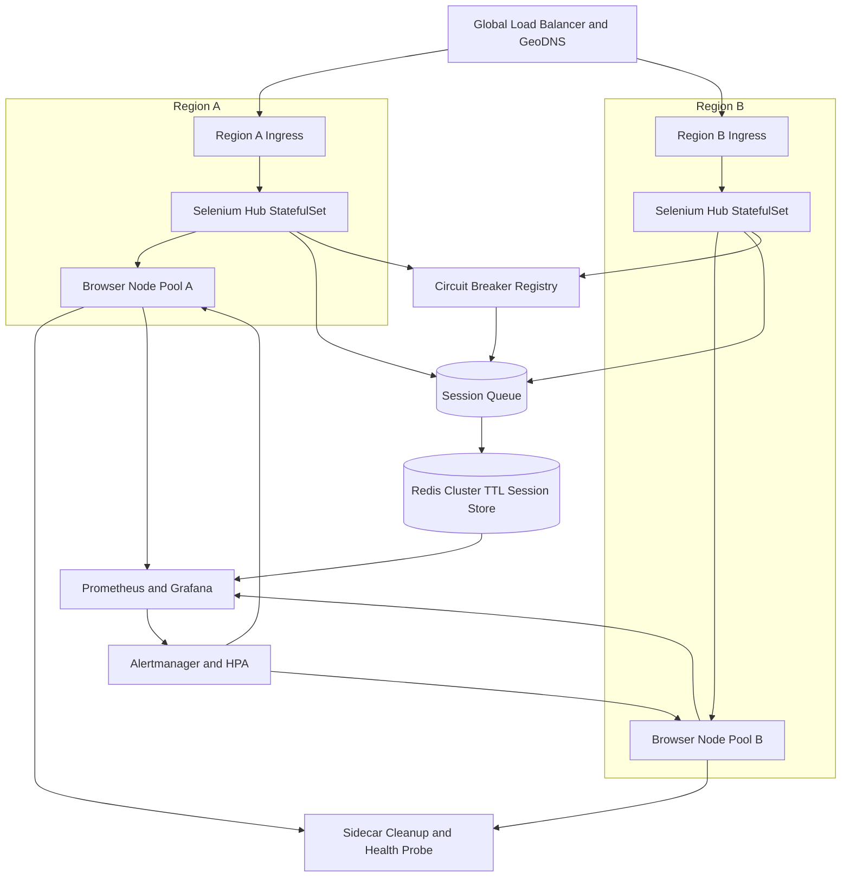

| Difficulty | Channel | Tags |
|---|---|---|
| advanced | system-design | selenium, webdriver, grid |

By 2014, Salesforce's roughly 120 engineering teams were committing about 500 times a day against 50,000 unique Selenium tests, running close to 1,000,000 browser tests daily across IE6 through IE11, Firefox, Chrome, and Safari [1]. To make that work, the company operated a dedicated 50,000-VM test data center — a multi-million-dollar bet that end-to-end UI testing could keep pace with continuous delivery [1]. That farm was impressive, but it also exposes the uncomfortable truth every test platform eventually meets: browsers are stateful, memory-hungry, and spectacularly good at failing in creative ways. The question is not whether your grid will lose a node; it is whether your users will notice when it does.

---

> ### Real-World Case — Salesforce
>
> By 2014, Salesforce's ~120 engineering teams were committing about 500 times a day against a suite of 50,000 unique Selenium tests. To run roughly 1,000,000 browser tests per day across IE6-IE11, Firefox, Chrome and Safari, the company operated a dedicated 50,000-VM test data center — a multi-million-dollar bet on end-to-end UI testing.
>
> | | |
> |---|---|
> | **Challenge** | Keeping a Selenium farm at that scale trustworthy: provisioning enough concurrent browser sessions, containing browser/driver version sprawl, diagnosing failures against a live app with real latency, and preventing non-deterministic 'flaky' tests from eroding confidence in the grid. |
> | **Solution** | Salesforce treated the grid as a product: a centralized farm with a shared harness and Page Object model, tests versioned together with app code and configuration, screenshot and HTML capture at the failure point, capacity allocated to the browsers customers actually used, and advance planning for Selenium and browser upgrades — including two Selenium committers on staff. Tests ran against the live app rather than mocks, with headless PhantomJS where appropriate. |
> | **Outcome** | The farm supported ~1,000,000 browser tests per day, 50,000 unique Selenium tests (7,500 WebDriver), ~120 teams and 500 commits per day on 50,000 VMs, backed by a multi-million-dollar infrastructure investment. |
> | **Lesson** | At 10,000+ sessions the bottleneck is rarely raw node count; it is session lifecycle hygiene and version coordination. Treat browsers, drivers and tests as one versioned artifact, make sessions disposable, and instrument failures — otherwise flakiness and upgrade drift quietly consume the capacity you paid for. |

---

## Hook — The 3 A.M. Browser That Wouldn't Die

At 3 a.m., a browser node can look perfectly healthy while quietly leaking memory into the void. The dashboard is green, the queue is moving, and then one Chrome process crosses a threshold and takes its pod down with it. Multiply that by 10,000 concurrent sessions across multiple data centers, and a routine Tuesday becomes an incident review. The stakes are simple: every stuck session is a developer waiting, a pipeline stalled, and a release delayed. Sound familiar? Good. That tension is the entire design problem.

## Problem — Ten Thousand Sessions Is a Different Sport

Selenium Grid's hub-node model centralizes routing while browser nodes do the expensive work [2]. That separation is elegant at 50 sessions and brutal at 10,000. The first trap is arithmetic: 10,000 sessions divided by 50 sessions per node gives 200 nodes. At 2 GB per node, that is 400 GB of baseline memory; add a 30% buffer and the cluster needs roughly 520 GB before the operating system, sidecars, and monitoring agents take their cut. The second trap is availability math. 99.9% uptime sounds generous until you translate it: roughly 43 minutes of allowed downtime per month. A single bad rolling restart can eat that budget. The third trap is state. Browser sessions are leases, not fire-and-forget jobs, and a session that nobody owns will outlive every alert you throw at it. Consequently, memory leaks are not primarily a monitoring problem; they are a lifecycle problem. The design needs three properties: automatic expiration, failure isolation, and observable saturation.

## Real-World Case — Salesforce

Salesforce did not stumble into this problem by accident. By 2014, roughly 120 engineering teams were committing about 500 times a day against a suite of 50,000 unique Selenium tests, including 7,500 WebDriver tests [1]. To run close to 1,000,000 browser tests per day across IE6 through IE11, Firefox, Chrome, and Safari, the company operated a dedicated 50,000-VM test data center — a multi-million-dollar bet on end-to-end UI testing [1]. That farm supported an extraordinary feedback loop, but it also revealed the operational truth that every large grid eventually faces: browser diversity multiplies cost, and test volume multiplies failure modes. The win was not merely raw capacity. It was the decision to treat test infrastructure as a product with capacity planning, ownership, and lifecycle discipline. Many teams stop at 'spin up more nodes.' Salesforce's scale shows why that answer runs out of runway.

## Deep Dive — The Five Levers That Keep a Grid Alive

Building on that case, the architecture has five levers: scheduling, session state, resource limits, failure isolation, and observability. Get any one wrong and the other four will spend their time compensating.

| Concern | Naive choice | Production choice | Real trade-off |
| --- | --- | --- | --- |
| Session state | In-memory hub map | Redis cluster with TTL [6] | Extra network hop, but survives hub restarts |
| Browser nodes | Plain pods | StatefulSets with stable identity [10] | Slower rollout, easier debugging and cleanup |
| Scaling | Fixed node count | HPA on queue depth and CPU [4] | Scaling lag during bursts |
| Health | TCP check only | HTTP readiness and liveness probes [5] | More probe traffic, far fewer poisoned nodes |
| Failure isolation | Retry forever | Circuit breaker per node [9] | Temporary capacity loss, prevents cascading failure |
| Cleanup | Cron job | Sidecar plus TTL expiry | More containers, predictable reclamation |

Kubernetes Deployments give you rolling updates [3], but browser nodes are closer to pets than cattle: they hold live sessions, temporary profiles, and Docker volumes. StatefulSets provide stable identity and ordered lifecycle operations, which makes orphan cleanup and capacity tracking far easier [10]. Redis is the session ledger. Every session gets a key with a TTL, so a crashed test runner cannot leave a permanent ghost behind [6]. Prometheus scrapes node and session metrics, while Grafana turns queue depth, memory growth, and session duration into trends you can actually act on [7]. Circuit breakers isolate a node after repeated health failures, giving it a cooldown window instead of letting every retry pile onto a dying browser [9]. Pod Disruption Budgets keep voluntary disruptions from taking the grid below 85% capacity [8]. The counterintuitive insight is that recycling a node at 80% memory is not wasteful; it is cheaper than debugging an OOM kill at 100%. This leads directly to the workflow that ties those levers together.

## Workflow — From Test Commit to Clean Shutdown

Here is the session lifecycle as a story, with the Mermaid diagram below tracing the same path across two regions.

1. A developer pushes a commit, and the CI system submits a test request to the nearest regional ingress.
2. The hub checks queue depth and the circuit breaker registry before selecting a browser node.
3. The scheduler picks a healthy node with available capacity, preferring the lowest latency region.
4. The hub writes a session record to Redis with a TTL and a node owner [6].
5. A sidecar starts the browser container and begins sending heartbeats that extend the lease.
6. Prometheus scrapes memory, session duration, and queue age, while the autoscaler watches queue depth [4][7].
7. If a probe fails three times, the node is removed from rotation and its circuit breaker opens for 30 seconds [5][9].
8. When the test finishes, the session is released explicitly; if it does not, the TTL expires and the sidecar terminates the container.

Edge cases are where the design earns its keep. Network partitions require leader election to prevent split-brain scheduling. Resource exhaustion requires Pod Disruption Budgets so maintenance cannot drain the last healthy nodes [8]. New browser versions require canary deployments with traffic splitting, because 'it is just test infrastructure' is exactly how a bad image reaches every node at once. Notice the theme: every step has an owner, a timeout, and a recovery path.

## Code Example — The Session Lease, in Python

The following Python sketch captures the core lifecycle contract: health-check a node, trip a circuit breaker after repeated failures, write a session record with a TTL, extend the lease on heartbeat, and release it explicitly when the test finishes. It is deliberately small enough to read in one sitting, but the pattern maps directly to a production sidecar or scheduler.

## Lessons Learned — What Survives at Scale

Salesforce's 50,000-VM farm is a useful north star, but the real lesson is not to copy the VM count. Copy the discipline instead.

- Treat sessions as leases with owners and deadlines, not as entries in a hub's memory.
- Alert on orphan rate and queue age, not just memory percentage.
- Isolate failing nodes with circuit breakers before retries turn one bad browser into a regional outage.
- Make cleanup idempotent: explicit release, TTL expiry, and a sidecar should all agree on the same outcome.
- Test the failure path with chaos experiments, because a grid that only works when nothing fails is not a grid.

⚠️ Watch Out: Retrying a failed session against the same poisoned node is one of the most common battle scars. It feels efficient and it almost always makes the incident worse.

💡 Insight: The fastest way to reduce memory pressure is often to shorten session lifetime, not to add RAM.

🔥 Hot Take: A hub that owns session state is a single point of failure wearing a load balancer costume.

🎯 Key Point: The memorable takeaway is simple: reliable grids are built from boring leases, hard timeouts, and aggressive recycling. Everything else is capacity planning.

---

## Multi-Region Selenium Grid Architecture

<strong>Original Interview Question</strong>

**Q:** Design a scalable Selenium Grid architecture to handle 10,000 concurrent test sessions with 99.9% uptime, ensuring zero memory leaks through automatic session lifecycle management, real-time monitoring, and graceful node failure recovery across multiple data centers?

**A:** Deploy Kubernetes cluster with auto-scaling node pools, Redis session store with TTL policies, Prometheus metrics for memory monitoring, circuit breakers for node isolation, and sidecar containers for session cleanup. Implement health checks, resource quotas, and rolling updates.

## Conclusion

Salesforce's experience proves that massive browser farms can work, but only when test infrastructure is engineered like a production system [1]. The next time you design a grid, start with the lease, not the node count. Give every session an owner, a deadline, and a failure path. Then measure the things that actually predict pain: orphan rate, queue age, P99 session start, and time-to-recycle a poisoned node. Do that, and 10,000 concurrent sessions stops being a heroic scaling story and becomes a boring, reliable Tuesday. And boring is exactly what you want at 3 a.m.

---

## References

1. [Salesforce incident report](https://speakerdeck.com/gwestr/selenium-at-salesforce-scale) — article
2. [Selenium Grid Architecture](https://www.selenium.dev/documentation/grid/architecture/) — documentation
3. [Kubernetes Deployments](https://kubernetes.io/docs/concepts/workloads/controllers/deployment/) — documentation
4. [Horizontal Pod Autoscaling](https://kubernetes.io/docs/tasks/run-application/horizontal-pod-autoscale/) — documentation
5. [Configure Liveness, Readiness, and Startup Probes](https://kubernetes.io/docs/tasks/configure-pod-container/configure-liveness-readiness-startup-probes/) — documentation
6. [Redis](https://en.wikipedia.org/wiki/Redis) — documentation
7. [Prometheus Overview](https://prometheus.io/docs/introduction/overview/) — documentation
8. [Disruptions and Pod Disruption Budgets](https://kubernetes.io/docs/concepts/workloads/pods/disruptions/) — documentation
9. [Circuit Breaker Design Pattern](https://en.wikipedia.org/wiki/Circuit_breaker_design_pattern) — documentation
10. [Kubernetes StatefulSets](https://kubernetes.io/docs/concepts/workloads/controllers/statefulset/) — documentation

---

**Author:** Satishkumar Dhule — [GitHub](https://github.com/satishkumar-dhule) · [LinkedIn](https://linkedin.com/in/satishkumar-dhule) · [Website](https://satishkumar-dhule.github.io)
