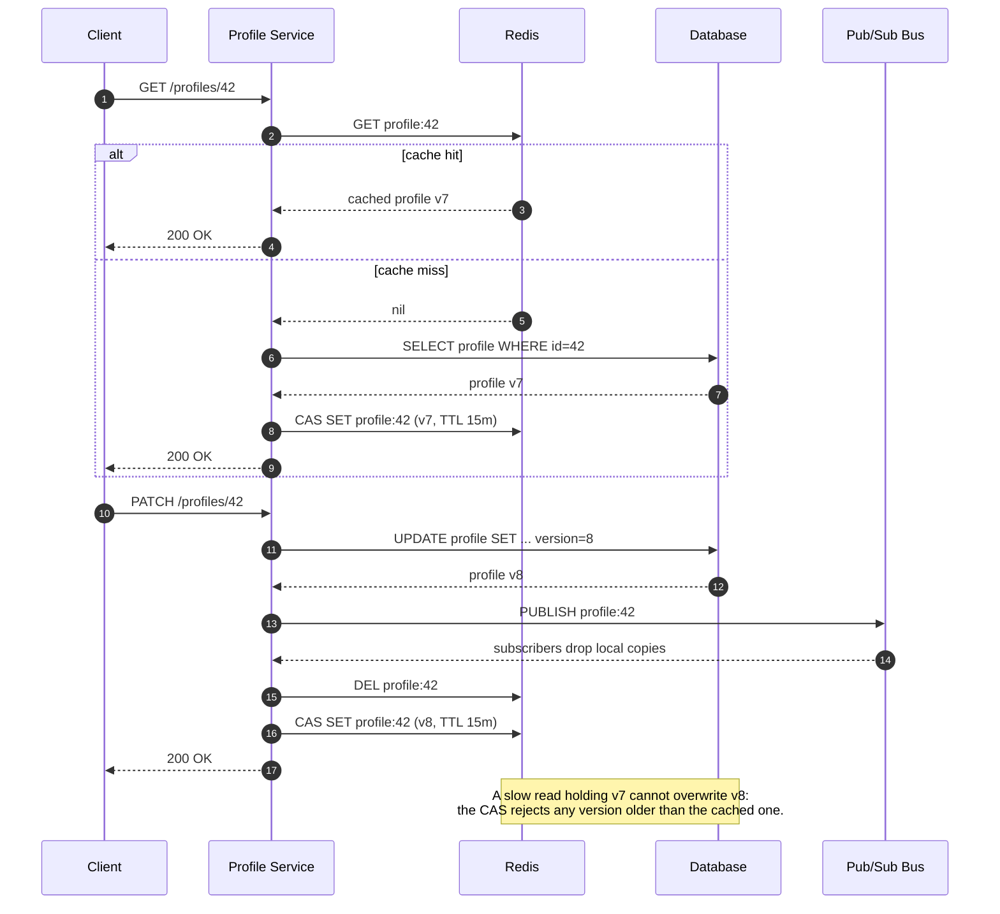

| Difficulty | Channel | Tags |
|---|---|---|
| beginner | backend | redis, memcached, cache-invalidation |

Meta serves its social graph through TAO and Memcache, replicated across regions, where a profile edit triggers asynchronous cache invalidation [1]. In rare cases, a cache fill racing an invalidation left a stale value in place indefinitely — and to the person staring at the screen, that stale profile was indistinguishable from data loss [1]. The team eventually pushed consistency from 99.9999% to 99.99999999%, but the journey says more about distributed systems than any benchmark [1]. Here is what that race looks like in your own profile service, and how to design around it before your users notice.

---

> ### Real-World Case — Meta (Facebook)
>
> Meta runs TAO and Memcache at enormous scale to serve the social graph, including user/profile-like objects replicated across regions. Profile mutations trigger asynchronous cache invalidation, but a cache fill racing an invalidation could leave a stale value in cache indefinitely — a state users cannot distinguish from data loss.
>
> | | |
> |---|---|
> | **Challenge** | Even with version fields, deletes, and TTLs, rare interleavings of cache fills, database transactions, replication, and transient errors produced permanent cache inconsistencies. The team could not simply log every cache mutation: TAO serves over one quadrillion queries a day, and even a 99% hit rate implies more than 10 trillion cache fills daily. |
> | **Solution** | Meta built Polaris, a service that measures client-observable cache consistency at multiple timescales without false positives, and a stateful tracing library that records cache mutations only in the small race window after a write. This let them pinpoint a real bug: an error handler called drop_cache(key, version) using the latest version, so it refused to drop the stale entry, leaving old metadata in cache forever. |
> | **Outcome** | Meta improved TAO cache consistency from 99.9999% (six nines) to 99.99999999% (ten nines), meaning fewer than 1 in 10 billion cache writes remained inconsistent after five minutes. The real bug, which previously could have taken weeks to find, was located by on-call engineers in under 30 minutes. |
> | **Lesson** | Cache invalidation is not solved by delete-on-write and TTL alone — correctness is an observability problem too. Versioned writes, targeted tracing of the fill/invalidation race window, and measurable consistency invariants are what turn a theoretically correct protocol into a production-safe cache. |

---

## Hook — The Stale Profile That Looked Like Data Loss

The support ticket reads like a ghost story: a user updates their display name, hits save, refreshes the page, and sees the old name staring back. The database says the write succeeded. The API returns 200. Yet the product insists the change never happened. At Meta's scale, this exact class of bug haunted the social graph, where profile-like objects are replicated across regions and invalidated asynchronously [1]. The scary part is not the stale value itself; it is that a stale value and a lost write look identical from the outside. One erodes trust in the cache, the other erodes trust in the entire product. Both start with the same innocent-looking race.

## Problem — Why Invalidation Is Harder Than Caching

Adding a cache feels like a straightforward optimization: check Redis, miss, query the database, store the result, move on. The complication arrives on the write path, where two operations must agree on the truth. A common sequence goes like this: a read misses the cache, fetches an old row from the database, and pauses; meanwhile an update writes a new row and deletes the cache key; then the paused read wakes up and writes its old row into the cache [2]. The cache now holds stale data with no expiration unless a TTL saves you. That is the fill-versus-invalidate race, and it is the reason cache invalidation has a reputation for being harder than caching itself [2].

TTLs help, but they are a bound, not a cure. HTTP caching calls this the freshness lifetime, and the same principle applies inside your service: a 15-minute TTL means the worst-case staleness is 15 minutes, which is acceptable for a profile bio and unacceptable for an account balance or a permissions change [5][6]. Write-through caching reduces the window by updating the cache on every write, but it does not eliminate concurrency bugs by itself. The real question is not whether to delete or update the key; it is how to make sure an older write can never overwrite a newer one.

## Real-World Case — Meta (Facebook)

In its 2022 engineering report, Meta described how TAO and Memcache serve the social graph at enormous scale, including profile-like objects replicated across regions [1]. Profile mutations trigger asynchronous cache invalidation, and in rare cases a cache fill could race an invalidation and leave a stale value behind indefinitely [1]. Users cannot distinguish that state from data loss, which turns a subtle consistency bug into a trust incident.

Meta's fix was not a single heroic line of code. The team reworked the consistency model and added detection strong enough to catch the rare race, improving TAO cache consistency from 99.9999% (six nines) to 99.99999999% (ten nines) [1]. In practical terms, fewer than 1 in 10 billion cache writes remained inconsistent after five minutes [1]. The operational payoff was just as striking: a bug that previously could have taken weeks to find was located by on-call engineers in under 30 minutes [1]. The lesson scales down beautifully. Whether you run one Redis node or a global fleet, the same fill-versus-invalidate race exists, and the same discipline — versioning, detection, and a bounded staleness window — is what tames it.

## Deep Dive — Redis, Memcached, and the Trade-offs That Actually Matter

Choosing between Redis and Memcached is less about benchmarks and more about which invalidation tools you want in your toolbox. Redis offers pub/sub, Lua scripting, persistence, replication, and rich data structures, which makes distributed invalidation patterns practical [3][7]. Memcached keeps things simple: a multithreaded, in-memory key-value cache with no persistence and no built-in pub/sub [4][8]. That simplicity is a feature until you need every node to hear about an invalidation immediately.

| Concern | Redis | Memcached |
|---|---|---|
| Distributed invalidation | Pub/sub, keyspace notifications, Lua | Manual coordination or short TTLs |
| Persistence | Optional RDB/AOF | None |
| Data structures | Strings, hashes, sets, sorted sets, streams | Strings and blobs |
| Scaling model | Cluster, replication, sentinel | Simple horizontal sharding |
| Best fit | Complex invalidation, durability, atomic ops | Pure caching, simple ops, low overhead |

Redis pub/sub is powerful, but it is fire-and-forget: a disconnected subscriber misses messages, so teams still pair it with TTLs and a periodic reconciliation job [3]. Memcached's lack of pub/sub means invalidation usually relies on deleting the key and accepting a TTL-bounded staleness window, or on application-level fan-out [4]. AWS ElastiCache supports both engines, which makes the trade-off concrete: pick Redis when invalidation logic needs coordination; pick Memcached when the cache is disposable and the access pattern is simple [9].

💡 Insight: The engine matters less than the contract. If your system promises "fresh within 15 minutes," a TTL plus delete-on-write is honest. If it promises "fresh immediately," you need versioning, pub/sub, or both.

## Workflow — A Race-Proof Invalidation Workflow

The race-proof workflow has five moves, and each one closes a different gap. First, reads use cache-aside: try the cache, and on a miss fetch the row from the database along with a monotonic version number. Second, writes persist to the database first and bump that version. Third, the service publishes an invalidation message so every app node can drop local copies. Fourth, the service deletes the Redis key before repopulating it. Fifth, every cache write uses an atomic compare-and-set that refuses to store a version older than the one already cached.

The sequence diagram below traces both paths, including the slow reader that causes trouble. Notice the note at the bottom: a read holding version 7 cannot overwrite version 8 because the compare-and-set rejects it. TTL remains as a safety net for the paths you did not anticipate, and single-flight or lease-based filling prevents a stampede when a hot key expires [10].

🎯 Key Point: Delete-on-write reduces the window; versioned compare-and-set closes it. TTL is the seatbelt, not the steering wheel.

## Code Example — Python Implementation with Versioned Compare-and-Set

The Python example below uses redis-py and a small Lua script to make the compare-and-set atomic. It is intentionally close to production shape: a read path, a write path, a pub/sub invalidation, and a TTL. Swap the two placeholder persistence functions for your real database calls, and the rest is portable to most services.

## Lessons Learned — What to Do Differently Tomorrow

Here is what to carry into the next design review:

- **Delete before you repopulate.** Writing a new value over an old one is fine until a slow reader overwrites it. Delete plus a versioned set gives you a clear ordering.
- **Version every cacheable record.** A monotonic version, updated_at timestamp, or database sequence gives the cache a way to reject older writes [2].
- **Treat TTL as a bound, not a strategy.** A TTL limits blast radius, but it does not prevent the race. Choose the TTL based on the product's tolerance for staleness, not on a round number [5][6].
- **Pick Redis for coordination, Memcached for simplicity.** Pub/sub, Lua, and persistence make Redis the better fit for complex invalidation; Memcached wins when the cache is disposable and ops simplicity matters most [3][4][7][8][9].
- **Instrument staleness, not just hit rate.** A 99% hit rate feels great until 1% of reads return yesterday's data. Track invalidation lag, version-rejection counts, and stale-read samples.
- **Test the race on purpose.** Add a delay between the database read and the cache fill in a test, then update the record. If the test passes without a version check, your cache is lying to you.
- **Watch for the thundering herd.** When a hot key expires, thousands of requests can hit the database at once; single-flight or lease-based filling keeps that from becoming a self-inflicted outage [10].

⚠️ Watch Out: Pub/sub is not a durable queue. A subscriber that reconnects after a network blip will miss invalidations, so pair pub/sub with TTLs and periodic reconciliation.

🔥 Hot Take: Most "cache bugs" are not cache bugs at all. They are ordering bugs that the cache makes visible.

---

## Cache Invalidation Sequence

<strong>Original Interview Question</strong>

**Q:** You're building a user profile service that caches frequently accessed profiles. How would you implement cache invalidation when a user updates their profile, and what trade-offs would you consider between Redis and Memcached?

**A:** Implement write-through caching with TTL-based expiration. On profile update, invalidate the cache by deleting the key and writing new data to both the database and cache. Redis offers pub/sub for automatic distributed invalidation, while Memcached requires manual coordination across nodes.

## Conclusion

Meta's journey from six nines to ten nines is not a story about buying a better cache. It is a story about treating invalidation as a distributed-systems contract: version the data, make the write ordering explicit, bound staleness with a TTL, and measure the result [1]. You do not need Meta's scale to benefit from that discipline. Add a version column, make your cache writes compare-and-set, publish invalidations where you can, and put a stale-read metric on the same dashboard as your hit rate. Do that, and the next support ticket about a "disappearing" profile update becomes a five-minute investigation instead of a weeks-long ghost hunt. The memorable takeaway: caching is how you make reads fast; invalidation is how you keep users believing the data is real.

---

## References

1. [Meta (Facebook) incident report](https://engineering.fb.com/2022/06/08/core-infra/cache-made-consistent/) — article
2. [Wikipedia: Cache invalidation](https://en.wikipedia.org/wiki/Cache_invalidation) — documentation
3. [Wikipedia: Redis](https://en.wikipedia.org/wiki/Redis) — documentation
4. [Wikipedia: Memcached](https://en.wikipedia.org/wiki/Memcached) — documentation
5. [MDN: HTTP caching](https://developer.mozilla.org/en-US/docs/Web/HTTP/Caching) — documentation
6. [RFC 7234: HTTP/1.1 Caching](https://datatracker.ietf.org/doc/html/rfc7234) — documentation
7. [GitHub: redis/redis](https://github.com/redis/redis) — documentation
8. [GitHub: memcached/memcached](https://github.com/memcached/memcached) — documentation
9. [Amazon ElastiCache: What is ElastiCache?](https://docs.aws.amazon.com/AmazonElastiCache/latest/red-ug/WhatIs.html) — documentation
10. [Wikipedia: Thundering herd problem](https://en.wikipedia.org/wiki/Thundering_herd_problem) — documentation

---

**Author:** Satishkumar Dhule — [GitHub](https://github.com/satishkumar-dhule) · [LinkedIn](https://linkedin.com/in/satishkumar-dhule) · [Website](https://satishkumar-dhule.github.io)
