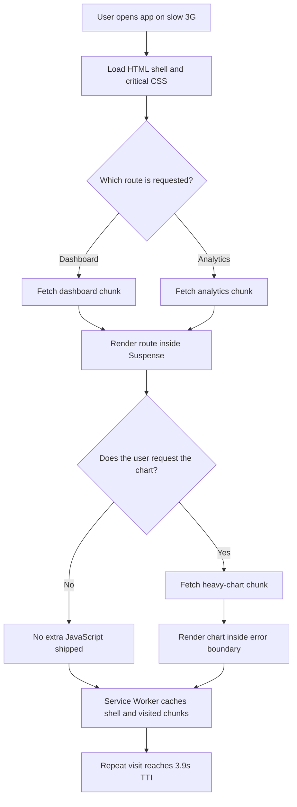

| Difficulty | Channel | Tags |
|---|---|---|
| intermediate | frontend | lighthouse, bundle, lazy-loading |

Picture a commuter on a mid-range Android phone, riding a bus through patchy 3G. They tap a Pinterest link, see a blank screen, and wait. In 2017, that wait stretched to roughly 23 seconds before the mobile web UI became usable, because the app shipped more than 2.5MB of JavaScript [1]. The site worked on a developer laptop; on the devices most of the world actually used, it was barely usable.

---

> ### Real-World Case — Pinterest
>
> In 2017, Pinterest's mobile web experience was a monolithic React/Redux app that shipped over 2.5MB of JavaScript (~1.5MB main bundle plus ~1MB lazily loaded). On average Android hardware over slow 3G, users waited roughly 23 seconds before the UI was usable, and the mobile site drove less than 10% of total signups.
>
> | | |
> |---|---|
> | **Challenge** | The multi-megabyte JavaScript payload had to be parsed and compiled before the main thread could settle, making the site painfully slow and non-interactive. Pinterest needed to dramatically shrink the initial bundle and improve Time to Interactive without breaking a complex, feature-rich React application. |
> | **Solution** | Over three months, Pinterest rebuilt the mobile web app as a PWA using React, Redux, and webpack. They analyzed chunks with webpack-bundle-analyzer and split the monolith into vendor, entry, and async route-level chunks using React Router code splitting. The counterintuitive twist: the analyzer revealed duplicate code spread across lazy-loaded chunks, so they deliberately moved shared duplicate code into the main chunk — increasing the entry chunk by 20% but cutting lazy chunk sizes by up to 90%. They also added a route preloading system, component-level splitting via a  component, virtualization for the Pin grid, and Service Worker caching with Workbox. |
> | **Outcome** | The core bundle dropped from 650KB to 150KB, total JavaScript from ~2.5MB to a much leaner payload, First Meaningful Paint fell from 4.2s to 1.8s, and Time to Interactive dropped from 23s to 5.6s (3.9s on repeat visits with Service Worker caching). Business results were equally dramatic: time spent up 40%, user-generated ad revenue up 44%, core engagements up 60%, and after a year weekly active users on mobile web rose 103% with signups up 843% year over year. |
> | **Lesson** | Code splitting is not simply 'make every chunk as small as possible.' Bundle analysis matters more than intuition: aggressively splitting can scatter shared code across many async chunks and make things worse. Deliberately increasing the main chunk to deduplicate shared code made lazy chunks up to 90% smaller overall. Also, performance must be defended continuously — with ~600 JS files, one bad import can re-bloat the bundle, so Pinterest added build-size alerts and custom ESLint rules to block dependency-heavy imports. |

---

## Hook — The 23-Second Wait That Nearly Hid a Product

Here is the uncomfortable part: the team did not make the servers faster first. They made the JavaScript smaller. That decision helped drop the core bundle from 650KB to 150KB, pulled First Meaningful Paint from 4.2s to 1.8s, and cut Time to Interactive from 23s to 5.6s — then to 3.9s on repeat visits with a Service Worker [1]. The business followed: time spent rose 40%, user-generated ad revenue rose 44%, and core engagements rose 60% [1].

So what does that have to do with a Lighthouse score of 65, a 2.1MB bundle, and a 4.2-second Time to Interactive? Everything. The same physics apply to a typical React app, and the fix starts with a question most teams avoid: what is actually inside those megabytes?

## Problem — When a React App Works and Still Feels Broken

Building on that, the interview scenario sounds familiar: a React app that works, ships, and still feels slow. Lighthouse says 65. The bundle is 2.1MB. Time to Interactive is 4.2s. Product managers see charts, engineers see green tests, and users see a spinner.

The trap is that bundle size is easy to measure and easy to misunderstand. A 2.1MB download is not just network time; it is parse time, compile time, and execution time on the main thread. Time to Interactive measures how long until the page can reliably respond to input, which is why a page can look finished while still feeling frozen [9]. A fast laptop can absorb that cost and hide the problem. A four-year-old Android phone on a congested network cannot. Lighthouse performance audits exist precisely to expose this gap between developer hardware and real-user hardware [2].

Moreover, the damage compounds. JavaScript blocks the main thread, so the browser cannot respond to taps while it parses and evaluates code. Images below the fold compete for bandwidth. Third-party scripts sneak into the critical path. The result is a page that looks loaded but does not respond — the worst kind of slow, because users blame the product, not the network.

This leads to the real question: which bytes are necessary for the first screen, and which bytes are just along for the ride?

## Real-World Case — Pinterest's 2017 Mobile Web Rebuild

Pinterest's 2017 mobile web rebuild is the clearest answer to that question. The company's mobile site was a monolithic React/Redux application delivering over 2.5MB of JavaScript. On average Android hardware over slow 3G, users waited about 23 seconds for the UI to become usable, and mobile web drove less than 10% of total signups [1]. Those numbers are not a minor performance nuisance; they are a product adoption ceiling.

The fix was not a single heroic optimization. It was a sequence: understand the bundle, split by route, load non-critical features on demand, and cache aggressively. The core bundle fell from 650KB to 150KB, total JavaScript dropped to a much leaner payload, First Meaningful Paint improved from 4.2s to 1.8s, and Time to Interactive fell from 23s to 5.6s [1]. With a Service Worker handling repeat visits, TTI reached 3.9s [1].

Then the plot twist arrived. The engineering win became a business win: time spent increased 40%, user-generated ad revenue increased 44%, and core engagements increased 60% [1]. After a year, weekly active users on mobile web rose 103% and signups rose 843% year over year [1]. Performance was not a technical side quest; it was the growth channel.

However, copying Pinterest's final architecture without copying its diagnosis is a recipe for cargo-cult engineering. The next step is understanding why those bytes were expensive in the first place.

## Deep Dive — The Anatomy of a Fat Bundle

Specifically, a JavaScript bundle is expensive in three separate phases: download, parse/compile, and execute. Compression helps the first phase; minification helps the first two; code splitting and tree shaking help all three by reducing what must be shipped and evaluated. That is why a 2.1MB uncompressed bundle can still hurt even when gzip makes the transfer look respectable.

The first move is always analysis, not guessing. Tools such as webpack-bundle-analyzer produce a treemap of what is actually inside the build, which routinely reveals duplicate copies of libraries, full-library imports where a single function was needed, and dependencies that seemed small until their transitive graph arrived [8]. A chunk cannot be optimized until it has been measured.

After that, the strategic choice is where to split. Code splitting is simply the practice of breaking one bundle into smaller chunks that load on demand [3]. Here is the real trade-off:

| Strategy | Best for | Trade-off |
|---|---|---|
| Route-based splitting | Pages with distinct URLs and clear navigation | One extra request per route; shared code may duplicate without configuration |
| Component-based splitting | Heavy widgets below the fold or behind interaction | More requests and a possible waterfall if overused |
| Vendor splitting | Large, stable third-party libraries | Cache-friendly, but can still be large on first visit |
| No splitting | Tiny apps or a single critical screen | Simplest build, but poor scalability |

Tree shaking is the quiet hero behind many of these wins. Modern bundlers can remove unused exports, but only when modules use ES module syntax and packages declare side effects honestly through the sideEffects field [7]. A CommonJS library, a barrel file that re-exports everything, or an import with side effects can quietly defeat the optimizer. Consequently, the fastest dependency is often the one you remove, and the second fastest is the one you import narrowly.

There is also a counterintuitive risk: splitting too aggressively. Twenty tiny chunks can create a network waterfall that is slower than one medium chunk on a high-latency connection. The goal is not the smallest possible file; it is the shortest critical path to an interactive first screen.

## Workflow — From 2.1MB to a Lean First Paint

This leads to a repeatable workflow rather than a one-time cleanup. The sequence below is the practical version of Pinterest's approach, adapted to a typical React app:

1. Establish a baseline. Record Lighthouse scores, bundle size, and real-user metrics such as TTI and First Contentful Paint. Without a baseline, every change is an opinion [2].
2. Analyze the bundle. Run webpack-bundle-analyzer or the bundler's equivalent, then rank chunks by size and by whether they are needed for the first screen [8].
3. Delete before splitting. Remove unused dependencies, replace heavyweight libraries with smaller alternatives, and switch full-library imports to named imports.
4. Split by route first. Wrap route components in React.lazy() and Suspense so each page loads its own chunk [4][5].
5. Split heavy components on intent. Dynamic-import charts, editors, modals, and map widgets when the user opens or approaches them, not on initial load.
6. Prefetch the likely next step. Use bundler magic comments or link prefetching for routes the user is likely to visit next, so splitting does not become a waterfall.
7. Lazy-load images and below-the-fold media. Native loading='lazy' and correct dimensions prevent layout shift while saving bandwidth.
8. Cache the shell. A Service Worker can serve the app shell and previously visited chunks on repeat visits, which is how Pinterest reached 3.9s TTI [1][10].
9. Guard the gains. Add a performance budget to CI so a new dependency cannot silently add 200KB next sprint.

The Mermaid diagram below shows how those decisions map to the browser's loading path.

## Code Example — Wiring Route Splitting Without a Blank Screen

Here is how the route and component strategy looks in code. The goal is not to lazy-load everything; it is to keep the initial shell small, isolate failures, and load heavy UI only when it is about to be needed. Note that the chunk-name magic comments are bundler-specific and may be replaced by equivalent syntax in other build tools.

## Lessons Learned — What Actually Moves the Score

Looking back at the 23-second wait, the lesson is not that React is slow or that lazy loading is magic. The lesson is that performance work starts with evidence, and the biggest wins usually come from shipping less code.

Here is what to carry into the next sprint:

- Measure before optimizing. A bundle analyzer and real-user metrics reveal the truth that localhost hides [8].
- Delete before splitting. Removing an unused dependency beats splitting it into a smaller chunk.
- Split by route first, then by intent. Route-level splitting is the reliable baseline; component-level splitting is for heavy, non-critical UI [6].
- Protect tree shaking. Use ES modules, avoid accidental side effects, and verify the sideEffects configuration [7].
- Do not over-split. A waterfall of tiny chunks can be slower than one medium chunk.
- Add error boundaries. Dynamic imports fail on real networks, and a failed chunk should not blank the page.
- Set a performance budget. Make regressions fail CI, not users' patience.
- Treat performance as a product metric. Pinterest's signups and engagement moved because the experience got faster [1].

The common battle scars are predictable: lazy-loading an above-the-fold hero and causing a blank first paint; wrapping the entire app in one Suspense boundary and losing the shell; importing a heavy library in a component that renders on every keystroke; and forgetting that third-party scripts can dwarf the app bundle.

If this feels overwhelming, start smaller than expected. Pick the single largest chunk in the analyzer, ask whether it is needed for the first screen, and move it behind a route or an interaction. Then measure again. Performance improves through a series of boring, verified decisions — not one heroic rewrite.

---

## Bundle Loading Flow

<strong>Original Interview Question</strong>

**Q:** You're tasked with improving a React app's Lighthouse performance score from 65 to 90+. The bundle size is 2.1MB and Time to Interactive is 4.2s. What specific steps would you take to optimize the bundle and implement lazy loading?

**A:** Implement code splitting with React.lazy() and Suspense, analyze bundle composition with webpack-bundle-analyzer to identify largest chunks, remove unused dependencies and optimize imports, add dynamic imports for heavy components and third-party libraries, implement route-based splitting for better initial load times, and utilize tree shaking with proper ES module configuration.

## Conclusion

Pinterest's story begins with a 23-second wait and ends with a 103% increase in weekly active users [1]. Yours can begin with a bundle analyzer and one lazy route. Tomorrow, open the build report, find the largest chunk that is not needed for the first screen, and move it behind React.lazy() and Suspense. Then set a budget so it never creeps back. The most memorable insight to share with your team is simple: the fastest JavaScript is the JavaScript you never ship.

---

## References

1. [Pinterest incident report](https://medium.com/dev-channel/a-pinterest-progressive-web-app-performance-case-study-3bd6ed2e6154) — article
2. [Lighthouse performance audits](https://developer.chrome.com/docs/lighthouse/performance/) — documentation
3. [MDN: Code splitting](https://developer.mozilla.org/en-US/docs/Glossary/Code_splitting) — documentation
4. [React: lazy](https://react.dev/reference/react/lazy) — documentation
5. [React: Suspense](https://react.dev/reference/react/Suspense) — documentation
6. [webpack: Code Splitting guide](https://webpack.js.org/guides/code-splitting/) — documentation
7. [webpack: Tree Shaking guide](https://webpack.js.org/guides/tree-shaking/) — documentation
8. [webpack-bundle-analyzer on GitHub](https://github.com/webpack-contrib/webpack-bundle-analyzer) — documentation
9. [Wikipedia: Time to interactive](https://en.wikipedia.org/wiki/Time_to_interactive) — documentation
10. [MDN: Service Worker API](https://developer.mozilla.org/en-US/docs/Web/API/Service_Worker_API) — documentation

---

**Author:** Satishkumar Dhule — [GitHub](https://github.com/satishkumar-dhule) · [LinkedIn](https://linkedin.com/in/satishkumar-dhule) · [Website](https://satishkumar-dhule.github.io)
