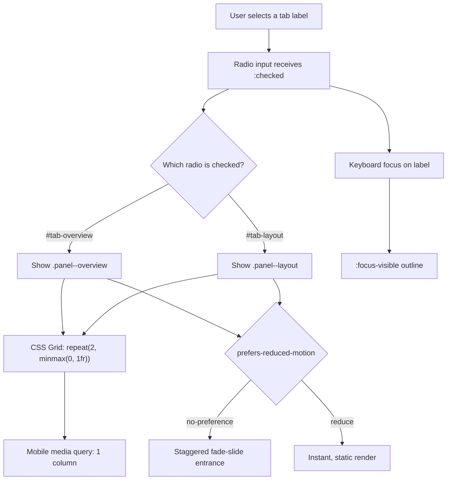

| Difficulty | Channel | Tags |
|---|---|---|
| beginner | frontend | css, flexbox, grid, animations |

In September 2013, roughly 200 million people downloaded iOS 7 in a matter of days — and thousands of them promptly felt sick [1]. The new parallax home screen and full-screen zoom transitions triggered nausea, dizziness, and vertigo in users with vestibular disorders, forcing Apple to ship Reduce Motion and setting off a chain of standards work that eventually became prefers-reduced-motion [1][3]. That incident is the reason a humble CSS-only tab panel deserves more care than it first appears. The challenge sounds simple: switch panels with radio inputs, lay out cards in a 2×2 grid, collapse to one column on mobile, add a staggered entrance, and keep keyboard focus visible. The hidden requirement is the one Apple learned the hard way — motion must be optional.

---

> ### Real-World Case — Apple
>
> In September 2013 Apple shipped iOS 7 with parallax home-screen motion and full-screen zoom and slide transitions throughout the OS. Within days, users with vestibular disorders reported nausea, dizziness, vertigo, and headaches, flooding Apple's support forums.
>
> | | |
> |---|---|
> | **Challenge** | Apple's motion-heavy design gave motion-sensitive users no real way to opt out. The initial Reduce Motion toggle only disabled parallax, not the zoom and slide animations, so affected users still got sick, and web content had no CSS mechanism to honor the OS preference. |
> | **Solution** | Apple added and expanded the OS-level Reduce Motion accessibility setting. The web platform later turned that user preference into the prefers-reduced-motion media query, letting a CSS-only tab component wrap its stagger animation in @media (prefers-reduced-motion: no-preference) and serve a static, fully usable panel to users who opted out, with no JavaScript required. |
> | **Outcome** | The backlash hit a base of roughly 200 million iOS 7 downloads within days. Apple shipped Reduce Motion, and prefers-reduced-motion later shipped in Safari 10.1 (2017), Firefox 63, and Chrome 74 (2019), becoming the standard way to make CSS animations accessible. |
> | **Lesson** | Motion is not decoration; it can cause physical harm. Build the reduced-motion path first, and let the user's OS preference, not your animation timeline, decide whether cards animate in. |

---

## Hook — The Docs Page That Made Someone Dizzy

It is 2 a.m. and a support thread is growing under a design-system release. The docs page looks immaculate: tabbed sections, a crisp 2×2 card grid, and a staggered fade-slide as each card arrives. Then a keyboard user tabs into the page and loses the focus ring behind a visually hidden radio. Minutes later, another reader reports dizziness from the entrance animation. Nothing in the component is broken in the traditional sense — no console error, no failed request, no red build. Yet the page has failed the people it was built for. That is the moment a beginner CSS exercise turns into an accessibility contract, and it is exactly the kind of moment Apple stumbled into in 2013 when iOS 7's motion effects made some users physically ill [1]. The uncomfortable question is not whether CSS can switch tabs without JavaScript. It can. The real question is whether your implementation can do it without leaving keyboard and motion-sensitive users behind.

## Problem — State Without JavaScript, Accessibility Without Excuses

Pure-CSS tabs solve a state problem with a browser primitive: a radio group. Each radio input shares a name, so the browser enforces exactly one checked value, and each label points at its input with for. That part is delightfully boring [2][9]. The trouble starts when the visual design and the accessibility model drift apart. A radio group is not the ARIA tabs pattern; it has native arrow-key behavior, but it does not provide tab roles, aria-selected, or roving tabindex on its own. If you add role='tablist' and role='tab' without implementing the expected keyboard contract, screen-reader users get a promise the component cannot keep. The safer choice for a docs page is to treat the control as a labeled radio group that reveals a region, not as a fake tab widget.

Then there is the DOM-order trap. The common selector .tabs input:not(:checked) ~ .panel looks elegant until there are two or more tabs. With multiple radios, an unchecked radio that appears later in the DOM can hide a panel belonging to the checked radio earlier in the DOM. The result is a panel that refuses to appear for no obvious reason. Layout adds another layer: a 2×2 grid must collapse to one column on small screens without horizontal overflow, and every card needs a stable 16:9 media area so the grid does not jump as images load [5][6]. Finally, the animation is not decoration. It is the part that can make someone sick.

Here is the practical answer to when this pattern earns its keep: static docs pages, settings panels, comparison views, and marketing sections where a JavaScript bundle is a poor trade for a simple reveal. If the interaction needs deep-linkable tab state, complex ARIA semantics, or animated panel transitions, a small JavaScript component is often the more honest choice.

## Real-World Case — Apple's iOS 7 Motion Backlash

The Apple story is the canonical warning. In September 2013, iOS 7 introduced parallax home-screen motion and full-screen zoom and slide transitions across the operating system. Within days, users with vestibular disorders reported nausea, dizziness, vertigo, and headaches, and Apple's support forums filled with complaints [1]. The rollout reached roughly 200 million downloads in a matter of days, which meant the problem scaled just as fast as the software did [1]. Apple responded by shipping Reduce Motion, a system-level opt-out for the most aggressive effects. The web platform followed a similar path: prefers-reduced-motion landed in Safari 10.1 in 2017, Firefox 63, and Chrome 74 in 2019, giving CSS authors a standard way to honor the same preference [3][8]. WCAG 2.1 later codified the principle under Animation from Interactions: motion triggered by interaction should be disableable unless it is essential [7]. The lesson is not that animation is bad. The lesson is that motion is a sensory input, and sensory inputs need a volume knob.

## Deep Dive — Selectors, Grids, and the Motion Contract

Understanding Apple's fix leads directly to the CSS mechanics. Start with DOM order, because CSS selectors are only as reliable as the structure they traverse. Put each radio immediately before its label, then place all panels after the full set of controls. That ordering lets you style the active label with input:checked + label and move focus styling to the label with input:focus-visible + label [4]. It also lets you use a general sibling selector from a specific checked input to its specific panel: #tab-overview:checked ~ .panel--overview { display: grid; }. Do not rely on a blanket input:not(:checked) ~ .panel rule; it is the selector equivalent of a rug pull when more than one tab exists.

The grid itself is straightforward but easy to get subtly wrong. Use grid-template-columns: repeat(2, minmax(0, 1fr)) so long words and wide images cannot blow out the columns [6]. Use aspect-ratio: 16 / 9 on the media wrapper and object-fit: cover on the image so the card reserves space before the asset loads [5]. On screens at or below 768px, switch to grid-template-columns: 1fr. That breakpoint is not sacred; the real signal is when the card text becomes uncomfortably narrow or the image crop stops communicating.

Motion deserves its own design decision. A staggered fade-slide of 300ms with 80–100ms delays feels polished, but it must be wrapped in @media (prefers-reduced-motion: no-preference), not bolted on as an afterthought [3]. The no-preference wrapper means the default for motion-sensitive users is stillness, while everyone else gets the effect. Use animation-fill-mode: backwards so cards do not flash at full opacity before the animation starts. Keep the travel distance small — 8 to 12 pixels is enough to suggest arrival without simulating a roller coaster.

Accessibility has one more trap: display: none removes a panel from the accessibility tree, which is usually what you want for an inactive tab. The radio inputs, however, must remain focusable. Do not use display: none or visibility: hidden on them. Use a visually hidden pattern that keeps them in the tab order, then draw the focus indicator on the adjacent label. A common battle scar is the docs page where the second tab never opens because the selector worked in a one-tab demo. Another is the focus ring that appears behind the card because someone styled input:focus instead of input:focus-visible + label.

| Approach | Strength | Trade-off |
|---|---|---|
| Radio + label | No JavaScript, native single-select, native arrow keys | Not the full ARIA tabs pattern |
| ARIA tabs + JavaScript | Complete tab semantics and roving tabindex | Requires careful keyboard handling and runtime JS |
| Links + :target | Simple and shareable through the URL | Adds history entries and can scroll unexpectedly |

## Workflow — From Radio State to Rendered Panel

With the mechanics clear, the build becomes a repeatable sequence rather than a pile of selectors. The diagram below shows how a user action moves through the component, from the radio state to the visible panel, responsive layout, motion preference, and focus treatment.

1. Group the controls. Wrap the component in a container with a shared radio name and a visible legend or heading. One checked radio is the initial state.
2. Pair every input with a label. Keep input and label adjacent in the DOM so :checked + label and :focus-visible + label work without :has().
3. Render every panel after the controls. Give each panel a stable class or ID hook, such as .panel--overview and .panel--layout.
4. Hide panels by default, then show only the matching checked state with ID-specific selectors. Avoid the blanket not(:checked) rule.
5. Build the card grid with repeat(2, minmax(0, 1fr)) and switch to one column in a mobile media query.
6. Reserve media space with aspect-ratio: 16 / 9 and object-fit: cover.
7. Add the staggered entrance inside prefers-reduced-motion: no-preference, with small delays and backwards fill.
8. Style focus-visible on the label, then test with Tab, Shift+Tab, arrow keys, a screen reader, and the operating system's Reduce Motion setting.

## Code Example — A Build-Time Template With Zero Runtime Tabs

The workflow becomes concrete in the following build-time template. The JavaScript here does not run in the browser; it exports two strings that a docs build can inline into static HTML and CSS. That keeps the runtime behavior CSS-only while making the component easy to reuse.

The key lines are the two ID-specific reveal rules and the focus selector. The reveal rules are intentionally explicit: #tab-overview:checked ~ .panel--overview and #tab-layout:checked ~ .panel--layout. The focus rule targets the label, because the radio itself is clipped to a 1px box. The motion block is wrapped in prefers-reduced-motion: no-preference, so the animation simply does not exist for users who asked for less motion.

## Lessons Learned — What to Ship Tomorrow

The journey from a dizzying iOS update to a calm docs page ends with a few durable rules. First, motion is not a neutral polish layer; it is an accessibility feature with a physical impact, and Apple's 2013 backlash is the proof [1]. Wrap entrance animations in prefers-reduced-motion: no-preference and test with the OS setting enabled [3]. Second, CSS-only does not mean accessibility-free. Use native radio semantics honestly, keep inputs focusable, and put the focus indicator where users can see it [4][9]. Third, structure is part of the algorithm: input, label, then panels, with ID-specific checked selectors instead of a fragile blanket rule [2]. Fourth, responsive grids need minmax(0, 1fr) and aspect-ratio so cards do not jump or overflow [5][6]. Finally, test the component the way real users meet it: Tab, Shift+Tab, arrow keys, a screen reader, a narrow viewport, and Reduce Motion turned on. The memorable insight is simple: the best CSS-only component is not the one with the cleverest selector. It is the one that disappears into the experience — including for the person who needs the motion to stop.

---

## CSS-Only Tab State Flow

<strong>Original Interview Question</strong>

**Q:** Build a CSS-only tab panel for a design-system docs page. Use radio inputs to switch tabs (no JavaScript). Desktop: a 2x2 grid of cards under each tab; mobile: single column. Each card has a fixed 16:9 image area, a title, and a short meta line. Add a subtle entrance animation with a stagger and keep focus-visible outlines; ensure prefers-reduced-motion is respected?

**A:** Use a set of radio inputs with a shared `name` attribute and corresponding `` elements for each tab section. The `:checked` state of each radio controls visibility of its associated panel via adjacent sibling selectors. Each panel renders a 2×2 card grid on desktop and collapses to a single column on mobile. Cards use `aspect-ratio: 16/9` for fixed image containers, with a title and meta line below.

## Conclusion

Apple's iOS 7 moment turned a design preference into a platform requirement, and the web inherited the lesson through prefers-reduced-motion [1][3]. Tomorrow, before shipping that polished tab panel, do three things: verify the DOM order, replace any blanket :not(:checked) rule with ID-specific selectors, and move the focus outline onto the visible label. Then turn on Reduce Motion and navigate the page with only the keyboard. If the experience still feels calm, clear, and usable, you have built more than a CSS trick. You have built a component that respects the person on the other side of the screen.

---

## References

1. [Apple incident report](https://www.scientificamerican.com/article/iphone-ipad-owners-complain-of-motion-sickness-due-to-ios-7) — article
2. [MDN: :checked pseudo-class](https://developer.mozilla.org/en-US/docs/Web/CSS/:checked) — documentation
3. [MDN: prefers-reduced-motion](https://developer.mozilla.org/en-US/docs/Web/CSS/@media/prefers-reduced-motion) — documentation
4. [MDN: :focus-visible](https://developer.mozilla.org/en-US/docs/Web/CSS/:focus-visible) — documentation
5. [MDN: aspect-ratio](https://developer.mozilla.org/en-US/docs/Web/CSS/aspect-ratio) — documentation
6. [MDN: CSS Grid Layout](https://developer.mozilla.org/en-US/docs/Web/CSS/CSS_grid_layout) — documentation
7. [W3C: Animation from Interactions](https://www.w3.org/WAI/WCAG21/Understanding/animation-from-interactions.html) — documentation
8. [Can I use: prefers-reduced-motion](https://caniuse.com/prefers-reduced-motion) — documentation
9. [MDN: Radio input element](https://developer.mozilla.org/en-US/docs/Web/HTML/Element/input/radio) — documentation

---

**Author:** Satishkumar Dhule — [GitHub](https://github.com/satishkumar-dhule) · [LinkedIn](https://linkedin.com/in/satishkumar-dhule) · [Website](https://satishkumar-dhule.github.io)
