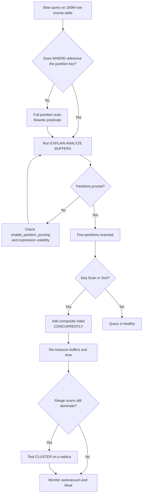

| Difficulty | Channel | Tags |
|---|---|---|
| intermediate | database | explain, query-plan, partitioning |

Imagine a dashboard that loads in 200 ms for one week and 40 seconds for a month. The table has 100 million rows, the date column is partitioned, and every index looks reasonable, yet PostgreSQL still reads far more data than the query needs. Tines hit a much larger version of this problem when its output_payloads table grew to roughly 17TB and began pressing against PostgreSQL's 32TB table limit [1]. The lesson is not to add another index and hope; it is to prove with EXPLAIN that partitioning and indexing are actually doing their jobs.

---

> ### Real-World Case — Tines
>
> Tines' `output_payloads` table in PostgreSQL grew to ~17TB on their largest cluster, rapidly approaching PostgreSQL's 32TB table size limit. Cleanup jobs were timing out, autovacuum was causing heavy I/O pressure and displacing other tables from the buffer cache, forcing them onto more expensive hardware.
>
> | | |
> |---|---|
> | **Challenge** | They needed to partition the massive table to avoid hitting the 32TB write limit and reduce operational pressure, but their initial partitioning strategy couldn't take advantage of partition pruning since their queries couldn't filter on the partition key. Later, multi-level partitioning introduced significant PostgreSQL catalog lookup overhead on one of their highest-read paths (over 1 billion action runs per week). |
> | **Solution** | Tines had to redesign their partitioning approach to align with actual, filterable query patterns to enable pruning, while also accounting for the overhead that multi-level partitioning introduced via `pg_class`/`pg_inherits` catalog lookups on their hot paths. |
> | **Outcome** | They mitigated the risk of hitting the 32TB hard limit, reduced pressure from long-running cleanup and autovacuum jobs, and addressed scalability challenges for a critical, high-throughput event payload path that powers all Tines workflows. |
> | **Lesson** | Partition pruning only works if queries filter directly on the partition key (functions/wrapping the key will break it), and partitioning must be designed around real query patterns. Additionally, multi-level partitioning can introduce substantial catalog-lookup overhead on extremely hot paths even when pruning is working correctly. |

---

## Hook — The Query That Should Have Been Fast

Imagine a dashboard that loads in 200 ms for one week and 40 seconds for a month. The table has 100 million rows, the date column is partitioned, and every index looks reasonable. Yet PostgreSQL still reads far more data than the query needs. That gap between what the schema promises and what the planner actually does is where performance investigations begin.

Tines ran into a much larger version of this problem. Its output_payloads table grew to roughly 17TB on the company's largest PostgreSQL cluster, and the team had to act before the table approached PostgreSQL's 32TB size limit [1]. The fix was not a single index or a clever query hint. It was a disciplined look at how data was physically organized, how cleanup jobs behaved, and how the planner would access data under pressure.

💡 Insight: Partitioning is a promise about which data PostgreSQL can skip. EXPLAIN is how you verify that the promise is being kept.

## Problem — When Partitioning Gives You a False Sense of Security

Partitioning is supposed to turn a 100M-row table into a set of smaller, independent tables. A query for January should touch January's partition and ignore the rest. However, many teams discover that the plan still fans out across dozens of partitions, or that pruning works beautifully and each surviving partition still gets a sequential scan.

The slow query is usually a symptom of three separate failures:

- **Pruning failure:** the predicate does not let the planner eliminate partitions.
- **Index failure:** the right partitions are scanned, but without a usable index.
- **Sort and aggregate pressure:** the query reads the right rows and then spills to disk while sorting or hashing.

There is a fourth, sneakier failure too: stale statistics and autovacuum lag can make a good plan look terrible [8]. PostgreSQL may estimate 50 rows and get 5 million, then choose a nested loop or a sequential scan that made sense only on paper.

⚠️ Watch Out: A fast query on one date range does not prove the schema is healthy. Test the widest range your users actually request, not the narrow slice that fits in cache.

## Real-World Case — Tines

Tines did not start with a mysterious EXPLAIN plan. It started with a physical ceiling. The output_payloads table had reached about 17TB on the largest cluster, and cleanup jobs were timing out while autovacuum created heavy disk pressure [1]. That pressure displaced other tables from the buffer cache, which pushed the team toward more expensive hardware just to keep the same workload alive [1].

The team partitioned the table and reduced the risk of hitting PostgreSQL's 32TB hard limit. The change also eased pressure from long-running cleanup and autovacuum jobs and improved scalability for a high-throughput event payload path that powers every Tines workflow [1]. In other words, the win came from changing how data was stored and maintained, not from rewriting one SELECT statement.

That distinction matters for the 100M-row interview question. The query is the symptom. The storage layout, partition boundaries, index design, and maintenance schedule are the system. When you debug a slow partitioned query, you are debugging all four at once.

This leads to the part most candidates skip: reading the plan as evidence rather than guessing at fixes.

## Deep Dive — Reading the Plan Like a Detective

Start with EXPLAIN (ANALYZE, BUFFERS), not EXPLAIN alone [3][4]. The estimated plan tells you what PostgreSQL intended to do. The actual plan tells you what happened, how long each node took, how many rows each node produced, and how many buffers were touched. BUFFERS is especially useful because it exposes cache misses that timing alone can hide [4].

For a partitioned table, look for the Append node first. A healthy plan scans only the partitions that overlap the date range, and PostgreSQL records how many subplans it removed. If the plan scans every partition, check three things: the WHERE clause must reference the partition key, the expression must not be volatile or wrapped in a function that hides the range, and partition pruning must be enabled [2][10]. A predicate such as WHERE date_trunc('month', event_date) = '2024-01-01' can defeat pruning because the planner cannot map the expression back to partition boundaries.

Here is the plot twist: pruning and indexing are independent wins. A query can prune 99% of partitions and still be slow because each remaining partition performs a sequential scan or an expensive sort. That is why the next question is not 'did pruning work?' but 'what happened inside the partitions that survived?'

Composite indexes are the usual answer, but column order is not arbitrary. B-tree indexes work best when equality predicates come first and range predicates come last [5]. For a query that filters status = 'completed' and a date range, (status, event_date) often gives the tightest access path inside each partition. For queries that rely on the partition key as the primary range filter, (event_date, status) is a strong default. Measure both against real data; do not assume the order from a blog post, including this one.

| Symptom in the plan | Likely cause | First fix |
| --- | --- | --- |
| Append scans every partition | Predicate misses the partition key, uses a volatile expression, or pruning is disabled | Rewrite the predicate; check enable_partition_pruning [10] |
| Sequential Scan inside each partition | No usable index or low selectivity | Add a composite index; run ANALYZE [5] |
| Sort spills to disk | No index matching the ORDER BY, or too many rows | Add an index that provides order; reduce the result set |
| High heap fetches | Visibility map is stale | Review VACUUM and autovacuum settings [8] |
| Huge buffer reads | Too many partitions or cache pressure | Prune earlier; reconsider partition granularity |

Clustering is the next lever, but treat it as a physical layout decision rather than a magic switch. CLUSTER rewrites a table according to an index and takes an exclusive lock while it runs [7]. That can dramatically improve range scans, yet it is a one-time reorganization: later inserts do not maintain the order. For a high-write table, plan the maintenance window and measure the benefit before making it a habit.

🔥 Hot Take: If a query is slow after partitioning, the most expensive mistake is adding another index before proving which partitions were scanned and which access path was chosen. Evidence first, indexes second.

## Workflow — From Slow Query to Pruned Plan

The fix follows a loop, not a checklist. The Mermaid diagram below maps the decision path from a slow query to a verified plan.

1. **Reproduce with production-shaped parameters.** Use the real date range, status values, and tenant filters. A query that is fast for one day may fall off a cliff for a quarter.
2. **Capture the actual plan.** Run EXPLAIN (ANALYZE, BUFFERS, FORMAT JSON) and save the output before changing anything [3].
3. **Confirm pruning.** Inspect the Append node and its subplans. If every partition appears, fix the predicate or the pruning configuration first [2][10].
4. **Inspect access paths.** Count sequential scans, index scans, bitmap scans, sorts, and hash aggregates. Compare estimated rows with actual rows; large gaps point to statistics problems [4].
5. **Add the smallest useful index.** Build it with CREATE INDEX CONCURRENTLY so writes are not blocked [6]. Start with the composite that matches the WHERE clause, then test alternatives.
6. **Re-measure.** Compare execution time, buffers, and rows scanned before and after. If the plan still sorts or spills, address that node directly.
7. **Evaluate clustering.** If range scans dominate and the table is read-heavy, test CLUSTER on a replica or staging copy first [7].
8. **Watch maintenance.** Track autovacuum duration, dead tuples, and cleanup job runtimes. A partitioning change that ignores maintenance simply moves the bottleneck [8][9].

🎯 Key Point: The goal is not a prettier plan. The goal is fewer buffers read, fewer rows processed, and predictable latency at the ranges your users actually query.

## Code Example — Automating the Diagnosis in Python

Automating the first pass turns a subjective hunt into a repeatable check. The Python script below connects with psycopg, runs EXPLAIN (ANALYZE, BUFFERS, FORMAT JSON), walks the plan tree, and reports the signals that matter: sequential scans, sort nodes, partitions scanned, and partitions pruned. It then ensures the composite index exists using CONCURRENTLY so a production table is not locked for writes [6].

The script is intentionally small. It does not try to be a full monitoring platform. It gives you a fast, repeatable way to answer the question 'what is the planner actually doing?' before you reach for another index or a bigger instance. Run it against staging with production-like data, compare the output for a narrow and a wide date range, and keep the JSON plan as evidence for the next review.

## Lessons Learned — What to Do Before the Next 3 A.M. Page

**Partitioning is not optimization by itself.** It is a way to make the optimizer's job easier. If the predicate cannot be pruned, or the surviving partitions cannot be indexed efficiently, the table is still a large table with extra metadata.

**Read the actual plan, not the estimated one.** Estimated rows are a hypothesis; actual rows and buffers are evidence [4]. The gap between them is often the real bug.

**Check pruning before adding indexes.** If PostgreSQL scans every partition, a new index on each partition may make the scan more expensive rather than less [2].

**Column order is a design decision.** Put equality columns before range columns when that matches the query [5]. Then measure. A composite index that looks right in a diagram can lose to a different order on real data.

**Build indexes without downtime.** CREATE INDEX CONCURRENTLY is slower and cannot run inside a transaction block, but it avoids blocking writes on a busy table [6].

**Clustering is a layout choice, not a cron job.** CLUSTER can help range-heavy reads, but it rewrites the table and does not preserve order for future inserts [7]. Treat it as a planned operation.

**Maintenance is part of query performance.** Autovacuum, statistics freshness, and cleanup jobs can dominate latency on large tables [8]. Track them with pg_stat_statements and maintenance logs so the next incident has context [9].

Battle scar to avoid: tuning a query against a warm cache and a narrow date range, then declaring victory. The production query arrives cold, spans a quarter, and touches partitions nobody tested. Always test the widest realistic range and the coldest plausible cache.

---

## Query Optimization Flow

<strong>Original Interview Question</strong>

**Q:** You have a PostgreSQL table with 100M rows partitioned by date. A query filtering on a specific date range is still slow. What would you check in the EXPLAIN plan and how would you optimize it?

**A:** Check partition pruning effectiveness, index utilization patterns, and expensive sort operations. Create composite indexes on (date, filtered_columns) and evaluate clustering strategies for optimal data access.

## Conclusion

Tines' 17TB table is a reminder that PostgreSQL performance is a physical story before it is a query story [1]. The 100M-row interview question is really asking whether you can follow that story: verify partition pruning, inspect the access path inside each surviving partition, add a composite index that matches the predicate, and treat clustering and maintenance as system-level decisions.

Tomorrow, before adding another index, run EXPLAIN (ANALYZE, BUFFERS) and answer three questions: which partitions were scanned, which access path was chosen, and how many buffers were touched? If you can answer those with evidence, you are already ahead of most candidates and most production incidents. The memorable insight to share with your team: partitioning tells PostgreSQL where to look, but EXPLAIN proves whether it actually looked there.

---

## References

1. [Tines incident report](https://www.tines.com/blog/futureproofing-tines-partitioning-a-17tb-table-in-postgresql/) — article
2. [PostgreSQL Documentation: Table Partitioning](https://www.postgresql.org/docs/current/ddl-partitioning.html) — documentation
3. [PostgreSQL Documentation: EXPLAIN](https://www.postgresql.org/docs/current/sql-explain.html) — documentation
4. [PostgreSQL Documentation: Using EXPLAIN](https://www.postgresql.org/docs/current/using-explain.html) — documentation
5. [PostgreSQL Documentation: Multicolumn Indexes](https://www.postgresql.org/docs/current/indexes-multicolumn.html) — documentation
6. [PostgreSQL Documentation: CREATE INDEX](https://www.postgresql.org/docs/current/sql-createindex.html) — documentation
7. [PostgreSQL Documentation: CLUSTER](https://www.postgresql.org/docs/current/sql-cluster.html) — documentation
8. [PostgreSQL Documentation: Routine Vacuuming](https://www.postgresql.org/docs/current/routine-vacuuming.html) — documentation
9. [PostgreSQL Documentation: pg_stat_statements](https://www.postgresql.org/docs/current/pgstatstatements.html) — documentation
10. [PostgreSQL Documentation: Query Planning Configuration](https://www.postgresql.org/docs/current/runtime-config-query.html) — documentation

---

**Author:** Satishkumar Dhule — [GitHub](https://github.com/satishkumar-dhule) · [LinkedIn](https://linkedin.com/in/satishkumar-dhule) · [Website](https://satishkumar-dhule.github.io)
