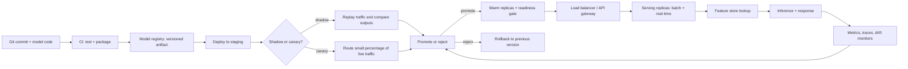

| Difficulty | Channel | Tags |
|---|---|---|
| beginner | devops | mlops, deployment |

At peak, Uber's Michelangelo platform handles roughly 10 million real-time predictions per second—a number that would make most ML teams reach for a second coffee [1]. Yet the platform's real lesson isn't scale; it's the invisible boundary between deploying a model and serving it. Blur that line, and you get a CI/CD pipeline that ships artifacts nobody can query, or an inference API with no safe rollback. Here is how to tell the two apart before your next launch.

---

> ### Real-World Case — Uber
>
> Uber built Michelangelo as an internal ML-as-a-service platform to unify how teams train, deploy, and serve models across ride pricing, ETA prediction, fraud detection, and Uber Eats. As usage exploded, the platform had to support both scheduled batch scoring and low-latency real-time inference for the company's highest-traffic services.
>
> | | |
> |---|---|
> | **Challenge** | Uber needed a clean separation between deployment (packaging, staging, rollout, monitoring of models) and serving (the runtime path that answers prediction requests). The hard part was that the same model artifact had to work in two very different execution modes: Spark batch jobs processing huge datasets, and online containers answering RPC calls with millisecond latency. Naively loading Spark pipelines for online serving added heavy memory and latency overhead. |
> | **Solution** | Michelangelo introduced distinct deployment modes: offline deployment to Spark jobs for batch predictions, online deployment to prediction service clusters behind load balancers for real-time RPC requests, and a library deployment embedded in other services. Models were packed at deploy time and pushed to the appropriate runtime, with feature-store pipelines wired automatically. For online serving, Uber later built lightweight OnlineTransformer interfaces that bypassed Spark SQL's per-request Catalyst planning, cutting native Spark model load time from 8x-44x overhead down to 2x-3x versus their custom format. |
> | **Outcome** | The 2017 platform served over 250,000 predictions per second on its highest-traffic models with P95 latency under 5 ms without feature-store calls and under 10 ms with Cassandra feature lookups. By 2024 Michelangelo managed over 5,000 production models serving 10 million real-time predictions per second at peak, with roughly 20,000 model training jobs monthly. |
> | **Lesson** | Deployment and serving are separate engineering problems: deployment is about safely shipping and monitoring an artifact, while serving is about the runtime's latency, throughput, and scaling characteristics. A model that performs well in batch can be unsuitable for online serving without a serving-specific abstraction, and building that abstraction explicitly is what lets one platform support both. |

---

## Hook — The 5-Millisecond Deadline

The ride request lands at 6:42 p.m. on a rainy Friday. Somewhere in the stack, a pricing model, an ETA model, and a fraud model all need to answer before the spinner disappears. The model is already deployed—the container was built, the artifact was registered, and the dashboards are green. Yet the request still has to travel through routing, feature lookup, batching, inference, and response serialization in under 10 milliseconds [1].

That gap between “it shipped” and “it answered” is where deployment ends and serving begins. Most teams celebrate when the model reaches production. The teams that stay reliable celebrate when they can explain exactly which model version answered a request, how long it took, and how to reverse the change at 2 a.m. Sound familiar?

Here is the uncomfortable part: you can do everything right in deployment and still build a serving system that buckles under its first real traffic spike. The difference is not tooling. It is a mental model.

## Problem — The Two Jobs Teams Keep Merging

Many developers treat deployment and serving as one milestone: the model goes to production, so the work is done. But deployment is the supply chain—CI/CD, infrastructure, artifact versioning, environment promotion, monitoring, and rollback. Serving is the storefront—the runtime path that accepts a request, loads the right model, retrieves features, runs inference, and returns a response within a latency budget.

When those responsibilities blur, the pain shows up in predictable places. A deployment dashboard says the pods are healthy, but p95 latency is climbing. A new model passed staging, but nobody warmed its caches, so the first hundred requests pay a cold-start tax. An incident review asks which model version was live at 14:03, and the answer lives in a Slack thread. This is the operational debt that ML systems accumulate when teams optimize for shipping models instead of operating them [8].

The stakes are higher because ML systems have two failure surfaces: infrastructure and data. A normal service breaks when a pod dies. An ML service can also break when a feature distribution shifts, a model artifact is wrong, or a feature-store lookup slows down [9]. If your deployment pipeline only checks whether the container started, you are monitoring the wrong half of the system. So what should the boundary look like?

## Real-World Case — Uber's Michelangelo

Uber built Michelangelo as an internal ML-as-a-service platform to unify how teams train, deploy, and serve models across ride pricing, ETA prediction, fraud detection, and Uber Eats [1]. That unification mattered because the company did not have one kind of inference. It had scheduled batch scoring and low-latency real-time inference running side by side for some of its highest-traffic services.

The published numbers explain why the deployment-versus-serving distinction is not academic. In 2017, Michelangelo served more than 250,000 predictions per second on its highest-traffic models, with P95 latency under 5 ms without feature-store calls and under 10 ms with Cassandra feature lookups [1]. By 2024, the platform managed more than 5,000 production models serving 10 million real-time predictions per second at peak, alongside roughly 20,000 model training jobs per month [1].

Here is the twist: Uber did not get there by finding one magic model server. It got there by making the handoff between training, deployment, and serving boring, observable, and reversible. The platform had to know which model was active, where its features came from, how much latency the full request path consumed, and how to roll back when a version misbehaved. At that scale, a deployment is not “done” when the artifact ships. It is done when serving can prove the model is healthy under real traffic.

## Deep Dive — Deployment Is the Supply Chain, Serving Is the Storefront

The cleanest way to separate the concepts is to ask what question each one answers. Deployment asks: “Can we ship this model safely, reproducibly, and reversibly?” Serving asks: “Can this request get an answer now, from the right model, within its latency budget?” Those are different contracts, owned by different parts of the lifecycle, even when the same platform team supports both.

| Dimension | Deployment | Serving |
| --- | --- | --- |
| Primary question | Can we ship this safely? | Can this request be answered now? |
| Unit of change | Artifact, config, environment | Model version, route, replica |
| Typical tools | Kubernetes, MLflow, SageMaker | TensorFlow Serving, TorchServe, BentoML |
| Success metric | Reproducible release, clean rollback | p95/p99 latency, throughput, error rate |
| Failure mode | Bad artifact or config reaches production | Slow feature lookup, cold start, saturated queue |
| Cadence | Release-driven | Request-driven, every millisecond |

On the deployment side, Kubernetes Deployments provide declarative rollout and rollback primitives [2], while MLflow tracks experiments and model artifacts so teams can reproduce what was shipped [7]. Managed platforms such as Amazon SageMaker add managed endpoints, model registry features, and deployment controls [10]. These tools answer the supply-chain question: what exactly are we releasing, and how do we undo it?

On the serving side, the runtime is a different animal. TensorFlow Serving specializes in high-performance model inference with versioned servables [4]. TorchServe provides a PyTorch-friendly serving layer with handlers and management APIs [5]. BentoML packages models with their dependencies and exposes production-ready prediction services [6]. API gateways and proxies such as Envoy handle routing, retries, and traffic splitting at the edge [11]. These tools answer the storefront question: which model handles this request, and can it respond fast enough?

🔥 Hot Take: The fastest model server in the world will still produce a slow product if feature retrieval sits outside the timed path. Uber’s sub-10 ms P95 with Cassandra lookups is impressive precisely because the feature path was treated as part of serving, not as an unrelated data problem [1].

The trade-offs are where interviews and production incidents get interesting. Batch inference maximizes throughput and cost efficiency when freshness is not critical; real-time inference minimizes latency but forces you to pay for idle capacity and cold-start protection. Horizontal scaling adds replicas through tools like the Kubernetes Horizontal Pod Autoscaler [3], but it cannot fix a model that is slow per request. Vertical scaling adds GPU memory or CPU, but it cannot fix a routing bug. And every rollout pattern—shadow, canary, blue-green—is really a bet about how much blast radius you can tolerate while learning whether the new version is better.

A useful rule: choose batch when the answer can be precomputed and reused; choose real-time when the answer depends on the request, the user, or the current context. Choose a dedicated model server when you need standard inference performance and version management; choose a custom API when you need tight integration with business logic, feature lookups, or multi-model orchestration. Neither choice removes the need for the other side of the boundary.

## Workflow — From Commit to a Confident Rollback

The flowchart below tells the visual story: deployment moves an artifact from code to a registered, promoted version, while serving turns that version into a request path with health checks, traffic control, and telemetry.

1. **Package and version the model.** Build an immutable artifact and attach a version, training data reference, and evaluation results. If you cannot identify the artifact, you cannot roll it back.
2. **Register it in a model registry.** Treat the registry as the source of truth for what is deployable, not as a nice-to-have experiment log [7].
3. **Deploy to staging first.** Use Kubernetes rollout primitives to validate configuration, resource limits, and startup behavior before production [2].
4. **Exercise the serving path, not just the container.** Send realistic requests through feature lookup, preprocessing, inference, and postprocessing. A healthy pod is not the same as a healthy prediction.
5. **Warm the model and gate readiness.** Load weights, compile kernels if needed, and run a few synthetic inferences before marking the replica ready. Cold starts are a serving problem, not a deployment checkbox.
6. **Shift traffic gradually.** Shadow the new version, then canary a small percentage. Compare latency, error rate, and prediction quality against the incumbent before promoting [3].
7. **Observe and roll back automatically.** Track p95/p99 latency, queue depth, error rate, model version, feature-store latency, and drift signals. If the canary violates its budget, route traffic back to the last known good version [9][10].

The key insight is that deployment and serving share a feedback loop. Deployment decides what is eligible to serve. Serving produces the evidence that decides whether the deployment should continue. Break that loop, and releases become acts of faith.

## Code Example — A Tiny Serving Gateway With Adult Supervision

Here is a deliberately small FastAPI gateway that captures the contract: a versioned model registry, a readiness gate, an explicit active version, and a response header that tells you which model answered [12]. It is not a replacement for BentoML or TorchServe [6]; it is the glue that makes the serving boundary visible in code.

The registry holds immutable model versions. The `/readyz` endpoint returns 503 until an active model exists, which prevents a load balancer from sending traffic to a replica that cannot predict. The `/predict` endpoint accepts an optional version for canary testing and always reports the version it used. The `/admin/activate` endpoint makes promotion an explicit operation instead of an accidental side effect of deployment.

In production, you would add request batching, timeouts around feature lookups, circuit breakers, structured tracing, and authentication on the admin route. The point is not to ship this exact file. The point is to make the boundary concrete: deployment registers and promotes versions; serving selects, executes, and reports them.

## Lessons Learned — What to Do Differently Tomorrow

- **Separate the contracts.** Deployment owns reproducibility, rollout, and rollback. Serving owns routing, latency, throughput, and version selection. Write both down and assign an owner for each.
- **Make the model version observable.** Every prediction response should be traceable to a model version, feature snapshot, and configuration. If an incident review cannot answer “which model answered?”, your serving layer is incomplete.
- **Gate readiness on inference, not process startup.** A pod that is running but cannot load weights or reach the feature store is not ready. Warm the model before sending it traffic.
- **Measure the full request path.** Model inference time is only one number. Track feature lookup, preprocessing, queue wait, inference, and serialization separately [8]. Otherwise you will optimize the wrong stage.
- **Canary the serving behavior, not just the container.** A new version can be healthy at the infrastructure level and worse at the product level. Compare latency, error rate, and prediction quality before full promotion [3].
- **Keep batch and real-time paths distinct.** They have different cost profiles, freshness requirements, and failure modes. Sharing a registry is good; sharing a runtime blindly is how batch jobs starve online traffic.

⚠️ Watch Out: Autoscaling on CPU alone is a classic trap. GPU inference can be queue-bound while CPU utilization looks calm. Scale on the metric that reflects the bottleneck—queue depth, concurrency, or latency—not the metric that is easiest to graph.

💡 Insight: The most memorable lesson from Uber’s Michelangelo is not the 10 million predictions per second. It is that deployment gets the model to production, while serving gets production to the model [1]. Teams that internalize that distinction stop treating a successful release as the finish line and start treating it as the beginning of an operational contract.

---

## Deployment and Serving Pipeline

<strong>Original Interview Question</strong>

**Q:** Explain the key differences between model serving and model deployment in ML systems, including specific technologies, scaling considerations, and real-world implementation patterns?

**A:** Deployment encompasses CI/CD pipelines, infrastructure setup, and monitoring using tools like Kubernetes, MLflow, and SageMaker. Serving focuses on runtime inference APIs with frameworks like TensorFlow Serving, TorchServe, or BentoML, handling request routing, model versioning, and autoscaling. Key trade-offs include latency vs throughput, batch vs real-time inference, and cold start optimization.

## Conclusion

Uber's Michelangelo did not become reliable because it had one perfect model server. It became reliable because the platform made the handoff between deployment and serving boring, observable, and reversible [1]. The moral is simple: deployment gets the model to production, while serving gets production to the model. Tomorrow, draw that boundary explicitly—add a readiness check that depends on inference, stamp every response with a model version, track feature lookup and queue time separately, and practice a rollback before you need one. Your future on-call self will thank you.

---

## References

1. [Uber incident report](https://www.uber.com/blog/michelangelo-machine-learning-platform/) — article
2. [Kubernetes Documentation: Deployments](https://kubernetes.io/docs/concepts/workloads/controllers/deployment/) — documentation
3. [Kubernetes Documentation: Horizontal Pod Autoscaling](https://kubernetes.io/docs/tasks/run-application/horizontal-pod-autoscale/) — documentation
4. [TensorFlow Serving GitHub Repository](https://github.com/tensorflow/serving) — documentation
5. [TorchServe GitHub Repository](https://github.com/pytorch/serve) — documentation
6. [BentoML GitHub Repository](https://github.com/bentoml/BentoML) — documentation
7. [MLflow GitHub Repository](https://github.com/mlflow/mlflow) — documentation
8. [Hidden Technical Debt in Machine Learning Systems](https://arxiv.org/abs/1503.05993) — paper
9. [MLOps - Wikipedia](https://en.wikipedia.org/wiki/MLOps) — documentation
10. [Amazon SageMaker Developer Guide: What Is Amazon SageMaker?](https://docs.aws.amazon.com/sagemaker/latest/dg/whatis.html) — documentation
11. [Envoy Proxy GitHub Repository](https://github.com/envoyproxy/envoy) — documentation
12. [FastAPI GitHub Repository](https://github.com/fastapi/fastapi) — documentation

---

**Author:** Satishkumar Dhule — [GitHub](https://github.com/satishkumar-dhule) · [LinkedIn](https://linkedin.com/in/satishkumar-dhule) · [Website](https://satishkumar-dhule.github.io)
