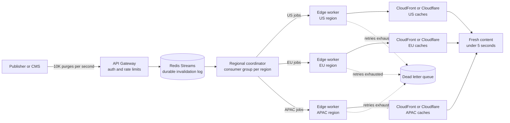

| Difficulty | Channel | Tags |
|---|---|---|
| intermediate | system-design | edge, caching, purging |

Your CEO just published a correction to the pricing page, and somewhere in Sydney a customer is still seeing the old number. The purge command returned 200 OK, the dashboard is green, yet the content is stale, and every second it stays stale grows the support queue. Cloudflare once lived this exact problem at planetary scale: its hub-and-spoke purge system forced requests from places like Australia to cross the Pacific and back before local caches updated [1]. What changed, and what you can copy, is a masterclass in designing cache invalidation for a five-second SLA at 10,000 requests per second.

---

> ### Real-World Case — Cloudflare
>
> Cloudflare's CDN spans 330 cities in 120+ countries, and customers were purging cached content millions of times per day. Its original flexible-purge system used a hub-and-spoke design: purge requests were backhauled to core data centers, then distributed via Quicksilver to every edge. Customers far from a core site, such as those in Australia, waited for a request to cross the Pacific and back before local caches updated.
>
> | | |
> |---|---|
> | **Challenge** | Scale broke the centralized model in three ways: latency depended on distance from the core ingest point, Quicksilver's write throughput became a bottleneck under high purge rates, and every data center had to store purge history long enough to cover its maximum cache eviction age, consuming disk space that could otherwise cache customer content. Cloudflare needed global propagation far below its 5-second target while handling enormous invalidation volume. |
> | **Solution** | Cloudflare rebuilt the system as 'Coreless Purge.' Instead of routing purges through a core, requests are accepted at any data center and distributed peer-to-peer to every machine using Durable Objects, with Consul handling last-mile fan-out inside each data center. Each cache machine runs CacheDB, a Rust service on RocksDB that indexes cached files by URL, hostname, and cache tag. CacheDB also queues pending purge operations and lets the cache proxy reject a matching cached object immediately on a HIT, even before the background process finishes deleting millions of matching files from disk. |
> | **Outcome** | Global purge latency for tags, hostnames, and prefixes dropped from 1,570ms P50 in May 2022 to 149ms P50 in August 2024, a 90.5% improvement, with regional results ranging from 115ms in Western North America to 303ms in Africa. The redesign also cut storage needs by 10x, eliminated the storage cost that scaled with purge throughput, and allowed Cloudflare to open purge-by-tag, hostname, and prefix to non-Enterprise plans. The 5-second SLA is met with roughly 30x headroom. |
> | **Lesson** | The counterintuitive move was abandoning a proven, centralized configuration-distribution system and broadcasting purges everywhere instead of tracking where content lives. Because every edge node can serve any object, maintaining a content-location map adds complexity without value. The real breakthrough came from making purge metadata local and cheap to query, and from letting the cache proxy consult a pending-purge queue on the hot path so invalidation is logically instant even when physical deletion is slow. |

---

## Hook — The 200 OK That Lied

The purge request returned 200 OK. The origin was updated, the tag was invalidated, and the dashboard turned green. Yet customers in Sydney, Singapore, and São Paulo kept seeing the old page.

This is the cruelest failure mode in content delivery: the control plane says success while the data plane keeps serving stale bytes. At 10,000 invalidations per second, one global bottleneck does not just add latency. It turns every deploy, price change, and security takedown into a race against stale data.

The stakes are simple: either freshness propagates within five seconds, or your users act on information you already tried to retract. Cloudflare ran into this exact wall at planetary scale [1], and the way it escaped is a blueprint for anyone building multi-region purge.

## Problem — Invalidation Is a Write Path With a Read Path Problem

Most teams spend months tuning the read path: cache hit ratio, TTLs, origin shielding, compression. Then they bolt on invalidation with a single API call and hope for the best. That works until traffic grows and the purge path becomes the system's most important write operation.

Why is it so hard? Because a purge must beat every read that follows it. With 330 cities and 10,000 invalidations per second, a naive broadcast produces millions of provider calls, hammering APIs and creating a fan-out storm. Each region adds latency, rate limits, and a new failure mode. A hub-and-spoke design makes it worse: a purge from Australia travels to a core data center and back before local caches update.

The non-functional requirements are unforgiving:

- **Latency:** under 5 seconds globally, not just in the provider's home region.
- **Throughput:** 10,000 concurrent invalidations per second.
- **Availability:** 99.99% uptime, even when a provider or region degrades.
- **Consistency:** strong enough that a successful response means the purge will eventually reach every targeted edge.

Here is the trap: TTLs alone can satisfy a 5-second SLA only if every object has a 2-second TTL, which destroys hit ratio and shifts load to the origin [5]. Purging alone can be fast in one region and slow in another. The real problem is coordination. So how do you keep freshness local without losing global guarantees?

## Real-World Case — Cloudflare's Planetary Purge Problem

Cloudflare's CDN spans 330 cities in 120+ countries, and customers were purging cached content millions of times per day [1]. The original flexible-purge system used a hub-and-spoke design: purge requests were backhauled to core data centers, then distributed via Quicksilver to every edge. For customers far from a core site, such as those in Australia, a request had to cross the Pacific and back before local caches updated [1].

The result was a latency tax that no amount of edge caching could hide. Global purge latency for tags, hostnames, and prefixes sat at 1,570ms P50 in May 2022. By August 2024, after redesigning the purge path, it had dropped to 149ms P50, a 90.5% improvement [1]. Regional results ranged from 115ms in Western North America to 303ms in Africa [1].

The redesign did more than make purges faster. It cut storage needs by 10x, eliminated storage cost that scaled with purge throughput, and allowed Cloudflare to open purge-by-tag, hostname, and prefix to non-Enterprise plans [1]. The 5-second SLA is now met with roughly 30x headroom [1].

🔥 **Hot Take:** The breakthrough was not more bandwidth or bigger core data centers. It was moving the decision closer to the edge and changing what had to be stored. That is the plot twist worth stealing.

## Deep Dive — The Trade-Offs Behind a 5-Second Purge

Building on Cloudflare's lesson, the first design decision is where the purge lives. A global broadcast is simple to reason about, but it pays cross-region latency on every request. A regional queue keeps propagation local, but adds coordination. A short TTL avoids purge APIs entirely, but trades freshness for origin load. Most production systems need a blend, not a winner.

| Approach | Strength | Weakness | Best fit |
| --- | --- | --- | --- |
| Global broadcast | Simple mental model | Cross-region latency, huge fan-out | Low purge volume |
| Regional queues | Local propagation, bounded blast radius | More moving parts, reconciliation needed | 10K/sec with a 5s SLA |
| Short TTL only | No purge control plane | Stale until expiry, origin pressure | Tolerant, static content |
| Push purge + 2s TTL | Fast plus a safety net | Double invalidation work | Strict freshness requirements |

**Batching is not optional.** Cloudflare's purge API accepts multiple files per call, and CloudFront invalidation requests have their own limits and cost model [2][3]. If each invalidation triggers one provider call, 10,000 requests per second becomes a rate-limit incident. Batching 100 patterns per call can reduce API costs by roughly 90% while keeping the 5-second budget intact.

**The queue is the coordination layer.** Redis Streams with consumer groups let each region read only its slice of the invalidation log, acknowledge after processing, and recover unacknowledged messages after a worker crash [4]. This is the difference between a broadcast bus and a work queue. The stream is the durable log; the consumer group is the regional cursor. Edge workers, such as Cloudflare Workers, can sit in front of each region to coordinate provider calls and apply local policy [10].

**TTL is a safety net, not the strategy.** A `Cache-Control: max-age=2, must-revalidate` header limits how long a missed purge can hurt you [6]. But it also raises origin traffic. Use it for dynamic content where five seconds is a hard promise, not for every image on the site. RFC 9111 defines the freshness and validation rules that make this contract work across caches [8].

**Retries need jitter.** When a provider throttles, synchronized retries create a second wave of failure. Exponential backoff with full jitter spreads retries across time and is the default recommendation for distributed systems [7]. Pair that with a circuit breaker so a failing region fails fast instead of burning the whole retry budget [9].

💡 **Insight:** The fastest purge is the one that never leaves the region. The safest purge is the one you can prove reached every region. A good design does both.

⚠️ **Watch Out:** Strong consistency at the edge is a budget, not a default. Every guarantee costs latency, API calls, or storage. Decide which one you are willing to pay for.

## Workflow — From Invalidation Request to Fresh Edge

The workflow below turns the trade-offs into an operable pipeline. The flowchart after this section shows the same path visually.

1. **Authenticate at the API gateway.** Validate the tenant, scope the purge to a zone, and apply per-tenant rate limits. A purge is a privileged write; treat it like one.
2. **Write one durable event.** Store the zone, patterns, target regions, and timestamp in a Redis Stream. The event is the source of truth, not the HTTP request that created it.
3. **Partition by region.** Give each region its own consumer group. A worker in Frankfurt should not read a purge targeted only at Sydney, and a worker in Sydney should not wait on Frankfurt.
4. **Deduplicate and batch.** Collapse duplicate patterns, merge jobs for the same zone, and cap each provider call at roughly 100 files. This is where throughput becomes affordable.
5. **Call the provider with a deadline.** Use a 1.5-second timeout per attempt, then retry with exponential backoff and full jitter. Three or four attempts fit inside a five-second SLA if the queue and batching stages stay fast [7].
6. **Acknowledge only after success.** If the provider confirms the purge, ack the message. If retries are exhausted, write to a dead-letter queue and trip the regional circuit breaker [9].
7. **Reconcile continuously.** A 2-second TTL catches missed purges, while a background job compares version markers between origin and edge. Reconciliation is how eventual consistency becomes trustworthy.

The five-second budget is easier to hit when you measure it in pieces: about 200ms at the gateway, 50ms in the queue, 100ms for batching, 300–800ms for the provider call, and 1–2 seconds for edge propagation. That leaves a healthy buffer for retries and regional variance. Without per-stage metrics, a global P50 can hide a 303ms regional tail.

🎯 **Key Point:** The purge path should be regional by default and global only by exception. That single inversion is what gives Cloudflare-style headroom.

## Code Example — A Regional Purge Worker in Python

The code below implements the core loop: one Redis Stream, one consumer group per region, batched provider calls, a timeout, jittered retries, a circuit breaker, and a dead-letter queue. It is intentionally small enough to read in one sitting, but it mirrors the shape of a production worker.

The worker starts by creating a regional consumer group, so each region has an independent cursor into the same durable stream. It then reads up to 100 events at a time with a one-second block, filters for jobs that target its region, and collapses duplicate patterns before calling the provider. The HTTP client uses a 1.5-second timeout, which prevents a single slow provider response from consuming the entire five-second budget. On failure, the worker sleeps for a random fraction of an exponential backoff window, so retries from many workers do not synchronize. After four failed attempts, the job goes to the dead-letter queue and the regional circuit breaker starts counting failures. The final `xack` is deliberate: the message is acknowledged only after the regional attempt has either succeeded or landed in the DLQ. That ordering is the difference between at-least-once delivery and silent data loss.

In production, add structured logs with zone, region, attempt, and latency; emit a metric for purge age at the edge; and run a reconciliation job that samples version markers. The code solves the coordination problem, but observability is what proves the SLA.

## Lessons Learned — What to Steal From the Purge Wars

Cloudflare's 90.5% latency drop is impressive, but the transferable lesson is smaller and sharper: freshness is a regional problem disguised as a global one [1]. Here is what to carry into your next design review.

- **Design the purge path like a write path.** It needs durability, ordering, idempotency, and backpressure. A fire-and-forget API call is not an invalidation system.
- **Regionalize the queue, not just the cache.** A global queue with regional workers still pays coordination costs. A regional queue with a shared durable log keeps the blast radius small.
- **Batch before you scale.** The provider API is the bottleneck, not your application. Deduplicate patterns and batch up to the provider's limit [2][3].
- **Use TTL as a blast-radius limiter.** A 2-second TTL is not a substitute for purging. It is what saves you when a purge message is lost.
- **Retry with jitter, then stop.** Exponential backoff without jitter is a retry storm with extra steps [7]. A circuit breaker and a DLQ are cheaper than an outage [9].
- **Measure the tail by region.** A global P50 hides the customers who wait 303ms in Africa or 1,570ms across the Pacific. Publish P50 and P99 per region.
- **Ack after confirmation.** The 200 OK trap is real: acknowledging before the provider succeeds creates a green dashboard and stale content.

**Battle scars to avoid:** the wildcard purge that accidentally purges the whole zone, the retry storm that takes down the provider API, and the missing DLQ that loses the one invalidation that mattered. Each is preventable with scoped patterns, jitter, and durable failure handling.

If this feels overwhelming, start small. Pick one dynamic content path, give it a 2-second TTL, and instrument purge age end to end. Then add the regional queue. The architecture grows with the evidence.

---

## Global Purge Architecture

<strong>Original Interview Question</strong>

**Q:** How would you design a multi-region CDN cache purging system that guarantees content propagation within 5 seconds while handling 10,000 concurrent invalidations per second?

**A:** Implement Cloudflare API + AWS CloudFront with distributed invalidation queue, edge compute coordination, and 2-second TTL. Use batch invalidation, exponential backoff, and regional cache headers for 5-second SLA.

## Conclusion

Cloudflare's journey from 1,570ms to 149ms did not come from a bigger hammer. It came from moving the purge closer to the edge, batching aggressively, and treating invalidation as a durable, regional workflow [1]. You do not need 330 cities to apply that lesson. You need one queue, one regional worker, one deadline, and one dashboard that tells the truth. Start tomorrow with three moves: tag every purge with its target regions, measure the age of a purge at the edge, and add a dead-letter queue before you need it. Then test a partial provider failure on purpose. The system that survives that drill is the one you can promise a five-second SLA. The memorable insight is simple: a cache purge is a promise, and the edge is where promises are kept. Design for local freshness, and global consistency becomes a consequence instead of a hope.

---

## References

1. [Cloudflare incident report](https://blog.cloudflare.com/instant-purge/) — article
2. [Cloudflare purge cache documentation](https://developers.cloudflare.com/cache/how-to/purge-cache/) — documentation
3. [Amazon CloudFront invalidation documentation](https://docs.aws.amazon.com/AmazonCloudFront/latest/DeveloperGuide/Invalidation.html) — documentation
4. [Redis Streams documentation](https://redis.io/docs/latest/develop/data-types/streams/) — documentation
5. [MDN HTTP caching](https://developer.mozilla.org/en-US/docs/Web/HTTP/Caching) — documentation
6. [MDN Cache-Control header](https://developer.mozilla.org/en-US/docs/Web/HTTP/Headers/Cache-Control) — documentation
7. [Timeouts, retries, and backoff with jitter](https://aws.amazon.com/builders-library/timeouts-retries-and-backoff-with-jitter/) — blog
8. [RFC 9111: HTTP Caching](https://datatracker.ietf.org/doc/html/rfc9111) — documentation
9. [CircuitBreaker](https://martinfowler.com/bliki/CircuitBreaker.html) — blog
10. [Cloudflare Workers documentation](https://developers.cloudflare.com/workers/) — documentation

---

**Author:** Satishkumar Dhule — [GitHub](https://github.com/satishkumar-dhule) · [LinkedIn](https://linkedin.com/in/satishkumar-dhule) · [Website](https://satishkumar-dhule.github.io)
