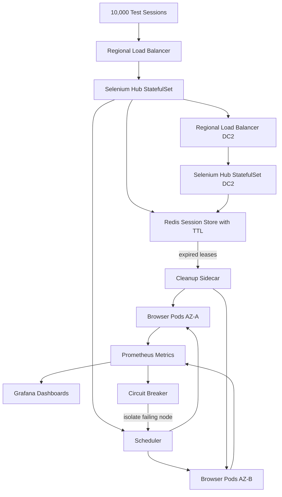

| Difficulty | Channel | Tags |
|---|---|---|
| advanced | system-design | selenium, webdriver, grid |

Expedia Group once ran UI automation on a static, EC2-based Selenium Grid for roughly five years — 100+ hubs pushing about 140,000 tests per day [1]. It worked, until microservices and shift-left testing demanded an ephemeral grid for every pull request, and EC2 hubs took two to four minutes to scale while burning idle capacity around the clock [1]. That gap between "it works" and "it scales on demand without leaking memory or money" is exactly where this story begins. By the end, you will know how to design a grid that handles 10,000 concurrent sessions, survives node failures across data centers, and cleans up after itself like it has a conscience.

---

> ### Real-World Case — Expedia Group
>
> Expedia ran UI automation on a static, EC2-based Selenium Grid for roughly five years, with 100+ hubs executing around 140,000 tests per day. As the company moved to microservices and shift-left testing, teams needed ephemeral grids per pull request, but EC2 hubs took 2–4 minutes to scale nodes and had to be manually stopped and restarted to control cost.
>
> | | |
> |---|---|
> | **Challenge** | Build a Selenium Grid that could dynamically create and destroy hubs and hundreds of browser nodes per CI/CD run, work across multiple AWS accounts with overlapping private IP ranges, avoid resource waste from oversized EC2 instances, and keep browser pods reliable under Kubernetes eviction pressure — all without paying third-party cross-browser vendors for 1,000 parallel connections. |
> | **Solution** | Expedia built 'DA-Kube' on Amazon EKS using Docker, Helm, and Traefik. Each test run gets its own hub and browser pods; Helm scales Chrome/Firefox replicas up and down, and the whole grid is disposable after a run. Traefik routes hostnames to per-hub services so overlapping private IPs across AWS accounts are no longer a problem. They run one browser per pod for predictable autoscaling and reliability, and use Kubernetes Guaranteed QoS (equal CPU/memory requests and limits) so browser pods are less likely to be evicted during resource shortages. |
> | **Outcome** | The containerized grid supported 140,000+ tests per day while cutting infrastructure cost to about $80,000 annually — versus an estimated $2.41 million for 1,000 parallel connections from a third-party cross-browser vendor. Hub/node provisioning dropped from the 2–4 minute EC2 model to on-demand Kubernetes scaling, and disposable hubs removed idle-capacity spend. |
> | **Lesson** | At Selenium Grid scale, the grid itself must be treated as disposable infrastructure: create a hub per workload, run one browser per pod, enforce Guaranteed QoS, and route through a layer like Traefik so the network topology of multiple cloud accounts stops constraining the design. The counterintuitive part is that one browser per pod costs the same or less while being far more reliable than packing many browsers into a node. |

---

## Hook — The 2 A.M. Question Every Test Platform Team Eventually Faces

Picture a dashboard at 2 a.m. Ten thousand browser sessions are supposed to be running. Instead, the queue depth is climbing, three nodes have stopped reporting health, and memory on the largest pool is creeping toward the limit with the quiet persistence of a leak that nobody instrumented. The on-call engineer has two choices: restart everything and lose the in-flight test evidence, or wait and hope the next autoscaling event arrives before the cluster does not.

This is not a hypothetical. It is the natural endpoint of treating Selenium Grid as a pile of long-lived virtual machines. Expedia Group lived that model for about five years, with more than 100 hubs executing roughly 140,000 tests per day [1]. The system was productive, but it was also static: scaling nodes on EC2 took two to four minutes, and hubs had to be manually stopped and restarted to control cost [1]. Speed and cost were pulling in opposite directions.

The uncomfortable truth is that most Selenium Grid outages are not browser failures. They are lifecycle failures. A session finishes, but its Chrome process keeps holding 400 MB. A node dies, but the hub keeps routing work to it. A pull request closes, but its grid keeps running until someone notices the bill. The architecture challenge is therefore not "how do you run Selenium?" It is "how do you make sessions, nodes, and entire grids disposable without making reliability disposable too?"

💡 Insight: The best test infrastructure is boring in the same way a good garbage collector is boring. You should never have to think about it, because it is always thinking about cleanup for you.

## Problem — Static Grids Break at the Exact Moment You Need Them Most

The core problem is a mismatch between demand and capacity. Test demand is bursty and correlated with developer activity: Monday morning, release freezes, and the hour before a demo. Static infrastructure is provisioned for the peak and paid for during the trough. Expedia's EC2 hubs exposed this trade-off clearly — scaling took minutes, and idle hubs stayed alive unless humans intervened [1].

Memory makes the problem worse. A Selenium node is not a stateless HTTP service. Every browser session carries a process tree, temporary profiles, cached assets, and sometimes a driver that forgets to exit. Over hours or days, leaked sessions accumulate. The node still answers health checks, so the orchestrator keeps sending it work, and the failure becomes a slow-motion queue jam rather than a clean crash. Without automatic session lifecycle management, "99.9% uptime" is a slogan, not an invariant.

Multi-data-center operation adds a second dimension. A hub in one region cannot magically route around a network partition or a failed availability zone unless the architecture separates session state from session execution. That separation is what makes graceful node failure recovery possible. It also introduces the hardest question in distributed systems: who owns the truth about whether a session is alive?

Here is the sizing math that turns anxiety into engineering:

- **Throughput:** 10,000 concurrent sessions ÷ 50 sessions per node = 200 nodes minimum.
- **Memory:** 200 nodes × 2 GB = 400 GB baseline; add a 30% buffer and the cluster needs about 520 GB.
- **Latency:** P99 session initiation under 2 seconds through regional load balancing.
- **Availability:** 99.9% uptime allows roughly 43 minutes of downtime per month, which means failover must be automatic rather than heroic.

⚠️ Watch Out: Sizing for exactly 200 nodes is how you get a 201-node incident. The buffer is not waste; it is the difference between a degraded queue and a dead grid.

## Real-World Case — Expedia Group Rebuilds the Grid Around Kubernetes

Expedia Group's engineering team documented a five-year run on a static, EC2-based Selenium Grid with 100+ hubs and roughly 140,000 tests per day [1]. The grid was effective, but the surrounding organization changed. Microservices multiplied, shift-left testing moved feedback earlier, and teams wanted ephemeral grids per pull request rather than a shared monolith of browsers [1]. The old model could not keep up: EC2 hubs needed two to four minutes to scale nodes, and cost control depended on manually stopping and restarting hubs [1].

The rebuild replaced hand-managed EC2 capacity with a containerized grid orchestrated by Kubernetes, Docker, Helm, and Traefik [1]. The results were not marginal. The containerized grid supported 140,000+ tests per day while cutting infrastructure cost to about $80,000 annually — compared with an estimated $2.41 million for 1,000 parallel connections from a third-party cross-browser vendor [1]. Provisioning moved from the two-to-four-minute EC2 model to on-demand Kubernetes scaling, and disposable hubs eliminated idle-capacity spend [1].

The plot twist is that the biggest win was not raw speed. It was the ability to throw the entire grid away after a pull request closed. Ephemeral infrastructure changes the economics of testing because it aligns cost with actual use instead of peak provisioning. That same principle — disposability by default — is what makes 10,000 concurrent sessions survivable at 99.9% uptime.

🔥 Hot Take: The most important reliability feature in Expedia's rebuild was not a smarter hub. It was the willingness to make hubs temporary [1].

## Deep Dive — Designing for Disposability, Not Just Scale

Building on Expedia's experience, the architecture starts with a familiar pattern: a hub receives session requests and browser nodes execute them. The difference is that both layers become Kubernetes workloads with explicit resource contracts. Hubs can run as StatefulSets when stable identity and ordered rollout matter [2], while browser nodes run as autoscaled pods whose count follows queue depth rather than a human's calendar [3].

**Session state belongs in Redis, not in the hub's memory.** Each session gets a key with a TTL. A heartbeat extends the TTL while the test is active; if the test runner disappears, the key expires and a reaper kills the orphaned browser process [6]. This is the mechanism that converts memory leaks from slow disasters into bounded events. Redis expiration is not a backup cleanup strategy — it is the primary lifecycle contract.

**Resource allocation is a reliability feature.** Every node pod gets CPU and memory limits — for example, 1 CPU and 2 GB of RAM — so one runaway browser cannot starve its neighbors [4]. Horizontal pod autoscaling watches queue depth and adds nodes before the backlog becomes a developer-visible outage [3]. The autoscaler itself is only as good as the metrics feeding it, which is why Prometheus scrapes session duration, queue depth, node memory, and restart counts, with Grafana turning those numbers into a story humans can act on [7].

**Health checks must be opinionated.** An HTTP `/status` endpoint every 10 seconds is a start, but three consecutive failures should remove a node immediately. Circuit breakers isolate failing nodes for a 30-second recovery window so the hub stops hammering a pod that is already struggling [9]. Pod Disruption Budgets preserve a minimum of 85% capacity during voluntary disruptions, and taints and tolerations keep noisy workloads away from browser nodes that need predictable memory [5][12].

| Decision | Static EC2 Grid | Kubernetes Ephemeral Grid |
|---|---|---|
| Scale-up time | 2–4 minutes [1] | Seconds to low minutes via autoscaling [3] |
| Idle cost | Paid until manually stopped [1] | Near zero when hubs are disposable |
| Memory leak blast radius | Whole node until restart | One pod, bounded by limits and TTL cleanup [4][6] |
| Failure recovery | Manual or scripted | Health checks, circuit breakers, pod replacement [9] |
| Multi-region | Separate snowflakes | Repeatable manifests per cluster |

The math still matters. At 10,000 sessions and 50 sessions per node, you need 200 nodes, or roughly 520 GB of cluster memory after a 30% buffer. Multi-AZ deployment and regional load balancing keep P99 session initiation under two seconds while allowing one zone to fail without taking the grid down. Managed Kubernetes services such as Amazon EKS reduce control-plane toil, but they do not remove the need for capacity math or Pod Disruption Budgets [11].

🎯 Key Point: 99.9% uptime is not achieved by preventing every failure. It is achieved by making every failure small, detectable, and automatically recoverable.

## Workflow — From Pull Request to Clean Shutdown

Here is the step-by-step workflow that turns the architecture into an operating model. The Mermaid diagram below traces the same journey visually, from incoming sessions through regional hubs, Redis-backed lifecycle tracking, and cleanup sidecars.

1. **A pull request triggers an ephemeral grid.** CI creates a namespace, deploys a hub, and points the test runner at the regional load balancer. No shared grid, no waiting for a static environment.
2. **The hub admits sessions through a queue.** Admission control checks current capacity and rejects or delays requests when the queue exceeds policy, rather than letting latency silently explode.
3. **Redis records the session with a TTL.** The session ID, node URL, creation time, and owner are stored together, and the TTL becomes the authoritative lease [6].
4. **The autoscaler adds browser nodes.** Queue depth drives horizontal pod autoscaling, and new pods join the node pool within seconds rather than minutes [3].
5. **Heartbeats extend active leases.** A healthy test runner refreshes its session TTL. A crashed runner does not, which is exactly the point.
6. **Health checks and circuit breakers isolate bad nodes.** Three failed `/status` probes remove a node, and the circuit breaker prevents the hub from retrying it too quickly [9].
7. **Cleanup sidecars reap stale sessions.** A sidecar compares Redis leases with local browser processes and kills anything without a valid lease.
8. **The namespace is deleted when the pull request closes.** Disposable hubs remove idle spend and eliminate configuration drift between test runs.

Notice that Redis sits at the center of the lifecycle story. The hub can be replaced, nodes can die, and a data center can disappear, but the lease record tells the system what should still be alive. That separation is what prevents split-brain behavior during network partitions and allows leader election to decide which control plane owns reconciliation.

## Code Example — A Session Lease Manager That Cleans Up After Itself

The following Python example implements the heart of the design: a session lease manager backed by Redis. It acquires a WebDriver session, stores a TTL-bound lease, extends the lease on heartbeat, releases cleanly, and reaps orphaned sessions whose leases have disappeared. The key design decision is that Redis owns the truth about liveness, while the browser node merely executes.

The explanation after the code walks through each section, including why the reaper checks TTL rather than trusting the local process list alone.

## Lessons Learned — What Actually Keeps 10,000 Sessions Alive

The journey from static EC2 hubs to a disposable Kubernetes grid is less about adopting containers and more about adopting a lifecycle mindset. Expedia's results show what becomes possible when provisioning drops from minutes to seconds and idle capacity disappears [1]. Here are the lessons that matter when you apply the same pattern to a 10,000-session system.

- **Treat every session as a lease, not a process.** If liveness is inferred from a local process list, leaked browsers will eventually look healthy. If liveness is a TTL-backed lease, expired sessions become impossible to hide.
- **Make cleanup independent of the happy path.** The reaper must run even when the test runner crashes, the hub restarts, or the node loses network. Redis TTL plus a scheduled reconciliation loop gives you that independence.
- **Budget for buffer, not just peak.** The 200-node calculation is a starting point, not a target. A 30% memory buffer and Pod Disruption Budgets are what keep a single zone failure from becoming a global outage [5].
- **Instrument the boring metrics.** Queue depth, session duration, node memory, pod restarts, and circuit-breaker trips tell you more about reliability than any dashboard full of green checkmarks [7].
- **Test the failure paths.** Kill a node during a test run. Expire a lease manually. Partition a region. If the system only works when nothing goes wrong, it does not work at scale.

⚠️ Watch Out: The most common battle scar is a cleanup script that only runs on success. If the test runner crashes before calling `release`, that browser process survives until someone notices. The reaper is not optional.

💡 Insight: Circuit breakers are not just for microservices. A Selenium hub that keeps retrying a wedged node is a distributed system making the same mistake as an API client hammering a failing dependency [9].

The transformation is ultimately cultural. Teams that expect infrastructure to be permanent build snowflakes and pay for them. Teams that expect infrastructure to be disposable build feedback loops and pay for what they use. Expedia's shift to ephemeral hubs is a concrete example of that cultural change producing a measurable financial result [1].

So what should you do differently tomorrow? Start by adding TTL-based session leases and a reaper to your current grid, even if it still runs on VMs. Then move one non-critical test suite to an ephemeral Kubernetes namespace and measure provisioning time, cost, and orphaned-session count. You do not need 10,000 sessions to benefit from the pattern. You need one leaked browser and a dashboard that cannot explain it.

---

## Ephemeral Selenium Grid on Kubernetes

<strong>Original Interview Question</strong>

**Q:** Design a scalable Selenium Grid architecture to handle 10,000 concurrent test sessions with 99.9% uptime, ensuring zero memory leaks through automatic session lifecycle management, real-time monitoring, and graceful node failure recovery across multiple data centers?

**A:** Deploy Kubernetes cluster with auto-scaling node pools, Redis session store with TTL policies, Prometheus metrics for memory monitoring, circuit breakers for node isolation, and sidecar containers for session cleanup. Implement health checks, resource quotas, and rolling updates.

## Conclusion

Expedia Group did not fix its Selenium Grid by making hubs smarter or nodes bigger. It fixed the grid by making the whole thing disposable [1]. That same principle scales to 10,000 concurrent sessions: put session leases in Redis with hard TTLs [6], let Kubernetes autoscale browser pods from queue depth [3], isolate failing nodes with health checks and circuit breakers [9], and schedule a reaper that assumes the happy path will fail. Start small tomorrow by adding TTL-backed leases and a reaper to the grid you already have. The memorable insight worth sharing with your team is simple: if your test infrastructure cannot be deleted without losing anything important, it cannot be trusted at scale.

---

## References

1. [Expedia Group incident report](https://medium.com/expedia-group-tech/da-kube-selenium-grid-using-kubernetes-docker-helm-and-traefik-856b802d1d08) — article
2. [Kubernetes Documentation: StatefulSets](https://kubernetes.io/docs/concepts/workloads/controllers/statefulset/) — documentation
3. [Kubernetes Documentation: Horizontal Pod Autoscaling](https://kubernetes.io/docs/tasks/run-application/horizontal-pod-autoscale/) — documentation
4. [Kubernetes Documentation: Resource Management for Pods and Containers](https://kubernetes.io/docs/concepts/configuration/manage-resources-containers/) — documentation
5. [Kubernetes Documentation: Disruptions](https://kubernetes.io/docs/concepts/workloads/pods/disruptions/) — documentation
6. [Redis Documentation: EXPIRE](https://redis.io/docs/latest/commands/expire/) — documentation
7. [Prometheus Documentation: Overview](https://prometheus.io/docs/introduction/overview/) — documentation
8. [Selenium Documentation: Grid](https://www.selenium.dev/documentation/grid/) — documentation
9. [Circuit Breaker Design Pattern](https://en.wikipedia.org/wiki/Circuit_breaker_design_pattern) — article
10. [Kubernetes Autoscaler Repository](https://github.com/kubernetes/autoscaler) — documentation
11. [Amazon EKS User Guide: What Is Amazon EKS?](https://docs.aws.amazon.com/eks/latest/userguide/what-is-eks.html) — documentation
12. [Kubernetes Documentation: Taints and Tolerations](https://kubernetes.io/docs/concepts/scheduling-eviction/taint-and-toleration/) — documentation

---

**Author:** Satishkumar Dhule — [GitHub](https://github.com/satishkumar-dhule) · [LinkedIn](https://linkedin.com/in/satishkumar-dhule) · [Website](https://satishkumar-dhule.github.io)
