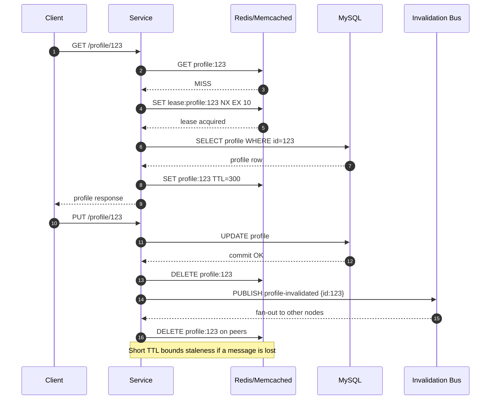

| Difficulty | Channel | Tags |
|---|---|---|
| beginner | backend | redis, memcached, cache-invalidation |

At Facebook, a single profile edit could ripple through thousands of memcached servers spread across frontend clusters and regions, leaving some users staring at yesterday's data while others saw the update instantly [1]. The system was fast, massively distributed, and quietly fighting stale sets, thundering herds, and cross-region invalidation delays. Facebook eventually cut peak database query rates for herd-prone keys from 17,000 per second to 1,300 per second using leases and batched invalidations [1]. Here is what that battle teaches every developer building a user profile service.

---

> ### Real-World Case — Meta (Facebook)
>
> Facebook used memcached as a massive look-aside cache for user and social-graph data spread across many frontend clusters and regions. When authoritative data changed in MySQL, the cache had to be invalidated everywhere, but concurrent reads and writes produced stale sets, thundering herds, and cross-cluster invalidation delays.
>
> | | |
> |---|---|
> | **Challenge** | Keeping a distributed memcached tier consistent with the database at enormous scale without overloading the databases or serving indefinitely stale data. Naive invalidation from web servers caused excessive packet rates and offered little recourse when deletes were misrouted. |
> | **Solution** | Facebook introduced a commit-log-based invalidation pipeline: database daemons called mcsqueal extracted deletes from committed SQL and broadcast them through mcrouter instances in each frontend cluster. They also added memcached leases—64-bit tokens issued on cache misses—to prevent stale sets and coalesce thundering herds, deliberately favoring deletes over sets and allowing brief stale reads where acceptable. |
> | **Outcome** | Leases reduced peak database query rate for thundering-herd-prone keys from 17K/s to 1.3K/s. Batching invalidations through mcsqueal improved the median number of deletes per packet by 18x, and Facebook found only 4% of issued deletes actually invalidated cached data. The design let Facebook scale memcached across clusters and regions while bounding staleness. |
> | **Lesson** | Cache invalidation is not just delete-the-key: concurrent reordering creates stale sets, and hot keys create thundering herds. Lease tokens, delete-based invalidation, and batched commit-log propagation are practical mechanisms, and accepting brief bounded staleness is often the right trade-off. |

---

## Hook — The Profile Update That Would Not Stick

Picture a user changing their display name, hitting save, and refreshing the page. The database says the write succeeded. The cache on one frontend cluster says otherwise. Multiply that mismatch by millions of users and thousands of cache nodes, and you have one of the most quietly brutal problems in backend engineering: cache invalidation at scale.

Facebook lived this reality with memcached as a massive look-aside cache for user and social-graph data [1]. When authoritative data changed in MySQL, the cache had to be invalidated everywhere. But concurrent reads and writes produced stale sets, thundering herds, and invalidation delays that made "fast" and "correct" feel like enemies.

The stakes are simple: stale profiles erode trust, herd-driven database spikes take down services, and cross-cluster delays turn a five-minute bug into a multi-hour incident. Sound familiar?

## Problem — Why Cache Invalidation Breaks at Scale

Cache invalidation is hard because a cache is a copy, and every copy can disagree with the source of truth at a different moment [2]. A profile update is not one operation; it is a sequence: write to the database, delete or refresh the cache, and hope no concurrent read repopulates the old value in between.

That race is the heart of the problem. A read misses the cache, fetches the old profile from the database, and then writes it back after the update has already invalidated the key. Now the cache is serving stale data with a fresh TTL. Many developers assume a delete is enough, until they watch a read repair resurrect the past.

On top of that, hot keys create thundering herds [7]. When a popular profile expires, hundreds of application servers miss simultaneously and stampede the database. The cache was supposed to protect the database; instead, it becomes the trigger for a traffic spike. Facebook saw this pattern clearly enough to build request coalescing and leases into its caching stack [1].

The question is not whether to cache profiles. The question is how to invalidate them without trading correctness for speed.

## Real-World Case — Meta (Facebook) and the Memcached Invalidation Problem

Facebook's memcached deployment was not a side cache. It was a core part of the read path for user and social-graph data, distributed across many frontend clusters and regions [1]. When MySQL changed, every relevant cache copy needed to be invalidated. That is a distributed systems problem disguised as a delete call.

The team observed three recurring failures. First, stale sets appeared when reads raced with writes. Second, thundering herds hammered the database when popular keys expired. Third, cross-cluster invalidation took time, so different regions could serve different versions of the same profile.

Facebook's response combined leases and batched invalidation. Leases reduced peak database query rates for thundering-herd-prone keys from 17,000 per second to 1,300 per second [1]. Batching invalidations through mcsqueal improved the median number of deletes per packet by 18 times [1]. Perhaps the most humbling finding: only 4% of issued deletes actually invalidated cached data [1]. In other words, most invalidation traffic was wasted work. The design ultimately let Facebook scale memcached across clusters and regions while bounding staleness [1].

That 4% statistic is the plot twist. Efficient invalidation is not just about deleting faster; it is about deleting smarter and knowing when a delete is even necessary.

## Deep Dive — Write-Through, Cache-Aside, and the Redis vs Memcached Trade-off

For a user profile service, two patterns dominate. Cache-aside means the application reads from the cache first, loads from the database on a miss, and populates the cache. Write-through means the application writes to the database and the cache together, usually with a TTL as a safety net. Facebook's system was fundamentally look-aside, which is another name for cache-aside [1][3].

Write-through sounds cleaner, but it has a subtle cost: every write now depends on cache availability. If the cache is down, does the profile update fail? That coupling is often unacceptable. A common production compromise is to write the database first, then delete the cache key, and let the next read repopulate it. Deleting instead of updating avoids some race conditions and keeps the cache from holding a value derived from a transaction that later rolls back.

TTL is your fallback, not your strategy. A 5-to-30-minute TTL for profiles bounds staleness, but it does not prevent a concurrent read from caching an old value after a write. That is why serious systems combine short TTLs with explicit invalidation and some form of request coalescing.

Here is the trade-off in practical terms:

| Concern | Redis | Memcached |
| --- | --- | --- |
| Distributed invalidation | Pub/sub and keyspace notifications make it easier [4] | Requires external coordination or manual fan-out [5] |
| Data structures | Rich structures such as hashes, sorted sets, and streams [4] | Simple key-value cache [5] |
| Persistence | Optional persistence and replication [4] | Designed as volatile memory cache [5] |
| Operational simplicity | More features, more knobs | Minimal and predictable |
| Memory efficiency | Strong, but feature overhead exists | Often lower overhead for pure caching |

Redis is the better fit when invalidation is complex, when durability matters, or when teams need pub/sub to broadcast changes [4]. Memcached remains attractive when the workload is simple, horizontal scaling is straightforward, and lower memory overhead matters more than advanced features [5]. The trap is choosing Memcached for raw speed and then rebuilding half of Redis on top of it.

🔥 Hot take: The cache technology matters less than the invalidation protocol. A disciplined Memcached deployment with leases and batched deletes can beat a naive Redis deployment with random deletes and long TTLs.

## Workflow — A Safer Invalidation Flow for Profile Updates

The workflow below combines cache-aside reads, database-first writes, explicit key deletion, pub/sub fan-out, and a lease to prevent stampedes. The sequence diagram shows the happy path and the race that teams must design around.

1. A read request checks the cache for profile:123.
2. On a miss, the service attempts to acquire a short lease for that key.
3. The lease owner loads the profile from the database and populates the cache with a TTL.
4. Concurrent readers wait briefly, recheck the cache, or fall back to a bounded database read.
5. An update writes the new profile to the database.
6. The service deletes the cache key and publishes an invalidation event.
7. Other nodes receive the event and delete their local or cluster-level copy.
8. TTL remains as the final safety net if an invalidation message is lost.

The order matters. Writing to the database before deleting the cache ensures the cache never advertises a value that the database rejected. Publishing after deletion gives other nodes a chance to converge. The lease prevents a hundred concurrent misses from becoming a hundred database queries.

⚠️ Watch Out: If the process crashes between the database write and the cache delete, the TTL is the only thing saving you. Keep TTLs short for mutable profile data and monitor invalidation lag.

## Code Example — Cache-Aside with Leases and Pub/Sub Invalidation in Python

The example below uses Redis for both caching and invalidation broadcast. The read path implements a lease so only one worker rebuilds a missing key, while the write path deletes the key and publishes an invalidation event. The database is simulated with a dictionary so the flow stays readable, but the pattern maps directly to a real profile service.

Key design decisions:

- The lease uses SET NX with an expiry, so a crashed worker cannot block the key forever.
- The update path writes the database first, then deletes the cache, then publishes.
- The listener deletes the key on every node that receives the invalidation event.
- The TTL is the safety net, not the primary invalidation mechanism.
- The fallback read is bounded in a real system with a timeout and a circuit breaker.

This is deliberately not a toy: it is the same shape Facebook described, reduced to a single service [1]. The difference at Facebook scale is that leases and batched invalidation become mandatory infrastructure rather than a helper function [1].

## Lessons Learned — What to Do Differently Tomorrow

The Facebook memcached story is not a story about memcached. It is a story about treating invalidation as a protocol, not a line of code [1]. Here are the lessons that matter for a profile service.

- **Delete, then let reads repopulate.** Updating the cache in place invites races and stale derived values. Delete the key after the database write, and rely on cache-aside for the next read.
- **Use short TTLs for mutable data.** A 5-to-30-minute TTL bounds staleness without turning the cache into a second database [2].
- **Add leases or request coalescing.** Thundering herds turn a cache miss into a database outage [7]. Facebook's lease work reduced peak query rates by more than 90% for herd-prone keys [1].
- **Batch and deduplicate invalidations.** Only 4% of Facebook's deletes actually invalidated cached data [1]. Blind fan-out is expensive; measure what your invalidations accomplish.
- **Choose Redis when invalidation coordination matters.** Pub/sub and richer data structures simplify distributed invalidation [4]. Choose Memcached when the workload is simple and memory efficiency wins [5].
- **Monitor hit rate, invalidation lag, and database QPS.** A high hit rate with high staleness is not success. Track the age of cached profiles and the time between database commit and cache convergence.
- **Remember HTTP caching has the same rules.** RFC 7234 formalizes freshness and validation for shared caches [8], and the same thinking applies inside your service.

The memorable insight: your cache is a distributed agreement, and every invalidation is a message that must eventually win. Design the message, not just the delete.

---

## Cache Invalidation Sequence

<strong>Original Interview Question</strong>

**Q:** You're building a user profile service that caches frequently accessed profiles. How would you implement cache invalidation when a user updates their profile, and what trade-offs would you consider between Redis and Memcached?

**A:** Implement write-through caching with TTL-based expiration. On profile update, invalidate the cache by deleting the key and writing new data to both the database and cache. Redis offers pub/sub for automatic distributed invalidation, while Memcached requires manual coordination across nodes.

## Conclusion

The Facebook memcached story ends with a deceptively simple moral: a fast cache is easy, but a trustworthy cache is a distributed protocol [1]. Tomorrow, when you add or review cache invalidation for a profile service, start by writing down the order of operations, the race conditions, and what happens when a message is lost. Use database-first writes, delete rather than update, keep TTLs short for mutable data, and add leases for hot keys. Then measure invalidation lag and database QPS, not just hit rate. Share this one insight with your team: your cache is only as correct as the invalidation messages that reach every copy.

---

## References

1. [Meta (Facebook) incident report](https://www.usenix.org/system/files/conference/nsdi13/nsdi13-final170_update.pdf) — article
2. [Cache invalidation](https://en.wikipedia.org/wiki/Cache_invalidation) — documentation
3. [Memcached](https://en.wikipedia.org/wiki/Memcached) — documentation
4. [Redis](https://en.wikipedia.org/wiki/Redis) — documentation
5. [Memcached project wiki](https://github.com/memcached/memcached/wiki) — documentation
6. [Redis source repository](https://github.com/redis/redis) — documentation
7. [Thundering herd problem](https://en.wikipedia.org/wiki/Thundering_herd_problem) — documentation
8. [RFC 7234: HTTP Caching](https://datatracker.ietf.org/doc/html/rfc7234) — documentation

---

**Author:** Satishkumar Dhule — [GitHub](https://github.com/satishkumar-dhule) · [LinkedIn](https://linkedin.com/in/satishkumar-dhule) · [Website](https://satishkumar-dhule.github.io)
