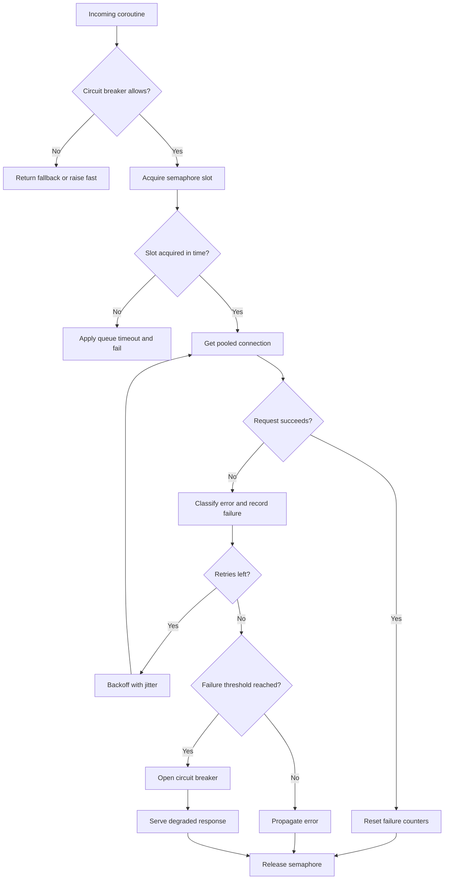

| Difficulty | Channel | Tags |
|---|---|---|
| advanced | backend | asyncio, aiohttp, concurrency |

At Netflix, more than a billion API calls a day fanned out sixfold to backend systems, and a single slow dependency could exhaust every shared request thread in seconds [1]. The lesson is brutal: concurrency without backpressure turns a small delay into a platform-wide outage. The same failure mode is waiting inside your aiohttp service, where an unbounded pool and optimistic retries can amplify one shaky dependency into a storm. Here is how to build a pool that degrades on purpose instead of collapsing by accident.

---

> ### Real-World Case — Netflix
>
> The Netflix API handled more than 1 billion incoming calls per day, fanning out roughly 6x to several billion outgoing calls across dozens of backend subsystems, with peaks over 100,000 dependency requests per second on thousands of EC2 instances. A single slow or failing dependency could saturate all shared Tomcat request threads within seconds and take down the entire API, even when every other dependency was healthy.
>
> | | |
> |---|---|
> | **Challenge** | Prevent one latent dependency from consuming the whole connection/thread pool and cascading into a total outage. Naive retries and hung connections made things worse: they kept pounding failing systems, delayed recovery, and turned partial failures into cluster-wide failures. Netflix calculated that 30 dependencies each at 99.99% availability would yield only 99.7% overall uptime — over 2 hours of downtime per month — before any cascading effects. |
> | **Solution** | Netflix built Hystrix, which combined bounded per-dependency resources with fast failure: network timeouts, separate thread pools per dependency, semaphores acquired with a non-blocking tryAcquire, and circuit breakers that tripped at thresholds such as a 50% error rate over a 10-second window. When a pool or semaphore was full, requests were rejected immediately rather than queued. Open circuits short-circuited calls and returned fallbacks, deliberately shedding load so the failing dependency could recover. Semaphore isolation was used for very high-volume calls, while thread isolation protected against latency for network-bound calls. |
> | **Outcome** | Hystrix grew to execute tens of billions of thread-isolated and hundreds of billions of semaphore-isolated calls per day at Netflix. In one production simulation, injecting 125-1500+ ms of latency into a dependency that normally had a ~15-20 ms median and 120-130 ms p99.5 produced up to ~5,000 fallbacks per second while exceptions reaching users stayed around ~1 per second. In a real single-dependency latency incident, circuit breakers tripped across about one-third of the cluster, releasing pressure on the backend while the other circuits stayed healthy — users received degraded but functional responses instead of an outage. |
> | **Lesson** | Graceful degradation is not about queueing and waiting longer; it is about bounding concurrency and failing fast. A non-blocking semaphore plus a circuit breaker converts a cascading outage into controlled load shedding, and per-dependency isolation ensures one bad downstream service cannot consume the resources needed by every other request. |

---

## Hook — Your Pool Is One Slow Dependency Away From Collapse

Picture a fleet of aiohttp workers at 2 a.m. Every instance is healthy, every dashboard is green, and every connection is busy. Then one downstream service starts answering in 800 ms instead of 20 ms.

Nothing explodes immediately. That is the trap. Requests queue behind a semaphore, retries multiply the load, and each waiting coroutine holds memory and a socket slot. Within seconds, healthy dependencies are starved because the pool is full of calls waiting on the sick one.

The pool did not fail because traffic doubled. It failed because nothing inside it knew when to stop, when to back off, or when to return a degraded answer instead of piling on. That distinction is the difference between an incident and an outage.

## Problem — When Backpressure Becomes a Domino Effect

A connection pool is often treated as a simple gate: allow N requests at a time and hope for the best. In production, that gate is only one part of the system. The connector limit controls sockets, the semaphore controls coroutines, the timeout controls how long a bad dependency can hold a slot, and the retry policy controls how much extra traffic you create when things go wrong [2].

When those controls are missing or mismatched, three failures appear together. First, slow responses consume capacity longer than expected, so the queue grows. Second, retries add fresh requests to an already saturated dependency. Third, error propagation becomes noisy: one timeout becomes a burst of exceptions, and every caller retries at the same moment.

Many developers discover this the hard way: `TCPConnector(limit=100)` does not protect your event loop from 10,000 waiting coroutines. It only limits open connections. Without a semaphore, an explicit timeout, and a failure policy, the pool still becomes a shock absorber that eventually bottoms out. The question is not whether your pool has a limit. The question is whether that limit creates useful backpressure or just a longer line.

## Real-World Case — Netflix and the 100,000 Requests per Second Lesson

Netflix operated an API that handled more than 1 billion incoming calls per day and fanned out roughly six times to several billion outgoing calls across dozens of backend subsystems [1]. Peaks exceeded 100,000 dependency requests per second across thousands of EC2 instances. At that scale, a single slow or failing dependency could saturate all shared Tomcat request threads within seconds and take down the entire API, even when every other dependency was healthy [1].

The response was Hystrix, which grew to execute tens of billions of thread-isolated and hundreds of billions of semaphore-isolated calls per day [1]. In one production simulation, injecting 125–1500+ ms of latency into a dependency that normally had a ~15–20 ms median and 120–130 ms p99.5 produced up to ~5,000 fallbacks per second, while exceptions reaching users stayed around ~1 per second [1]. In a real single-dependency latency incident, circuit breakers tripped across about one-third of the cluster, releasing pressure on the backend while the other circuits stayed healthy [1].

That last detail matters. Users received degraded but functional responses instead of an outage. The system did not pretend everything was fine. It made a deliberate trade: protect the healthy majority by isolating the failing minority.

## Deep Dive — The Three Levers: Concurrency, Retries, and Circuit Breaking

The first lever is concurrency. A semaphore is the right primitive because it bounds the number of coroutines allowed into a critical section, not just the number of sockets [4]. Pair it with an aiohttp connector limit so you have two aligned boundaries: one for coroutines and one for TCP connections. When those numbers drift apart, you get either idle sockets or a queue of coroutines waiting for sockets.

The second lever is time. aiohttp exposes connect, socket-read, and total timeouts through `ClientTimeout` [3]. A total timeout alone is often too blunt because it hides whether the connection stalled during DNS, TLS, or response streaming. Python also provides explicit timeout scopes for surrounding asynchronous work [5]. Use both layers: aiohttp timeouts for the HTTP exchange and an outer timeout for the whole operation, including retries.

The third lever is failure policy. Exponential backoff with jitter prevents synchronized retry storms [7], while a circuit breaker stops calling a dependency that is clearly unhealthy [6]. The breaker has three states: closed, open, and half-open. Closed means traffic flows. Open means fail fast. Half-open means allow a small probe to decide whether recovery is real.

| Strategy | What it protects | What it does not solve |
|---|---|---|
| Semaphore only | Event loop and local capacity | Retry storms, slow dependency isolation |
| Connector limit only | Socket count | Queue growth from waiting coroutines |
| Retries only | Transient failures | Cascading overload |
| Circuit breaker only | Failing dependency | Local concurrency limits |
| Semaphore + breaker + backoff | Capacity, blast radius, recovery | Nothing, but it needs tuning |

💡 Insight: The semaphore protects your process. The circuit breaker protects your dependency and your users. You need both because they solve different failure modes.

## Workflow — From Incoming Request to Graceful Fallback

The request lifecycle should be boring in the best way. A coroutine arrives, asks the circuit breaker whether the dependency is currently trusted, then waits for a semaphore slot. Only after acquiring that slot does it touch a pooled connection. If the request succeeds, failure counters reset. If it fails, the error is classified, the breaker records the failure, and a retry may follow with exponential backoff and jitter.

The diagram below traces that path, including the two exits that matter most: fast failure when the circuit is open and a degraded response when retries are exhausted. Notice that the semaphore is released in every path. That single discipline prevents the slowest, most frustrating bug in pool management: capacity that disappears one leaked slot at a time.

1. Check the circuit breaker before spending a semaphore slot.
2. Acquire the semaphore with a bounded wait, not forever.
3. Reuse a pooled connection through the shared `ClientSession`.
4. Apply connect, read, and total timeouts to every exchange [3].
5. Retry only idempotent or explicitly safe operations, with jitter [7].
6. Open the breaker after repeated failures and serve a fallback [6].

⚠️ Watch Out: Retrying a non-idempotent POST can duplicate side effects. The safest default is to retry GET, HEAD, and explicitly idempotent operations only.

## Code Example — A Production-Shaped aiohttp Pool Manager

The implementation below combines a semaphore, a three-state circuit breaker, a bounded connector, explicit timeouts, and jittered exponential backoff. It is intentionally small enough to read in one sitting, but it includes the pieces that prevent the Netflix-style cascade: fast failure, bounded concurrency, and clean shutdown.

The key design choice is ordering. The breaker check happens before the semaphore so an open circuit refuses work immediately instead of making callers wait for a slot they cannot use. The semaphore wraps the retry loop so one logical request consumes one slot even when it retries internally. That prevents retries from multiplying local concurrency beyond the configured limit.

Another important detail is cleanup. The session and connector are closed through an async context manager, which avoids the leak that appears when workers restart under load and old sockets remain half-open. The code is illustrative, but the structure maps directly to production services.

## Lessons Learned — What Survives the Next Traffic Spike

Netflix's experience shows that the hardest part of resilience is not adding a retry. It is deciding what should happen when retries are no longer useful [1]. A pool that only knows how to wait will eventually wait forever. A pool that knows how to fail fast, isolate, and recover buys the rest of the system time to breathe.

Here are the battle scars worth remembering:

- Set a timeout for every phase of the request. A total timeout without a connect timeout hides the difference between a dead host and a slow response [3].
- Bound both coroutines and connections. A connector limit without a semaphore is not backpressure [2].
- Add jitter to retries. Synchronized retries turn a brief blip into a self-inflicted DDoS [7].
- Treat the circuit breaker as a state machine, not a counter. Half-open probes are how recovery is verified [6].
- Close sessions and connectors on shutdown. Leaked connections look like capacity loss and behave like a memory leak [8].
- Measure fallback rate, queue depth, breaker state, and p99 latency. Throughput alone will tell you the system is busy, not whether it is healthy.

🎯 Key Point: Graceful degradation is a product decision expressed in code. The fallback should be useful, cheap, and honest about what is missing.

HTTP semantics also matter here. Retry safety depends on method semantics and idempotency, not on optimism [9]. A pool manager that ignores that distinction can protect availability while quietly corrupting business state.

---

## Request Lifecycle and Degradation Path

<strong>Original Interview Question</strong>

**Q:** How would you implement a connection pool manager for aiohttp that handles graceful degradation under high load and connection timeouts?

**A:** Implement a connection pool manager for aiohttp using a semaphore to limit concurrent connections, exponential backoff for retrying failed requests, and circuit breaker pattern to gracefully degrade under high load and connection timeouts.

## Conclusion

Netflix's hardest lesson was not that dependencies fail. It was that a system without deliberate degradation will sacrifice every healthy dependency to save one sick one [1]. The fix is not a single clever library. It is a set of boundaries: a semaphore that limits local concurrency, timeouts that cap how long a bad dependency can hold a slot, backoff that prevents retry storms, and a circuit breaker that decides when waiting is no longer useful [4][6][7].

Start tomorrow by adding one missing boundary to your aiohttp client. If you already have a semaphore, add explicit timeouts. If you already have timeouts, add jittered retries. If you already retry, add a breaker and a fallback that your product team agrees is acceptable. Then instrument queue depth, fallback rate, and breaker state before the next peak arrives. The memorable insight is simple: a resilient pool is not the one that never fails. It is the one that fails in a shape the rest of your system can survive.

---

## References

1. [Netflix incident report](https://netflixtechblog.com/fault-tolerance-in-a-high-volume-distributed-system-91ab4faae74a) — article
2. [aiohttp client advanced usage: connectors and limits](https://docs.aiohttp.org/en/stable/client_advanced.html) — documentation
3. [aiohttp client reference: ClientTimeout and sessions](https://docs.aiohttp.org/en/stable/client_reference.html) — documentation
4. [Python asyncio synchronization primitives: Semaphore](https://docs.python.org/3/library/asyncio-sync.html) — documentation
5. [Python asyncio task timeouts and cancellation](https://docs.python.org/3/library/asyncio-task.html) — documentation
6. [Martin Fowler: CircuitBreaker](https://martinfowler.com/bliki/CircuitBreaker.html) — blog
7. [AWS: Exponential backoff and jitter](https://docs.aws.amazon.com/general/latest/gr/api-retries.html) — documentation
8. [Wikipedia: Connection pool](https://en.wikipedia.org/wiki/Connection_pool) — documentation
9. [RFC 9110: HTTP Semantics](https://datatracker.ietf.org/doc/html/rfc9110) — documentation

---

**Author:** Satishkumar Dhule — [GitHub](https://github.com/satishkumar-dhule) · [LinkedIn](https://linkedin.com/in/satishkumar-dhule) · [Website](https://satishkumar-dhule.github.io)
