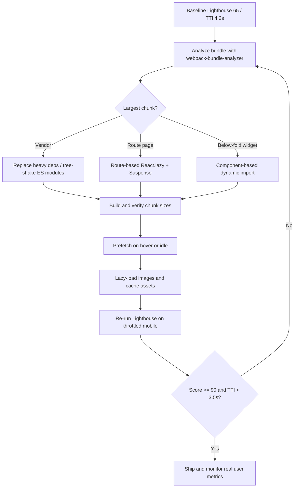

| Difficulty | Channel | Tags |
|---|---|---|
| intermediate | frontend | lighthouse, bundle, lazy-loading |

The signup button was right there, but on a throttled mobile connection it might as well have been behind a locked door. Netflix discovered that its logged-out homepage was shipping roughly 300kB of JavaScript, and the first step of the signup funnel was paying for it [1]. The fix was not a rewrite or a new framework; it was a disciplined attack on bundle composition and loading strategy. Here is the playbook for taking a 2.1MB React bundle at Lighthouse 65 and turning it into a 90+ experience that users can actually feel.

---

> ### Real-World Case — Netflix
>
> Netflix found that many new users were signing up on mobile devices over less-than-ideal connections. The logged-out Netflix.com homepage shipped roughly 300kB of JavaScript, including React, Lodash, and state-hydration data, which pushed Time-to-Interactive to an unacceptable level for the first step of the signup funnel.
>
> | | |
> |---|---|
> | **Challenge** | Cut the JavaScript payload and Time-to-Interactive on the logged-out landing page without breaking the interactive React single-page signup flow that users entered immediately afterward. |
> | **Solution** | The team audited what actually needed React on the first page and discovered most interactions were simple DOM work. They kept server-side React rendering but removed React and other client libraries from the client bundle, rebuilding the language switcher, tabs, cookie banner, and analytics in vanilla JavaScript (the language switcher alone was rewritten in under 300 lines). They then prefetched the HTML, CSS, and React JavaScript needed for the next SPA signup page using browser APIs and XHR so the client-side React flow stayed fast. |
> | **Outcome** | Client-side JavaScript dropped by over 200kB, even though React's initial footprint was only about 45kB. Time-to-Interactive improved by more than 50% for the logged-out desktop homepage (desktop TTI under 3.5s), prefetching reduced TTI by another 30% for subsequent navigations, and users clicked the sign-up button at a greater rate. |
> | **Lesson** | The fastest bundle is often the code you do not ship at all. Instead of reflexively code-splitting a framework, determine whether the critical path actually needs it, remove unnecessary dependencies, and prefetch heavier code for the next step so the transition still feels instant. |

---

## Hook — A 300kB Tax on the First Click

Picture a commuter on a train, phone in one hand, coffee in the other, tapping a Netflix link from a friend. The page paints, but the button does not respond. JavaScript is still parsing, React is still hydrating, and every additional kilobyte is a toll booth between curiosity and conversion. This is the invisible tax of frontend performance: it rarely shows up as an error, only as a quiet drop in signups. Netflix measured that tax directly and found the logged-out homepage was shipping around 300kB of JavaScript, including React, Lodash, and state-hydration data [1]. That number sounds small until you realize React's own footprint was only about 45kB. The rest was the cost of everything developers had piled on top of it. The lesson is uncomfortable: most performance problems are not framework problems. They are decisions about what gets loaded, when, and for whom. So what exactly was in those 300kB, and why did removing them change user behavior?

## Problem — The 2.1MB Elephant in the Bundle

Now swap Netflix's homepage for a typical React application: 2.1MB of JavaScript, a Time to Interactive of 4.2 seconds, and a Lighthouse score stuck at 65. The score is a symptom, not the disease. The disease is that the browser must download, parse, compile, and execute the entire application before a user can click anything meaningful. On a fast laptop this feels acceptable. On a mid-tier Android phone with a congested network, it feels broken. Many developers assume the culprit is React itself, but the real weight usually comes from charting libraries, date utilities, icon packs, polyfills, duplicated dependencies, and third-party scripts that were added one pull request at a time. The stakes are concrete: every 100ms of delay can erode conversion, and Time to Interactive is a direct measure of how long users stare at a page that looks ready but is not [7]. The challenge is not simply deleting code. It is deciding which code is critical for first paint, which can wait for a route change, and which should never ship to users who will not use it. That distinction is where most optimization efforts succeed or stall.

## Real-World Case — Netflix's Logged-Out Homepage

Netflix's web performance team faced exactly this distinction. New users were signing up on mobile devices over less-than-ideal connections, and the logged-out homepage, the very first step of the signup funnel, was shipping roughly 300kB of JavaScript [1]. That bundle included React, Lodash, and state-hydration data, and it pushed Time-to-Interactive beyond what the team considered acceptable for a first impression. The team did not replace React. React's initial footprint was only about 45kB. Instead, they attacked the surrounding weight: they removed and replaced heavy dependencies, trimmed hydration data, and split code so that non-critical logic arrived later. The result was a drop of more than 200kB of client-side JavaScript. Time-to-Interactive improved by more than 50% for the logged-out desktop homepage, landing under 3.5 seconds, and prefetching reduced TTI by another 30% for subsequent navigations [1]. Most importantly, users clicked the sign-up button at a greater rate. The twist is that the biggest win did not come from a shiny new framework feature. It came from treating every kilobyte as a product decision. That raises the next question: how do you find the expensive kilobytes in your own bundle before your users find them for you?

## Deep Dive — Splitting Without Breaking the Experience

The first move is measurement, not optimization. Tools like webpack-bundle-analyzer produce a treemap of every module in the build, making it obvious whether the 600kB chunk is a charting library, a duplicate copy of Lodash, or a locale file for languages you do not support [4]. Once the map is clear, code splitting becomes a design decision rather than a mechanical one [2]. Route-based splitting is the safest default: each top-level page becomes its own chunk, so a user visiting the dashboard never downloads the analytics workspace. Component-based splitting is more surgical and more dangerous; it is ideal for heavy widgets below the fold, modals, and rich editors, but it can create waterfalls and layout jank if overused. React.lazy and Suspense make the mechanics straightforward, but they do not decide the boundaries for you [3]. Tree shaking is the quiet partner to splitting: it removes unused exports at build time, provided the code uses ES modules and avoids patterns that defeat static analysis [5]. Then there is prefetching, which is the difference between a split that feels instant and one that feels like a loading spinner. Prefetch on user intent (hover, focus, viewport proximity) or during idle time, not on first paint. The trade-off table below is the one most teams wish they had printed on the wall.

| Strategy | Best for | Cost | Watch out |
|---|---|---|---|
| Route-based splitting | Distinct top-level pages | Extra requests per navigation | Shared vendor chunks can still balloon |
| Component-based splitting | Heavy below-the-fold widgets | More Suspense boundaries | Too many small chunks create waterfalls |
| Tree shaking | Unused exports and dead code | Requires ES modules | CommonJS dependencies silently block it |
| Prefetching | Likely next navigation | Wasted bytes if prediction is wrong | Never compete with critical requests |

💡 Insight: The goal is not the smallest possible bundle. It is the smallest bundle that lets the user complete the next action. ⚠️ Watch Out: Splitting a 2.1MB bundle into forty tiny chunks can make performance worse, because HTTP/2 multiplexing does not eliminate parse cost or request overhead. 🔥 Hot Take: If your performance budget is not enforced in CI, it is a suggestion, not a budget.

## Workflow — From Audit to 90+ in Six Moves

Building on the analysis above, the workflow should be sequential and measurable. Start by capturing a baseline Lighthouse run on a throttled mobile profile so every later change has a reference point [7]. Next, run the bundle analyzer and rank chunks by parsed size, not raw size, because a compressed 300kB chunk can still be expensive to parse. Then classify each large dependency into three buckets: critical for first paint, needed only after navigation, or removable entirely. After that, implement route-based splitting first, since it delivers the biggest initial-load win with the least risk [2]. Only then add component-level splitting for heavy widgets, and wrap those boundaries in error handling so a failed chunk does not blank the page. Finally, layer in prefetching and asset caching, then re-run Lighthouse under the same throttling conditions [9]. The diagram below tells the visual story of this loop.

This loop matters because optimization is not a one-time event. Dependencies creep back in, product teams add features, and the bundle regresses silently. A workflow that ends with monitoring real user metrics closes the loop that Lighthouse alone cannot [7].

## Code Example — Route Splitting, Prefetching, and a Graceful Fallback

The following example applies the workflow to a React application using React Router. It splits routes into named chunks, keeps a heavy chart component off the critical path, and warms the analytics chunk when the user shows intent to navigate. The loading fallback is accessible, and the prefetch is triggered on hover or focus rather than on first paint.

## Lessons Learned — What to Ship Tomorrow

The Netflix case is a reminder that performance work is product work. The team did not need a new framework; they needed to stop shipping 300kB of JavaScript to users who had not asked for it [1]. Here are the takeaways worth carrying into the next sprint:

- **Measure parsed cost, not just transfer size.** A chunk that compresses well can still be expensive to parse and execute on low-end phones [4].
- **Split by user intent.** Route-based splitting is the safest first win; component-based splitting should follow evidence, not enthusiasm [2].
- **Treat tree shaking as a build contract.** CommonJS dependencies and side-effectful imports quietly defeat it [5].
- **Prefetch after first paint, never before.** Warming a chunk on hover is a gift; warming it during the critical path is a tax [9].
- **Lazy-load images and non-critical media.** JavaScript is not the only payload; below-the-fold images should arrive when needed [6].
- **Enforce a performance budget in CI.** Otherwise the 2.1MB bundle returns within two quarters.

⚠️ Battle scar: Teams often split aggressively, celebrate a smaller initial bundle, then discover that every navigation now shows a spinner. The fix is to prefetch likely next routes and to keep shared vendor code in a stable chunk. If this feels overwhelming, you are not alone; most performance regressions are accumulated small decisions, which means they can be reversed by small, deliberate ones.

---

## Bundle Optimization Workflow

<strong>Original Interview Question</strong>

**Q:** You're tasked with improving a React app's Lighthouse performance score from 65 to 90+. The bundle size is 2.1MB and Time to Interactive is 4.2s. What specific steps would you take to optimize the bundle and implement lazy loading?

**A:** Implement code splitting with React.lazy() and Suspense, analyze bundle composition with webpack-bundle-analyzer to identify largest chunks, remove unused dependencies and optimize imports, add dynamic imports for heavy components and third-party libraries, implement route-based splitting for better initial load times, and utilize tree shaking with proper ES module configuration.

## Conclusion

Netflix's 300kB homepage is the story of a thousand small bundling decisions, and the fix was not glamorous: measure the bundle, question every dependency, split by intent, prefetch after first paint, and enforce the budget in CI [1]. The same discipline applies to a 2.1MB React app stuck at Lighthouse 65. Start tomorrow by running a bundle analyzer on your production build, identifying the single largest non-critical chunk, and moving it behind a route boundary or a dynamic import [4]. Then re-run Lighthouse on a throttled mobile profile and compare Time to Interactive, not just the score. The memorable insight to share with your team is simple: performance is not about how fast your framework is, it is about how much code you refuse to ship to users who do not need it yet.

---

## References

1. [Netflix incident report](https://medium.com/dev-channel/a-netflix-web-performance-case-study-c0bcde26a9d9) — article
2. [MDN: Code splitting](https://developer.mozilla.org/en-US/docs/Glossary/Code_splitting) — documentation
3. [React documentation: lazy](https://react.dev/reference/react/lazy) — documentation
4. [webpack-bundle-analyzer repository](https://github.com/webpack-contrib/webpack-bundle-analyzer) — documentation
5. [webpack guide: Tree shaking](https://webpack.js.org/guides/tree-shaking/) — documentation
6. [MDN: Lazy loading](https://developer.mozilla.org/en-US/docs/Web/Performance/Lazy_loading) — documentation
7. [Wikipedia: Time to interactive](https://en.wikipedia.org/wiki/Time_to_interactive) — documentation
8. [webpack repository](https://github.com/webpack/webpack) — documentation
9. [MDN: HTTP caching](https://developer.mozilla.org/en-US/docs/Web/HTTP/Caching) — documentation

---

**Author:** Satishkumar Dhule — [GitHub](https://github.com/satishkumar-dhule) · [LinkedIn](https://linkedin.com/in/satishkumar-dhule) · [Website](https://satishkumar-dhule.github.io)
