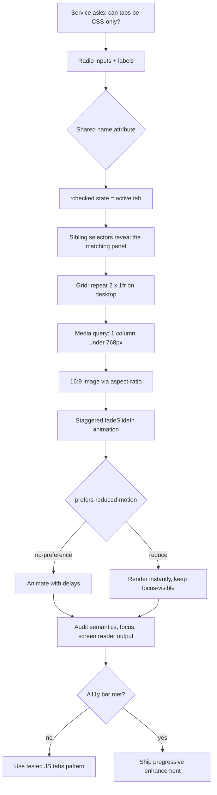

| Difficulty | Channel | Tags |
|---|---|---|
| beginner | frontend | css, flexbox, grid, animations |

Picture a design system so widely deployed that a single component decision reaches courts, farms, and benefits offices. That is GOV.UK Frontend, the code behind services at HMCTS, Defra, and DWP. In 2024, a service team asked why its tabs component needs JavaScript at all when radio inputs and the :checked selector can switch tabs with pure CSS [1]. It sounded like a cleanup. It became a masterclass in why "it works" and "it is accessible" are two very different bars.

---

> ### Real-World Case — GOV.UK (Government Digital Service)
>
> GOV.UK's design system ships a tabs component used by services across HMCTS, Defra and DWP. In 2024 a service team asked why the component needs JavaScript at all when radio inputs and the `:checked` selector can switch tabs with CSS alone.
>
> | | |
> |---|---|
> | **Challenge** | The team wanted the simplicity and no-JS resilience of the CSS-only radio/label pattern, but the component still had to work for keyboard and screen-reader users, show a visible focus indicator, and degrade gracefully when JavaScript is unavailable. |
> | **Solution** | GOV.UK kept JavaScript for the WAI-ARIA tab behaviour—roving focus, `aria-selected`, and arrow-key handling—and used progressive enhancement so the no-JS view renders every tab section in order with a table of contents. Maintainers explained that radio inputs are form controls, so assistive tech announces them as a radio group rather than tabs, and hiding the inputs with `display:none` removes keyboard access; CSS cannot update ARIA state as selection changes. |
> | **Outcome** | The JS tabs component remains the shipped pattern and is tested to WCAG 2.2 AA; GOV.UK Frontend v5.5.0 (Aug 2024) removed up/down arrow key bindings after screen-reader testing found they interfered with navigation. Services without JavaScript still get all the content instead of a broken tab widget, and the design system avoided adopting the radio-input hack. |
> | **Lesson** | A CSS-only tab panel is a great demo but not automatically an accessible tab control. If you use the radio pattern, keep the inputs focusable with `opacity:0` rather than `display:none`, mirror `:focus-visible` onto the labels, and be honest that screen readers hear a radio group—not ARIA tabs. |

---

## Hook — The question that looked like a free win

Every frontend developer has felt the pull of the pure-CSS tab. No bundle. No hydration. No JavaScript failure mode. A handful of radio inputs and a sibling selector, and the whole thing just works. So when a service team inside the GOV.UK ecosystem asked why the official tabs component ships JavaScript at all, the question had real gravity [1]. After all, the CSS approach is shorter, faster to load, and looks elegant in a code review.

The catch is that a design system does not ship to one page. It ships to services used by people who navigate with screen readers, keyboards, switch devices, and voice control. A pattern that dazzles in a demo can quietly fail those users. That tension — elegance versus inclusion — is the story of this article, and it starts with a deceptively simple CSS trick.

## Problem — Why the radio-input hack feels perfect (until it doesn't)

The radio-input pattern is built on a neat trick. Each tab gets an `` with the same `name` attribute, so the browser enforces mutual exclusivity for free [7]. A matching `` toggles the input, and the `:checked` pseudo-class tells CSS which panel to reveal. Combine that with CSS Grid using `repeat(2, 1fr)` [2], `aspect-ratio: 16/9` for stable image boxes [3], and a staggered animation guarded by `prefers-reduced-motion` [4], and you have a compact, dependency-free component.

However, the pattern silently swaps one interaction model for another. Native tabs announce `role="tablist"`, `role="tab"`, and `role="tabpanel"`; a radio group announces a radio group. Keyboard users expect Left and Right arrows to move between tabs, while radios use arrow keys to change selection. Focus management, announced state, and screen-reader instructions all change. Consequently, the CSS-only version can be technically functional and still be confusing to assistive technology.

There is a second, sneakier problem. The selector `.tabs input:not(:checked) ~ .panel` seems to hide inactive panels, but with multiple radios every panel still has at least one unchecked input before it. The result: nothing hides, and all four cards from every tab stack on top of each other. The "simple" solution suddenly needs ID-scoped rules, strict DOM ordering, and a no-CSS fallback plan. Sound familiar?

## Real-World Case — GOV.UK says no to the radio hack

GOV.UK did not dismiss the idea with a hand wave; the team examined it in public [1]. The outcome was that the JavaScript tabs component would remain the shipped pattern, tested against WCAG 2.2 AA [6]. The reasoning was practical rather than dogmatic: the existing component already manages focus, announced state, and keyboard behavior for users who depend on those details.

Then came the plot twist. In August 2024, GOV.UK Frontend v5.5.0 removed up/down arrow key bindings after screen-reader testing found those bindings interfered with navigation [1]. That is the kind of bug a pure-CSS radio hack cannot even detect, let alone fix, because the behavior lives in the browser's native radio semantics rather than in code the team controls. The design system also kept a deliberate progressive-enhancement stance: services without JavaScript still receive all the tab content instead of a broken widget [8].

That decision protected thousands of services across HMCTS, Defra, and DWP from inheriting an accessibility regression in the name of elegance. The radio-input shortcut stayed out of the design system — and the reasoning behind that choice is more useful than the trick itself.

## Deep Dive — The mechanics, the trade-offs, and the trapdoor

Start with the parts that genuinely work well. CSS Grid makes the 2×2 desktop layout a one-liner with `repeat(2, 1fr)`, and a single media query collapses it to one column on mobile [2]. `aspect-ratio: 16 / 9` reserves the image space before the asset loads, which prevents layout shift and keeps every card rhythmically aligned [3]. The stagger is just `animation-delay` on `:nth-child`, wrapped in `@media (prefers-reduced-motion: no-preference)` so motion-sensitive users get an instant, calm render [4]. And `:focus-visible` gives keyboard users a clear outline without punishing mouse clicks [5].

Those pieces are portable to almost any component. The fragile part is the tab semantics. Here is the honest trade-off table:

| Approach | Bundle cost | Screen-reader semantics | Keyboard model | No-JS fallback |
| --- | --- | --- | --- | --- |
| Tested JS tabs | Small JS | Native tablist roles and state | Arrow keys, managed focus | All content shown or links |
| Radio/CSS tabs | Zero JS | Radio group, not tabs | Native radio arrow behavior | Content depends on CSS |

The radio approach wins on payload and loses on semantics. That does not make it useless; it makes it a tool with a narrow job. For a docs page where the "tabs" are really mutually exclusive content filters and every panel is present in the DOM, a radio group is defensible. For a product UI that promises tab behavior, it misrepresents the control.

Here is the trapdoor most tutorials miss. Do not hide panels with `.tabs input:not(:checked) ~ .panel`. With several radios, that selector keeps matching because unchecked siblings still exist. Instead, scope each rule to a specific pair — `#tab-overview:checked ~ #panel-overview` — or use `:has()` if your browser support allows it. The corrected pattern is the difference between a working demo and a working component.

## Workflow — Building the component without lying to users

The accompanying diagram traces the decision path from the original question to a shippable result. Follow it as a checklist:

1. Decide what the control really is. If it switches views and users expect tab semantics, use a tested tabs component. If it filters a finite set of always-present content, a radio group is honest.
2. Write the DOM in the order the selectors need: all inputs first, each label immediately after its input, then all panels. Sibling selectors are order-sensitive.
3. Hide panels by default, then reveal only the matching panel with an ID-scoped `:checked ~` rule. Never rely on `input:not(:checked) ~ .panel`.
4. Lay out cards with `grid-template-columns: repeat(2, 1fr)` and collapse to `1fr` below 768px.
5. Reserve image space with `aspect-ratio: 16 / 9` so the grid does not jump when assets arrive.
6. Add the stagger inside `@media (prefers-reduced-motion: no-preference)`, then verify the reduced-motion path renders instantly.
7. Test with a keyboard, a screen reader, and CSS disabled. If the no-CSS view is a wall of orphaned labels, fix the fallback before shipping.

The workflow is less about writing clever selectors and more about knowing when the clever selector is the wrong tool.

## Code Example — A dependency-free renderer with the leak fixed

The snippet below builds the component from a small data model, emits the CSS alongside the markup, and uses the corrected ID-scoped visibility rules. Read it as a production-shaped version of the interview answer, not a toy.

The `TABS` array keeps content separate from markup, so a docs page can render tabs from frontmatter. The `CSS` template owns layout, motion, and focus styling in one place. The `card` helper produces the fixed-ratio image box, title, and meta line. Finally, `renderCssTabs` emits inputs and labels in the required order, then all panels, and returns a single string that can be injected into a static page.

## Lessons Learned — What to carry into the next component

The GOV.UK story is not an argument against CSS. It is an argument against confusing visual equivalence with behavioral equivalence. A radio group can look exactly like tabs and still tell assistive technology the wrong story.

- **Semantics are part of the API.** If users expect tab behavior, ship tab roles, roving focus, and announced state. If you ship a radio group, call it a filter and design accordingly.
- **The naive sibling selector is a trap.** Use ID-scoped rules or `:has()`; test with more than one panel.
- **Progressive enhancement is a feature.** GOV.UK keeps all content available without JavaScript [8], which is safer than a widget that collapses into broken labels.
- **Motion is a preference, not a decoration.** Gate animation behind `prefers-reduced-motion: no-preference` and keep `focus-visible` outlines intact [4][5].
- **Test with the people the pattern excludes.** The v5.5.0 arrow-key removal came from screen-reader testing, not from a linter [1].

Many teams discover this the hard way: the component passes visual QA, ships, and then generates accessibility tickets months later. The cheaper path is to ask the GOV.UK question early — and to accept that the honest answer may be "keep the JavaScript."

---

## CSS-Only Tabs Decision Flow

<strong>Original Interview Question</strong>

**Q:** Build a CSS-only tab panel for a design-system docs page. Use radio inputs to switch tabs (no JavaScript). Desktop: a 2x2 grid of cards under each tab; mobile: single column. Each card has a fixed 16:9 image area, a title, and a short meta line. Add a subtle entrance animation with a stagger and keep focus-visible outlines; ensure prefers-reduced-motion is respected?

**A:** Use a set of radio inputs with a shared `name` attribute and corresponding `` elements for each tab section. The `:checked` state of each radio controls visibility of its associated panel via adjacent sibling selectors. Each panel renders a 2×2 card grid on desktop and collapses to a single column on mobile. Cards use `aspect-ratio: 16/9` for fixed image containers, with a title and meta line below.

## Conclusion

The next time a teammate suggests replacing a working component with a five-line CSS trick, ask the GOV.UK question: what does this pattern tell a screen reader, and what happens when the CSS never loads [1]? Pure-CSS tabs are a legitimate tool for honest content filters, but they are not a free upgrade for a real tabs widget. Keep the semantics you promise, test with the people your shortcut might exclude, and let accessibility — not line count — decide when the JavaScript earns its place.

---

## References

1. [GOV.UK (Government Digital Service) incident report](https://github.com/alphagov/govuk-design-system/discussions/6045) — article
2. [MDN: CSS Grid Layout](https://developer.mozilla.org/en-US/docs/Web/CSS/CSS_grid_layout) — documentation
3. [MDN: aspect-ratio](https://developer.mozilla.org/en-US/docs/Web/CSS/aspect-ratio) — documentation
4. [MDN: prefers-reduced-motion](https://developer.mozilla.org/en-US/docs/Web/CSS/@media/prefers-reduced-motion) — documentation
5. [MDN: :focus-visible](https://developer.mozilla.org/en-US/docs/Web/CSS/:focus-visible) — documentation
6. [W3C: Web Content Accessibility Guidelines (WCAG) 2.2](https://www.w3.org/TR/WCAG22/) — documentation
7. [MDN: :checked](https://developer.mozilla.org/en-US/docs/Web/CSS/:checked) — documentation
8. [GOV.UK Design System: Tabs component](https://design-system.service.gov.uk/components/tabs/) — documentation
9. [MDN: Using CSS animations](https://developer.mozilla.org/en-US/docs/Web/CSS/CSS_animations/Using_CSS_animations) — documentation
10. [MDN: General sibling combinator](https://developer.mozilla.org/en-US/docs/Web/CSS/General_sibling_combinator) — documentation

---

**Author:** Satishkumar Dhule — [GitHub](https://github.com/satishkumar-dhule) · [LinkedIn](https://linkedin.com/in/satishkumar-dhule) · [Website](https://satishkumar-dhule.github.io)
