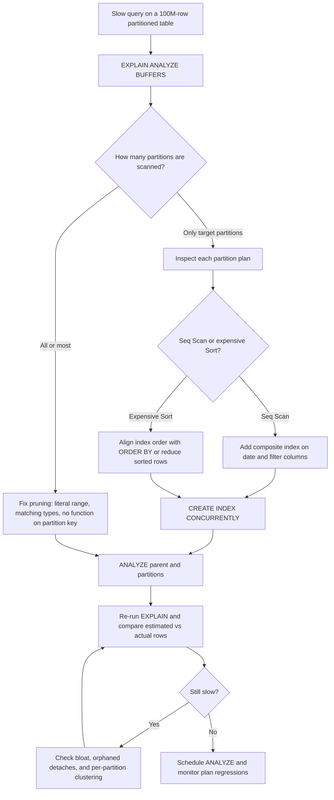

| Difficulty | Channel | Tags |
|---|---|---|
| intermediate | database | explain, query-plan, partitioning |

The migration passed every load test. Five days later, queries on Hatchet's partitioned task table were up to 10x slower, latency jumped from a few milliseconds to more than 20 ms, and active sessions and CPU spiked [1]. The team had done the seemingly responsible thing: split a roughly 200-million-row task table into daily partitions to escape index bloat and chunked deletes [1]. Yet the database was now doing more work, not less. What follows is the diagnostic journey every developer needs before trusting a partitioned table in production.

---

> ### Real-World Case — Hatchet
>
> Hatchet, a durable task queue built on Postgres, stores hundreds of millions of tasks per day. After hitting ~200 million rows and struggling with index bloat and constant chunked deletes, the team replaced its single task table with daily range partitions on inserted_at. The rollout passed load tests, but within days queries against the partitioned tables became up to 10x slower, jumping from a few milliseconds to over 20 ms and causing spikes in active sessions and CPU.
>
> | | |
> |---|---|
> | **Challenge** | Queries joining the day-partitioned task and task-event tables on a compound primary key were suddenly slow. The team first suspected too many partitions being scanned and tried to force plan-time partition pruning, but that did not help. They needed to understand why Postgres was choosing a bad plan for a query that should have been a fast index lookup. |
> | **Solution** | They reproduced the issue locally with 14 daily partitions of 1 million rows each and ran EXPLAIN ANALYZE on the join. The plan showed the row estimate was off by a factor of 6,100,000x. The root cause was a Postgres footnote: autovacuum processes individual partitions but does not ANALYZE the partitioned parent table, so the planner had terrible statistics for queries referencing the parent. Running ANALYZE manually on the parent partitioned table immediately fixed the plans. |
> | **Outcome** | The fix resolved the production slowdown: manual ANALYZE on the parent table immediately restored fast query plans, and Hatchet added an AnalyzeTaskTables routine to its codebase. The incident also produced concrete partitioning lessons: use DETACH PARTITION CONCURRENTLY, finalize orphaned detaches, and periodically ANALYZE parent partitioned tables. |
> | **Lesson** | When a date-partitioned query is slow, do not only check whether pruning or indexes are working. In EXPLAIN ANALYZE, compare estimated rows with actual rows; if they diverge wildly, the planner may be choosing sequential scans or bad joins. For partitioned tables, parent-level statistics are not maintained by autovacuum, so manual ANALYZE on the parent is a critical and easily missed optimization. |

---

## Hook — The Migration That Passed Every Test

The rollout looked boring, which is exactly how teams like it. Hatchet had replaced a single task table holding roughly 200 million rows with daily range partitions on `inserted_at`, a change designed to escape index bloat and the endless chunked deletes that came with it [1]. Load tests passed. Then production found the edge case the test suite could not feel: queries against the partitioned tables became up to 10x slower, latency climbed from a few milliseconds to more than 20 ms, and active sessions and CPU spiked [1].

Here is the uncomfortable question every developer should ask before copying that architecture: what if the partition is correct, the index exists, and the query is still slow? The answer usually hides in one EXPLAIN line that most people skim.

🎯 Key Point: Partitioning changes where rows live. It does not automatically change how the planner finds them.

## Problem — Partitioning Is Not a Performance Spell

Partitioning is a data placement strategy, not a magic index. When you partition by date, PostgreSQL stores each range in a child table and the parent becomes a routing layer. A query filtering on a specific date range should touch only a few children, but that happy path depends on three separate systems cooperating: the planner must prune partitions, each surviving partition must have a useful access path, and the statistics must describe the data accurately [3].

Many developers assume that adding an index on the partition key is enough. It is not. The index may exist on every partition and still lose to a sequential scan if the planner estimates that the range contains most of the table. A composite index may be ignored if the leading column is not selective enough for the query. And a query can prune perfectly yet still spend most of its time sorting a million rows because the index order does not match the ORDER BY.

The stakes are easy to underestimate. A 20 ms query sounds harmless until it runs thousands of times per second, holds connection slots, and pushes CPU toward saturation. At 100 million rows, small planning mistakes become operational incidents.

⚠️ Watch Out: A partitioned table is not automatically faster. Without pruning, it is a collection of sequential scans wearing a costume.

## Real-World Case — Hatchet's 10x Postgres Slowdown

Hatchet, a durable task queue built on Postgres, stores hundreds of millions of tasks per day. At around 200 million rows, the team hit the classic wall: index bloat and constant chunked deletes were making the single task table expensive to maintain. The fix was daily range partitioning on `inserted_at`, a design that should have improved retention, vacuum behavior, and query locality [1].

The rollout passed load tests. Within days, however, queries against the partitioned tables were up to 10x slower, jumping from a few milliseconds to over 20 ms and causing spikes in active sessions and CPU [1]. Notice what did not fail: the partitions existed, the data was routed correctly, and the indexes were present. What failed was the planner's picture of the data.

The resolution was almost anticlimactic. A manual `ANALYZE` on the parent table immediately restored fast query plans, and Hatchet added an `AnalyzeTaskTables` routine to keep statistics fresh [1]. The incident also produced hard-won partitioning rules: use `DETACH PARTITION CONCURRENTLY`, finalize orphaned detaches, and periodically `ANALYZE` parent partitioned tables [1][9].

🎯 Key Point: The most expensive query in this incident was not missing an index. It was missing fresh statistics.

## Deep Dive — Pruning, Access Paths, Sorts, and Statistics

Building on Hatchet's experience, the first diagnostic is partition pruning. Run `EXPLAIN (ANALYZE, BUFFERS)` and count how many partitions appear in the plan [2]. If the query filters `event_date BETWEEN ...` and the plan still scans every child, the predicate is not pruning. Common causes include wrapping the partition key in a function such as `date_trunc('day', event_date)`, casting it to a different type, using a timezone conversion, or passing a parameter through a prepared statement that forces a generic plan. The planner cannot prune what it cannot prove is constant [3].

However, pruning is only half the story. Once the plan touches the right partitions, inspect the access path inside each one. A `Seq Scan` on a partition that should return a few hundred rows is a signal that the index is missing, bloated, or simply not selective enough for the planner's estimate. This is where composite indexes earn their keep. An index on `(event_date, status)` can serve both the range filter and the equality filter, while an index on `(event_date, status) INCLUDE (id)` can enable an index-only scan for queries that select only those columns [5]. The trade-off is write amplification: every additional index slows inserts and updates, so the index must match a real query pattern.

Then there is the sort. A query with `ORDER BY event_date DESC LIMIT 100` wants an index whose order matches the requested order. If the planner has to read a million rows and sort them, latency climbs even when pruning works. Matching the index order to the ORDER BY, or reducing the number of rows before the sort, often removes the most expensive node in the plan.

The quiet killer, though, is statistics. PostgreSQL needs row estimates to choose between a sequential scan and an index scan. For partitioned tables, the parent needs a coherent statistical picture, and autovacuum does not reliably analyze partitioned parents [7]. When estimates drift, the planner can choose a nested loop for a million rows or a sequential scan for a hundred. Hatchet's manual `ANALYZE` fixed the plan because it fixed the estimate [1][4].

There is also a planning-cost dimension. Thousands of partitions mean thousands of child relations and indexes for the planner to consider. More partitions improve retention granularity but can increase planning time and memory. Daily partitions are often a sensible balance for high-volume event data; hourly partitions can be reasonable for extreme ingest, but they are not free.

| Symptom in EXPLAIN | Likely cause | First fix |
|---|---|---|
| `Append` over every partition | Pruning failed | Use a literal, type-matched range on the partition key |
| `Seq Scan` on target partitions | Missing, bloated, or unselective index | Add a composite index for the filter and order |
| Large `Sort` or `HashAggregate` | Index order does not match the query | Align index columns with ORDER BY and GROUP BY |
| Estimated rows far from actual rows | Stale or missing statistics | Run ANALYZE on parent and partitions |
| High planning time | Too many partitions | Re-evaluate partition granularity |

💡 Insight: `EXPLAIN` without `ANALYZE` tells you what the planner intended. `EXPLAIN (ANALYZE, BUFFERS)` tells you what the database actually did. Trust the second one.

## Workflow — A Practical Triage Path

Here is the triage path that turns a slow partitioned query into a concrete fix. The flowchart below maps the same sequence.

1. Reproduce the slow query with real parameters. Use production-like values, not `WHERE 1=1`. Capture `EXPLAIN (ANALYZE, BUFFERS, VERBOSE)` and compare estimated rows with actual rows [2].
2. Count the partitions. If the plan scans every child, stop and fix pruning before touching indexes. Check for functions, casts, and timezone conversions on the partition key [3].
3. Inspect the surviving partitions. Look for sequential scans, high `Rows Removed by Filter`, and loops that repeat more than expected.
4. Check statistics freshness. Query `pg_stat_user_tables` for `last_analyze`, then run `ANALYZE` on the parent and the hot partitions [4][8].
5. Design the index around the whole query. Put the partition key first when the range is selective, add equality filters next, and consider `INCLUDE` columns for index-only scans [5].
6. Build it safely. Use `CREATE INDEX CONCURRENTLY` outside a transaction to avoid blocking writes [5].
7. Re-measure. Compare latency, buffers, and rows. If the plan is still wrong, investigate bloat, orphaned detached partitions, and per-partition clustering [6][9].

🔥 Hot Take: Most slow partitioned queries are not solved by adding another index. They are solved by making the existing plan honest.

## Code Example — Reproduce, Inspect, Index, Analyze

This bash script uses `psql` to reproduce the plan, inspect partition-level statistics, add a composite index, refresh statistics, and verify the result. It is deliberately boring: the kind of runbook you can adapt for a production read replica or a maintenance window.

The key discipline is that every step produces evidence. The script does not assume the index is missing, and it does not assume `ANALYZE` is the answer. It measures first, changes one thing, and measures again.

## Lessons Learned — What to Do Before the Next Pager Alert

1. Verify pruning before optimizing anything else. If the plan touches every partition, indexes are a distraction.
2. Treat statistics as part of the schema. A partitioned table without fresh parent statistics is a plan waiting to regress [7].
3. Match indexes to full query shapes, not just WHERE clauses. Filter columns, join columns, and ORDER BY all matter [5].
4. Measure with `EXPLAIN (ANALYZE, BUFFERS)`. Estimated rows are a hypothesis; actual rows and buffer counts are evidence [2].
5. Plan for partition lifecycle. Use `DETACH PARTITION CONCURRENTLY`, clean up orphaned detaches, and monitor planning time as partition counts grow [9].
6. Do not cluster everything. Clustering rewrites data and takes a strong lock; use it surgically on hot partitions during maintenance windows [6].
7. Add observability. Track slow queries with `pg_stat_statements` and alert on plan regressions after schema changes [8].

The battle scar from Hatchet is simple: partitioning changed where the data lived, but it did not change the need for accurate statistics. A manual `ANALYZE` restored a production system that had passed every load test [1]. That is the kind of lesson that does not show up in a migration checklist until it shows up in an incident review.

⚠️ Watch Out: Load tests often run against warm caches and freshly analyzed tables. Production runs against cold data, skewed distributions, and autovacuum schedules. Test the statistics, not just the schema.

---

## Partitioned Query Triage Flow

<strong>Original Interview Question</strong>

**Q:** You have a PostgreSQL table with 100M rows partitioned by date. A query filtering on a specific date range is still slow. What would you check in the EXPLAIN plan and how would you optimize it?

**A:** Check partition pruning effectiveness, index utilization patterns, and expensive sort operations. Create composite indexes on (date, filtered_columns) and evaluate clustering strategies for optimal data access.

## Conclusion

Hatchet's 10x slowdown is a reminder that database performance is a chain of assumptions: the planner assumes the predicate is prunable, the index assumes the query shape, and the statistics assume someone analyzed the table. Break one link and the whole plan falls apart [1]. Before the next partitioning migration, run the EXPLAIN triage, check the parent statistics, and make `ANALYZE` a scheduled part of the system rather than a heroic fix. The memorable takeaway is this: partitions divide the data, but statistics decide how the database reads it. Share that with your team before the next 3 a.m. pager.

---

## References

1. [Hatchet incident report](https://hatchet.run/blog/postgres-partitioning) — article
2. [PostgreSQL Documentation: EXPLAIN](https://www.postgresql.org/docs/current/sql-explain.html) — documentation
3. [PostgreSQL Documentation: Table Partitioning](https://www.postgresql.org/docs/current/ddl-partitioning.html) — documentation
4. [PostgreSQL Documentation: ANALYZE](https://www.postgresql.org/docs/current/sql-analyze.html) — documentation
5. [PostgreSQL Documentation: CREATE INDEX](https://www.postgresql.org/docs/current/sql-createindex.html) — documentation
6. [PostgreSQL Documentation: CLUSTER](https://www.postgresql.org/docs/current/sql-cluster.html) — documentation
7. [PostgreSQL Documentation: Routine Vacuuming](https://www.postgresql.org/docs/current/routine-vacuuming.html) — documentation
8. [PostgreSQL Documentation: pg_stat_statements](https://www.postgresql.org/docs/current/pgstatstatements.html) — documentation
9. [PostgreSQL Documentation: ALTER TABLE](https://www.postgresql.org/docs/current/sql-altertable.html) — documentation

---

**Author:** Satishkumar Dhule — [GitHub](https://github.com/satishkumar-dhule) · [LinkedIn](https://linkedin.com/in/satishkumar-dhule) · [Website](https://satishkumar-dhule.github.io)
