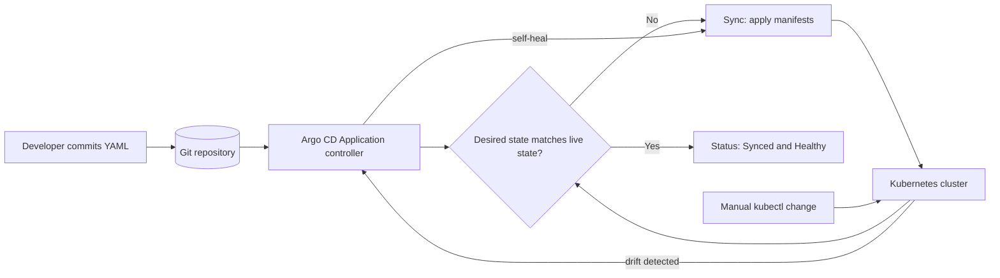

| Difficulty | Channel | Tags |
|---|---|---|
| beginner | devops | argocd, flux, declarative |

It is tax season, traffic doubles overnight, and one misconfigured deployment can freeze TurboTax for millions of filers. Intuit lived that pressure after lifting TurboTax and QuickBooks to AWS, only to watch releases still crawl through manual scripts over days or weeks [1]. The fix was not a faster script; it was a different contract between Git and Kubernetes. Here is how ArgoCD turns that contract into an auto-syncing, self-healing deployment machine.

---

> ### Real-World Case — Intuit
>
> Intuit moved TurboTax and QuickBooks to AWS, but lift-and-shift only slightly improved velocity—releases still took days or weeks through manual scripts, and tax season demanded rapid scale-up and scale-down across thousands of services. To fix this, Intuit adopted Kubernetes and acquired Applatix, the team behind the Argo project.
>
> | | |
> |---|---|
> | **Challenge** | Teams were deploying with imperative scripts and direct kubectl-style changes, creating configuration drift and slow, unauditable releases across more than 100 Kubernetes clusters. There was no reliable single source of truth for the desired state of each service. |
> | **Solution** | Intuit built and adopted Argo CD around declarative GitOps: Kubernetes manifests, Helm charts, and Kustomize overlays live in Git as the source of truth, while Argo CD Application CRDs continuously reconcile the live cluster state against Git. Auto-sync and self-healing revert manual drift, and every deployment becomes a reviewable, reversible Git commit. Intuit then open-sourced Argo CD. |
> | **Outcome** | Intuit went from zero to about 2,000 services running on Kubernetes in 18 months and operated 150+ clusters. Deployment cycles dropped from days to minutes, MTTR fell from 45 minutes to under 5 minutes, and creating or upgrading a service took less than 10 minutes. |
> | **Lesson** | Declarative GitOps is more than a deployment tool—making Git the single source of truth turns releases into auditable, reversible state reconciliation. The company that created Argo CD used it on its own highest-stakes tax-season workloads, proving that self-healing and drift correction matter most at scale. |

---

## Hook — The deploy looked fine. Then the cluster disagreed.

Picture a war room at 2 a.m. during tax season. A release went out hours ago, the dashboards are green, and then a support ticket arrives: one region is serving stale pricing. An engineer runs kubectl get pods, sees a hotfix that exists nowhere in Git, and realizes the cluster has quietly drifted away from the repository everyone trusts.

That is the moment GitOps stops being a buzzword and becomes a survival strategy. The stakes are not abstract. A manual change made under pressure can survive for weeks, invisible to code review, until the next deploy wipes it out or, worse, preserves it in production forever. Developers often assume that Kubernetes is self-documenting because YAML is involved. The uncomfortable truth is that a cluster will happily accept commands that no one can audit, reproduce, or roll back.

The question is not whether drift happens. It is whether your platform can detect it, reverse it, and prove what changed. ArgoCD exists to answer that question, and the story of how Intuit operationalized it shows why the answer matters at scale.

## Problem — Manual kubectl is fast until it is not

The core problem is simple: imperative commands optimize for the next five minutes, while production optimizes for the next five months. Running kubectl apply or kubectl edit feels immediate and powerful. However, those actions bypass version control, so the cluster becomes a separate, undocumented source of truth. The result is configuration drift: staging and production slowly diverge, rollbacks depend on someone remembering the previous command, and incident response turns into archaeology [4].

This pain compounds in three predictable ways:

- **Auditability disappears.** A Git commit has an author, a timestamp, a diff, and a review trail. A kubectl command has a shell history entry that may vanish with a laptop.
- **Rollbacks become guesswork.** Reverting a bad release should be a Git revert, not a sequence of reverse-engineered kubectl patches.
- **Scale breaks the model.** When a team manages ten services, tribal knowledge can cover the gaps. When it manages hundreds or thousands, manual commands become an operational liability.

The declarative model flips the direction of control. Instead of telling Kubernetes what to do step by step, teams declare what the end state should look like, and a controller works continuously to make reality match [3]. That shift sounds philosophical until a tax-season traffic spike arrives and the difference between a documented desired state and a heroic shell session becomes measurable in revenue.

## Real-World Case — Intuit's journey from manual releases to 2,000 services

Intuit moved TurboTax and QuickBooks to AWS expecting a velocity boost, but lift-and-shift only delivered a modest improvement. Releases still took days or weeks because deployment depended on manual scripts, and tax season demanded rapid scale-up and scale-down across thousands of services [1]. The platform team faced a classic trap: the cloud was elastic, but the delivery process was not.

Intuit responded by adopting Kubernetes and acquiring Applatix, the team behind the Argo project [1]. The results were not incremental. Intuit went from zero to roughly 2,000 services running on Kubernetes in 18 months and operated more than 150 clusters. Deployment cycles dropped from days to minutes, mean time to recovery fell from 45 minutes to under 5 minutes, and creating or upgrading a service took less than 10 minutes [1].

🔥 **Hot Take:** The headline number is the 45-to-5-minute MTTR drop, but the real unlock is the 2,000-service scale. Manual recovery can work when a handful of services exist. It collapses when hundreds of teams deploy independently and every incident has a different tribal-knowledge tax.

What makes Intuit's case instructive is the sequence. Kubernetes provided the substrate, Argo provided the reconciliation engine, and Git became the control plane. The company did not simply automate old scripts; it changed the operating model so that the desired state lived in version control and the cluster was continuously corrected toward it [1][9].

## Deep Dive — Declarative versus imperative, and why reconciliation wins

At the center of GitOps is a deceptively simple idea: the repository is the desired state, and a controller continuously compares that desired state with the live cluster [5][12]. ArgoCD implements this through an Application custom resource. The Application points at a Git repository, a path, and a target cluster namespace. ArgoCD then renders the manifests, compares them with what is running, and reports whether the application is Synced or OutOfSync [2].

The contrast with imperative operations is stark:

| Dimension | Declarative GitOps | Imperative kubectl |
|---|---|---|
| Source of truth | Git repository | Engineer's terminal and cluster state |
| Change review | Pull request with diff | None by default |
| Rollback | Git revert | Reconstruct previous commands |
| Drift handling | Continuous detection and self-healing | Invisible until something breaks |
| Audit trail | Commit history and ArgoCD events | Shell history, if it survives |
| Scale ceiling | High, because automation is uniform | Low, because knowledge is tribal |

Declarative configuration does not mean Kubernetes ignores changes. It means the desired state is expressed as data, and controllers reconcile toward it [3]. Helm charts and Kustomize overlays are common ways to generate that data without copy-pasting YAML across environments [7][8]. ArgoCD can consume raw manifests, Helm, Kustomize, and more, which is why it fits teams at different maturity levels [2].

💡 **Insight:** Self-healing is not a magic undo button. It is a policy that tells ArgoCD to reapply the Git-defined state when live state diverges. That policy is powerful precisely because it makes manual hotfixes temporary by design. If a change matters, it must go through Git.

The trade-off is real. Declarative GitOps adds a feedback delay, typically measured in minutes rather than seconds, and it requires discipline around repository structure and secrets management. However, that delay buys something imperative workflows cannot: a reproducible, reviewable, and automatically enforced definition of production. For teams comparing tools, Flux offers a similar reconciliation model with a different architecture and packaging approach [11], but the underlying principle is the same.

## Workflow — From commit to reconciled cluster

The workflow below is the heartbeat of an ArgoCD setup. Each step exists to shrink the distance between what developers intend and what the cluster actually runs.

1. **Store the desired state in Git.** Keep Kubernetes manifests, Helm charts, or Kustomize overlays in a dedicated repository with protected branches and pull-request reviews.
2. **Install ArgoCD in its own namespace.** This separates the control plane from the workloads it manages.
3. **Register the repository.** ArgoCD needs credentials to read the repo, ideally through a scoped token or a GitHub App rather than a personal password.
4. **Create an Application CRD.** Point it at the repository, target revision, path, destination cluster, and namespace [2].
5. **Enable automated sync.** Turn on auto-sync so ArgoCD applies changes without a human clicking a button [6].
6. **Enable prune and self-heal.** Prune removes resources deleted from Git, while self-heal reverts manual cluster edits [6].
7. **Watch health and sync status.** ArgoCD reports Synced, OutOfSync, Healthy, Degraded, and Progressing states so teams can act before users notice.
8. **Roll back through Git.** A revert commit becomes the new desired state, and ArgoCD reconciles the cluster back to safety.

The diagram traces this reconciliation loop, including the drift path that makes self-healing necessary. Notice that manual kubectl changes do not disappear from the model; they become inputs that ArgoCD detects and corrects. That is the plot twist many teams miss: the goal is not to forbid kubectl. The goal is to make Git the only change that survives.

## Code Example — A production-shaped ArgoCD Application

The following bash script installs ArgoCD, registers a repository, and applies an Application manifest with automated sync, pruning, self-healing, and retry backoff. It is illustrative rather than environment-specific, but the structure mirrors what teams actually run in production.

The key design choices are intentional. The Application lives in the argocd namespace, the source path isolates one service, and the sync policy encodes the operating contract. Prune prevents orphaned resources from accumulating. Self-heal prevents silent drift. Retry backoff prevents a transient API hiccup from leaving the application stuck in a failed sync. The final commands refresh and wait on health so the script fails loudly instead of pretending success.

## Lessons Learned — What to do differently tomorrow

The Intuit story is not a story about buying a tool. It is a story about changing where truth lives [1]. Teams that adopt ArgoCD but keep hotfixing production with kubectl end up with the worst of both worlds: automation that fights humans and humans who distrust automation. The following lessons prevent that outcome.

- **Make Git the only path to production.** If a change cannot be represented as a commit, it cannot be audited or reproduced. Treat manual cluster edits as temporary exceptions, not workflows.
- **Start with auto-sync in non-production.** Enable automated sync and self-heal in staging first. Watch how the system behaves when someone deliberately introduces drift, then promote the policy.
- **Use prune carefully.** Pruning is essential for cleanup, but it can delete resources that were created outside Git. Label and scope Applications so ownership is unambiguous [6].
- **Separate application config from secrets.** GitOps repositories should not contain plaintext credentials. Use sealed secrets, external secret operators, or a managed secret store.
- **Design for rollback before you need it.** A Git revert should be the default recovery path. Test it during calm periods so it works during tax season.
- **Measure the metrics that matter.** Track deployment frequency, lead time, change failure rate, and MTTR. Intuit's MTTR drop from 45 minutes to under 5 minutes is the kind of outcome that justifies the migration [1].
- **Do not confuse declarative with static.** Helm and Kustomize let teams generate environment-specific desired state while preserving a single reviewed source [7][8].

⚠️ **Watch Out:** Self-healing can mask a broken deployment pipeline if no one watches sync failures. Pair auto-sync with alerting on OutOfSync and Degraded states, or the cluster may be healthy while the application is silently stale.

The memorable takeaway is this: Kubernetes gives you a reconciler, but GitOps gives you a contract. The contract says production is whatever Git says it is, and any divergence is a bug to be corrected, not a secret to be preserved. Teams that internalize that idea stop asking whether the deploy worked and start asking whether the desired state is correct.

---

## GitOps Reconciliation Loop

<strong>Original Interview Question</strong>

**Q:** You're setting up GitOps for a microservices deployment. How would you configure ArgoCD to automatically sync changes from your Git repository to Kubernetes, and what's the difference between declarative and imperative approaches in this context?

**A:** I'd configure ArgoCD by setting up a Git repository containing Kubernetes manifests or Helm charts, creating an Application CRD that points to the Git repository, enabling auto-sync with a health check interval of 3 minutes, and implementing self-healing to automatically revert any manual changes. The declarative approach involves defining the desired state in Git through YAML manifests, Helm charts, or Kustomize configurations, where ArgoCD continuously reconciles the actual state with the desired state. In contrast, the imperative approach uses kubectl commands to make direct changes to the cluster, bypassing the Git repository as the single source of truth.

## Conclusion

Intuit's transformation did not happen because someone found a better deployment script. It happened because the platform team made Git the contract for production and let a reconciler enforce it [1]. The next time a hotfix tempts you to run kubectl directly against production, ask a different question: will this change still exist tomorrow, and will anyone know why? Put the answer in Git, let ArgoCD sync it, and make drift a detected event rather than a silent incident. That single shift is how 45-minute recoveries become five-minute ones.

---

## References

1. [Intuit incident report](https://www.cncf.io/case-studies/intuit) — article
2. [Argo CD Documentation](https://argo-cd.readthedocs.io/en/stable/) — documentation
3. [Kubernetes Documentation: Declarative Management of Kubernetes Objects](https://kubernetes.io/docs/tasks/manage-kubernetes-objects/declarative-config/) — documentation
4. [Kubernetes Documentation: Managing Kubernetes Objects Using Imperative Commands](https://kubernetes.io/docs/tasks/manage-kubernetes-objects/imperative-command/) — documentation
5. [GitOps](https://en.wikipedia.org/wiki/GitOps) — documentation
6. [Argo CD Documentation: Automated Sync Policy](https://argo-cd.readthedocs.io/en/stable/user-guide/auto_sync/) — documentation
7. [Kubernetes Documentation: Managing Kubernetes Objects Using Kustomize](https://kubernetes.io/docs/tasks/manage-kubernetes-objects/kustomization/) — documentation
8. [Helm Documentation](https://helm.sh/docs/) — documentation
9. [Argo CD GitHub Repository](https://github.com/argoproj/argo-cd) — documentation
10. [Kubernetes Documentation: Controllers](https://kubernetes.io/docs/concepts/architecture/controller/) — documentation
11. [Flux Documentation](https://fluxcd.io/flux/) — documentation
12. [OpenGitOps Principles](https://opengitops.dev/) — documentation

---

**Author:** Satishkumar Dhule — [GitHub](https://github.com/satishkumar-dhule) · [LinkedIn](https://linkedin.com/in/satishkumar-dhule) · [Website](https://satishkumar-dhule.github.io)
