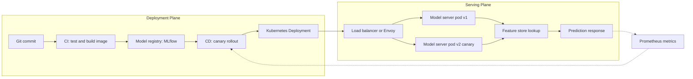

| Difficulty | Channel | Tags |
|---|---|---|
| beginner | devops | mlops, deployment |

In 2015, Uber's data scientists trained models in R and scikit-learn on desktop machines while separate engineering teams hand-built one-off serving containers for every project [1]. There was no reproducible training pipeline, no shared experiment repository, and no standard path from a trained model to production [1]. The fix was not a fancier algorithm. It was a platform that separated the deployment plane from the serving plane, and that distinction eventually carried more than 250,000 predictions per second at sub-10 ms P95 latency [1]. Understanding that separation is the difference between shipping a demo and running a system.

---

> ### Real-World Case — Uber
>
> Before Michelangelo launched in 2015, Uber's data scientists trained models in R and scikit-learn on desktop machines while separate engineering teams hand-built one-off serving containers for each project. There was no reproducible training pipeline, no shared experiment repository, and no standard path from a trained model to production.
>
> | | |
> |---|---|
> | **Challenge** | Uber needed one system that covered the full deployment lifecycle (data pipelines, training, evaluation, packaging, rollout, monitoring) and also delivered low-latency online inference at massive scale, while guaranteeing that features used in training matched those used at serving time. |
> | **Solution** | Michelangelo standardized a six-step workflow and made deployment a first-class, multi-mode operation: offline deployment to Spark batch jobs, online deployment to prediction clusters of hundreds of machines behind a load balancer using Thrift RPC, and library deployment embedded in another service. Models were packaged as ZIP artifacts with metadata, parameters, and compiled feature-DSL expressions, then shipped through Uber's standard deployment infrastructure; serving containers loaded them from disk and could hold multiple models, addressed by UUID or tag for safe rollouts and A/B tests. Online features were precomputed into Cassandra via batch jobs or Kafka/Samza streaming, with a backfill tool to avoid cold-start gaps. |
> | **Outcome** | The highest-traffic models served more than 250,000 predictions per second. P95 latency was under 5 ms for models not needing Cassandra features and under 10 ms when feature-store lookups were required. The shared feature store grew to roughly 10,000 features, and because models are stateless, Uber scaled online serving simply by adding hosts behind the load balancer. |
> | **Lesson** | Deployment and serving are distinct lifecycles that must be designed together: deployment is about reproducible artifacts, versioning, rollout, and monitoring, while serving is about runtime latency, routing, and feature retrieval. The counterintuitive finding is that inference math is rarely the bottleneck—feature-store access and training/serving skew dominate real-world latency and correctness. |

---

## Hook — The model was not the hard part

It is 2 a.m., the model is accurate, and the API is on fire. The artifact trained beautifully, the notebook looked clean, and the handoff deck said "ready for production." Then traffic arrives, and nobody can answer the simplest operational questions: Which model version is live? How does a rollback work? Why does the first request take four seconds while the next one takes forty milliseconds?

This is the moment many teams discover that a trained model is not a product. Production machine learning is two distinct disciplines wearing the same job title. One discipline builds the road from code to a running system. The other builds the engine that answers requests once the system is live. Confuse them, and you get brittle pipelines, mystery deployments, and pager alerts that nobody owns.

Uber learned this at scale before Michelangelo existed [1]. The lesson was not that Uber needed better models. It was that Uber needed a repeatable path from experiment to inference, and a runtime that could serve that path reliably under enormous load [1].

## Problem — Deployment and serving get conflated, and everything downstream suffers

Ask ten developers to explain the difference between model deployment and model serving, and you will often get ten versions of "putting the model into production." That ambiguity sounds harmless until an incident forces the team to distinguish between a bad build and a bad runtime.

Deployment is the supply chain. It covers continuous integration and continuous delivery, infrastructure provisioning, environment promotion, model registration, approval gates, monitoring setup, and rollback strategy. Serving is the storefront. It covers the inference API, request routing, model loading, feature lookup, batching, response serialization, autoscaling, and per-version traffic control.

When teams blur the two, three predictable failures appear. First, deployment becomes a manual event instead of an automated process, so releases slow down and drift creeps in. Second, serving becomes an afterthought bolted onto a training script, which makes latency and reliability impossible to reason about. Third, ownership dissolves, because the data scientist owns the model, the platform team owns Kubernetes, and nobody owns the end-to-end path.

The stakes are concrete. A model that takes hours to roll back is a business risk. A serving layer that cannot isolate a bad version can turn one bad prediction path into a full outage. MLOps as a discipline exists precisely because these concerns span data, code, and operations rather than living in a single notebook [2].

## Real-World Case — Uber's Michelangelo and the road to 250,000 predictions per second

Before Michelangelo launched in 2015, Uber's model lifecycle was fragmented by design. Data scientists trained models in R and scikit-learn on desktop machines, while separate engineering teams hand-built one-off serving containers for each project [1]. There was no reproducible training pipeline, no shared experiment repository, and no standard path from a trained model to production [1].

The result was predictable. Every project reinvented its own deployment process, its own serving wrapper, and its own operational assumptions. A model that worked on a laptop had no guaranteed route to a reliable endpoint, and the organization paid for that gap in duplicated effort and slow delivery.

Michelangelo changed the shape of the problem by giving teams a shared platform. The highest-traffic models served more than 250,000 predictions per second [1]. P95 latency stayed under 5 ms for models that did not need Cassandra features and under 10 ms when feature-store lookups were required [1]. The shared feature store grew to roughly 10,000 features, and because models are stateless, Uber scaled online serving simply by adding hosts behind the load balancer [1].

That last detail is the plot twist. The breakthrough was not a secret inference trick. It was an architectural decision: keep models stateless, centralize features, and let horizontal scaling do the heavy lifting. Deployment gave Uber repeatability. Serving gave Uber speed. Neither would have worked alone.

## Deep Dive — Two planes, two sets of trade-offs

The cleanest mental model is to think in planes. The deployment plane answers "how does this artifact become a running, observable, reversible system?" The serving plane answers "how does a live request get a correct, fast response right now?"

On the deployment side, Kubernetes Deployments provide declarative rollout and revision history, which makes controlled promotion and rollback a platform primitive rather than a custom script [3]. Model registries such as MLflow track artifacts, parameters, and versions so the thing being deployed is identifiable [8]. The Horizontal Pod Autoscaler adjusts replica counts based on observed metrics, which connects deployment configuration to real runtime demand [4].

On the serving side, dedicated model servers handle the messy runtime details. TensorFlow Serving provides versioned model serving with a stable API surface [5]. TorchServe packages PyTorch models with handlers, management endpoints, and metrics [6]. BentoML focuses on packaging models into deployable services with consistent runtime behavior [7]. A load balancer or service abstraction sits in front so traffic can be split across versions without clients knowing the difference [10].

The trade-offs are where interviews and production incidents both live. Latency versus throughput is the classic tension: larger batches improve GPU utilization but increase tail latency, while per-request inference keeps tails tight and costs more. Batch versus real-time inference is a product decision disguised as an infrastructure decision. Cold starts are a deployment problem that shows up as a serving symptom, because loading a model into memory is not free.

| Concern | Deployment plane | Serving plane |
|---|---|---|
| Primary question | How does this reach production safely? | How does this answer requests fast? |
| Core tools | Kubernetes, Terraform, MLflow, CI/CD | TensorFlow Serving, TorchServe, BentoML, Envoy |
| Scaling unit | Replicas, nodes, rollout percentage | Concurrency, batch size, queue depth |
| Failure mode | Bad artifact promoted broadly | Latency spike or version mismatch |
| Key metric | Deployment frequency, rollback time | P95/P99 latency, throughput, error rate |

There is also a quieter risk: hidden technical debt. Machine learning systems accumulate glue code, pipeline jungles, undeclared consumers, and configuration debt that rarely appears in model accuracy discussions but dominates maintenance cost [9]. Separating deployment from serving makes that debt visible, because each plane gets its own contracts, metrics, and ownership.

## Workflow — From commit to canary to scaled inference

A reliable ML system treats deployment and serving as a relay race, not a single sprint. The workflow below is the pattern that scales from a side project to a high-traffic platform.

1. Commit and validate. Code, model training configuration, and serving code enter version control together. CI runs unit tests, schema checks, and a smoke inference test against a tiny fixture.
2. Build an immutable artifact. The pipeline produces a container image and a registered model version. The image tag and model version are linked, so the running system is always traceable [8].
3. Deploy to a staging environment. Kubernetes applies the new Deployment and waits for readiness probes before sending traffic [3].
4. Run a canary. A small percentage of traffic goes to the new version while the old version stays warm. This is where serving-level routing earns its keep [10].
5. Observe and decide. Compare latency, error rate, and prediction distribution against the baseline. Roll forward only when the canary is boring.
6. Scale on demand. The autoscaler adds replicas when concurrency or latency crosses a threshold, and removes them when traffic falls [4].
7. Roll back without drama. Because the previous version is still registered and deployable, rollback is a routing change plus a rollout reversal, not an archaeology project.

The Mermaid flowchart below tells the visual story: the deployment plane builds and promotes, the serving plane routes and responds, and metrics feed back into the rollout decision.

## Code Example — A small serving gateway with explicit model versions

The code example turns the architecture into something concrete. It implements a minimal serving gateway with a model registry, health and readiness endpoints, and explicit version selection per request. The point is not to replace TensorFlow Serving or BentoML. The point is to make the contract between deployment and serving visible in code.

The registry holds already-loaded models in memory, which mirrors the production pattern of loading artifacts during startup rather than on the hot path. The readiness endpoint reports which versions are loaded, so Kubernetes can avoid routing traffic to a pod that is not prepared to serve [3]. The predict endpoint resolves the requested version and returns a clear error when that version is unknown, which prevents silent fallbacks to the wrong model.

In a real system, the registry would be populated from object storage or a model registry [8], the fake model would be replaced by a framework runtime [5][6], and the gateway would sit behind a load balancer that handles canary traffic splits [10]. The structure stays the same: deployment prepares artifacts, serving resolves and executes them.

## Lessons Learned — Build the road before you tune the engine

The first lesson is that deployment and serving fail differently, so they deserve separate dashboards, separate ownership, and separate rollback plans. Deployment failures look like bad artifacts promoted too widely. Serving failures look like latency spikes, cold starts, and version mismatches. Treating them as one concern hides both.

⚠️ Watch Out: Cold starts are not a model problem. They are a startup-sequence problem. Preloading models, warming connection pools, and using readiness probes prevents the classic "first request takes four seconds" surprise.

💡 Insight: Stateless models are a scaling superpower. Uber scaled online serving by adding hosts behind a load balancer because the models held no session state [1]. If your serving layer stores per-user state, you have accidentally made scaling harder.

🔥 Hot Take: A model registry without a rollback path is just a filing cabinet. Versioning only matters when it changes what happens during an incident [8].

🎯 Key Point: Latency and throughput are not opposites to balance once. They are a product decision that should be encoded in serving configuration, not rediscovered during every traffic spike.

Battle scars worth avoiding: hand-built serving containers per project, deployment steps that live in a wiki, canary releases without comparable metrics, and autoscaling configured on CPU while the real bottleneck is GPU memory or queue depth [4]. Each of these starts as a shortcut and becomes an outage.

The transformation is straightforward once the separation is explicit. Define the deployment contract, define the serving contract, connect them with a registry and a routing layer, and measure both planes independently. Teams that do this stop asking "is the model in production?" and start asking the better question: "which version is serving which traffic, and how fast can it be removed?"

---

## Deployment vs Serving Pipeline

<strong>Original Interview Question</strong>

**Q:** Explain the key differences between model serving and model deployment in ML systems, including specific technologies, scaling considerations, and real-world implementation patterns?

**A:** Deployment encompasses CI/CD pipelines, infrastructure setup, and monitoring using tools like Kubernetes, MLflow, and SageMaker. Serving focuses on runtime inference APIs with frameworks like TensorFlow Serving, TorchServe, or BentoML, handling request routing, model versioning, and autoscaling. Key trade-offs include latency vs throughput, batch vs real-time inference, and cold start optimization.

## Conclusion

Uber's pre-Michelangelo chaos and its eventual 250,000-predictions-per-second platform tell the same story from opposite ends [1]. The missing ingredient was never a better model. It was a repeatable deployment path and a stateless, observable serving layer that could scale independently. Tomorrow, audit your own system by asking two questions: can you identify exactly which model version is serving traffic, and can you remove it in minutes without touching client code? If either answer is no, fix the contract between deployment and serving before tuning anything else. The memorable takeaway for your team: deployment builds the road, serving drives the traffic, and mature ML systems keep the two lanes separate on purpose.

---

## References

1. [Uber incident report](https://www.uber.com/us/en/blog/michelangelo-machine-learning-platform/) — article
2. [MLOps](https://en.wikipedia.org/wiki/MLOps) — documentation
3. [Kubernetes Deployments](https://kubernetes.io/docs/concepts/workloads/controllers/deployment/) — documentation
4. [Horizontal Pod Autoscaling](https://kubernetes.io/docs/tasks/run-application/horizontal-pod-autoscale/) — documentation
5. [TensorFlow Serving](https://github.com/tensorflow/serving) — documentation
6. [TorchServe](https://github.com/pytorch/serve) — documentation
7. [BentoML](https://github.com/bentoml/BentoML) — documentation
8. [MLflow](https://github.com/mlflow/mlflow) — documentation
9. [Hidden Technical Debt in Machine Learning Systems](https://arxiv.org/abs/1503.05991) — paper
10. [Kubernetes Services, Load Balancing, and Networking](https://kubernetes.io/docs/concepts/services-networking/) — documentation

---

**Author:** Satishkumar Dhule — [GitHub](https://github.com/satishkumar-dhule) · [LinkedIn](https://linkedin.com/in/satishkumar-dhule) · [Website](https://satishkumar-dhule.github.io)
