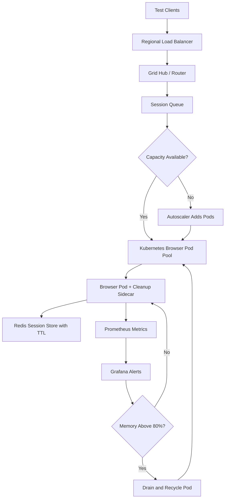

| Difficulty | Channel | Tags |
|---|---|---|
| advanced | system-design | selenium, webdriver, grid |

It started with a grid that passed every test on Monday and mysteriously failed by Friday. Zalando's engineering team lived this exact nightmare across dozens of product teams, where long-lived browser nodes slowly drifted, leaked sessions, and turned test infrastructure into a full-time maintenance job [1]. The fix was not a bigger server or another dashboard; it was a fundamental shift toward disposable, self-healing sessions. That same shift is what makes a 10,000-session, 99.9% uptime Selenium Grid possible today.

---

> ### Real-World Case — Zalando
>
> Zalando's Engineering Productivity team supported dozens of product teams running Selenium UI tests, split between an internal docker-selenium grid and Sauce Labs. Long-lived grid nodes became unstable over time as browser and driver versions drifted, sessions leaked, and nodes accumulated state, making the grid expensive to maintain and slow to recover.
>
> | | |
> |---|---|
> | **Challenge** | Keep a Selenium Grid stable and fast at growing scale without spending engineering time babysitting nodes, chasing memory/session leaks, or paying cloud-testing vendors for every Chrome and Firefox run. |
> | **Solution** | Zalando built Zalenium, a disposable Selenium Grid: each test gets a brand-new Dockerized browser node created on demand and destroyed immediately after the session, so leaked memory and stale state cannot survive into the next test. Unsupported browser requests are transparently relayed to Sauce Labs, BrowserStack, or TestingBot, while video recording, live preview, and a dashboard provide real-time session monitoring. Its dynamic per-session provisioning model was later reflected in upstream Selenium Grid 4's dynamic grid. |
> | **Outcome** | Zalando's published benchmarks on an AWS c3.4xlarge ran 50 tests in about 3.5 minutes at 10 threads, with 10-12 threads producing roughly 16-18 concurrent disposable containers; a Zalenium user reported their suite runtime dropping from over an hour to six minutes. The project became a widely adopted open-source grid and influenced Selenium Grid 4's on-demand browser provisioning. |
> | **Lesson** | Treat browser nodes as cattle, not pets: instead of trying to make long-lived nodes leak-proof, make the session itself the cleanup boundary. Destroying the node after every test turns memory-leak prevention, session lifecycle management, and node failure recovery into the same simple operation. |

---

## Hook — The Grid That Rotated Like Bread

Picture a test suite that takes six minutes on a good day and over an hour on a bad one, with no code change in between. Developers rerun the pipeline, shrug at the flaky failures, and quietly lose trust in the entire quality signal. That is not a testing problem. It is a lifecycle problem. Browser nodes accumulate state, drivers drift from browser versions, sessions leak, and memory climbs until the kernel politely ends the party. The grid did not fail all at once; it rotted one long-lived container at a time. The uncomfortable truth is that most teams scale hardware when they should be scaling hygiene.

## Problem — Long-Lived Nodes Are a Slow-Motion Outage

At 10,000 concurrent sessions, the math gets brutal fast. If one node handles 50 sessions, you need at least 200 nodes before accounting for failure headroom. Long-lived nodes break that model because each session leaves residue: temp profiles, zombie browser processes, stale Docker volumes, orphaned driver locks, and cached state that behaves differently after the hundredth test. Memory leaks do not need to be dramatic. A few megabytes per session multiplied across thousands of runs becomes a cluster-wide reliability tax. Consequently, teams see rising P99 session startup times, random timeouts, and nodes that report healthy while being functionally useless. The core challenge is not raw capacity; it is guaranteed cleanup, fast failure detection, and the ability to replace a poisoned node without pausing the test queue.

## Real-World Case — Zalando's Disposable Grid Breakthrough

In 2017, Zalando's Engineering Productivity team supported dozens of product teams split between an internal docker-selenium grid and Sauce Labs. Their long-lived nodes became unstable as browser and driver versions drifted, sessions leaked, and accumulated state made recovery painfully slow. The team's published benchmarks on an AWS c3.4xlarge ran 50 tests in about 3.5 minutes at 10 threads, while 10-12 threads produced roughly 16-18 concurrent disposable containers. One Zalenium user reported suite runtime dropping from over an hour to six minutes [1]. The lesson was not subtle: disposable browser containers beat carefully nursed pets every time. Zalenium became a widely adopted open-source grid and influenced Selenium Grid 4's on-demand browser provisioning [10]. The plot twist is that throwing containers away made the system more reliable, not less.

## Deep Dive — Architecture, Math, and the Trade-Offs That Bite

The architecture starts with a hub-and-node pattern, but the hub must not be a single pet server. Kubernetes StatefulSets or Deployments manage browser pods across availability zones, while a regional load balancer routes session requests to the nearest healthy hub [3]. Session state lives in Redis with TTL-based expiration, so a crashed node cannot leave an immortal session behind [5]. Each browser pod carries CPU and memory limits, typically around 2GB RAM and 1 CPU, plus a sidecar or init container that cleans stale volumes before the next run [8].

The capacity math is straightforward but easy to underestimate. With 200 nodes at 2GB each, the baseline is 400GB of memory. Add a 30% buffer for browser spikes and garbage collection overhead, and the cluster needs roughly 520GB. Horizontal pod autoscaling should react to queue depth rather than CPU alone, because browser sessions are often memory-bound and bursty [4]. Prometheus metrics expose memory trends, session duration, and failure rates, while Grafana dashboards turn those numbers into alerts before users feel them [6].

Here is the real trade-off table:

| Decision | What You Gain | What It Costs |
|---|---|---|
| Long-lived nodes | Lower cold-start overhead | State drift, leaks, slow recovery |
| Disposable pods | Clean state, predictable behavior | Higher container churn and image pull cost |
| Redis TTL sessions | Automatic leak cleanup | Requires careful TTL tuning |
| Aggressive recycling | Lower memory risk | Lost in-flight sessions if done poorly |
| Circuit breakers | Fast isolation of bad nodes | Temporary capacity reduction |

Load balancing should use weighted round-robin based on node capacity and response time, not blind equal distribution. Health checks must hit a real /status endpoint every 10 seconds and remove a node after three consecutive failures [11]. Circuit breakers, following the classic pattern, isolate failing nodes for a 30-second recovery window so the queue does not keep hammering a dead resource [9]. Pod Disruption Budgets protect at least 85% of capacity during rolling updates or voluntary disruptions [7]. The nuance many teams miss is that health checks must verify browser launch capability, not just process liveness.

## Workflow — From Test Request to Self-Healing Session

The workflow begins when a test client requests a session through the regional load balancer. The hub checks Redis-backed queue depth and asks the autoscaler for capacity if the wait time threatens the P99 target of under two seconds. A scheduler assigns the session to a browser pod, and the pod registers the session in Redis with a TTL. A sidecar monitors the browser process and memory usage, while Prometheus scrapes metrics every few seconds. If memory crosses 80%, the pod is drained and recycled rather than allowed to degrade. If health checks fail three times, the circuit breaker removes the node from rotation immediately. The diagram below tells the visual story end to end.

flowchart TD
    A[Test Clients] --> B[Regional Load Balancer]
    B --> C[Grid Hub / Router]
    C --> D[Session Queue]
    D --> E{Capacity Available?}
    E -->|Yes| F[Kubernetes Browser Pod Pool]
    E -->|No| G[Autoscaler Adds Pods]
    G --> F
    F --> H[Browser Pod + Cleanup Sidecar]
    H --> I[Redis Session Store with TTL]
    H --> J[Prometheus Metrics]
    J --> K[Grafana Alerts]
    K --> L{Memory Above 80%?}
    L -->|Yes| M[Drain and Recycle Pod]
    L -->|No| H
    M --> F

The critical design choice is that cleanup is not a best-effort script. It is part of the session lifecycle. Redis expiration handles abandoned sessions, Kubernetes init containers handle stale volumes, and the scheduler refuses to place new sessions on nodes marked for draining. That combination turns recovery from an incident into routine background work.

## Code Example — A Session Lifecycle Manager That Reaps Leaks

The following Python example shows the core control loop: register sessions with a TTL, refresh them with heartbeats, reap abandoned sessions, and isolate unhealthy nodes with a circuit breaker. It is intentionally framework-light so the lifecycle logic is visible.

python
import time
from dataclasses import dataclass

import redis

SESSION_TTL_SECONDS = 300
MEMORY_LIMIT_PERCENT = 80
FAILURE_THRESHOLD = 3
COOLDOWN_SECONDS = 30

@dataclass
class Node:
    name: str
    memory_percent: float
    consecutive_failures: int = 0
    isolated_until: float = 0.0

class SessionLifecycleManager:
    def __init__(self, redis_url):
        self.store = redis.Redis.from_url(redis_url, decode_responses=True)

    def register(self, session_id, node_name):
        key = f'session:{session_id}'
        self.store.hset(key, mapping={'node': node_name, 'started': time.time()})
        self.store.expire(key, SESSION_TTL_SECONDS)
        self.store.rpush(f'node:{node_name}:sessions', session_id)

    def heartbeat(self, session_id):
        self.store.expire(f'session:{session_id}', SESSION_TTL_SECONDS)

    def reap(self, session_id):
        key = f'session:{session_id}'
        node = self.store.hget(key, 'node')
        self.store.delete(key)
        if node:
            self.store.lrem(f'node:{node}:sessions', 0, session_id)

    def should_isolate(self, node, now=None):
        now = now or time.time()
        if now < node.isolated_until:
            return True
        healthy = (
            node.memory_percent < MEMORY_LIMIT_PERCENT
            and node.consecutive_failures < FAILURE_THRESHOLD
        )
        if not healthy:
            node.isolated_until = now + COOLDOWN_SECONDS
            return True
        return False

The register method creates a hash with session metadata and sets a TTL, so Redis deletes abandoned sessions automatically [5]. The heartbeat method extends the TTL only while the browser is genuinely alive. The reap method removes the session key and its node index entry, preventing orphaned references from inflating future scheduling decisions. Finally, should_isolate implements a simple circuit breaker: memory pressure or repeated failures trigger a cooldown window, during which the scheduler routes work elsewhere [9]. The code is small because the real power comes from combining it with Kubernetes probes, resource limits, and Prometheus alerts [11].

## Lessons Learned — Treat Browsers Like Cattle, Not Pets

The first lesson is that disposable infrastructure is a reliability feature, not a cost optimization. Zalando's results showed that replacing long-lived nodes with fresh containers reduced suite runtime from over an hour to six minutes for at least one user [1]. The second lesson is that TTL-based session cleanup must be paired with node-level cleanup; one without the other leaves a leak path open [5]. The third lesson is that autoscaling on queue depth beats autoscaling on CPU for browser workloads, because a node can look idle while a session queue grows [4]. The fourth lesson is to isolate failures fast. Three failed health checks and a 30-second circuit breaker window are enough to prevent a bad node from poisoning the entire grid [9].

Many teams discover too late that their monitoring was measuring the wrong thing. Node-up metrics look great while session startup latency quietly doubles. Track P99 session initiation, memory growth per node, session duration, and cleanup failures together. Use Pod Disruption Budgets so rolling updates never drop below 85% capacity [7]. Keep browser and driver images version-pinned and rebuild them weekly rather than patching pets in place [8]. The memorable insight is simple: a Selenium Grid does not scale by adding nodes; it scales by making every node safe to destroy.

---

## Self-Healing Selenium Grid Flow

<strong>Original Interview Question</strong>

**Q:** Design a scalable Selenium Grid architecture to handle 10,000 concurrent test sessions with 99.9% uptime, ensuring zero memory leaks through automatic session lifecycle management, real-time monitoring, and graceful node failure recovery across multiple data centers?

**A:** Deploy Kubernetes cluster with auto-scaling node pools, Redis session store with TTL policies, Prometheus metrics for memory monitoring, circuit breakers for node isolation, and sidecar containers for session cleanup. Implement health checks, resource quotas, and rolling updates.

## Conclusion

Zalando did not solve grid instability by buying bigger machines; it solved it by making every browser node disposable [1]. That is the transformation waiting for any team running large-scale Selenium workloads. Start by adding TTLs to sessions, health checks that verify real browser capability, and a recycle policy that drains nodes before memory pressure becomes an outage. Then measure P99 session startup and cleanup failures, not just node uptime. The team that treats browsers like cattle will spend less time debugging infrastructure and more time shipping software.

---

## References

1. [Zalando incident report](https://engineering.zalando.com/posts/2017/02/zalenium-a-disposable-and-flexible-selenium-grid-infrastructure.html) — article
2. [Selenium Grid Documentation](https://www.selenium.dev/documentation/grid/) — documentation
3. [Kubernetes StatefulSets](https://kubernetes.io/docs/concepts/workloads/controllers/statefulset/) — documentation
4. [Kubernetes Horizontal Pod Autoscaling](https://kubernetes.io/docs/tasks/run-application/horizontal-pod-autoscale/) — documentation
5. [Redis EXPIRE Command and TTL Semantics](https://redis.io/docs/latest/commands/expire/) — documentation
6. [Prometheus Overview](https://prometheus.io/docs/introduction/overview/) — documentation
7. [Kubernetes Pod Disruption Budgets](https://kubernetes.io/docs/concepts/workloads/pods/disruptions/) — documentation
8. [Docker Selenium](https://github.com/SeleniumHQ/docker-selenium) — documentation
9. [Circuit Breaker Design Pattern](https://en.wikipedia.org/wiki/Circuit_breaker_design_pattern) — documentation
10. [Zalenium: Disposable Selenium Grid](https://github.com/zalando/zalenium) — documentation
11. [Kubernetes Liveness, Readiness, and Startup Probes](https://kubernetes.io/docs/tasks/configure-pod-container/configure-liveness-readiness-startup-probes/) — documentation

---

**Author:** Satishkumar Dhule — [GitHub](https://github.com/satishkumar-dhule) · [LinkedIn](https://linkedin.com/in/satishkumar-dhule) · [Website](https://satishkumar-dhule.github.io)
