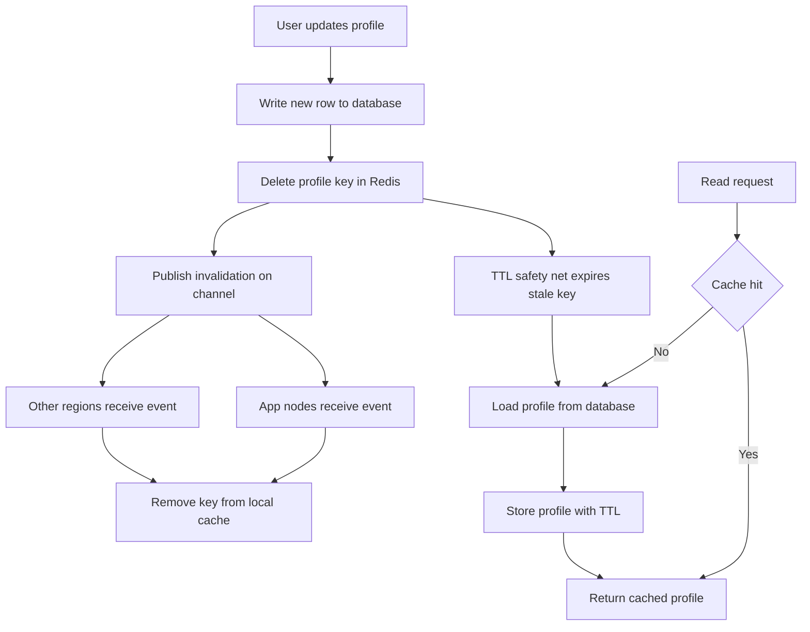

| Difficulty | Channel | Tags |
|---|---|---|
| beginner | backend | redis, memcached, cache-invalidation |

Meta's TAO and Memcache systems serve more than one quadrillion queries a day, caching user and social-graph data that behaves exactly like a profile service [1]. Every profile update must ripple through caches across regions without leaving a stale copy behind, and at that scale, a tiny inconsistency becomes millions of wrong answers [1]. Meta's engineers pushed cache consistency from six nines to ten nines at a five-minute timescale, then used the same tracing to diagnose a production bug in under 30 minutes [1]. The lesson for anyone building a profile service is simple: invalidation is not a cleanup task, it is the core of your cache design.

---

> ### Real-World Case — Meta (Facebook)
>
> Meta operates TAO and Memcache, two of the world's largest cache deployments, caching user and social-graph metadata that behaves much like a profile service. They serve more than one quadrillion queries a day, and any profile update must invalidate cached copies across regions without leaving stale data behind.
>
> | | |
> |---|---|
> | **Challenge** | The standard playbook—delete the cache key on write and rely on a TTL—is not enough at scale. Concurrent cache fills and invalidations can reorder, so an old value can be written back after the delete and remain stale indefinitely. Debugging this is nearly impossible because logging every cache mutation would turn a read-heavy workload into a massive write-heavy tracing workload. |
> | **Solution** | Meta added version fields to resolve conflicts so older data cannot overwrite newer data, then built Polaris, a service that measures client-observable cache consistency against the database. They also built a stateful tracing library that logs cache mutations only during the short post-write race window where invalidations and fills can interleave, making rare bugs reproducible. |
> | **Outcome** | TAO's cache consistency improved from 99.9999% (six nines) to 99.99999999% (10 nines) at a five-minute timescale—less than 1 in 10 billion cache writes inconsistent after five minutes. A production bug that previously could take weeks to find was diagnosed in under 30 minutes using the new tracing. |
> | **Lesson** | Deleting the key on update is necessary but not sufficient; cache invalidation is a distributed-systems state-machine problem. Versioning, idempotent invalidation, and observability matter more than the Redis-vs-Memcached choice, and TTL is a backstop rather than a consistency strategy. The team also warns that invalidating derived or relational data can cause unbounded write amplification. |

---

## Hook — The 40-Millisecond Lie

Picture a profile page that loads in 40 milliseconds because it is served from cache. A user changes their display name, the database write succeeds, and the cache still returns the old name for the next ten minutes. Support gets the ticket, the user loses trust, and the fix sounds trivial: delete a key.

In practice, that one delete has to reach every cache node, every region, and every in-flight request. The stakes are not just a stale avatar; they are correctness, revenue, and the kind of bug that only appears under production traffic. Many developers discover this the hard way: the cache works beautifully until the first write, and then the system starts telling different stories to different users.

So how do you make a profile update visible everywhere without turning every read into a database query? The answer starts with understanding why invalidation is deceptively hard.

## Problem — When Deleting One Key Is Not Enough

Profile services are overwhelmingly read-heavy. A single user update might be followed by hundreds or thousands of reads, which makes caching an obvious win. The usual pattern is cache-aside: check the cache, return on a hit, load from the database on a miss, then populate the cache with a TTL. That pattern is simple, effective, and completely dependent on one uncomfortable detail: knowing when the cached copy is no longer true [4].

However, the hard part is not adding Redis or Memcached. The hard part is coordinating invalidation across concurrent readers and writers. Consider two common races. First, a reader misses the cache, reads an old database value, and then writes that stale value back after the writer has already deleted the key. Second, two updates arrive close together and the slower writer overwrites the cache with older data. These are cache coherence problems, and they are the reason HTTP caching defines explicit freshness and validation rules rather than trusting optimism [5].

The TTL trade-off makes the problem more subtle. A short TTL, say 60 seconds, limits staleness but increases database load and makes thundering herds more likely. A long TTL, say 30 minutes, improves hit rate but lets stale profiles linger. Here is the key point: a TTL is a safety net, not an invalidation strategy. It bounds the damage when invalidation fails; it does not replace invalidation.

This is exactly the problem Meta had to solve at a scale where 'just wait for the TTL' is not an acceptable answer.

## Real-World Case — Meta's TAO and Memcache at Quadrillion Scale

Meta operates TAO and Memcache, two of the world's largest cache deployments, caching user and social-graph metadata that behaves much like a profile service [1]. TAO is a distributed data store built for the social graph, and its cache layer serves more than one quadrillion queries a day [1][11]. At that volume, a profile update cannot simply invalidate one local key; it has to invalidate cached copies across regions without leaving stale data behind [1].

Meta's published work describes the consistency challenge in numbers that are hard to ignore. TAO's cache consistency improved from 99.9999% to 99.99999999% at a five-minute timescale, which means less than 1 in 10 billion cache writes remained inconsistent after five minutes [1]. The same observability investment paid off in debugging: a production bug that previously could have taken weeks to find was diagnosed in under 30 minutes using the new tracing [1].

The plot twist is that Meta did not achieve this by making every read hit the database or by making every write painfully synchronous. The system uses a carefully designed invalidation path, strong observability, and an understanding that consistency is a spectrum rather than a binary. For a profile service, that means you should measure stale reads explicitly instead of assuming they do not happen.

Building on Meta's experience, the next question is practical: which caching pattern gives you the best chance of matching that discipline in a normal application?

## Deep Dive — Write-Through, Delete-on-Write, and the Redis vs Memcached Trade-Off

The first design decision is how writes interact with the cache. Write-through means the application writes to the database and the cache as part of the same logical operation. Cache-aside means the application writes to the database, invalidates the cache, and lets the next read repopulate it. Both can work, but for profile updates, delete-on-write is often the safer default because it avoids two writers racing to set different cached values [4].

💡 Insight: Delete the key instead of overwriting it. If writer A deletes and writer B later writes a fresh value, the next read still gets a chance to load the authoritative row. If both writers overwrite the cache directly, the slower writer can silently resurrect stale data.

A practical profile service usually combines three techniques:

- Cache-aside reads for the common path
- Delete-on-write for updates
- A TTL of 5 to 30 minutes as a bounded safety net

The choice between Redis and Memcached then becomes a question of which failure modes you want to manage. Redis provides pub/sub, persistence options, and richer data structures [2]. Memcached is a simpler key-value cache with lower per-key overhead and straightforward horizontal scaling [3]. The table below shows the real trade-off.

| Concern | Redis | Memcached |
| --- | --- | --- |
| Distributed invalidation | Built-in pub/sub and keyspace notifications [7] | Requires application-level coordination |
| Data model | Strings, hashes, sets, streams, and more [2] | Key-value strings [3] |
| Persistence | Optional RDB and AOF [2] | None; volatile by design [3] |
| Scaling model | Cluster and replicas [2] | Simple sharding across nodes [3] |
| Memory overhead | Higher per key | Lower per key |
| Best fit | Complex invalidation and durability needs | Pure volatile caching at scale |

⚠️ Watch Out: Pub/sub is not a durability mechanism. Redis pub/sub delivers messages to currently connected subscribers, but it does not replay missed events after a reconnect [7]. If a node is down during invalidation, the TTL and a periodic reconciliation job must cover the gap.

🔥 Hot Take: Memcached's simplicity is a feature, not a limitation. If your invalidation strategy is already application-driven, Memcached removes an entire category of operational complexity. If you need Redis pub/sub to avoid manual coordination, Redis earns its overhead.

Consequently, the decision is not 'which cache is faster?' The real question is 'which cache makes invalidation easier to reason about in your architecture?' For many teams, Redis wins because pub/sub turns invalidation into an explicit event instead of a manual checklist. For teams with a very simple cache-aside workload, Memcached can be the more honest choice [3][6].

With the trade-offs clear, the next step is turning them into a repeatable workflow.

## Workflow — From Profile Update to Global Invalidation

A reliable profile invalidation flow has one job: make the new value visible everywhere, and make stale values temporary. The workflow below is the backbone of that guarantee.

1. The user submits a profile update.
2. The service validates and merges the change.
3. The service writes the new profile to the database.
4. The service deletes the profile cache key in Redis.
5. The service publishes an invalidation event on a channel [7].
6. Every app node and region subscribed to that channel removes its local copy.
7. The next read misses the cache, loads the authoritative row, and repopulates the cache with a TTL.
8. Monitoring records invalidation latency, cache hit rate, and stale-read indicators.

The Mermaid diagram below tells the same story visually, including the TTL safety net that catches missed events.

flowchart TD
    A[User updates profile] --> B[Write new row to database]
    B --> C[Delete profile key in Redis]
    C --> D[Publish invalidation on channel]
    D --> E[App nodes receive event]
    D --> F[Other regions receive event]
    E --> G[Remove key from local cache]
    F --> G
    H[Read request] --> I{Cache hit}
    I -- Yes --> J[Return cached profile]
    I -- No --> K[Load profile from database]
    K --> L[Store profile with TTL]
    L --> J
    C --> M[TTL safety net expires stale key]
    M --> K

🎯 Key Point: The database is the source of truth. The cache is a copy. Every copy needs both a fast invalidation path and a slow expiry path, because distributed systems will eventually drop a message or delay a consumer.

This leads naturally to implementation. The code example below shows the core loop in Python, using Redis for both the cache and the invalidation channel.

## Code Example — A Production-Shaped Python Invalidation Loop

The following example implements cache-aside reads, delete-on-write updates, and Redis pub/sub invalidation [2][7]. It is intentionally compact, but the structure mirrors what a real profile service needs: a clear read path, a clear write path, and a subscriber that keeps local caches honest.

Start by noticing the order of operations in update_profile. The database write happens first, then the cache delete, then the publish. If the process crashes between the write and the delete, the TTL still bounds the staleness. If the publish fails, the TTL still bounds the staleness. That is defense in depth, not paranoia [5][10].

Also notice that the code deletes rather than updates the cache. Deleting avoids the classic race where an older writer overwrites a newer cached value. The next read repopulates from the database, which is the authoritative source.

Finally, the subscriber uses a local cache eviction hook. In a multi-node deployment, each node subscribes to the same channel and removes the key from its own local cache. For multi-region deployments, the same event can be bridged through a regional message bus or replicated channel, as long as missed messages are reconciled by TTL and periodic audits [7].

## Lessons Learned — What to Do Before the Next Stale Read

Meta's experience shows that cache consistency is an engineering discipline, not a lucky side effect of picking the right database [1]. The teams that get it right tend to share a few habits.

- **Delete on write, do not overwrite on write.** Overwriting opens the door to out-of-order writes and stale resurrection [4].
- **Always set a TTL.** A 5 to 30 minute TTL for profiles is a reasonable starting range. It is not the invalidation strategy; it is the failure budget [5].
- **Use pub/sub for fast propagation, but assume messages can be missed.** Redis pub/sub is best-effort for connected subscribers, not a durable event log [7].
- **Instrument stale reads.** Track invalidation latency, cache hit rate, and a sampled consistency check. Meta's tracing investment turned a weeks-long bug hunt into a 30-minute diagnosis [1].
- **Beware the thundering herd.** When a hot profile key expires or is deleted, many readers may hit the database at once. Add request coalescing, per-key locks, or stale-while-revalidate behavior [6][10].
- **Version sensitive records.** For high-contention profiles, a version number in the cache key or value makes stale writes easier to reject.

⚠️ Battle scar: Many teams add a cache, see a 90% hit rate, and declare victory. Then a profile update goes missing in one region and the incident review reveals there was no invalidation metric at all. If you cannot answer 'how stale is the cache right now?' you do not have a cache strategy; you have a hope strategy.

If this feels overwhelming, you are not alone. Start with the simplest reliable version: write to the database, delete the cache key, set a TTL, and publish an invalidation event. Measure it. Then add regional propagation and reconciliation only when the data shows you need them.

So what should you do differently tomorrow? Pick one profile update path and trace it end to end. Confirm that the database write, cache delete, publish, and subscriber eviction all happen in the right order. That single exercise will teach you more than another hour of comparing Redis and Memcached benchmarks.

---

## Profile Update and Invalidation Flow

<strong>Original Interview Question</strong>

**Q:** You're building a user profile service that caches frequently accessed profiles. How would you implement cache invalidation when a user updates their profile, and what trade-offs would you consider between Redis and Memcached?

**A:** Implement write-through caching with TTL-based expiration. On profile update, invalidate the cache by deleting the key and writing new data to both the database and cache. Redis offers pub/sub for automatic distributed invalidation, while Memcached requires manual coordination across nodes.

## Conclusion

Meta's story ends with a number that should stick with every backend developer: consistency improved from six nines to ten nines at a five-minute timescale, and a bug that once took weeks to find was diagnosed in under 30 minutes [1]. That did not happen because someone picked Redis over Memcached. It happened because invalidation was treated as a first-class system with tracing, ownership, and a clear fallback. The next time you add a cache to a profile service, start with the write path: write the database, delete the key, publish the invalidation, set a TTL, and measure the result. A cache is a copy of the truth, and every copy needs a reliable way to be told that the truth changed.

---

## References

1. [Meta (Facebook) incident report](https://engineering.fb.com/2022/06/08/core-infra/cache-made-consistent/) — article
2. [Redis](https://en.wikipedia.org/wiki/Redis) — documentation
3. [Memcached](https://en.wikipedia.org/wiki/Memcached) — documentation
4. [Cache coherence](https://en.wikipedia.org/wiki/Cache_coherence) — documentation
5. [RFC 9111: HTTP Caching](https://datatracker.ietf.org/doc/html/rfc9111) — documentation
6. [What is Amazon ElastiCache for Redis?](https://docs.aws.amazon.com/AmazonElastiCache/latest/red-ug/WhatIs.html) — documentation
7. [Redis Pub/Sub](https://redis.io/docs/latest/develop/interact/pubsub/) — documentation
8. [redis/redis on GitHub](https://github.com/redis/redis) — documentation
9. [memcached/memcached on GitHub](https://github.com/memcached/memcached) — documentation
10. [HTTP caching](https://developer.mozilla.org/en-US/docs/Web/HTTP/Guides/Caching) — documentation
11. [TAO: Facebook's Distributed Data Store for the Social Graph](https://www.usenix.org/conference/atc13/technical-sessions/presentation/bronson) — paper

---

**Author:** Satishkumar Dhule — [GitHub](https://github.com/satishkumar-dhule) · [LinkedIn](https://linkedin.com/in/satishkumar-dhule) · [Website](https://satishkumar-dhule.github.io)
