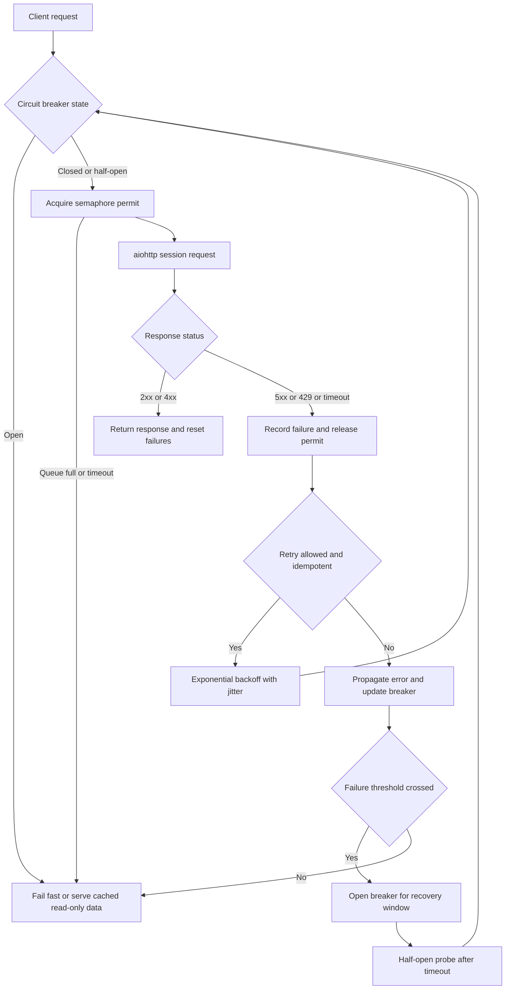

| Difficulty | Channel | Tags |
|---|---|---|
| advanced | backend | asyncio, aiohttp, concurrency |

At 16:58 UTC on September 29, 2025, PostHog's feature-flag service began returning HTTP 504 errors to most of its US traffic, even for read-only flags that never touched the writer database [1]. The trigger was not a bug in the flags product, but an unrelated deployment that cut a database connection timeout from one second to 300 milliseconds while the writer database was already saturated [1]. Within minutes, pods could not create connection pools and entered crash loops, turning a narrow database problem into a 108-minute outage that affected roughly 78% of US evaluations [1]. The lesson is uncomfortable: in aiohttp, a timeout is not just a number—it is a load-shedding policy, and a connection pool manager must treat it that way.

---

> ### Real-World Case — PostHog
>
> On September 29, 2025, PostHog's Feature Flags service suffered a 1-hour-48-minute outage after an unrelated deployment reduced its database connection timeout from 1 second to 300 milliseconds while the writer database was already saturated by person-ingestion load. Pods began failing to create connection pools and entered crash loops.
>
> | | |
> |---|---|
> | **Challenge** | Connection-pool waits exceeded the new 300ms timeout, and the retry logic had no circuit breaker or exponential backoff. Failed connection attempts multiplied into a retry storm that overwhelmed the writer database. Kubernetes also kept routing traffic to crash-looping pods for up to 45 minutes, while hardcoded timeout values and a failed ArgoCD rollback delayed recovery. |
> | **Solution** | PostHog moved connection timeouts into runtime configuration and raised them to handle peak load. It then began separating read and write connection pools into distinct failure domains, adding circuit breakers with exponential backoff to stop retry amplification, tightening liveness/readiness probes, and documenting rollback runbooks. |
> | **Outcome** | The outage lasted from 16:58 to 18:46 UTC, and approximately 78% of US feature-flag evaluation requests failed with HTTP 504 errors, including read-only flags that did not need writer-database access. Manual configuration changes restored service after the automated rollback failed. |
> | **Lesson** | Lowering a timeout can make an overloaded pool worse when retries are unbounded: a 1s to 300ms change turned database saturation into a service-wide cascade. Bound concurrency, add jittered exponential backoff plus a circuit breaker, externalize timeout configuration, isolate read/write pools, and ensure health probes remove failing instances quickly. PostHog's service is written in Rust, not aiohttp, but the failure mode maps directly to an aiohttp TCPConnector plus Semaphore, retry, and circuit-breaker design. |

---

## Hook — When a 300-Millisecond Change Became a 108-Minute Outage

The deploy looked routine. No feature-flag code changed, no new model shipped, and no customer-facing announcement went out. Yet at 16:58 UTC, PostHog's flags service started failing [1]. For the next 108 minutes, teams watched 504s climb while pods restarted, connection pools refused to initialize, and an automated rollback failed to bring the service back [1]. The uncomfortable part? The change was a timeout reduction from one second to 300 milliseconds—a number that probably looked harmless in review.

This is the kind of failure that makes senior engineers sit up. A connection pool is supposed to protect a service from overload. Instead, it can become the amplifier that turns a slow dependency into a crash loop. How does a single timeout setting escape its blast radius and take down read-only traffic that never needed the struggling database? The answer starts with understanding what a pool actually controls.

## Problem — A Pool Is Not a Safety Net Until It Has Boundaries

Connection pools are admission control systems, whether teams treat them that way or not. Every request that enters a pool consumes a slot, a socket, a file descriptor, and a slice of memory; when the downstream service slows down, those resources are held longer [2]. A semaphore can cap concurrent work, but it does not decide what to do when the queue behind it grows. Without a bounded queue and a clear rejection policy, latency climbs, clients time out, and retries arrive just in time to make the saturation worse [5].

Many developers think a bigger pool is the safe answer. In reality, a larger pool can push more load into an already saturated dependency and increase tail latency for everyone [2]. The opposite mistake is just as common: timeouts so tight that healthy-but-slow responses are treated as failures, triggering retries and circuit breakers that create a second outage on top of the first [5]. PostHog's incident sits exactly on that fault line.

The hardest part is that graceful degradation is product-specific. A read-only feature flag can often be served from a cache, a replica, or a last-known-good snapshot. A write to a billing system cannot. A single global circuit breaker or a single global pool collapses those distinct failure domains into one, which is how a writer-database problem becomes a read-path outage [6]. That is the gap a production-grade aiohttp pool manager must close. Also remember that an aiohttp ClientSession owns its connector and should be reused for the lifetime of the application, not created per request [4].

## Real-World Case — PostHog's Feature Flags Service

On September 29, 2025, PostHog's Feature Flags service suffered a 1-hour-48-minute outage, from 16:58 to 18:46 UTC [1]. An unrelated deployment reduced the database connection timeout from one second to 300 milliseconds while the writer database was already saturated by person-ingestion load [1]. The tighter timeout meant pods could not create connection pools reliably; they entered crash loops instead of serving traffic [1].

The impact was brutal and counterintuitive. Approximately 78% of US feature-flag evaluation requests failed with HTTP 504 errors, including read-only flags that did not need writer-database access at all [1]. The automated rollback did not restore service, so engineers had to make manual configuration changes to recover [1]. In other words, the system's safety mechanisms—timeouts, pool creation, and pod restarts—interacted in a way that widened the blast radius rather than containing it.

⚠️ Watch Out: The incident is not a story about one bad timeout value. It is a story about coupling: the read path shared a failure domain with the write path, and the pool's initialization depended on a database that was already under pressure [1]. If your feature-flag service can return a stale flag during a database emergency, that is not a compromise—it is a resilience requirement.

## Deep Dive — Semaphores, Timeouts, and Breakers Are Different Tools

Building on that incident, the core design question is not 'how many connections should the pool have?' It is 'which failures should this pool absorb, and which should it fail fast?' A resilient aiohttp manager usually combines several controls, and each one protects a different resource [2][3].

| Control | What it protects | Failure mode if misconfigured |
| --- | --- | --- |
| Semaphore | Local concurrency | Queue grows without bound and latency explodes |
| Connector limit | Sockets and file descriptors | Hidden waits, connection churn, or resource exhaustion |
| Timeout budget | Tail latency | Premature failures or requests that hold slots forever |
| Retry with jitter | Transient faults | Retry storms that hammer a recovering dependency |
| Circuit breaker | A failing dependency | Cascading load and slow failure for every caller |
| Bulkhead | Failure isolation | One dependency sinks unrelated traffic |

💡 Insight: The semaphore and the connector limit are not interchangeable. The semaphore controls how many requests your application admits; the connector controls how many sockets aiohttp opens [2][3]. If the connector limit is lower than the semaphore, requests wait in a hidden queue that your metrics may never show. If it is much higher, you may open more sockets than the downstream service can handle. Align both with the same capacity budget.

Circuit breakers add another layer. In the closed state, requests flow normally; after a failure threshold, the breaker opens and rejects calls immediately; after a recovery window, it moves to half-open and allows a limited probe [6]. That half-open probe is where many implementations get sloppy: if every waiting request is allowed through, the breaker is not really testing recovery—it is replaying the outage.

🔥 Hot Take: A global circuit breaker is often worse than no breaker at all. Breakers should be scoped to a dependency, an endpoint class, or a tenant—not to the entire application. PostHog's read-only flags needed a different fallback from its writer-dependent operations [1]. The same is true for your services.

Retries need equal discipline. Exponential backoff with jitter spreads retry attempts so that clients do not synchronize into a thundering herd [5][7]. Moreover, retries should be limited to idempotent operations unless the downstream API supports idempotency keys; HTTP semantics make this distinction explicit for safe and idempotent methods [8]. A retry on a non-idempotent write can turn a timeout into duplicate work.

The plot twist is that longer timeouts are not automatically safer. A generous timeout keeps a request alive, but it also holds a semaphore permit and a socket for longer, which can starve healthy requests behind it. PostHog's 300-millisecond timeout was too aggressive for a saturated writer pool, but simply raising it without limiting queue depth would have moved the failure rather than removed it [1]. Timeouts, pool size, and retry policy have to be designed together.

## Workflow — Designing the Request Lifecycle

Here is a practical workflow for turning those controls into a coherent manager. The accompanying flowchart traces a request from admission to recovery, including the fail-fast and fallback paths.

1. Classify traffic by dependency and consequence. Separate read-only flag evaluation from writes, and give each class its own pool, timeout budget, and fallback behavior.
2. Set an end-to-end latency budget, then derive connect, read, and total timeouts from it. A total timeout that exceeds the caller's deadline is just a resource leak with extra steps [5].
3. Size the pool from measured concurrency and downstream capacity, not from a round number. Align the semaphore and aiohttp connector limits so one does not hide the other [2].
4. Add bounded admission control. When the queue is full, reject fast with a clear error or serve a degraded response instead of letting latency grow without limit.
5. Retry only idempotent requests, with capped attempts, exponential backoff, and jitter [5][7][8].
6. Wrap each dependency in its own circuit breaker, and use a single half-open probe to test recovery [6].
7. Instrument saturation, queue depth, timeout rate, retry rate, breaker state, and pool initialization failures. Alert on symptoms that precede an outage, not just on 504s.
8. Wire readiness and liveness probes carefully, and close sessions cleanly during shutdown so pods do not exit with connections in flight [9].

The flowchart makes the critical branch obvious: when the breaker is open, the request should not wait for a semaphore permit at all. It should take the fallback path immediately.

## Code Example — An aiohttp Manager That Degrades Instead of Collapsing

The following manager implements the core pattern: a semaphore for admission control, a dependency-scoped circuit breaker, bounded retries with jitter, and explicit session cleanup. It is intentionally small enough to adapt, but the design choices map directly to the workflow above.

The code uses a single `ConnectionPoolManager` per downstream dependency. That is deliberate: a shared manager across unrelated services would recreate the coupling that made PostHog's outage so wide [1]. The `get` method retries only when the caller marks the request idempotent, and the circuit breaker short-circuits before a request can consume a permit.

## Lessons Learned — What to Change Before the Next Timeout Tweaks

PostHog's outage offers a compact checklist for anyone operating aiohttp services under load [1].

- Treat timeouts as capacity decisions. A shorter timeout frees resources faster, but it can also reject healthy requests and trigger retries; a longer timeout protects slow responses, but it holds shared capacity longer [5].
- Scope pools and breakers by dependency. Read-only traffic should not share a failure domain with writer-dependent traffic [1][6].
- Bound every queue. An unbounded wait is not graceful degradation; it is delayed failure with worse metrics.
- Retry only idempotent work, with jitter and a hard attempt cap [5][7][8].
- Test configuration changes under realistic saturation. A timeout value that works in staging with an idle database can fail immediately in production [1].
- Use readiness probes to stop routing traffic to pods that cannot initialize their pools, and close sessions during shutdown [9].
- Measure queue depth and pool initialization failures. Those leading indicators often reveal trouble before 504s reach customers.

🎯 Key Point: A timeout is a promise about how long you are willing to hold a shared resource. Make that promise deliberately, and make sure the rest of the pool manager honors it.

---

## Resilient Request Lifecycle

<strong>Original Interview Question</strong>

**Q:** How would you implement a connection pool manager for aiohttp that handles graceful degradation under high load and connection timeouts?

**A:** Implement a connection pool manager for aiohttp using a semaphore to limit concurrent connections, exponential backoff for retrying failed requests, and circuit breaker pattern to gracefully degrade under high load and connection timeouts.

## Conclusion

PostHog's outage began with a 300-millisecond change and ended with manual intervention, but the real story is about shared failure domains [1]. A writer database under ingestion pressure should never have been able to crash the pods serving read-only flags. You cannot eliminate slow dependencies, but you can stop one saturated pool from becoming a service-wide crash loop. Tomorrow, audit every timeout, align every pool limit, and ask which traffic can safely fail fast or fall back to stale data. Share this with your team: a timeout is a load-shedding decision, not a magic number.

---

## References

1. [PostHog incident report](https://posthog.com/handbook/company/post-mortems/2025-09-29-flags-is-down) — article
2. [aiohttp client advanced usage](https://docs.aiohttp.org/en/stable/client_advanced.html) — documentation
3. [asyncio synchronization primitives](https://docs.python.org/3/library/asyncio-sync.html) — documentation
4. [aiohttp client quickstart](https://docs.aiohttp.org/en/stable/client_quickstart.html) — documentation
5. [Timeouts, retries, and backoff with jitter](https://docs.aws.amazon.com/builders-library/timeouts-retries-and-backoff-with-jitter.html) — documentation
6. [Circuit breaker design pattern](https://en.wikipedia.org/wiki/Circuit_breaker_design_pattern) — documentation
7. [Exponential backoff](https://en.wikipedia.org/wiki/Exponential_backoff) — documentation
8. [RFC 9110: HTTP Semantics](https://datatracker.ietf.org/doc/html/rfc9110) — documentation
9. [Configure liveness, readiness and startup probes](https://kubernetes.io/docs/tasks/configure-pod-container/configure-liveness-readiness-startup-probes/) — documentation

---

**Author:** Satishkumar Dhule — [GitHub](https://github.com/satishkumar-dhule) · [LinkedIn](https://linkedin.com/in/satishkumar-dhule) · [Website](https://satishkumar-dhule.github.io)
