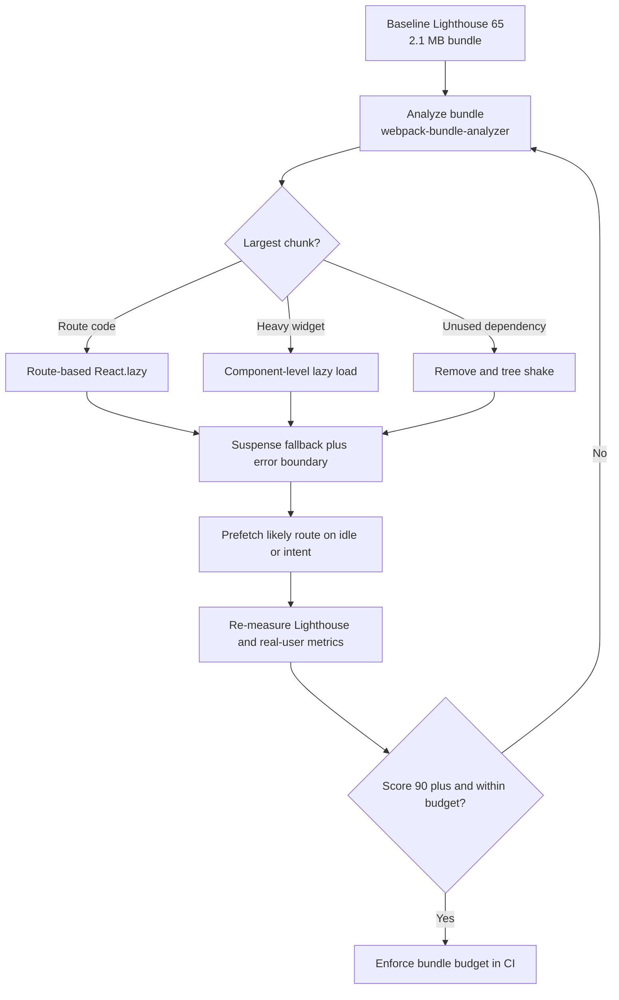

| Difficulty | Channel | Tags |
|---|---|---|
| intermediate | frontend | lighthouse, bundle, lazy-loading |

Intercom's Messenger is a React app embedded on thousands of customer websites, which means every visitor downloads its JavaScript before they can chat. As features piled up, the single frame.js bundle swelled from roughly 400 KB to nearly 600 KB gzipped, quietly taxing every customer's page and forcing returning visitors to re-download the whole thing dozens of times a day [1]. The fix was not a heroic rewrite; it was a disciplined campaign of bundle analysis, route-level code splitting, and lazy loading that took the Messenger down to 240 KB and pushed its Lighthouse score from 59 to 100 [1]. The same playbook can take a React app from 65 to 90+, and the story of how it works—and where it bites—is worth understanding before your next deploy.

---

> ### Real-World Case — Intercom
>
> Intercom's Messenger is a React app embedded on thousands of customer websites, so its JavaScript ships to visitors on every page load. Over time, as new features were added, the single `frame.js` bundle crept from about 400 KB to nearly 600 KB of gzipped JavaScript, slowing down every customer's site. Because Intercom deploys dozens of versions per day, returning visitors were forced to re-download the entire bundle repeatedly.
>
> | | |
> |---|---|
> | **Challenge** | Cut a bloated 600 KB gzipped React bundle and improve load performance without breaking a Messenger used across wildly different customer sites and networks. The team needed to find where the bytes were going, split code that wasn't needed on first paint, and avoid latency regressions from lazy loading. |
> | **Solution** | They ran webpack-bundle-analyzer to map the bundle, then split vendor packages (~40% of the bundle) into a separately cached `vendor.js` because dependencies rarely change. They code-split the app by route using react-loadable, and preloaded the Messenger chunk on hover of the launcher to hide the latency cost. They also cherry-picked Lodash with babel-plugin-lodash, dynamic-imported only the needed locale (saving ~55 KB), lazy-loaded the Sentry SDK, moved the public-suffix list logic server-side, swapped a full `css` import for `css/lib/parse`, and migrated styles to Emotion CSS-in-JS so styles could be split with components instead of shipping a 4,000-rule Sass file. |
> | **Outcome** | The Messenger dropped from nearly 600 KB to 240 KB gzipped — a 65% reduction. On mobile, the savings shaved up to 5 seconds on fast 3G and up to 11 seconds on slow 3G. Google Lighthouse score went from 59 to 100, and teams could add features without growing the initial bundle. |
> | **Lesson** | The biggest wins came from measurement, not guesswork: splitting rarely-changing vendor code for caching and cutting unused imports (whole Lodash, Sentry, locales, PSL, CSS) mattered as much as lazy loading. The counterintuitive move was rewriting the stylesheet into CSS-in-JS specifically so it could participate in bundle splitting — and preloading on hover to make dynamic imports feel instant. |

---

## Hook — The Four-Second Wake-Up Call

Picture a dashboard that looks healthy. The deploy pipeline is green, the feature flags are on, and the product team is shipping faster than ever. Then a customer sends a screenshot: their marketing site now takes more than four seconds to become interactive on a mid-range phone, and the Lighthouse score has slid to 65.

That is the moment bundle size stops being an abstract build statistic and becomes a business problem. Every kilobyte of JavaScript has to be downloaded, parsed, compiled, and executed before the page can respond to a tap [2]. On a fast laptop the cost hides. On a congested mobile network, it compounds.

The Intercom team knew this feeling. Their Messenger is embedded on thousands of customer sites, so every feature they shipped placed a direct tax on someone else's page load [1]. The question was not whether to optimize. It was where to start when the bundle already felt like a single, tangled organism.

## Problem — The 2.1 MB Illusion of Speed

Here is the uncomfortable truth about a 2.1 MB bundle and a 4.2-second Time to Interactive: the number is rarely caused by one dramatic mistake. It is usually the accumulated result of dozens of reasonable decisions—a charting library here, an analytics SDK there, a shared component that quietly imports the entire design system.

Bundle weight hurts in three separate ways:

- **Download cost:** bytes travel over the network, and mobile users pay for them in time and data.
- **Parse and compile cost:** the browser must turn JavaScript into something it can execute, often on CPUs far slower than a developer laptop.
- **Execution cost:** long tasks block the main thread, delaying input responsiveness and pushing TTI later [9].

Lazy loading addresses the first two by deferring non-critical code until it is needed [2]. Code splitting is the mechanism that makes those deferrals possible [3]. But neither works well as a random act of optimization. Without measurement, teams often split the wrong things, create request waterfalls, and wonder why the score barely moved.

So how did a company shipping dozens of Messenger versions per day turn this around without freezing feature work?

## Real-World Case — Intercom

Intercom's Messenger is a React application embedded on thousands of customer websites, which means its JavaScript ships to visitors on every page load—whether or not they open the chat widget [1]. Over time, as new features were added, the single frame.js bundle crept from about 400 KB to nearly 600 KB of gzipped JavaScript [1].

The deployment cadence made the problem worse. Because Intercom deploys dozens of versions per day, returning visitors could not rely on a stable cached bundle; a new version meant re-downloading the entire payload [1]. The code was not merely large. It was a repeatedly paid tax.

The team attacked the bundle directly. After the work, the Messenger dropped from nearly 600 KB to 240 KB gzipped—a 65% reduction [1]. On mobile, the savings shaved up to 5 seconds on fast 3G and up to 11 seconds on slow 3G [1]. Google Lighthouse climbed from 59 to 100, and teams could add features without growing the initial bundle [1].

🎯 **Key point:** The win was not a single clever import. It was a repeatable discipline: measure the payload, separate what can wait, and protect the initial download with a budget.

## Deep Dive — Splitting Without Creating a Waterfall

Building on Intercom's result, the technical question becomes: what exactly should be split, and when does splitting backfire?

**Route-based splitting vs. component-based splitting**

Route-based splitting gives each major URL its own chunk. A visitor landing on the dashboard does not need the analytics page's code, so that code can wait. Component-based splitting goes finer: a heavy chart, a rich text editor, or a modal can live in its own chunk and load only when rendered.

| Strategy | Best for | Trade-off |
|---|---|---|
| Route-based | Distinct pages with clear entry points | A brief loading state on navigation |
| Component-based | Heavy widgets below the fold or behind interaction | More requests and potential chunk sprawl |
| Vendor splitting | Large, stable third-party libraries | Cache benefits, but version churn can invalidate chunks |
| Prefetch on intent | Likely next routes or actions | Wasted bytes for users who never follow through |

**The plot twist: lazy loading is not automatically faster.** If you lazy-load a component that is visible on first paint, you have added a network round trip to the critical path. If you split every small component into its own file, you can create a waterfall of tiny requests that is slower than one medium bundle. The goal is not the smallest possible chunk. It is the smallest initial payload that still lets the first screen become useful quickly.

Many developers think a smaller bundle is automatically a faster app. The truth is more nuanced: a smaller initial bundle helps, but excessive fragmentation can hurt. Splitting is a tool for controlling when code arrives, not a guarantee that it arrives efficiently.

**React.lazy and Suspense** provide the language-level primitives: React.lazy lets you render a dynamically imported component as if it were a normal one [6], while Suspense supplies a fallback while the chunk loads [7]. Under the hood, the bundler—webpack, Vite, or another tool—turns each dynamic import() into a separate chunk [4].

**Tree shaking** complements splitting by removing code that is never referenced, but it depends on static ES module structure [8]. CommonJS interop, barrel files that re-export everything, and side-effectful imports can quietly defeat it. A package that looks small in package.json may pull in a surprising amount of code once bundled.

This is why bundle analysis comes first. Tools like webpack-bundle-analyzer visualize what is actually inside each chunk, including duplicate dependencies and unexpectedly large modules [5]. You cannot prioritize what you cannot see.

## Workflow — From Baseline to Bundle Budget

With the trade-offs clear, the workflow becomes a loop rather than a one-time cleanup. Here is the sequence that consistently moves a React app from the mid-60s into the 90s.

1. **Establish a baseline.** Run Lighthouse on a production build, not a development server, and capture the bundle's gzipped size. Record TTI, Total Blocking Time, and the largest chunks [9].
2. **Inspect the payload.** Generate a bundle report with webpack-bundle-analyzer and look for duplicate libraries, oversized dependencies, and code that arrived on the initial route by accident [5].
3. **Set a budget.** Choose an explicit initial-JS threshold—many teams start around 170–200 KB gzipped for the app shell—and enforce it in CI.
4. **Split by route first.** Convert top-level pages to React.lazy imports and wrap the router in Suspense [6][7]. This usually delivers the biggest win with the least risk.
5. **Lazy-load heavy, non-critical components.** Charts, editors, modals, and below-the-fold widgets are strong candidates. Keep above-the-fold content eager.
6. **Fix imports and enable tree shaking.** Prefer ES modules, avoid broad barrel imports, and verify that production mode is actually removing dead code [8].
7. **Prefetch likely next steps.** Warm the cache on idle or on hover so splitting does not turn navigation into a waiting game [2].
8. **Re-measure and iterate.** Compare Lighthouse and real-user metrics, then repeat the loop until the budget and the score are both healthy.

The diagram accompanying this section maps the loop visually: baseline, analyze, split, prefetch, measure, and enforce. Notice that step 8 feeds back into step 2. Optimization is not a finish line; it is a feedback loop. A feature that adds 40 KB this sprint becomes next sprint's regression unless the budget catches it.

## Code Example — A Production-Ready Splitting Pattern

The code below applies the workflow to a realistic React router setup. It combines route-level splitting, component-level splitting, an error boundary, and intent-based prefetching—the same four ideas that delivered most of Intercom's gain [1].

Read it with one question in mind: what does the browser need before the first screen becomes useful? Everything else is a candidate for a later chunk.

💡 **Insight:** The fallback is part of the user experience, not an afterthought. A skeleton that matches the final layout feels faster than a spinner that shifts the page when content arrives.

## Lessons Learned — What Survives the Next Feature Sprint

Intercom's journey from nearly 600 KB to 240 KB is a reminder that performance work is usually less about exotic tricks and more about removing accidental complexity [1]. Here are the lessons that transfer to almost any React application.

- **Measure before you split.** Bundle analysis turns guesswork into a prioritized list [5].
- **Protect the first screen.** Lazy-load what can wait; keep the critical path eager [2].
- **Split by route before splitting by component.** Route boundaries are natural, stable, and easy to reason about [3].
- **Treat tree shaking as a build property, not a wish.** Verify that production bundles actually exclude dead code [8].
- **Prefetch with intent.** Idle-time or hover-based prefetching preserves the instant feel of a single bundle [2].
- **Enforce a budget in CI.** Without a guardrail, the bundle will grow back.

⚠️ **Watch out:** A common battle scar is splitting a component that renders immediately, then celebrating a smaller bundle while TTI gets worse. Another is lazy-loading a library that is also imported eagerly elsewhere, which produces duplicate chunks and destroys the intended savings.

💡 **Insight:** The most valuable metric is not bundle size in isolation. It is the amount of JavaScript required before the user's first meaningful interaction. Optimize for that number, and the Lighthouse score tends to follow.

🔥 **Hot take:** Most performance regressions are not caused by malicious complexity. They are caused by well-intentioned features that never had a budget to push against.

---

## Bundle Optimization Loop

<strong>Original Interview Question</strong>

**Q:** You're tasked with improving a React app's Lighthouse performance score from 65 to 90+. The bundle size is 2.1MB and Time to Interactive is 4.2s. What specific steps would you take to optimize the bundle and implement lazy loading?

**A:** Implement code splitting with React.lazy() and Suspense, analyze bundle composition with webpack-bundle-analyzer to identify largest chunks, remove unused dependencies and optimize imports, add dynamic imports for heavy components and third-party libraries, implement route-based splitting for better initial load times, and utilize tree shaking with proper ES module configuration.

## Conclusion

The Intercom Messenger story ends with a 65% smaller bundle, a Lighthouse score of 100, and teams that can keep shipping without sinking the initial load [1]. The path there was not a secret compiler flag. It was a loop: measure the payload, split at natural boundaries, defer what can wait, verify with real metrics, and enforce a budget so the problem does not creep back.

Tomorrow, before adding another feature, open a bundle report and ask one question: does this code need to be on the first screen? If the answer is no, it can wait. That single habit—applied consistently—is how a 65 becomes a 90+, and how a 600 KB anchor becomes a 240 KB advantage.

---

## References

1. [Intercom incident report](https://www.intercom.com/blog/reducing-intercom-messenger-bundle-size/) — article
2. [MDN: Lazy loading](https://developer.mozilla.org/en-US/docs/Web/Performance/Lazy_loading) — documentation
3. [MDN: Code splitting](https://developer.mozilla.org/en-US/docs/Glossary/Code_splitting) — documentation
4. [webpack: Code Splitting](https://webpack.js.org/guides/code-splitting/) — documentation
5. [webpack-bundle-analyzer](https://github.com/webpack-contrib/webpack-bundle-analyzer) — documentation
6. [React: lazy](https://react.dev/reference/react/lazy) — documentation
7. [React: Suspense](https://react.dev/reference/react/Suspense) — documentation
8. [MDN: Tree shaking](https://developer.mozilla.org/en-US/docs/Glossary/Tree_shaking) — documentation
9. [Chrome Developers: Lighthouse overview](https://developer.chrome.com/docs/lighthouse/overview) — documentation

---

**Author:** Satishkumar Dhule — [GitHub](https://github.com/satishkumar-dhule) · [LinkedIn](https://linkedin.com/in/satishkumar-dhule) · [Website](https://satishkumar-dhule.github.io)
