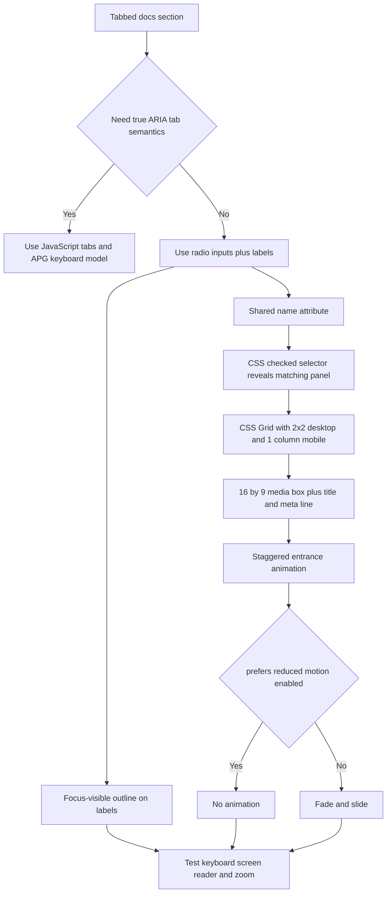

| Difficulty | Channel | Tags |
|---|---|---|
| beginner | frontend | css, flexbox, grid, animations |

A design-system team once faced a deceptively simple question: why does the GOV.UK Tabs component ship JavaScript when a handful of radio inputs and labels can switch panels for free? The question came from developers who had seen the CSS-only pattern in CodePens and other design systems, and it landed in a public discussion thread that exposed a deeper tension between elegance and equivalence [1]. On one side sits a tiny, dependency-free trick; on the other sits a published government pattern used by services across DWP, HMCTS, Defra, and beyond. The real lesson is not that one side is wrong — it is that 'CSS-only' and 'accessible' are not automatically the same sentence.

---

> ### Real-World Case — GOV.UK Design System (Government Digital Service)
>
> GOV.UK's design system team was asked why its Tabs component ships JavaScript when a pure-CSS radio-input and label pattern can switch panels with zero JS. That approach was already circulating in CodePens and other design systems as a lighter alternative.
>
> | | |
> |---|---|
> | **Challenge** | Make tabs work without JavaScript while still meeting the design system's accessibility bar: keyboard operation, visible focus, announced tab role and selection, arrow-key navigation, and a usable no-JS fallback. A radio-input CSS hack can toggle panels, but it exposes the control as a radio group and cannot update ARIA state or implement roving tabindex. |
> | **Solution** | They kept the JavaScript-enhanced Tabs component and treated tabs as progressive enhancement: without JS, content degrades to headings and a table of contents. The radio-input approach was explicitly rejected because it breaks semantic expectations, needs fragile screen-reader workarounds, and risks making services harder to use. The team also documented accessibility criteria that the pattern must meet, including announcing the tab role, selection, position, and supporting arrow-key switching. |
> | **Outcome** | The JS-based Tabs component remained the published GOV.UK pattern and was used by services across DWP, HMCTS, Defra, and others listed in the discussion. No hard before/after performance metric was published; the measurable outcome is standards compliance and avoiding accessibility regressions across those services. |
> | **Lesson** | CSS-only does not automatically mean more accessible or more progressive. Using form controls as tabs can mislead screen-reader and speech-recognition users; for production design systems, use JavaScript for ARIA state and focus management, and provide a real no-JS fallback rather than a radio hack. |

---

## Hook — The GitHub Question That Split a Design System

The question arrived in a public GitHub discussion, not a postmortem: why does a government design system ship JavaScript for tabs when CSS can do the job [1]? On the surface, the challenger had a point. A radio input, a label, and a sibling selector can reveal a panel with no runtime, no bundle cost, and no hydration story. But a design system is not a CodePen. Every shortcut becomes a contract inherited by teams that may never read the source, which is why the conversation quickly moved from 'Can CSS do this?' to 'Does CSS do this the same way?'

## Problem — Tabs Are a Layout Problem Until They Are Not

Tabs look like a layout problem. They are actually three problems wearing one coat: state, semantics, and motion. State is the easy part: one panel visible, the rest hidden. Semantics is harder: assistive technology needs to understand what changed, what is selected, and how to move between options. Motion is the quiet one: a subtle stagger can feel polished to one person and nauseating to another. Then add the design-system constraints — a 2x2 card grid on desktop, a single column on mobile, fixed 16:9 media, visible focus rings, and reduced-motion support. The stakes are not aesthetic. A broken tab pattern can strand keyboard users, confuse screen readers, or trigger motion sensitivity across every service that inherits the component. Sound familiar?

## Real-World Case — GOV.UK Design System

Building on that tension, GOV.UK Design System (Government Digital Service) provides the documented case. Its published Tabs component uses JavaScript [2], and its team was asked why a pure-CSS radio-input and label pattern could not replace it. That pattern was already circulating in CodePens and other design systems as a lighter alternative [1]. The JS-based Tabs component remained the published GOV.UK pattern and was used by services across DWP, HMCTS, Defra, and others listed in the discussion [1]. No hard before/after performance metric was published; the measurable outcome is standards compliance and avoiding accessibility regressions across those services. In other words, the decision was not 'JS is faster' or 'CSS is purer.' It was 'which pattern can a design system defend at scale?'

## Deep Dive — The Radio Trick, the Grid, and the Semantics Trap

Here is the thing though: the CSS-only pattern is genuinely good at the job it actually does. A set of radio inputs with a shared `name` creates a native single-choice group. The `:checked` pseudo-class exposes which option is selected [3], and a label with a matching `for` attribute turns the visible text into a larger click target [9]. CSS can then reveal the matching panel with a sibling selector. For layout, CSS Grid handles the 2x2 desktop arrangement and the single-column mobile collapse with a media query [7], while `aspect-ratio: 16 / 9` keeps every image box proportional without JavaScript or padding hacks [4]. Accessibility details matter just as much. `:focus-visible` keeps outlines for keyboard users without punishing mouse users [6], and `@media (prefers-reduced-motion: no-preference)` ensures the stagger only runs for people who have not asked for less motion [5].

But wait — there is a plot twist. A radio group is accessible, yet it is not a tablist. Screen readers announce radio buttons and their position in the group; native arrow keys change selection immediately. The ARIA Authoring Practices Guide describes a different contract for tabs: a tablist, tabs, tabpanels, and managed focus movement [10]. If the requirement is 'tabs' in the assistive-technology sense, CSS alone cannot deliver it. If the requirement is 'mutually exclusive views with clear labels,' the radio pattern can be a legitimate, lighter choice.

| Question | CSS radio pattern | JS/ARIA tabs |
| --- | --- | --- |
| Screen-reader announcement | 'radio button, 1 of 3' | 'tab, selected, 1 of 3' |
| Arrow keys | Native radio selection | Custom focus movement |
| Runtime JavaScript | None | Required |
| Deep-linkable state | Limited without JS | Straightforward |
| Best fit | View switchers, filters, docs demos | Product tabs with APG semantics |

That is why the GOV.UK answer was not a dismissal of CSS. It was a boundary. The simpler pattern is excellent when its semantics match the product; it becomes a liability when teams call it 'tabs' and assume equivalence.

## Workflow — From Markup to a Defensible Tab Panel

Here is a workflow that keeps the pattern honest from the first commit.

1. Decide the semantics before writing markup. Ask whether users need true APG tab behavior [10]. If yes, use JavaScript or a proven component. If no, continue with the radio pattern.
2. Create one radio input per view with a shared `name`, unique IDs, and a label whose `for` attribute matches the ID [9].
3. Visually hide the inputs instead of using `display: none`; focus must still land on them, and the label should receive the visible outline.
4. Hide every panel by default, then reveal only the panel tied to the checked input with an ID-specific selector.
5. Apply CSS Grid for the 2x2 desktop layout and switch to one column below your mobile breakpoint [7].
6. Give every media box `aspect-ratio: 16 / 9` so the card height stays stable while images load [4].
7. Gate the staggered entrance behind `prefers-reduced-motion: no-preference` [5], then test with a keyboard, a screen reader, 200% zoom, and reduced motion enabled.

The flowchart below maps this decision path from requirement to shipped pattern.

## Code Example — A Zero-JS Tab Panel for Your Docs

Enough theory — here is a build-time module that exports the markup and CSS for a three-tab docs panel. The JavaScript never ships to the browser; it generates static HTML and CSS for the documentation build. The interaction itself is still zero-JS.

A key detail is the panel selector. A tempting shortcut is `.tabs input:not(:checked) ~ .panel { display: none; }`, but that can hide the checked panel too because a later unchecked input still matches. The version below uses explicit panel classes and checked-ID selectors, which keeps the state unambiguous.

Watch three lines in particular: the shared `name` on every radio, the `:focus-visible + label` rule that preserves keyboard focus, and the `prefers-reduced-motion` gate that makes the stagger opt-in rather than mandatory.

## Lessons Learned — Ship the Pattern You Can Defend

Tie it back to the opening question: GOV.UK did not choose JavaScript because CSS is incapable. It chose the pattern its teams could defend across DWP, HMCTS, Defra, and other services [1]. The same test applies to your docs page. CSS-only tabs are a technique, not a certification.

Here are the battle scars worth avoiding:

- Using `display: none` on radio inputs, which removes them from the keyboard tab order and quietly breaks focus.
- Hiding panels with `input:not(:checked) ~ .panel`, which can hide the active panel when multiple radios exist.
- Animating cards on page load instead of tab activation, so the stagger feels random rather than responsive.
- Forgetting `prefers-reduced-motion`, which turns a polished detail into an accessibility defect [5].
- Calling a radio group 'tabs' without checking how screen readers announce it [10].
- Replacing `aspect-ratio` with fixed heights, which breaks as soon as a title wraps to two lines.
- Testing only with a mouse and a fast laptop, then discovering the pattern fails at 200% zoom or on a small phone.

The WCAG guidance is clear that interface components must be operable and understandable for people with disabilities [8], and a design system amplifies both successes and failures. If the radio pattern matches your product semantics, ship it with the full accessibility contract: visible focus, reduced-motion support, responsive layout, and honest documentation. If users need true tab semantics, pay the JavaScript cost and use the APG model [10]. The memorable insight is simple: the cheapest interaction is not the one with the least code, but the one your team can explain, test, and defend.

---

## CSS-Only Tabs Decision Flow

<strong>Original Interview Question</strong>

**Q:** Build a CSS-only tab panel for a design-system docs page. Use radio inputs to switch tabs (no JavaScript). Desktop: a 2x2 grid of cards under each tab; mobile: single column. Each card has a fixed 16:9 image area, a title, and a short meta line. Add a subtle entrance animation with a stagger and keep focus-visible outlines; ensure prefers-reduced-motion is respected?

**A:** Use a set of radio inputs with a shared `name` attribute and corresponding `` elements for each tab section. The `:checked` state of each radio controls visibility of its associated panel via adjacent sibling selectors. Each panel renders a 2×2 card grid on desktop and collapses to a single column on mobile. Cards use `aspect-ratio: 16/9` for fixed image containers, with a title and meta line below.

## Conclusion

The GOV.UK discussion is not a story about JavaScript winning a code-golf contest. It is a story about a design system choosing the pattern it can defend for services that inherit every decision [1]. The CSS-only radio pattern is a sharp tool: fast, dependency-free, and perfectly capable of a 2x2 card grid with a staggered entrance. But it is a radio group, not a tablist, and that distinction is the difference between shipping a clever demo and shipping an accessible component. Audit one tabbed interface tomorrow. Ask what it announces, how it behaves with arrow keys, and whether it respects reduced motion. Then choose the pattern that matches the promise you are making.

---

## References

1. [GOV.UK Design System (Government Digital Service) incident report](https://github.com/alphagov/govuk-design-system/discussions/6045) — article
2. [GOV.UK Design System — Tabs component](https://design-system.service.gov.uk/components/tabs/) — documentation
3. [MDN — :checked CSS pseudo-class](https://developer.mozilla.org/en-US/docs/Web/CSS/:checked) — documentation
4. [MDN — aspect-ratio CSS property](https://developer.mozilla.org/en-US/docs/Web/CSS/aspect-ratio) — documentation
5. [MDN — prefers-reduced-motion media query](https://developer.mozilla.org/en-US/docs/Web/CSS/@media/prefers-reduced-motion) — documentation
6. [MDN — :focus-visible CSS pseudo-class](https://developer.mozilla.org/en-US/docs/Web/CSS/:focus-visible) — documentation
7. [MDN — CSS Grid Layout](https://developer.mozilla.org/en-US/docs/Web/CSS/CSS_grid_layout) — documentation
8. [W3C — Web Content Accessibility Guidelines (WCAG) 2.2](https://www.w3.org/TR/WCAG22/) — documentation
9. [MDN — HTML label element](https://developer.mozilla.org/en-US/docs/Web/HTML/Element/label) — documentation
10. [WAI-ARIA Authoring Practices Guide — Tabs pattern](https://www.w3.org/WAI/ARIA/apg/patterns/tabs/) — documentation

---

**Author:** Satishkumar Dhule — [GitHub](https://github.com/satishkumar-dhule) · [LinkedIn](https://linkedin.com/in/satishkumar-dhule) · [Website](https://satishkumar-dhule.github.io)
