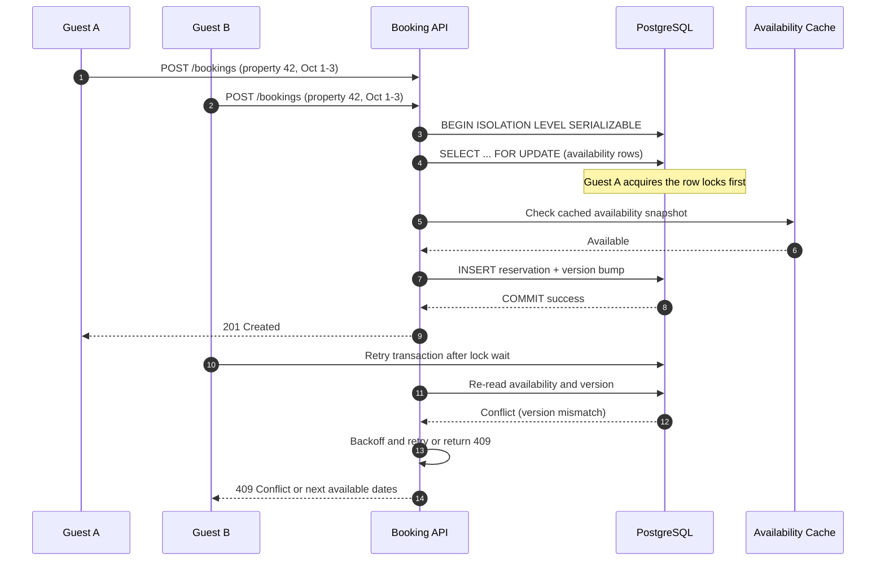

| Difficulty | Channel | Tags |
|---|---|---|
| intermediate | database | acid, isolation-levels, mvcc |

Picture the final unit of a limited-edition product sitting in a cart while two buyers hit checkout at the same instant. Both see the same inventory count, both receive a success response, and one of them is about to get a refund email instead of a package. Shopify ran this exact race at massive scale, and its journey from Redis counters to a MySQL reservation ledger reveals why atomic booking is harder than it looks [1]. The fix was not a faster query or a bigger server; it was a redesign of where reservations live, how long connections stay open, and how the final claim is isolated. Here is the story of how that lesson applies to every booking system you build.

---

> ### Real-World Case — Shopify
>
> Shopify's oversell protection system reserves inventory during checkout, holding units for several minutes while payment completes so two concurrent buyers cannot claim the same last item. For years this ran on Redis using per-item quantity counters (DECR to reserve, INCR to release), but reservations and the inventory ledger lived in separate systems, so the final 'claim' step could not be made atomic. When Shopify moved toward a unified database strategy, it had to find out whether MySQL could handle the same reservation throughput.
>
> | | |
> |---|---|
> | **Challenge** | Prevent double-selling under flash-sale contention while preserving ACID guarantees between the reservation hold and the inventory ledger. An earlier MySQL design using one row per item with a quantity column collapsed under hot-row contention, and a naive SELECT ... FOR UPDATE approach would serialize every buyer on the same popular item and exhaust the database connection pool at peak traffic. |
> | **Solution** | Shopify modeled one row per sellable unit instead of one quantity counter, keeping a bounded pool of about 1,000 rows per item/location. Reservations claim rows with SELECT ... FOR UPDATE SKIP LOCKED inside a single MySQL ACID transaction that also covers the inventory ledger, so locked rows are skipped rather than waited on. They changed those transactions from MySQL's default REPEATABLE READ to READ COMMITTED to avoid gap and supremum locks during pool replenishment, used a composite primary key to cut InnoDB row locks from two per reservation to one, standardized lock ordering to eliminate deadlocks, and batched cart line items with UNION ALL. They ran Redis and MySQL in parallel in 'shadow mode' and cut over gradually with a kill switch. |
> | **Outcome** | The MySQL-based system carried Shopify through a Black Friday 2025 peak of $5.1 million in sales per minute, with an 11% year-over-year increase in peak sales rate. During high-volume flash sales, writer CPU stayed under 50% and reader CPU under 16%. Cleaning up connection-holding code elsewhere in checkout removed 50% of reads and 33% of transactions on the primary database. The counterintuitive finding: the throughput ceiling was not CPU or query cost but connection hold time in unrelated checkout code. |
> | **Lesson** | Preventing double bookings is less about cranking isolation to SERIALIZABLE and more about making the conflict visible to the database as a single atomic operation. SKIP LOCKED let Shopify turn hot-row contention into parallel work, and READ COMMITTED actually beat the stricter default by avoiding gap locks. The bigger lesson is to instrument the whole path: they spent weeks optimizing locks and queries before discovering the real bottleneck was connections held by code nobody was looking at. |

---

## Hook — The Last Item Is a Loaded Gun

A flash sale starts at noon. Ten thousand buyers refresh the same product page, and the inventory counter says one. The first request to reserve that unit should win, but the system is doing three separate things: reading a count, deciding there is stock, and writing a new count. Those three steps create a gap, and in that gap, a second buyer can squeeze through.

The result is not a theoretical bug. It is an oversell, a support ticket, a refund, and a customer who now trusts the store a little less. The uncomfortable truth is that most teams do not notice the gap until traffic arrives. So what exactly is happening inside that gap?

## Problem — When Two Winners Become One Refund

At its core, a booking is a read-modify-write operation, and read-modify-write is where race conditions thrive [7]. Two requests read the same availability window, both conclude the dates are free, and both attempt to write a reservation. Without a mechanism that makes the check and the write one indivisible action, the database happily accepts both writes. This is the double-booking problem in its purest form.

The stakes go beyond a single bad reservation. Overbooking creates refunds, rebooking costs, angry customers, and in marketplaces like Airbnb or Shopify, a loss of trust that is difficult to measure but impossible to ignore. High availability adds another constraint: the system cannot simply serialize every request behind one global lock, because a single hot property or flash-sale item would turn the entire platform into a queue.

Many developers reach for a cache or a distributed counter first. Those tools can reduce load, but they also split the source of truth. When the reservation and the inventory ledger live in different systems, the final claim step is no longer atomic, which is exactly the trap Shopify encountered [1]. The question then becomes: how do you enforce correctness without sacrificing throughput?

## Real-World Case — Shopify's Reservation Ledger

Shopify's oversell protection system reserves inventory during checkout, holding units for several minutes while payment completes. For years, that reservation layer ran on Redis using per-item quantity counters: DECR to reserve and INCR to release [1][9]. The counters were fast, but reservations and the inventory ledger lived in separate systems. That separation meant the final claim could not be made atomic.

When Shopify moved toward a unified database strategy, the team had to prove that MySQL could handle the same reservation throughput. The result carried the company through a Black Friday 2025 peak of $5.1 million in sales per minute, an 11% year-over-year increase in peak sales rate. During high-volume flash sales, writer CPU stayed under 50% and reader CPU under 16%. Cleaning up connection-holding code elsewhere in checkout removed 50% of reads and 33% of transactions on the primary database.

Then came the plot twist. The throughput ceiling was not CPU or query cost. It was connection hold time in unrelated checkout code. A reservation system can be logically perfect and still collapse because a connection is held open while some other service waits on a network call. Shopify's experience shows that atomicity and availability are not just database settings; they are properties of the entire request lifecycle [1].

## Deep Dive — Isolation Levels, Locks, and the Optimism Tax

To prevent double bookings, you need two things: a correctness guarantee and a concurrency strategy that does not collapse under load. ACID gives you the vocabulary for the first part [5], and isolation levels define how much interference concurrent transactions can see [8].

At the strict end sits SERIALIZABLE, which makes concurrent transactions behave as if they ran one after another. PostgreSQL implements this with Serializable Snapshot Isolation, a form of MVCC that detects dangerous read-write dependencies and aborts one of the transactions [2][3]. That abort is not a failure; it is the database telling your application to retry. At the row level, SELECT ... FOR UPDATE explicitly locks the rows a transaction is about to modify, which is useful for availability calendars where each date is a row [10]. MySQL's InnoDB offers a similar locking model with next-key locks and gap locks [6].

Optimistic concurrency control takes a different bet. Instead of blocking readers, it attaches a version column to each row and checks that version during the write [4]. If another transaction changed the row first, the version no longer matches, and the write fails. This works beautifully for low-contention data and becomes a retry storm for hot inventory.

Here is the real tradeoff:

| Strategy | Best for | Cost | Failure mode |
|---|---|---|---|
| SERIALIZABLE + retry | Critical multi-row invariants | Abort/retry overhead | Retry storms under extreme contention |
| SELECT FOR UPDATE | Small, well-indexed row sets | Lock waits | Hot rows and deadlocks |
| Optimistic version check | Low-contention records | Failed writes | High contention causes repeated retries |
| Conditional writes | Distributed ledgers | Limited query flexibility | Hot partition throttling |

💡 Insight: The strongest design is often a hybrid. Use row locks on the specific availability dates, use a version column as a second guard, and keep the transaction short.

⚠️ Watch Out: SERIALIZABLE is not a magic switch. If every request touches the same hot row, the database will serialize them anyway. The goal is to make the critical section small, not to make the whole request serializable.

Distributed databases offer similar primitives. DynamoDB conditional writes let you update an item only if a condition still holds [11], while two-phase locking remains the classic protocol for coordinating locks across resources [12]. The pattern is universal: make the check and the claim one operation, or make the conflict detectable and retryable.

🎯 Key Point: The database is not the only place where atomicity can break. If a reservation is written to one system and the ledger to another, you have created a distributed transaction without the tools to manage it.

## Workflow — Reserve, Verify, Claim, Release

The solution is easier to reason about as a lifecycle than as a single query. Each booking moves through four stages, and each stage has a clear owner.

1. Reserve. Create a short-lived reservation record and mark the requested dates as held. The reservation has an expiry time, typically a few minutes, so abandoned checkouts release inventory automatically.
2. Verify. Re-read the availability rows inside the same transaction, using a lock or a version check. This is where the system confirms that the dates are still free.
3. Claim. Convert the reservation into a confirmed booking and update the inventory ledger in one atomic commit. If the claim fails, the reservation must be released.
4. Release. On timeout, payment failure, or cancellation, return the units to the available pool with an idempotent operation. Redis counters used DECR and INCR for this [9], but a unified database can do it with a conditional update.

The sequence diagram below tells the story of two guests racing for the same dates. Guest A acquires the lock first, commits the reservation, and Guest B receives a conflict instead of a confirmed booking.

Notice the retry loop. A conflict is expected under contention, so the API should retry with exponential backoff and jitter, then return a clear 409 response if the dates are genuinely gone. A booking system that treats every conflict as an error will melt down precisely when traffic is highest.

🔥 Hot Take: A good booking API returns a conflict faster than a bad booking API returns a false success. Correctness is a feature, and a fast 409 is better than a slow refund.

## Code Example — A PostgreSQL Reservation Transaction

The Python example below uses psycopg2 to reserve a date range in a single transaction. It combines SERIALIZABLE isolation, row-level locks, version checks, and retry logic in a pattern that maps directly to the workflow above.

## Lessons Learned — Atomicity Is a System Property

Shopify's story is a reminder that the hardest part of booking systems is not the SQL statement. It is the boundary around the transaction.

- Keep the critical section small. Lock only the dates being booked, not the entire property or the entire calendar.
- Never split the reservation and the ledger without a plan. If two systems own the same truth, you need an outbox, a saga, or a single database that can commit both.
- Treat conflicts as normal. Retry serialization failures and version mismatches with backoff and jitter, and make retries idempotent.
- Watch connection hold time. Shopify found that unrelated checkout code holding connections was the real throughput ceiling [1]. A transaction that waits on an external API is a transaction that is blocking other buyers.
- Add expiry to reservations. Holds should expire automatically so abandoned carts do not permanently remove inventory.
- Instrument lock contention. Track lock waits, deadlocks, retry rates, and 409 rates per property. Hot rows are a product signal as much as an infrastructure signal.
- Cache with invalidation, not hope. Availability caches are safe only if a successful booking invalidates the affected keys or publishes an event.

🎯 Key Point: Many teams optimize the query and ignore the connection. The query may take two milliseconds, but the transaction can hold a lock for two hundred milliseconds while waiting on something else.

The battle scar is predictable: a system passes load tests, launches, and then fails during the first real flash sale because the hottest item turns every request into a lock wait. The fix is rarely a bigger database. It is a smaller critical section, a clearer ownership boundary, and a retry strategy that expects conflict.

---

## Booking Reservation Sequence

<strong>Original Interview Question</strong>

**Q:** You're building a booking system for Airbnb where multiple users can reserve the same property simultaneously. How would you design the transaction handling to prevent double bookings while maintaining high availability?

**A:** Use SERIALIZABLE isolation with optimistic concurrency control. Implement row-level locks on property availability tables, use MVCC snapshot reads for checking availability, and apply application-level validation to ensure atomic booking operations.

## Conclusion

Shopify did not win the last-item race by making MySQL magically faster. It won by understanding where atomicity lived, moving reservations and ledger closer together, and discovering that connection hold time was the real constraint [1]. The same lesson applies whether you are building Airbnb-style bookings, ticket sales, or inventory reservations for a flash sale.

Start tomorrow by drawing the boundary of your transaction. Ask what must be true at commit time, which rows must be locked, which conflicts are expected, and which external calls can happen outside the critical section. Then test the ugly path: two concurrent requests, one last unit, and a payment provider that takes longer than expected.

The memorable insight is simple: high availability is not the absence of locks. It is the discipline of holding them for as little time as possible, on as few rows as possible, with a plan for what happens when two buyers arrive at once. If your team remembers only one thing, make it this: the last item should have exactly one winner, and the database should be the place where that truth is decided.

---

## References

1. [Shopify incident report](https://shopify.engineering/scaling-inventory-reservations) — article
2. [Multiversion concurrency control](https://en.wikipedia.org/wiki/Multiversion_concurrency_control) — documentation
3. [PostgreSQL transaction isolation](https://www.postgresql.org/docs/current/transaction-iso.html) — documentation
4. [Optimistic concurrency control](https://en.wikipedia.org/wiki/Optimistic_concurrency_control) — documentation
5. [ACID](https://en.wikipedia.org/wiki/ACID) — documentation
6. [MySQL InnoDB locking](https://dev.mysql.com/doc/refman/8.0/en/innodb-locking.html) — documentation
7. [Race condition](https://en.wikipedia.org/wiki/Race_condition) — documentation
8. [Isolation (database systems)](https://en.wikipedia.org/wiki/Isolation_(database_systems)) — documentation
9. [Redis INCR command](https://redis.io/docs/latest/commands/incr/) — documentation
10. [PostgreSQL SELECT and FOR UPDATE](https://www.postgresql.org/docs/current/sql-select.html#SQL-FOR-UPDATE-SHARE) — documentation
11. [Amazon DynamoDB conditional writes](https://docs.aws.amazon.com/amazondynamodb/latest/developerguide/WorkingWithItems.html#WorkingWithItems.ConditionalUpdate) — documentation
12. [Two-phase locking](https://en.wikipedia.org/wiki/Two-phase_locking) — documentation

---

**Author:** Satishkumar Dhule — [GitHub](https://github.com/satishkumar-dhule) · [LinkedIn](https://linkedin.com/in/satishkumar-dhule) · [Website](https://satishkumar-dhule.github.io)
