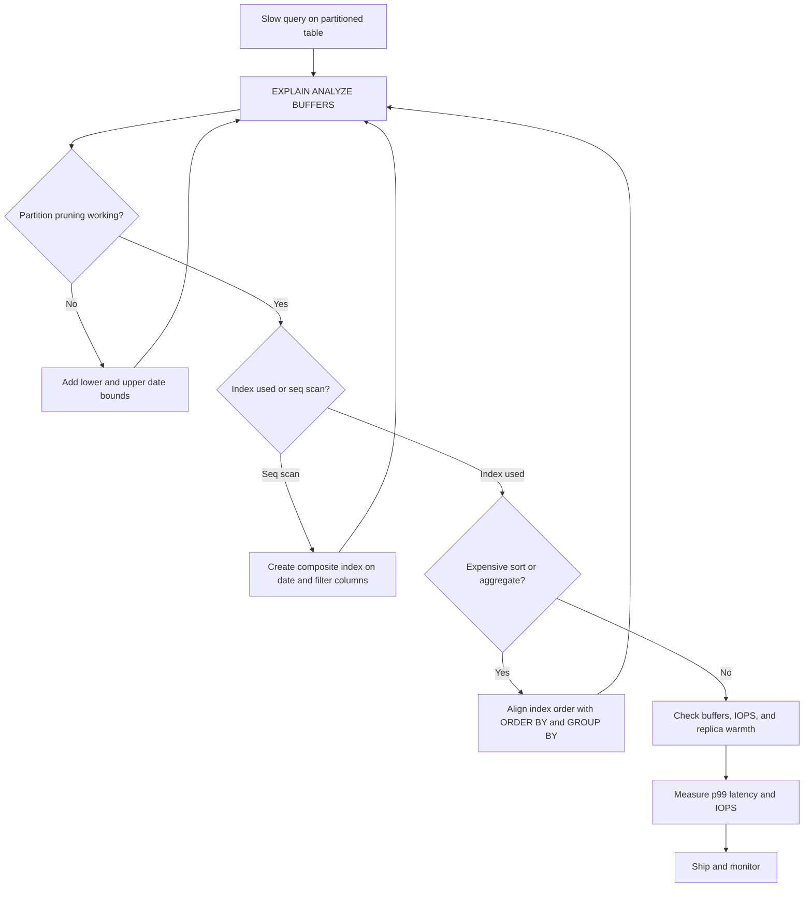

| Difficulty | Channel | Tags |
|---|---|---|
| intermediate | database | explain, query-plan, partitioning |

A date-range query on a 100-million-row, date-partitioned PostgreSQL table should be fast. Then it is not, and the usual advice — add an index, buy a bigger replica — starts to feel like guesswork. CoinGecko lived this at 1TB scale, where queries averaged over 30 seconds and partitioning eventually cut p99 latency by roughly 86% [1]. The twist? One query got slower after partitioning because it never told the planner where the date range began. Here is how to read the EXPLAIN plan, spot that trap, and fix it before it reaches production.

---

> ### Real-World Case — CoinGecko
>
> CoinGecko stored over 8 years of hourly cryptocurrency price data in a PostgreSQL table that had grown beyond 1TB. Average queries against the table took more than 30 seconds, and the workload was replicated across multiple read replicas, multiplying the cost and latency impact.
>
> | | |
> |---|---|
> | **Challenge** | Millions of users querying price history by timestamp range were hitting a single monolithic table that was too large to scan efficiently. The team needed to cut query latency and IOPS without breaking application queries or taking the service down during migration. |
> | **Solution** | They chose native PostgreSQL range partitioning by month, since almost every query includes a timestamp range and typically needs only a few months of data, so the planner can prune to at most four partitions. They built shadow partitioned tables, backfilled data, validated all performance-sensitive queries against both old and new tables, tuned indexes on the new partitions, and cut over with views. Crucially, they audited queries to ensure the date bounds were present and prunable rather than relying on partitioning alone. |
> | **Outcome** | After partitioning, p99 latency dropped from 4.13s to 578ms (about an 86% reduction) with 6-8x faster query performance on the same queries. IOPS fell roughly 20% immediately, cost savings were multiplied across replicas, and warming the table dropped from 10 hours to 3 hours. The plot twist: one query actually got slower than on the unpartitioned table because it omitted a lower bound on the date range, forcing a scan of every partition. |
> | **Lesson** | Partitioning is not automatically a speedup. You must verify in EXPLAIN that the planner is actually pruning, count the partitions under the Append node, and ensure every query constrains the partition key with both bounds. A query that was fine on one big table can become far worse when it causes a scan across every partition. |

---

## Hook — The 30-Second Query That Should Have Been Instant

The query looked innocent. A date range, a status filter, a table that had been partitioned exactly as the playbook prescribed. Yet the dashboard still spun for 30 seconds, and every refresh multiplied the pain across read replicas. If that sounds familiar, you are not alone — some of the largest PostgreSQL deployments have hit the same wall, including CoinGecko, whose 1TB time-series table became the center of a very expensive lesson [1].

The stakes are easy to underestimate. A slow query is not just a slow query when it runs on a dashboard, an API endpoint, or a nightly report. It becomes a queue of waiting requests, a fleet of replicas doing the same wasteful work, and a bill that grows quietly in the background. Partitioning was supposed to fix this. So why did the database still look like it was reading everything?

That question is the beginning of the investigation. The answer lives in the EXPLAIN plan — but only if you know which lines to distrust.

## Problem — Partitioning Is Not a Performance Switch

Building on that opening scene, the core problem is a false sense of safety. Table partitioning is often described as a cure for large-table performance, but partitioning alone does not make a query fast [2]. It changes the physical layout of the data. The planner still has to prove that it can skip the partitions you do not need, use an index inside the partitions you do need, and avoid sorting or aggregating more rows than necessary.

With 100 million rows, every mistake gets amplified. A missing lower bound on a date range can turn a one-month lookup into a full sweep of every partition. A composite predicate such as `event_date BETWEEN ... AND status = 'completed'` can defeat a single-column index because the database reads every matching date row and then throws most of them away. A sort can spill to disk and turn a millisecond operation into a multi-second one.

Here is where partitioned queries usually bleed time:

- **Pruning that never happens** — the WHERE clause does not give the planner enough constraints to eliminate partitions.
- **Indexes that do not match the predicate shape** — a single-column index helps with dates, but not with the status filter that follows.
- **Sorts and aggregates that process too much** — the plan is doing work the index could have avoided.
- **Planner choices made for the wrong data distribution** — stale statistics or generic prepared plans can produce a bad plan.

Many developers discover this the hard way: the table is partitioned, the query is still slow, and the instinct is to add hardware. But hardware does not fix a plan that reads 100 partitions when it only needs one.

## Real-World Case — CoinGecko's 1TB Time-Series Table

However, this is not a theoretical concern. CoinGecko experienced it at a scale that makes the lesson impossible to ignore. The company stored more than eight years of hourly cryptocurrency price data in a PostgreSQL table that had grown beyond 1TB. Average queries against that table took more than 30 seconds, and the workload ran across multiple read replicas, so every inefficiency was multiplied [1].

Partitioning changed the trajectory. After the table was partitioned, p99 latency fell from 4.13 seconds to 578 milliseconds — roughly an 86% reduction — and the same queries ran 6–8x faster. IOPS dropped by about 20% immediately, the savings compounded across replicas, and warming the table fell from 10 hours to 3 hours [1].

Then came the plot twist. One query actually became slower than it had been on the unpartitioned table. The reason was not a bug in PostgreSQL. The query omitted a lower bound on its date range, so the planner could not prune partitions and had to scan every one of them [1]. That detail is the whole story: partitioning narrows the haystack, but only when the query tells the planner where the haystack ends.

| Metric | Before partitioning | After partitioning |
| --- | --- | --- |
| p99 latency | 4.13s | 578ms |
| Query speed | Baseline | 6–8x faster |
| IOPS | Baseline | ~20% lower |
| Table warming | 10 hours | 3 hours |

The CoinGecko case is a reminder that the win is real, but it is conditional. A partitioned table rewards precise predicates and punishes vague ones.

## Deep Dive — Reading EXPLAIN Like a Detective

This leads to the central skill: reading the EXPLAIN plan like a detective rather than a tourist. `EXPLAIN (ANALYZE, BUFFERS)` is the difference between guessing and knowing, because it shows both the planner's estimates and what actually happened at runtime [3]. The `BUFFERS` option adds cache hit and read counts, which is often where the real cost hides. An index is fundamentally a trade: extra write and storage cost in exchange for faster reads [10].

Start with pruning. In a partitioned table, the plan should show only the partitions needed for the query. If the query filters on a date range, the plan should not list every partition; if it does, the predicate is not giving the planner enough to work with [7]. This is especially important with parameterized queries: a prepared statement may use a generic plan that cannot prune as aggressively as a custom plan. The fix is not always a database setting — sometimes it is as simple as ensuring both bounds are present and the partition key is compared directly, without a function wrapped around it.

Next, inspect the scan strategy. A sequential scan is not automatically bad, but on a large partition it usually means the index is missing, mismatched, or not selective enough [4]. Look at `Rows Removed by Filter`. If the database reads 1 million rows and discards 990,000, the index is doing very little for you. That is the signal to design an index around the actual predicate shape.

This is where composite indexes earn their keep. For a query like `WHERE event_date BETWEEN ... AND status = 'completed'`, an index on `(event_date, status)` lets PostgreSQL seek into the date range and filter by status inside the index [5]. The order matters: equality columns and range columns should be arranged so the range column does not prevent the equality column from being useful. A common heuristic is equality columns first, then the range column — but the real answer depends on selectivity and query mix, so measure both.

| Approach | What it helps with | Where it falls short |
| --- | --- | --- |
| Single-column index on `event_date` | Fast date-range entry | Still reads every status value in the range |
| Composite index on `(event_date, status)` | Range plus equality filtering | Less useful for queries that omit `event_date` |
| Composite index on `(status, event_date)` | Status-heavy queries | Range scans may be less efficient for broad dates |
| CLUSTER on a composite index | Physical locality for range reads | One-time rewrite; new writes can drift |

Speaking of locality, `CLUSTER` rewrites a table according to an index, which can dramatically reduce the number of pages read for range queries [6]. But it is not a free lunch. It takes an exclusive lock, it is a one-time ordering, and subsequent inserts will gradually erode the benefit. Use it when read patterns are stable and the table can tolerate the rewrite.

💡 **Insight:** The best index is not the one with the most columns. It is the one that matches the shape of your most expensive queries and keeps the planner from touching rows it will discard.

Finally, look for expensive sorts and hash aggregates. A sort that says `external merge Disk` is a clue that `work_mem` is too small or that the index order does not match the `ORDER BY` [9]. An index that covers the filter and the sort order can remove the sort entirely. That is often the difference between a 4-second p99 and a sub-second one.

⚠️ **Watch Out:** Do not tune `work_mem` globally to hide a bad plan. It can mask the symptom while increasing memory pressure across the whole server.

## Workflow — From Slow Query to Pruned Plan

With the diagnostic lenses in place, the workflow becomes repeatable. The diagram below tells the visual story of the investigation, from the first slow query to a validated fix.

1. **Capture the real query and parameters.** Use the actual values from production, not a simplified example. The plan depends on the constants.
2. **Run `EXPLAIN (ANALYZE, BUFFERS)`.** Save the output. Compare estimated rows with actual rows; large gaps often point to stale statistics.
3. **Count the partitions touched.** If the plan reads more partitions than the date range requires, fix the predicate before touching indexes.
4. **Inspect scan types and filter removal.** Look for sequential scans on large partitions and high `Rows Removed by Filter` counts.
5. **Check sorts and aggregates.** A disk-based sort or a hash aggregate processing far more rows than the result needs is a sign that index order or memory settings need attention.
6. **Design the composite index around the predicate.** Match the column order to the query's equality and range conditions, then test it with `EXPLAIN` again.
7. **Evaluate clustering or partition-wise strategies.** If range reads dominate and the table can tolerate a rewrite, `CLUSTER` may help [6]. If not, consider partition-wise joins or finer partitioning.
8. **Validate under realistic concurrency.** Measure p99 latency, IOPS, and buffer hit ratios on a replica-like dataset before shipping.

The order matters. Fixing pruning first prevents you from building an index that the planner will never use. Fixing indexes next prevents you from blaming the sort for a problem that starts with a sequential scan. Each step narrows the search space, just like a good detective story.

## Code Example — Automating the Diagnosis

Here is where automation helps. Instead of eyeballing a wall of plan output, a small Python script can run the plan, walk the node tree, and flag the three most common failure modes: too many relations scanned, large sequential scans, and sorts that spill to disk. The script uses psycopg 3 and expects a query with named parameters, so the same diagnostic can be reused across endpoints.

The key idea is to treat the plan as structured data, not prose. Once the JSON plan is parsed, the checks are simple and repeatable.

## Lessons Learned — What to Do Before the Next Slow Query

Looking back at CoinGecko's experience, the lesson is not that partitioning is overhyped. The lesson is that partitioning is a contract: it works when queries give the planner enough information to prune, when indexes match the predicate shape, and when the physical layout supports the read pattern [2]. Break any part of that contract and the database falls back to brute force.

Here are the battle scars worth remembering:

- **Always bound both ends of a range.** A missing lower bound can force a scan of every partition, exactly as it did in CoinGecko's slower query [1].
- **Test the plan, not the intention.** A partitioned table with a perfect schema can still produce a sequential scan if the predicate is wrong [3].
- **Match composite index order to the query.** Equality filters and range filters play different roles; measure both orderings on realistic data [5].
- **Treat `CLUSTER` as a maintenance decision.** It can help range reads, but it is not a permanent fix and it locks the table [6].
- **Watch prepared statements and generic plans.** A plan that prunes in development may not prune in production when parameters change.
- **Measure the fleet, not just the primary.** Replica multiplication means a 20% IOPS reduction is a 20% reduction everywhere [1].

🎯 **Key Point:** The EXPLAIN plan is not a report card. It is a map of the decisions the database made on your behalf. Read it before you add hardware, and read it again after you add an index.

🔥 **Hot Take:** Most 'partitioning did not help' stories are really 'the query did not let partitioning help' stories.

---

## Query Optimization Workflow

<strong>Original Interview Question</strong>

**Q:** You have a PostgreSQL table with 100M rows partitioned by date. A query filtering on a specific date range is still slow. What would you check in the EXPLAIN plan and how would you optimize it?

**A:** Check partition pruning effectiveness, index utilization patterns, and expensive sort operations. Create composite indexes on (date, filtered_columns) and evaluate clustering strategies for optimal data access.

## Conclusion

The investigation started with a 30-second query and ended with a repeatable diagnostic habit. CoinGecko's 1TB table shows both sides of the story: partitioning delivered an 86% p99 improvement and 6–8x faster queries, but one unbounded date range was enough to make a single query slower than before [1]. The difference was not luck. It was the planner having enough information to prune, the right index for the predicate, and a team willing to read the plan instead of guessing.

So what should you do differently tomorrow? Before adding another replica or upgrading the instance, run `EXPLAIN (ANALYZE, BUFFERS)` on the slow query. Count the partitions. Check the scan types. Look for the sort that should not exist. Then design the smallest index that makes the plan boring. The most memorable insight to share with your team is this: **partitioning narrows the haystack, but your predicates and indexes decide whether the planner can find the needle.**

---

## References

1. [CoinGecko incident report](https://dev.to/coingecko/scaling-postgresql-performance-with-table-partitioning-136o) — article
2. [PostgreSQL Documentation: Table Partitioning](https://www.postgresql.org/docs/current/ddl-partitioning.html) — documentation
3. [PostgreSQL Documentation: EXPLAIN](https://www.postgresql.org/docs/current/sql-explain.html) — documentation
4. [PostgreSQL Documentation: Indexes](https://www.postgresql.org/docs/current/indexes.html) — documentation
5. [PostgreSQL Documentation: CREATE INDEX](https://www.postgresql.org/docs/current/sql-createindex.html) — documentation
6. [PostgreSQL Documentation: CLUSTER](https://www.postgresql.org/docs/current/sql-cluster.html) — documentation
7. [PostgreSQL Documentation: Partition Pruning](https://www.postgresql.org/docs/current/ddl-partitioning.html#DDL-PARTITION-PRUNING) — documentation
8. [Wikipedia: B-tree](https://en.wikipedia.org/wiki/B-tree) — article
9. [PostgreSQL Documentation: Using EXPLAIN](https://www.postgresql.org/docs/current/using-explain.html) — documentation
10. [Wikipedia: Database index](https://en.wikipedia.org/wiki/Database_index) — article

---

**Author:** Satishkumar Dhule — [GitHub](https://github.com/satishkumar-dhule) · [LinkedIn](https://linkedin.com/in/satishkumar-dhule) · [Website](https://satishkumar-dhule.github.io)
