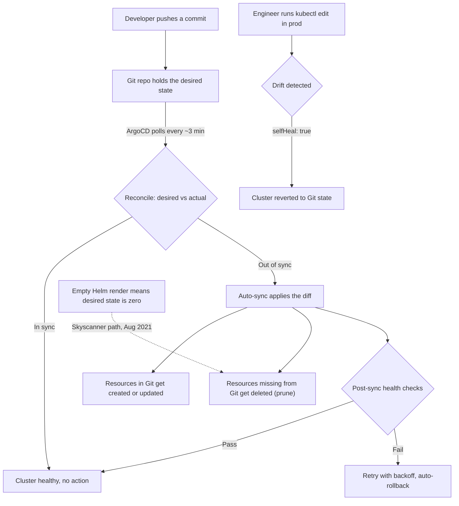

| Difficulty | Channel | Tags |
|---|---|---|
| beginner | devops | argocd, flux, declarative |

On August 25, 2021, a one-line change to a Helm template wiped out 478 services across every Skyscanner cluster, region, and availability zone, dropping the travel platform's website and mobile apps to zero traffic worldwide [1]. The trigger wasn't a hack, a hardware failure, or even a bug in ArgoCD — it was two missing curly braces and a declarative system that obeyed them perfectly; the outage lasted roughly four hours, and full recovery took another two days [1]. That's the paradox of GitOps: the same reconciliation loop that rescues teams from Kubernetes chaos can also amplify a typo into a global incident. Understanding exactly how that machinery works — Application CRDs, auto-sync, self-healing, and the prune setting that did the deleting — is the difference between riding that loop and being run over by it.

---

> ### Real-World Case — Skyscanner
>
> On August 25, 2021, Skyscanner was midway through migrating from its legacy deployment tool to GitOps with ArgoCD. A seemingly trivial one-line Helm template change removed curly braces, so the template rendered an empty/invalid list of target namespaces. ArgoCD, doing exactly what declarative reconciliation told it to do, interpreted this as 'zero desired resources' and mass-deleted workloads across the entire global estate.
>
> | | |
> |---|---|
> | **Challenge** | Skyscanner had a dangerous hybrid ownership model: ArgoCD declaratively managed namespaces, Istio objects, and resource quotas, while application Deployments and Services were still deployed imperatively through their legacy 'Slingshot' tool. GitOps therefore controlled the containers of resources it did not fully own. A single global config file drove which clusters and namespaces ArgoCD targeted, and it had not changed in roughly three years, so it was untested and assumed safe. |
> | **Solution** | ArgoCD was configured with auto-sync and auto-prune, templating Helm charts from Git and applying the rendered manifests to clusters in every region. When the malformed template produced no valid namespaces, ArgoCD saw hundreds of previously managed objects as orphans and pruned them. Recovery involved reverting the PR (which restored namespaces but not the imperatively deployed Deployments and Services), then manually restoring services using runbooks, prioritizing a single region and shedding non-critical load. Post-incident fixes included unit-testing Helm templates, channeled/staged rollouts instead of global config deploys, disabling dangerous auto-prune, adding prune protection at the namespace level, and using a cells architecture to limit blast radius. |
> | **Outcome** | ArgoCD deleted 478 services across every namespace, availability zone, and region worldwide, dropping Skyscanner's website and mobile apps to zero traffic. Travelers and partners suffered a total outage of roughly 4 hours, and full recovery across all regions took about two more days. The cells architecture eventually let the team serve all critical traffic from just four clusters in one region overnight. |
> | **Lesson** | Declarative GitOps is only as safe as the blast radius you grant it. Auto-sync plus auto-prune faithfully executes the desired state, so a single bad template line can be far more destructive than an imperative kubectl mistake because it is applied globally and instantly. Test your templating, roll out config changes in channels, protect stateful resources from pruning, and never let GitOps manage the parent namespace of resources it does not also own. |

---

## Hook — The Deploy Nobody Thought Twice About

Picture the scene: it's August 2021, and Skyscanner's platform team is midway through migrating from a battle-worn legacy deployment tool to a shiny GitOps setup built on ArgoCD [1]. Someone opens a pull request to tidy up a Helm template. It's a one-line change — not application code, not infrastructure, just template syntax. It gets reviewed, approved, merged, and forgotten. The most boring kind of change there is.

Minutes later, a travel platform serving millions of travelers and partners is delivering zero traffic. Everywhere.

Here's the thing though — the scariest production incidents are rarely exotic. They're mundane changes handed to systems that never pause to ask, 'Are you sure?' That merge didn't deploy a bug; it deployed an instruction. And the reconciliation engine read that instruction as: 'the desired state of this estate is nothing.'

⚠️ **Watch Out**: Any system that automatically enforces a desired state will enforce a *wrong* desired state with exactly the same enthusiasm as a correct one.

So what kind of system sees an empty list and concludes the right move is to delete 478 services? The answer — one that might already be managing production clusters today — starts with a problem every microservices team knows intimately.

## Problem — Microservices Sprawl and the Imperative Death Spiral

Now zoom out from that blast radius and ask a bigger question: why would a well-funded travel platform be running a risky platform migration in the first place? Because of a problem every scaling engineering team hits eventually.

Every developer has lived some version of this arc: a company starts with twelve microservices and three environments, and deployment feels easy — someone runs kubectl apply, everything works, dashboards stay green. Fast-forward two years, and it's 200 services across five environments, and 'someone' has become a folklore of tribal knowledge [8].

The imperative approach — driving the cluster by hand with kubectl commands — has three fatal flaws at that scale:

- **No source of truth**: the real state of production lives in shell history and muscle memory, not in version control
- **Configuration drift**: staging and production slowly diverge, until 'it works in staging' stops meaning anything
- **No audit trail**: when something breaks at 2am, 'what changed yesterday?' becomes archaeological research

Consequently, rollbacks are manual guesswork, onboarding takes months, and only a handful of engineers with production credentials can sleep soundly. If this feels overwhelming, you're not alone — it's the default end state of imperative operations.

GitOps promises to fix all of it by flipping the model: Git becomes the single source of truth, and an automation layer continuously forces the cluster to match it [9]. That's the exact promise that convinced Skyscanner to migrate.

But there's a plot twist waiting inside that promise. The tool that kills configuration drift arrives carrying its own failure mode — one where correctness, not malfunction, is the weapon.

## Real-World Case — Skyscanner

Skyscanner's engineers documented the incident publicly, and the mechanics deserve to be read twice [1].

In August 2021, the team was midway through migrating from a legacy deployment tool to GitOps powered by ArgoCD. During the transition, a Helm template that generated the list of target namespaces was edited. The change removed the curly braces around a Go template expression, so the template no longer evaluated the variable — it rendered an empty, invalid list of namespaces [1].

ArgoCD then did exactly what a declarative reconciler is built to do. It compared the actual state of the cluster — hundreds of healthy, running workloads — against the desired state in Git, which now effectively declared 'zero resources.' The diff between '478 services' and 'zero services' is, mathematically, minus 478 services. ArgoCD reconciled that diff across every namespace, availability zone, and region in the global estate.

The numbers are brutal:

- **478 services deleted** worldwide
- **Zero traffic** on the website and mobile apps for roughly **4 hours**
- **~2 more days** until every region was fully recovered
- The quiet hero: a cells architecture that let all critical traffic run from just **4 clusters in a single region** overnight [1]

🎯 **Key Point**: ArgoCD was never malfunctioning. It executed a perfectly valid reconciliation — the desired state it was handed was simply catastrophic.

How does an engine this obedient end up deleting an entire estate? To answer that, you have to understand the reconciliation loop itself — including the three settings that turn it from guardian into demolition crew.

## Deep Dive — Declarative Reconciliation, the Obedient Engine

Building on the incident mechanics, it's time to open the hood on the engine itself.

**The declarative model asks one question, forever: 'What should exist?'** The answer lives in YAML manifests, Helm charts [10], or Kustomize overlays [7], all stored in Git. ArgoCD continuously polls that repository — by default roughly every 3 minutes, or near-instantly with webhooks — and computes the diff between desired state and actual cluster state [2].

**The Application CRD is the contract.** ArgoCD is itself a Kubernetes controller, and its core resource is a Custom Resource Definition called Application, which points at a repository, a revision, and a path [5]. Because the tool is configured through the same Kubernetes API it manages, the deployment config for your deployments is itself versionable, reviewable, and declarative [3]. (ArgoCD isn't the only reconciler in town — Flux takes the same declarative, Git-as-truth approach [6] — so everything here applies to either engine.)

Then there are the three settings that mattered so much on August 25, 2021:

- **Auto-sync**: when drift appears, apply the diff automatically — no human clicks required
- **Prune**: resources that exist in the cluster but not in Git get **deleted**
- **Self-heal**: manual changes made directly with kubectl get reverted back to the Git state

Moreover, here's the plot twist most teams discover the hard way: declarative systems don't reduce the number of mistakes — they make every mistake deterministic and instant. Imperative chaos fails randomly and locally. Declarative correctness fails completely, everywhere, all at once. Skyscanner's failure wasn't drift, and it wasn't a buggy tool. It was the correct execution of an incorrect desired state.

| Dimension | Declarative (GitOps + ArgoCD) | Imperative (kubectl by hand) |
| --- | --- | --- |
| Source of truth | Git repository, versioned and reviewed | Shell history and memory |
| Audit trail | Every change is a commit with an author | Whoever ran the command knows |
| Rollback | git revert, done in minutes | Manual archaeology, hours |
| Drift | Self-healing reverts it automatically | Accumulates silently |
| Blast radius of a mistake | Estate-wide, instant, deterministic | Localized, random, human-speed |
| Collaboration | PRs, reviews, branch protection | Credential hoarding |

🔥 **Hot Take**: Auto-sync isn't dangerous. *Unvalidated* auto-sync is. The Skyscanner template change should have been stopped by a CI check that renders templates and fails loudly when the output is empty.

💡 **Insight**: The same properties that make GitOps safe — auditability, single source of truth, automated rollback — also make it excellent at executing whatever Git says. Guard the input, and the output takes care of itself.

So how do you wire this up without volunteering for the next four-hour outage? The workflow below walks the full path, guardrails included.

## Workflow — Wiring Up ArgoCD Auto-Sync Without Reenacting the Outage

Enough theory — here's the step-by-step journey from a Git repository to a self-reconciling cluster. It's the same path Skyscanner was walking, annotated with the safety rails they wished they'd had.

1. **Structure the Git repository.** Store base manifests plus per-environment overlays — Kustomize is the idiomatic choice for separating environments, Helm for templated applications [7][10]. The repo layout *is* the deployment contract.
2. **Install ArgoCD** in the target cluster (one command, shown in the next section) and expose the API server [4].
3. **Define the Application CRD.** Point it at a repo URL, branch, and path. That single resource is the entire integration between Git and the cluster — there's nothing else to wire up [3].
4. **Enable auto-sync deliberately, in stages.** Start with plain `automated: {}` — no prune, no self-heal. Watch it work for a week. Then add `selfHeal: true` to kill drift. Only enable `prune: true` once a CI gate validates every render.
5. **Add the validation gate in CI.** Render every template (`helm template`, `kustomize build`) and compare resource counts against the previous commit. A render that produces zero resources should fail the build — this exact check would have stopped the Skyscanner change cold.
6. **Bound the blast radius.** One Application per service or per team, never one mega-Application for the estate. If a template renders empty again, it takes down one service — not 478.
7. **Observe and iterate.** ArgoCD polls Git (default ~3 minutes; add webhooks for near-instant sync), reports Synced/Healthy status per application, and retries failed syncs with backoff [2].

The full loop — including the failure path — is traced in the **GitOps Reconciliation Flow** diagram below. Notice that the dotted 'empty render' edge isn't an error path at all: it's the normal reconciliation loop, executed with a catastrophic desired state.

The code below shows how the pieces fit together in practice.

## Code Example — The Application Manifest That Runs Your Deploys

Enough theory — here is the machinery itself: a script you could adapt to a real cluster today, with comments placed exactly where the danger lives.

```bash
# Install ArgoCD into the cluster (once per cluster)
kubectl create namespace argocd
kubectl apply -n argocd -f https://raw.githubusercontent.com/argoproj/argo-cd/stable/manifests/install.yaml

# Declare the entire deployment as one Application resource
cat <<'EOF' | kubectl apply -f -
apiVersion: argoproj.io/v1alpha1
kind: Application
metadata:
  name: payments-prod              # one Application per service keeps blast radius small
  namespace: argocd                # Application resources must live in the ArgoCD namespace
spec:
  project: default
  source:
    repoURL: https://github.com/example-org/gitops-repo.git
    targetRevision: main           # every merge to main deploys automatically
    path: overlays/production      # Kustomize overlay holding prod-specific values
  destination:
    server: https://kubernetes.default.svc
    namespace: payments
  syncPolicy:
    automated:
      prune: true                  # DELETES anything not in Git - this erased 478 services at Skyscanner
      selfHeal: true               # reverts manual kubectl edits back to Git within ~3 minutes
    syncOptions:
      - CreateNamespace=true
    retry:                          # survive transient API-server failures gracefully
      limit: 5
      backoff:
        duration: 15s
        factor: 2
        maxDuration: 5m
EOF

# Check the result: Synced + Healthy is the goal state
kubectl get application payments-prod -n argocd
```

Three lines deserve a second read. `prune: true` is the exact setting that deleted 478 services — anything running in the cluster but missing from Git gets removed, by design [2]. `selfHeal: true` is the anti-drift guardian that quietly reverts manual kubectl edits back to the Git state [2]. And `targetRevision: main` means every merge to main deploys automatically — pair it with branch protection and the CI render gate from the workflow section, or you're one approved-but-broken PR away from your own four-hour outage [4]. The full line-by-line walkthrough follows in the explanation.

## Lessons Learned — Trust the Automation, Verify the Inputs

So, what should be done differently tomorrow morning? The Skyscanner postmortem and the wider GitOps discipline [9] converge on a short list:

- **Validate renders in CI.** `helm template` / `kustomize build` plus a resource-count diff catches empty renders before ArgoCD ever sees them. This one check would have prevented the entire incident.
- **Enable prune last, not first.** Adopt in stages: manual sync → auto-sync → self-heal → prune. Each step earns trust before the next one gains power.
- **Shrink blast radius by design.** One Application per service, restricted destination namespaces. Running 478 services under one template creates 478 single points of failure — Skyscanner's cells architecture is what let four clusters in one region carry critical traffic overnight [1].
- **Make Git the only door to production.** Read-only kubectl credentials for humans, so self-healing has nothing to fight. Auditability comes free when every change is a commit [3].
- **Design for the bad day.** Automated rollback via `git revert`, sync windows, retry policies — practice recovery before you need it [2].

Many developers think GitOps removes humans from the loop. It doesn't — it moves humans from the execution step to the review step, which is exactly where two missing curly braces should have been caught.

💡 **Insight**: ArgoCD never misunderstands instructions — it obeys them perfectly. Guard what goes into Git, because reconciliation has no mercy for typos.

---

## GitOps Reconciliation Flow



<details>
<summary><strong>Original Interview Question</strong></summary>

**Q:** You're setting up GitOps for a microservices deployment. How would you configure ArgoCD to automatically sync changes from your Git repository to Kubernetes, and what's the difference between declarative and imperative approaches in this context?

**A:** I'd configure ArgoCD by setting up a Git repository containing Kubernetes manifests or Helm charts, creating an Application CRD that points to the Git repository, enabling auto-sync with a health check interval of 3 minutes, and implementing self-healing to automatically revert any manual changes. The declarative approach involves defining the desired state in Git through YAML manifests, Helm charts, or Kustomize configurations, where ArgoCD continuously reconciles the actual state with the desired state. In contrast, the imperative approach uses kubectl commands to make direct changes to the cluster, bypassing the Git repository as the single source of truth.

</details>

## Conclusion

Two curly braces in, 478 services out — a four-hour global blackout and two days of recovery, produced by a system working exactly as designed [1]. The journey from imperative chaos to declarative order solves the drift problem, the audit problem, and the 3am rollback problem. But it swaps them for a new contract: whatever Git says, the cluster becomes — instantly, everywhere, without asking questions. Teams that honor that contract with validation gates, staged automation, and small blast radii get the magic. Teams that don't get a physics demonstration.

So here's tomorrow's to-do list: set up the CI render check, split your Applications per service, and only then flip on prune. And before the first auto-sync ever runs, ask the question Skyscanner's incident forces on everyone: 'If Git were wrong right now, what exactly would happen?' Then send this to the engineer who reviews your next Helm template change — it might be the most valuable two minutes they spend this week.

---

## References

1. [Skyscanner incident report](https://medium.com/@SkyscannerEng/how-a-couple-of-characters-brought-down-our-site-356ccaf1fbc3) — blog
2. [ArgoCD Documentation](https://argo-cd.readthedocs.io/en/stable/) — documentation
3. [ArgoCD Declarative Setup](https://argo-cd.readthedocs.io/en/stable/operator-manual/declarative-setup/) — documentation
4. [ArgoCD GitHub Repository](https://github.com/argoproj/argo-cd) — documentation
5. [Kubernetes Custom Resources](https://kubernetes.io/docs/concepts/extend-kubernetes/api-extension/custom-resources/) — documentation
6. [Flux GitOps Operator GitHub Repository](https://github.com/fluxcd/flux2) — documentation
7. [Kustomize GitHub Repository](https://github.com/kubernetes-sigs/kustomize) — documentation
8. [kubectl Command Reference](https://kubernetes.io/docs/reference/kubectl/) — documentation
9. [OpenGitOps — GitOps Principles](https://opengitops.dev/) — documentation
10. [Helm Chart Template Guide](https://helm.sh/docs/chart_template_guide/) — documentation

---

**Author:** Satishkumar Dhule — [GitHub](https://github.com/satishkumar-dhule) · [LinkedIn](https://linkedin.com/in/satishkumar-dhule) · [Website](https://satishkumar-dhule.github.io)
