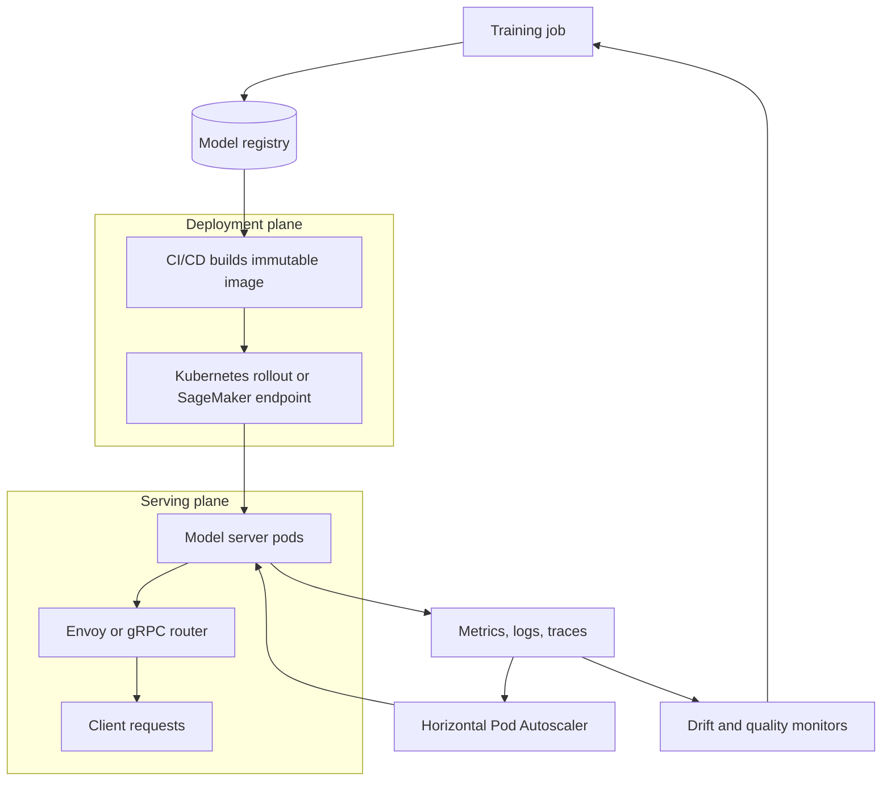

| Difficulty | Channel | Tags |
|---|---|---|
| beginner | devops | mlops, deployment |

By 2016, Uber had machine learning models scattered across ride pricing, ETA prediction, fraud detection, and UberEATS — and almost no standard way to get any of them into production [1]. Every team hand-built its own serving container, wired up its own monitoring, and hoped the model that passed training would behave the same under real traffic [1]. That gap between shipping a model and actually running it is where the distinction between deployment and serving stops being academic. Michelangelo eventually grew to roughly 400 active ML projects and more than 5,000 models in production serving about 10 million real-time predictions per second at peak [1] — but only after Uber separated the pipeline that delivers models from the runtime that answers requests.

---

> ### Real-World Case — Uber
>
> By 2016 Uber had ML models spread across teams with no standard path to production. Every new model required engineers to hand-build a custom serving container, and there was no reliable, reproducible way to train, deploy, and monitor models at Uber's scale across ride pricing, ETA prediction, fraud detection, and UberEATS.
>
> | | |
> |---|---|
> | **Challenge** | Uber needed to separate the deployment lifecycle (packaging, versioning, rollout, monitoring, rollback) from the serving runtime (low-latency inference APIs) while supporting thousands of models and millions of predictions per second without each team rebuilding infrastructure. |
> | **Solution** | Uber built Michelangelo, an end-to-end ML platform. Deployment standardized model packaging, batch vs. online targets, a feature store (Palette), automated pipelines, and monitoring. Serving used a multi-tenant Java Online Prediction Service with Thrift request/response APIs, later integrating TensorFlow Serving and NVIDIA Triton for GPU inference, plus online transformers to avoid Spark's per-request query-planning overhead. Models were treated as stateless, so they scaled horizontally across data centers. |
> | **Outcome** | Michelangelo grew to roughly 400 active ML projects, over 20K monthly training jobs, and more than 5K models in production serving about 10 million real-time predictions per second at peak. Earlier online serving achieved p95 latency under 5ms without Cassandra features and under 10ms with them, while the highest-traffic models handled 250,000+ predictions per second. |
> | **Lesson** | Deployment and serving are distinct disciplines: a great training pipeline is useless without a paved path to production, and a fast model server is useless without standardized packaging, versioning, and monitoring. Treating serving as a shared multi-tenant runtime, not a per-model custom container, is what let Uber scale from a handful of models to thousands. |

---

## Hook — The 2 A.M. Model That Nobody Owned

The pager goes off at 2 a.m. A model that sailed through offline evaluation is now timing out in production, and the dashboard shows three different versions running across four clusters. Nobody can say which container image is live, which training run produced it, or why p95 latency doubled after lunch. Sound familiar? That is not a modeling failure — it is a boundary failure between two disciplines teams constantly blur: deployment and serving. One gets the model to the door; the other keeps it answering requests at scale. Confuse them, and you spend your night debugging infrastructure instead of shipping features.

The stakes are higher than a single bad night. When deployment and serving collapse into one undefined blob of work, every new model becomes a bespoke project. Rollbacks turn into archaeology. Latency regressions become guesswork. And the platform team slowly becomes a ticket queue for hand-holding instead of a leverage point for the whole organization. The question is not whether your team needs both — it is whether you can name where one ends and the other begins.

## Problem — One Word, Two Very Different Jobs

Here is the trap. A data scientist finishes a notebook, hands over a pickle file, and calls the work done. The platform team receives an opaque artifact with no pinned dependencies, no input schema, and no rollback plan. Six weeks later, a new model is 'deployed' by copying a file onto a VM, and the serving API quietly becomes a snowflake that only one engineer understands. The word deployment did all the work, and nobody defined the contract.

The distinction matters because deployment and serving fail in different ways. Deployment failures look like broken pipelines, missing artifacts, inconsistent environments, and rollouts that cannot be reversed [2]. Serving failures look like timeouts, memory spikes, cold-start storms, and version skew under live traffic [2]. Treating them as one problem means you cannot reason about either. You cannot tell whether the model is wrong or the infrastructure around it is wrong.

The cost is not just downtime. It is the slow erosion of trust that makes teams afraid to ship models at all. When every launch feels like a coin flip, leadership starts asking for more approval gates, engineers start building shadow pipelines, and the platform fragments further. The real problem is architectural ambiguity dressed up as process.

## Real-World Case — Uber and the Birth of Michelangelo

Uber hit this wall at scale. By 2016, ML models were spread across ride pricing, ETA prediction, fraud detection, and UberEATS, but every new model required engineers to hand-build a custom serving container [1]. There was no reliable, reproducible path to train, deploy, and monitor models across the company [1]. The result was predictable: duplicated effort, inconsistent latency, and a platform that could not keep up with demand.

Uber's answer was Michelangelo, an internal platform that separated the deployment pipeline from the runtime serving layer. It grew to roughly 400 active ML projects, more than 20,000 monthly training jobs, and over 5,000 models in production serving about 10 million real-time predictions per second at peak [1]. Earlier online serving achieved p95 latency under 5ms without Cassandra features and under 10ms with them, while the highest-traffic models handled more than 250,000 predictions per second [1]. Those numbers are not the result of a clever model architecture. They are the result of treating serving as a first-class runtime with its own contracts, not as an afterthought bolted onto a training script.

The plot twist? The hard part was never training the model. It was building a repeatable contract between the pipeline that ships artifacts and the runtime that answers requests. Uber did not just standardize tooling — it standardized the handoff. That is the part most teams skip.

## Deep Dive — Deployment Ships It, Serving Keeps It Alive

Building on that, the cleanest mental model is a handoff. Deployment owns the journey from code to a running artifact: CI/CD, infrastructure provisioning, environment parity, rollout strategy, and rollback [2]. Serving owns what happens after the artifact is live: loading weights, validating inputs, routing requests, managing versions, batching, and scaling with traffic [2].

| Concern | Deployment | Serving |
| --- | --- | --- |
| Primary question | How does the model reach production safely? | How does the model answer requests fast? |
| Core tools | Kubernetes, Terraform, MLflow, SageMaker, GitHub Actions [3][9][10] | TensorFlow Serving, TorchServe, BentoML, FastAPI, Envoy [4][5][6][11] |
| Failure mode | Broken pipeline, config drift, bad rollout | Timeout, cold start, memory pressure, version skew |
| Success metric | Reproducibility and rollback time | p95/p99 latency and throughput |
| Scaling lever | Replica count and cluster capacity | Batching, caching, model optimization, autoscaling [8] |

Now the trade-offs. The first is latency versus throughput. A single-request path minimizes tail latency, while batching amortizes expensive hardware work across many inputs [7]. Clipper showed that even modest batching can dramatically raise throughput without destroying interactive latency when the serving layer owns the scheduling decision [7]. The second is batch versus real-time inference. Batch scoring is cheap and predictable; real-time serving is expensive and spiky. Many systems need both, which is why the deployment plane should produce one artifact that the serving plane can consume in either mode.

The third trade-off is cold start. Loading a large model from object storage can take seconds, and a rolling deploy that replaces every pod at once can create a latency cliff. Warm the model before the pod reports ready, and keep a buffer of pre-warmed replicas during rollouts. The fourth is model versioning. Serving infrastructure must be able to answer a deceptively simple question: which model produced this prediction? If the answer is not logged with the response, debugging becomes folklore.

💡 Insight: Deployment is a pipeline problem; serving is a runtime problem. Pipelines care about correctness and repeatability. Runtimes care about latency and resource efficiency.

⚠️ Watch Out: Autoscaling on CPU alone is a classic mistake. A GPU-bound model can show low CPU while request queues grow. Scale on queue depth, concurrency, or p99 latency instead [8].

🔥 Hot Take: Most 'model performance' incidents are actually serving incidents. The model did not get worse — the runtime around it did.

## Workflow — A Repeatable Path from Artifact to Answer

The workflow below turns the handoff into a repeatable loop. Notice that the deployment plane and the serving plane meet at exactly one place: an immutable, versioned artifact. Everything before that point is about producing it; everything after is about running it.

The diagram shows a training job feeding a model registry, a CI/CD pipeline building an immutable image, and a deployment controller rolling it out to the serving plane. Once live, model server pods sit behind a router, emit metrics and traces, and feed both an autoscaler and a drift monitor that loops back into training.

1. Train and register. Every run logs parameters, metrics, and artifacts to a registry such as MLflow, so the exact artifact can be reproduced later [9].
2. Build an immutable image. Dependencies, model checksum, and configuration are baked in. No copying files onto production hosts.
3. Deploy with a rollout strategy. Kubernetes Deployments or a managed endpoint such as SageMaker handles replica management and progressive rollout [3][10].
4. Serve behind a router. Envoy or gRPC handles traffic splitting, retries, timeouts, and canary weights without changing application code [11][12].
5. Autoscale on the right signal. Horizontal Pod Autoscaling works best when it targets the metric that actually reflects pressure, such as concurrency or latency [8].
6. Observe and feed back. Log the model version with every prediction, alert on drift and p99, and close the loop back to training.

🎯 Key Point: The artifact is the contract. If the serving layer cannot identify and verify the artifact, the deployment layer has not finished its job.

## Code Example — A Serving Layer That Respects the Contract

The snippet below is deliberately small but production-shaped. It uses FastAPI with a lifespan hook to warm the model once per pod, separates liveness from readiness, pins the model version via environment variables, and exposes a batch endpoint for throughput-sensitive callers.

The important design choice is that the process can be alive before the model is ready. Liveness answers whether the process should be restarted; readiness answers whether traffic should be routed to it. Mixing those two is how teams create restart loops during slow model loads. The batch endpoint is also intentional: it gives high-volume callers a way to trade a little latency for much better hardware utilization, which is exactly the throughput-versus-latency trade-off described earlier [7].

Because the service holds no session state, it scales horizontally by adding pods. Version pinning via MODEL_VERSION makes rollbacks a deployment concern rather than a code change, and logging the version with every response keeps serving observable when something goes sideways.

## Lessons Learned — What to Do Differently Tomorrow

The journey from hand-built containers to a reliable ML platform follows a predictable arc: pain, standardization, separation, and observability. Here is what that arc teaches.

- Treat deployment and serving as separate contracts. Deployment produces a verifiable artifact; serving consumes it and reports which version answered each request.
- Make rollback boring. If reverting a model takes more than one command, the deployment plane is incomplete.
- Warm before ready. Load the model in a startup hook and gate readiness on successful load to avoid cold-start latency cliffs.
- Measure tails, not averages. p95 and p99 reveal the pain users feel; averages hide it.
- Scale on pressure, not guesses. Queue depth, concurrency, and latency are better autoscaling signals than CPU for inference workloads [8].
- Batch when throughput matters. A batch endpoint or server-side dynamic batching can multiply utilization without rewriting the model [7].
- Log the model version with every prediction. Without it, incident response becomes speculation.

Battle scars worth avoiding: baking a model into an image without a checksum, using a liveness probe that loads the model, autoscaling GPU workloads on CPU, and shipping a new version without shadow traffic. Each one looks harmless in staging and brutal in production.

If this feels overwhelming, you are not alone. Most teams discover these lessons one incident at a time. The advantage comes from naming the boundary early and making the handoff explicit before scale forces the issue.

---

## Deployment vs Serving Architecture

<strong>Original Interview Question</strong>

**Q:** Explain the key differences between model serving and model deployment in ML systems, including specific technologies, scaling considerations, and real-world implementation patterns?

**A:** Deployment encompasses CI/CD pipelines, infrastructure setup, and monitoring using tools like Kubernetes, MLflow, and SageMaker. Serving focuses on runtime inference APIs with frameworks like TensorFlow Serving, TorchServe, or BentoML, handling request routing, model versioning, and autoscaling. Key trade-offs include latency vs throughput, batch vs real-time inference, and cold start optimization.

## Conclusion

Uber's Michelangelo did not win because it had a better model server. It won because it made the path from training to production boring — one artifact, one contract, one observable runtime [1]. The next time a model launch feels risky, resist the urge to add another approval meeting. Instead, ask two questions: can you identify the exact artifact that is live, and can you see the version that produced every prediction? If the answer to either is no, the boundary between deployment and serving has blurred. Fix the contract, and the 2 a.m. pager becomes a lot quieter.

---

## References

1. [Uber incident report](https://www.uber.com/blog/from-predictive-to-generative-ai) — blog
2. [MLOps](https://en.wikipedia.org/wiki/MLOps) — documentation
3. [Kubernetes Deployments](https://kubernetes.io/docs/concepts/workloads/controllers/deployment/) — documentation
4. [TensorFlow Serving](https://github.com/tensorflow/serving) — documentation
5. [TorchServe](https://github.com/pytorch/serve) — documentation
6. [BentoML](https://github.com/bentoml/BentoML) — documentation
7. [Clipper: A Low-Latency Online Prediction Serving System](https://arxiv.org/abs/1612.03079) — paper
8. [Horizontal Pod Autoscaling](https://kubernetes.io/docs/tasks/run-application/horizontal-pod-autoscale/) — documentation
9. [MLflow](https://github.com/mlflow/mlflow) — documentation
10. [Amazon SageMaker Developer Guide](https://docs.aws.amazon.com/sagemaker/latest/dg/whatis.html) — documentation
11. [Envoy Proxy documentation](https://www.envoyproxy.io/docs/envoy/latest/) — documentation
12. [gRPC Introduction](https://grpc.io/docs/what-is-grpc/introduction/) — documentation

---

**Author:** Satishkumar Dhule — [GitHub](https://github.com/satishkumar-dhule) · [LinkedIn](https://linkedin.com/in/satishkumar-dhule) · [Website](https://satishkumar-dhule.github.io)
