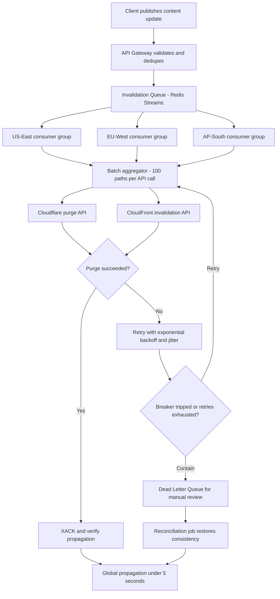

| Difficulty | Channel | Tags |
|---|---|---|
| intermediate | system-design | edge, caching, purging |

Somewhere right now, a newsroom editor is hitting publish on a story that could move markets — and millions of readers are about to see yesterday's headline instead. That gap between 'published' and 'visible' is where CDN cache purging lives, and Fastly spent over a decade engineering it down to roughly 150 milliseconds across every edge node on Earth [1]. This is the story of how instant purging actually works — and how to design a multi-region system that guarantees propagation in under 5 seconds while absorbing 10,000 invalidations per second.

---

> ### Real-World Case — Fastly
>
> Fastly operates a global CDN where breaking news, live events, and e-commerce promotions require content to be invalidated across every edge node almost simultaneously. Their original purge design treated every cache server as a peer that received and rebroadcast every purge, which worked at small scale but buckled as the network and customer base grew.
>
> | | |
> |---|---|
> | **Challenge** | Deliver cache purges to every POP worldwide within milliseconds while scaling from a few thousand invalidations per second to tens of thousands (and beyond), without a central coordinator becoming a single point of failure or a latency bottleneck. The system also had to survive packet loss and 'internet weather' between POPs. |
> | **Solution** | Fastly framed purging as a distributed messaging problem and built it on Bimodal Multicast: a cache server receiving a purge immediately broadcasts it to all other servers over UDP, with no acknowledgment required and no attempt to track where content lives. They later added hierarchy (deliver to at least two healthy nodes per POP, which rebroadcast locally), a double-delivery reliability layer, and true batch purging instead of splitting batches into individual purges. |
> | **Outcome** | Global purge latency is ~150ms (P50) across all POPs, near the ~65ms speed-of-light theoretical floor, and purges start landing within 5ms. Throughput grew from 2-3k purges/sec in 2018 to ~60k purges/sec by 2025, and after real batch purging they are confident they can scale to hundreds of thousands per second, with a stated goal of millions per second. |
> | **Lesson** | Counterintuitively, the fastest and most scalable purge design was not smart routing or centralized coordination — it was dumbly broadcasting every invalidation everywhere and skipping acknowledgments, which cut latency by up to half. The real scaling win came from fixing 'fake' batching: their API accepted batches but internally exploded them into individual purges, flooding the system and forcing rate limits. |

---

## Hook — The Tweet Is Live, but the Cache Doesn't Care

It's 9:59 a.m. The flash sale starts at 10:00, the CEO's tweet is already flying, and the press release just hit the wire. Meanwhile, in a POP outside Frankfurt, a cached copy of yesterday's prices sits smugly in memory, cheerfully serving stale content to a few hundred thousand customers who are about to be very wrong about how much things cost.

That's the purging problem in one sentence: publication is instant, but caches have no idea anything happened [2]. A CDN is brilliant at serving copies — that is the entire job [7] — which makes it equally brilliant at serving the wrong copy. And when the wrong copy is a wrong price, a wrong headline, or a premature 'sold out' badge, the blast radius is measured in revenue per second.

Here's the thing, though: the instinctive fix — cranking the TTL down to a couple of seconds — quietly murders your origin servers the moment traffic spikes [2]. The real answer is a purge pipeline that treats invalidation as a first-class, globally distributed system, exactly what Fastly built across more than a decade of rebuilds on the way to 150-millisecond global purges [1].

So how do you build one of these — a multi-region purge system with a hard 5-second propagation SLA that shrugs off 10,000 invalidations per second? The journey from naive first attempt to battle-tested architecture starts with understanding precisely why this problem fights back.

## Problem — Four Numbers That Refuse to Cooperate

Strip away the buzzwords, and the requirements fit on an index card:

- **Latency:** every region must see the invalidation in under 5 seconds — globally, not on average
- **Throughput:** 10,000 concurrent invalidations per second, sustained
- **Availability:** 99.99% uptime, because a broken purge pipeline means permanently stale content
- **Consistency:** strongly consistent across regions, so no two users see different versions

Sounds reasonable. Now meet the four forces that make those numbers fight each other.

**Physics shows up first.** Light itself needs roughly 65 milliseconds to make a round trip around the planet, which puts a hard floor under any global propagation system [1]. Five seconds sounds luxurious until the budget has to cover queuing, batching, API calls, retries, and that one region having a bad day.

**Then the CDN APIs push back.** Provider invalidation endpoints are rate-limited and metered — CloudFront charges per invalidation path and caps how many can be in flight at once [5]. At 10,000 events per second, one-path-per-call purging isn't just slow; it's a compliance incident with your invoice. Cloudflare's purge API accepts batches for precisely this reason [6].

**And failure is guaranteed.** Any system spanning dozens of POPs will experience partial failure — one region failing while nine succeed. At that moment, consistency is on the line, and the CAP theorem strolls in to remind everyone that partition tolerance is not optional [9].

Many developers hit this wall and conclude the answer is a 2-second TTL everywhere. It works — right up until the traffic spike, when every request becomes a cache miss and the origin buckles under the full weight of global demand [2]. Here's the real tradeoff between the three strategies:

| Strategy | Propagation speed | Origin load | API cost | When it shines |
|---|---|---|---|---|
| Ultra-short TTL (~2s) | Bounded by TTL | High — constant revalidation | Low | Content that changes unpredictably |
| Purge on publish | Sub-second if built well | Minimal | Medium — metered API calls | Breaking news, pricing, emergencies |
| Hybrid (TTL + purge) | Best of both | Tunable | Balanced | Almost every real production system |

The hybrid row isn't a cop-out; it's the architecture. The purge is the fast path, the TTL is the safety net, and the whole game is engineering the purge path so the safety net rarely matters. What does that look like in practice? A CDN company already ran this gauntlet at planetary scale.

## Real-World Case — Fastly: From Peer Gossip to 150ms Global Purges

Fastly's purge evolution is the rare engineering tale with a happy ending and real numbers attached. Their original design, from the early days, was elegantly simple: every cache server in the network was a peer. When a purge arrived, each server received it and rebroadcast it to its peers — a gossip protocol where everyone told everyone [1].

At a handful of POPs, it was charming. As the network and customer base grew, the charm curdled: every purge multiplied across every server, so each new node made every purge more expensive. A design that scaled beautifully at small scale buckled under its own success — one of the classic traps of distributed systems.

So they rebuilt it — more than once. The mature architecture replaced peer-to-peer rebroadcast with coordinated fan-out: a purge enters once, gets routed efficiently, and lands at every POP with almost no redundant chatter. The results, straight from their own engineering writeup [1]:

- **Global purge latency:** ~150ms at P50 across all POPs — remarkably close to the ~65ms theoretical speed-of-light floor
- **Time to first landing:** purges start arriving at edge nodes within 5ms of entering the system
- **Throughput:** from 2,000–3,000 purges per second in 2018 to roughly 60,000 per second by 2025
- **Headroom:** with real batch purging in place, hundreds of thousands per second is in reach — with a stated goal of millions

💡 **Insight:** The breakthrough wasn't a faster network. It was removing redundant work. Purging is a broadcast problem, and broadcasts are won by coordination, not enthusiasm.

Notice what those numbers quietly tell you: 150ms is the floor for the fastest CDN on Earth. A 5-second SLA is roughly 30x best-in-class propagation time — and that margin is exactly what absorbs your queueing, batching, and retries. But how does this translate into a cloud-native architecture you can actually build? Time for the deep dive.

## Deep Dive — Inside a 5-Second Purge Architecture

Building directly on Fastly's fan-out insight, here is the architecture that turns 'invalidate everything, quickly' into a system with real budgets:

```text
API Gateway → Invalidation Queue → Edge Workers
                ↓
        Regional Cache Coordinators
                ↓
        CDN Providers (CloudFront / Cloudflare)
```

Walk it top to bottom.

**The API Gateway is the bouncer.** It authenticates callers, validates paths against wildcard allowlists, deduplicates the inevitable double-submits, and rate-limits abusive producers. Nothing sloppy enters the queue, because garbage in the queue is garbage in every region.

**The queue is the shock absorber — and the interesting part.** Redis Streams with consumer groups deliver three properties that plain message queues force you to build by hand: atomic fan-out to regional consumer groups, explicit acknowledgment (an event isn't done until a region says so), and a pending list that records exactly which purges were claimed but never confirmed [4]. That pending list is a built-in ledger for partial failures — and the raw material for your dead letter queue.

**Regional coordinators turn floods into batches.** Each region runs a consumer group — deployed as edge compute, with something like Cloudflare Workers executing coordination logic close to the caches it manages [10] — that aggregates up to 100 invalidations per CDN API call [6]. Batching is where the money hides: 100 purges per call instead of one means roughly 90% fewer API calls, which is 90% less rate-limit pressure and 90% less spend [5].

**The cache strategy is a seatbelt, not the engine.** A 2-second TTL on genuinely dynamic content — `Cache-Control: max-age=2, must-revalidate` [3] — means that even if the purge pipeline degrades, content converges within two seconds of expiry. The purge is the fast path; the TTL is the backstop. Purges exist so you can cache aggressively by default, and short TTLs exist so purges can fail gracefully.

🎯 **Key Point:** Confuse the TTL for the engine and the purge for the backup, and you end up with an origin server on fire during the exact traffic spike that made you care about freshness in the first place.

Failure handling is where the SLA is actually won:

- **Circuit breaker:** after 5 consecutive provider failures, stop calling and fail fast — hammering a failing API with retries makes everything worse [8]
- **Dead letter queue:** invalidations that exhaust 3 retries park for manual review
- **Health checks:** regional endpoints are monitored so work shifts away from a struggling region instead of piling in

⚠️ **Watch Out:** Strong consistency across every region during a network partition is a promise physics won't keep [9]. The honest design is strong consistency within a region, eventual consistency across regions, plus a reconciliation job that sweeps discrepancies.

There's one more counterintuitive discipline worth internalizing: smart invalidation only purges affected regions. A price change on the EU storefront does not need to evict cache in Tokyo — and that restraint is the difference between a 5-second SLA and a 5-second average hiding a 45-second tail. Ready to see the whole pipeline as a single flow?

## Workflow — The Life of a Purge, Millisecond by Millisecond

Every invalidation now takes the same journey through the system, and the full flow — including every failure path — is mapped in the diagram below:

1. **Ingest (0ms).** A client — CMS webhook, deploy hook, admin panel — POSTs the invalidation to the API Gateway with paths and an optional region scope.
2. **Validate + dedupe (1ms).** The gateway authenticates, checks wildcards against the pattern allowlist, and collapses duplicate requests for the same path into one event.
3. **Enqueue (2ms).** The event lands on a Redis Stream via `XADD`, timestamped and ordered [4]. The client gets an immediate `202 Accepted` — purging is async by design.
4. **Fan-out (5ms).** Consumer groups in each target region read the stream in parallel. No region waits on another.
5. **Batch (up to 500ms window).** Coordinators buffer events until they hit 100 paths or a 500ms timer — whichever comes first. Batching trades a controlled sliver of latency for roughly 90% fewer API calls [5][6].
6. **Purge (provider-dependent).** Each region calls its CDN provider's batch endpoint — Cloudflare's purge API or a CloudFront invalidation [5][6]. Regional cache headers (`max-age=2, must-revalidate`) guarantee the TTL backstop is already in place [3].
7. **Acknowledge + verify.** On success, the batch is `XACK`ed and propagation is verified against regional health endpoints. On failure, the batch retries with exponential backoff and jitter — max 3 attempts [8].
8. **Contain the blast.** Events that exhaust retries go to the dead letter queue; if a provider keeps failing, the circuit breaker trips and the system fails fast while the 2-second TTL quietly absorbs the user-facing impact.

The whole dance, including the failure paths, is mapped below — every box is a place where latency or failure can hide:

Notice the loop between retry and purge in the diagram: that little cycle is where most homegrown systems die. Next, the code that implements it.

## Code Example — A Regional Purge Worker That Batches, Retries, and Contains

Here is the heart of the pipeline in JavaScript — the regional worker that consumes the stream, batches up to 100 paths, purges, acknowledges, and contains failures. This is the component that turns 10,000 events per second into roughly 100 CDN API calls per second:

The full implementation is in the code block below, and the walkthrough that follows explains it line by line. Pay special attention to the jitter in the backoff function — it's the difference between a graceful recovery and a self-inflicted stampede on a recovering provider.

The same skeleton ports cleanly to other stacks: the queue semantics (consumer groups, ack, pending entries) exist in Kafka and NATS JetStream too, but Redis Streams keep the operational footprint small enough for a team that's already running Redis [4].

## Lessons Learned — Battle Scars Worth Borrowing

After staring at systems like this — and at their incident channels — a few patterns repeat:

- **Ack after success, never after send.** Acknowledging a purge on fire-and-forget means silent data loss, and Redis Streams' pending list will happily show every message you lied about [4].
- **Always add jitter to backoff.** Synchronized retries are a DDoS you scheduled yourself. AWS's own guidance on exponential backoff exists because retry storms in lockstep are that common [8].
- **Batch at the coordinator, not the client.** Clients can't know global load; regional batching is what turns 10K events/sec into something a rate-limited API can actually survive [6].
- **Keep the DLQ sacred.** The dead letter queue isn't a trash can; it's the reconciliation source that saves you during network partitions [9].
- **Resist the wildcard temptation.** Purging `/*` feels safe and is almost never correct — one stray full purge at the wrong moment is an origin outage with extra steps.

🔥 **Hot Take:** Treat your purge pipeline with the same rigor as your payment path. At 10K events per second, invalidation is transactional infrastructure — nobody celebrates a cache that serves yesterday's price 'mostly'.

If this feels like a lot of moving parts, you're not alone — but notice that each piece is boring on purpose: a queue, some batches, a breaker, a retry loop. Every boring piece has exactly one failure mode and exactly one containment strategy, which is what 'production-grade' actually means.

The memorable version — the one worth repeating to your team — is this: **caches are easy; agreements about caches are hard.** Fastly spent a decade learning that purging is a coordination problem wearing a caching costume [1], and once you see it that way, the queue, the batches, and the circuit breakers stop looking like overhead and start looking like the entire point.

---

## Global Cache Purge Pipeline



<details>
<summary><strong>Original Interview Question</strong></summary>

**Q:** How would you design a multi-region CDN cache purging system that guarantees content propagation within 5 seconds while handling 10,000 concurrent invalidations per second?

**A:** Implement Cloudflare API + AWS CloudFront with distributed invalidation queue, edge compute coordination, and 2-second TTL. Use batch invalidation, exponential backoff, and regional cache headers for 5-second SLA.

</details>

## Conclusion

Fastly's journey — from peer-to-peer gossip that buckled under its own growth to coordinated fan-out that purges the planet in ~150ms — proves that instant purging isn't a networking miracle; it's disciplined coordination [1]. Your 5-second SLA is won the same way: a durable queue that absorbs bursts, regional batching that respects provider limits, aggressive TTLs that backstop failures, and containment strategies — circuit breaker, dead letter queue, reconciliation — for the day physics or a provider lets you down. Tomorrow, audit your own purge path with three questions: Can it absorb 100x today's rate without falling over? Does it know, precisely, which purges failed and where? And if the CDN API vanished for an hour, would users see stale content or just slightly slower fresh content? If any answer is uncomfortable, you've found your next system design project. The 5-second clock starts now.

---

## References

1. [Fastly incident report](https://www.fastly.com/blog/over-a-decade-later-evolution-of-instant-purge) — article
2. [HTTP caching — MDN Web Docs](https://developer.mozilla.org/en-US/docs/Web/HTTP/Caching) — documentation
3. [Cache-Control HTTP header — MDN Web Docs](https://developer.mozilla.org/en-US/docs/Web/HTTP/Headers/Cache-Control) — documentation
4. [Redis Streams documentation](https://redis.io/docs/latest/develop/data-types/streams/) — documentation
5. [Invalidating files in Amazon CloudFront distributions — AWS Documentation](https://docs.aws.amazon.com/AmazonCloudFront/latest/DeveloperGuide/Invalidation.html) — documentation
6. [Purge cached content in Cloudflare](https://developers.cloudflare.com/cache/how-to/purge-cache/) — documentation
7. [Content delivery network — Wikipedia](https://en.wikipedia.org/wiki/Content_delivery_network) — documentation
8. [Error retries and exponential backoff in AWS — AWS Documentation](https://docs.aws.amazon.com/general/latest/gr/api-retries.html) — documentation
9. [CAP theorem — Wikipedia](https://en.wikipedia.org/wiki/CAP_theorem) — documentation
10. [Cloudflare Workers documentation](https://developers.cloudflare.com/workers/) — documentation

---

**Author:** Satishkumar Dhule — [GitHub](https://github.com/satishkumar-dhule) · [LinkedIn](https://linkedin.com/in/satishkumar-dhule) · [Website](https://satishkumar-dhule.github.io)
