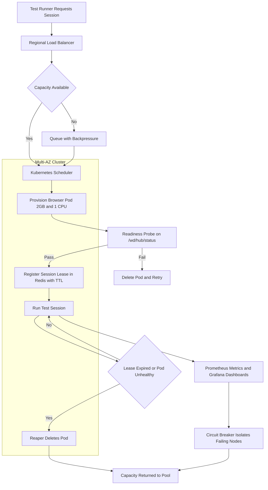

| Difficulty | Channel | Tags |
|---|---|---|
| advanced | system-design | selenium, webdriver, grid |

Salesforce's quality engineering team once faced a deceptively simple question: how do you run more than 40,000 Selenium UI test cases across dozens of browser and platform combinations without letting the grid rot [1]? Their answer was not a bigger hub or a longer-lived fleet of nodes. They made browser hosts disposable, so every test session started clean and every failure could be replaced instead of repaired [1]. That single design choice is the difference between a grid that survives 10,000 concurrent sessions and one that leaks memory until the pager screams at 3 a.m.

---

> ### Real-World Case — Salesforce
>
> Salesforce's quality engineering team needed to run more than 40,000 Selenium UI test cases across many browser and platform combinations as part of its continuous integration pipeline. Keeping a large, long-lived Selenium Grid healthy would have meant constant browser/driver upgrades, state drift, and the memory buildup that comes from reusing nodes across thousands of sessions.
>
> | | |
> |---|---|
> | **Challenge** | Scale browser test execution to tens of thousands of cases without relying on a fragile, persistent Selenium Grid that accumulates leaked browser processes, drifts out of sync with browser versions, and becomes an operational single point of failure. |
> | **Solution** | Instead of scaling through Selenium Grid, Salesforce continuously provisioned fresh virtual machines from browser-specific 'gold master' images, installed additional software dynamically, ran the tests, and then destroyed the hosts. Every run started from a clean, known-good browser state, and unhealthy hosts could simply be replaced rather than repaired. |
> | **Outcome** | Salesforce executed over 40,000 Selenium test cases against its application across a wide variety of browsers and platforms while avoiding the state accumulation and maintenance burden of long-running grid nodes; disposable hosts provided clean isolation and straightforward failure recovery. |
> | **Lesson** | At large scale, treat Selenium browser nodes as disposable cattle rather than pets: provisioning a clean host per run is often more reliable than trying to keep a long-lived Grid leak-free, and it gives you failure isolation for free. |

---

## Hook — The Memory Graph That Climbs at 3 A.M.

The pager goes off at 3:07 a.m. Your Selenium Grid dashboard shows 197 browser nodes, 41,000 queued tests, and a memory curve that looks like a staircase to the moon. Nothing crashed. That is the worst part. The grid is technically alive, so every retry lands on the same tired nodes, each one holding a little more browser cache, a little more orphaned driver process, a little more state from the last thousand sessions. By sunrise, the suite that usually finishes in 40 minutes is four hours behind, and the release train is stuck at the station.

Now scale that picture to 10,000 concurrent sessions across multiple data centers. At 50 sessions per node, you need roughly 200 browser nodes. At 2GB per node, that is 400GB of baseline memory before you add a 30% safety buffer — 520GB in total. Every leaked session is no longer a rounding error. It is a slow, expensive erosion of capacity that turns your carefully planned autoscaling into a treadmill.

🔥 Hot Take: Most Selenium Grid outages are not sudden failures. They are long, boring memory leaks wearing a lanyard.

The question is not whether nodes will fail. It is whether failure becomes boring, automatic, and cheap. That is the story this architecture has to tell.

## Problem — Long-Lived Browsers Are a Slow Leak

Selenium Grid traditionally follows a hub-node pattern: a central router accepts test requests and forwards them to registered browser nodes [9][10]. It is a sensible model. It is also a model that quietly assumes nodes are precious, long-lived pets that deserve to be nursed back to health. In a large CI pipeline, that assumption becomes the source of the problem.

Here is the trap. A browser node that has handled thousands of sessions is carrying invisible baggage: stale temp profiles, zombie driver processes, cached extensions, and the accumulated weirdness of every test that forgot to call quit(). Add constant browser and driver upgrades, and you get state drift across the fleet. Two nodes running the same test may behave differently because one has been alive since the last release and the other was recycled yesterday.

The non-functional requirements make the pressure worse:

- **Throughput:** 10,000 sessions divided by 50 sessions per node equals 200 nodes minimum.
- **Memory:** 200 nodes x 2GB equals 400GB baseline, plus a 30% buffer for 520GB cluster memory.
- **Latency:** P99 session initiation under 2 seconds through regional load balancing.
- **Availability:** 99.9% uptime, which sounds generous until you realize it is only about 43 minutes of downtime per month.

| Approach | What it optimizes | What it quietly costs |
|---|---|---|
| Bigger long-lived grid | Warm starts and simple routing | Memory leaks, state drift, upgrade pain, fragile recovery |
| Disposable browser pods | Clean isolation and cheap failure | Slightly slower cold starts and more orchestration complexity |
| Hybrid warm pool | Fast starts plus isolation | Extra scheduling logic and idle capacity |

Many developers discover that adding nodes does not fix a leak. It just gives the leak more places to hide. So what did Salesforce do differently?

## Real-World Case — Salesforce's 40,000-Test Wake-Up Call

In 2013, Salesforce's quality engineering team documented a challenge that will feel familiar to anyone who has owned a large UI test suite [1]. The team needed to run more than 40,000 Selenium UI test cases across a wide variety of browsers and platforms as part of its continuous integration pipeline. A large, long-lived Selenium Grid would have meant constant browser and driver upgrades, state drift between nodes, and the memory buildup that comes from reusing the same hosts across thousands of sessions [1].

Salesforce's answer was not to build a more durable grid. The team leaned on disposable hosts, giving each test run clean isolation and making failure recovery straightforward instead of heroic [1]. The result was more than 40,000 Selenium test cases executed across many browser and platform combinations, without the state accumulation and maintenance burden of long-running grid nodes [1].

That is the plot twist. The lesson was not 'buy more machines.' It was 'stop protecting machines that should be replaced.' The reliability came from disposability, not durability.

🎯 Key Point: Salesforce did not eliminate failures. The team made failures cheap enough that they stopped being incidents.

That idea is the seed of the 10,000-session architecture. The next question is how to turn 'disposable hosts' into an automated, observable system.

## Deep Dive — Architecture That Treats Nodes as Cattle

At its core, Selenium Grid still needs a router and a pool of browsers [9][10]. The scalable version keeps that mental model but removes the fragile part: the long-lived node. Here is how the pieces fit together.

**1. Orchestration: StatefulSets and disposable pods.** Kubernetes StatefulSets give browser nodes stable identity when you need it, while ordinary Deployments or Jobs are better for truly ephemeral sessions [2]. The important design decision is that every browser pod has a finite life. It is created for a session, or a small batch of sessions, and then deleted. No node gets to celebrate an anniversary.

**2. Capacity: autoscale on queue depth.** Horizontal Pod Autoscaling can scale on CPU or memory, but queue depth is the signal that actually reflects test demand [3]. At 50 sessions per node, 10,000 concurrent sessions means 200 nodes. Autoscaling should add capacity before the queue becomes a parking lot, not after developers start complaining.

**3. Session state: Redis with TTL.** A Redis cluster stores session leases with time-to-live policies, connection pooling, and automatic cleanup [6]. The TTL is not a suggestion. It is a hard deadline. If a test runner dies, the lease expires, and the reaper knows the pod is safe to delete.

**4. Health and isolation.** Readiness and liveness probes check a /status endpoint every 10 seconds, and a node is removed after three consecutive failures [5]. Circuit breakers isolate failing nodes for a 30-second recovery window, then probe again with a half-open state [7]. Pod Disruption Budgets keep at least 85% capacity during rolling updates [4]. Without that floor, a routine cluster upgrade can become an accidental load test.

**5. Observability.** Prometheus scrapes memory usage, session duration, queue depth, and failure counts [8]. Grafana dashboards make the leak visible before it becomes an outage. Alerts fire at 80% memory usage, not at 99%.

**6. Multi-region availability.** Multi-AZ deployments and regional load balancing provide automatic failover and keep P99 session initiation under 2 seconds for nearby teams [12]. HTTP health endpoints follow standard semantics, so a failing node returns a clear signal instead of a mysterious timeout [11].

💡 Insight: The fastest way to fix a memory leak is to make sure the leaking process has a scheduled death.

⚠️ Watch Out: A circuit breaker without a half-open probe is just a permanent outage with better branding.

**Memory management deserves its own paragraph.** Prevention means weekly rolling restarts, memory alerts at 80%, and garbage collection tuning for the browser and driver processes. Cleanup means Kubernetes init containers remove stale Docker volumes, while Redis expiration scans run every five minutes. Monitoring means Prometheus and Grafana track memory trends and session duration, so teams can see the difference between a busy day and a slow leak.

**When should you actually use this pattern?** Use disposable nodes when session duration is short, test volume is spiky, and isolation matters more than warm-start latency. If startup time dominates your suite, keep a small warm pool and recycle it aggressively. The trade-off is idle capacity versus predictable cleanliness.

🔥 Hot Take: If your grid nodes have uptime measured in weeks, you do not have a grid. You have a museum.

With the architecture mapped out, the next step is to follow a single session from request to teardown.

## Workflow — From Test Request to Clean Teardown

The Mermaid diagram below tells the visual story of one session moving through the system. Follow the arrows from the test runner to the reaper, and notice how every happy path has a failure path beside it.

1. A test runner requests a session through a regional load balancer, which keeps P99 session initiation under two seconds for nearby teams.
2. The scheduler checks Redis for live leases and queue depth, then asks Kubernetes for capacity [3].
3. Kubernetes provisions a browser pod with a hard 2GB memory limit and 1 CPU limit, so one runaway Chrome instance cannot starve its neighbors.
4. A readiness probe hits /wd/hub/status every 5 to 10 seconds; the pod only receives traffic after the probe passes [5].
5. The control plane writes a session lease to Redis with a 30-minute TTL [6].
6. Prometheus scrapes memory, session duration, and queue depth every 15 seconds [8].
7. A reaper compares live pods to Redis leases and deletes orphans whose lease has expired or vanished.
8. If a node fails three health checks, the circuit breaker isolates it for a 30-second recovery window [7].
9. Pod Disruption Budgets keep at least 85% capacity during rolling updates, and canary deployments split traffic before a new node image reaches everyone [4].

This workflow turns node failure into a routine event. A pod dies, the lease expires, the reaper cleans up, and capacity returns to the pool. No human has to log in at 3 a.m. to restart a browser.

But the workflow is only as good as the code that enforces it. The next section shows a session lease implementation that cleans up after itself.

## Code Example — A Session Lease That Cleans Up After Itself

The snippet below implements the heart of the lifecycle: create an isolated browser pod, register a Redis lease with a TTL, and reap pods whose lease has disappeared [6][8]. It is intentionally small, but it captures the production pattern.

The key design decisions are simple. The pod has hard CPU and memory limits, so one browser cannot consume the whole node. The readiness probe prevents traffic from reaching a browser that is still starting. The Redis lease has an expiration, which means cleanup works even if the reaper crashes. And the reaper treats a missing lease as a deletion signal, so orphaned pods cannot accumulate.

The explanation field walks through each section line by line, including the metrics that make leaks visible before they become outages.

## Lessons Learned — Build for Replacement, Not Immortality

The Salesforce story is not a story about a clever grid configuration [1]. It is a story about a mindset shift: reliability comes from making failure cheap. Here are the lessons that matter when you are staring down 10,000 concurrent sessions.

- **Disposability beats durability.** A browser node that is designed to die is easier to trust than one that is designed to survive forever [1].
- **Put a deadline on every session.** Redis TTLs turn cleanup into a guarantee instead of a hope [6].
- **Measure the leak, not just the crash.** Prometheus dashboards and 80% memory alerts catch the slow erosion before it becomes an outage [8].
- **Isolate failure at the edge.** Circuit breakers and Pod Disruption Budgets keep one bad node from becoming a bad day [7][4].
- **Autoscale on the signal that matters.** Queue depth reflects demand more honestly than CPU ever will [3].

**Battle scars to avoid:**

- Setting memory limits without requests, which lets Kubernetes overcommit and evict pods at the worst possible moment.
- Forgetting to delete orphaned pods when a test runner crashes, which turns Redis into a graveyard of stale leases.
- Using a circuit breaker that never probes again, which converts a temporary failure into a permanent capacity loss.
- Rolling out a new browser image to the entire fleet at once, then discovering the regression with 10,000 tests instead of 100.

| What to do tomorrow | Why it matters |
|---|---|
| Add a TTL to every session lease | Cleanup survives control-plane failures |
| Set memory requests and limits per pod | Prevents noisy-neighbor eviction |
| Alert at 80% memory, not 99% | Gives the team time to act before users notice |
| Keep a canary path for node images | Limits blast radius during upgrades |
| Measure node age | Long-lived nodes are a leading indicator of drift |

🎯 Key Point: The goal is not a grid that never fails. The goal is a grid where failure is a scheduled event, not a surprise.

Salesforce proved that disposable hosts can handle tens of thousands of test cases without the maintenance burden of long-running nodes [1]. The same principle scales to 10,000 concurrent sessions when you pair it with Kubernetes autoscaling, Redis TTLs, Prometheus monitoring, and circuit breakers. The architecture is not magic. It is a commitment to treating every browser node as temporary.

---

## Session Lifecycle Flow

<strong>Original Interview Question</strong>

**Q:** Design a scalable Selenium Grid architecture to handle 10,000 concurrent test sessions with 99.9% uptime, ensuring zero memory leaks through automatic session lifecycle management, real-time monitoring, and graceful node failure recovery across multiple data centers?

**A:** Deploy Kubernetes cluster with auto-scaling node pools, Redis session store with TTL policies, Prometheus metrics for memory monitoring, circuit breakers for node isolation, and sidecar containers for session cleanup. Implement health checks, resource quotas, and rolling updates.

## Conclusion

Salesforce did not win by building a grid that never failed [1]. The team won by making failure cheap, isolated, and replaceable. That same principle scales to 10,000 concurrent sessions when you pair disposable browser pods with Kubernetes autoscaling, Redis TTLs, Prometheus monitoring, and circuit breakers. The architecture is not about preventing every leak. It is about ensuring that no leak gets to live long enough to matter.

Tomorrow, audit one number in your own grid: how long does a browser node live? If the answer is measured in weeks, you have found your leak. Start by adding a TTL to every session lease and a reaper that trusts that TTL. Then make the reaper boring. The most reliable browser is the one you are willing to throw away.

---

## References

1. [Salesforce incident report](https://developer.salesforce.com/blogs/engineering/2013/06/automated-testing-using-selenium-at-salesforce) — article
2. [Kubernetes StatefulSets](https://kubernetes.io/docs/concepts/workloads/controllers/statefulset/) — documentation
3. [Kubernetes Horizontal Pod Autoscaling](https://kubernetes.io/docs/tasks/run-application/horizontal-pod-autoscale/) — documentation
4. [Kubernetes Pod Disruption Budgets](https://kubernetes.io/docs/concepts/workloads/pods/disruptions/) — documentation
5. [Configure Liveness, Readiness, and Startup Probes](https://kubernetes.io/docs/tasks/configure-pod-container/configure-liveness-readiness-startup-probes/) — documentation
6. [Redis](https://en.wikipedia.org/wiki/Redis) — documentation
7. [Circuit Breaker Design Pattern](https://en.wikipedia.org/wiki/Circuit_breaker_design_pattern) — documentation
8. [Prometheus (software)](https://en.wikipedia.org/wiki/Prometheus_(software)) — documentation
9. [Selenium (software)](https://en.wikipedia.org/wiki/Selenium_(software)) — documentation
10. [SeleniumHQ GitHub Repository](https://github.com/SeleniumHQ/selenium) — documentation
11. [RFC 7231: HTTP/1.1 Semantics and Content](https://datatracker.ietf.org/doc/html/rfc7231) — documentation
12. [Amazon RDS Multi-AZ Deployments](https://docs.aws.amazon.com/AmazonRDS/latest/UserGuide/Concepts.MultiAZ.html) — documentation

---

**Author:** Satishkumar Dhule — [GitHub](https://github.com/satishkumar-dhule) · [LinkedIn](https://linkedin.com/in/satishkumar-dhule) · [Website](https://satishkumar-dhule.github.io)
