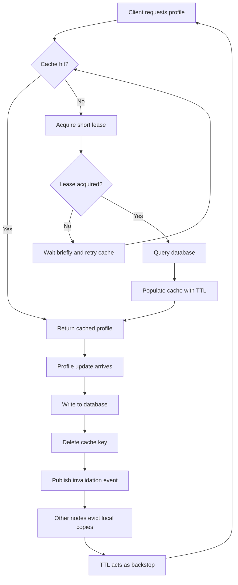

| Difficulty | Channel | Tags |
|---|---|---|
| beginner | backend | redis, memcached, cache-invalidation |

In 2013, engineers at Facebook published an account of a cache layer so large it held trillions of items for more than a billion users, handled billions of requests per second, and still had to answer one deceptively simple question: when a profile changes, how do you make sure nobody reads the old version [1]? Their answer involved memcached, regional clusters, and a lease mechanism that cut peak database queries from roughly 17,000 per second to 1,300 per second [1]. The strangest detail? Only about 4% of the deletes they issued actually invalidated a cached item [1]. That number is the doorway into everything confusing, counterintuitive, and genuinely important about cache invalidation.

---

> ### Real-World Case — Facebook (Meta)
>
> Facebook cached social-graph and profile-like data in memcached across thousands of servers, multiple frontend clusters, and multiple regions. Reads vastly outnumbered writes, and a single page render could fan out into hundreds of cache lookups, so stale or missing cache entries could hammer MySQL.
>
> | | |
> |---|---|
> | **Challenge** | After a database write, every cached copy of that key across many clusters had to be invalidated without overloading the database. Naive delete-on-write created a race: a slow reader could refill the cache with an old value after the delete, leaving the cache permanently stale (the 'stale set' problem). Popular keys also triggered thundering herds of misses on the database. |
> | **Solution** | Facebook used a look-aside cache and deliberately chose deletes over updates on write because deletes are idempotent. A daemon called mcsqueal tailed the MySQL commit log and batched invalidation deletes to mcrouter instances in every frontend cluster. To close the stale-set race and stop thundering herds, they extended memcached with 'leases': a 64-bit token issued on a miss that the server invalidates on delete, so a slow client's stale set is rejected. They also accepted short-lived staleness rather than blocking reads. |
> | **Outcome** | The system handled billions of requests per second and held trillions of items for over a billion users. Leases cut the peak database query rate from roughly 17K queries/sec to 1.3K queries/sec, and Facebook found that only about 4% of issued deletes actually invalidated a cached item. |
> | **Lesson** | Cache invalidation is a distributed consistency protocol, not just a delete call. Delete-on-write is safer than update-on-write because it is idempotent, but you still need a mechanism like leases or versioning to prevent a slow reader from resurrecting stale data, and you should push complexity into clients rather than the cache servers. |

---

## Hook — The Delete That Almost Never Hit

Picture a profile service on a normal Tuesday. A user changes their display name, the database write succeeds, and the API returns 200 OK. Ten minutes later, a friend opens the profile and sees the old name. Nothing crashed. No alert fired. The system simply lied. That is the special cruelty of cache invalidation: the failure is invisible until someone screenshots it.

At Facebook's scale, the same problem played out across thousands of memcached servers, multiple frontend clusters, and several regions, where a single page render could fan out into hundreds of cache lookups [1]. The obvious fix — delete the cache key on update — sounds simple. The numbers say otherwise. In fact, most of those deletes were hitting nothing at all, which raises an uncomfortable question: if invalidation mostly misses, what is actually keeping the data correct?

## Problem — When the Profile Page Lies

Here is the thing though: profile reads vastly outnumber profile writes. That ratio is exactly why caches exist, and exactly why invalidation is hard. If one write must correct hundreds of cached copies, the write path becomes a distributed-systems problem.

A read that starts just before an update can repopulate the cache with the old value just after the delete, leaving stale data behind [2]. Developers often respond by shortening the TTL, but shorter TTLs increase database load, and longer TTLs increase the blast radius of stale data. Others try updating the cache in place instead of deleting it, which creates races and writes values nobody may ever read.

Consequently, the real question is not 'Redis or Memcached?' yet. The real question is: what guarantee does the profile page need, and what is the cheapest way to provide it? That is where Facebook's experience becomes unusually useful.

## Real-World Case — Facebook (Meta)

In 2013, Facebook engineers published one of the most cited papers on caching at scale [1]. Their memcached deployment spanned thousands of servers, multiple frontend clusters, and multiple regions, and it held trillions of items for more than a billion users [1]. Reads dominated writes, and a single page render could trigger hundreds of cache lookups, so a miss could send a burst of traffic straight to MySQL [1].

The team introduced leases: on a miss, one client gets permission to fetch from the database while others wait briefly. That single change cut peak database query rates from roughly 17,000 queries per second to 1,300 queries per second [1].

Then came the plot twist. Only about 4% of the deletes Facebook issued actually invalidated a cached item [1]. Most of that invalidation work was wasted because the item had already been evicted or expired. The lesson is not 'stop deleting.' The lesson is that invalidation must be cheap, safe, and backed by TTLs, because the cache is already changing underneath you. So what does that mean for a smaller profile service? It means the design should assume misses are normal.

## Deep Dive — Redis, Memcached, and the Trade-Offs That Actually Matter

Building on this, the Redis versus Memcached decision is less about raw speed and more about which invalidation tools you need. Both store key-value data in memory, but they make different promises. Redis offers pub/sub, persistence, atomic data structures, and scripts; Memcached offers a simpler multithreaded design with very low overhead and no persistence [3][4][5][6].

| Concern | Redis | Memcached |
|---|---|---|
| Distributed invalidation | Pub/sub channels and keyspace notifications | Manual coordination required |
| Persistence | Optional snapshots and append-only file | None; cache is ephemeral |
| Data structures | Strings, hashes, sets, sorted sets, streams | Strings and blobs |
| Scaling model | Cluster, replicas, more operational knobs | Simple horizontal sharding |
| Memory overhead | Higher per-key overhead | Lower for pure caching |
| Best fit | Complex invalidation, durability, rate limits | Simple, hot, disposable cache |

Moreover, the pattern matters as much as the product. Write-through writes to the database and cache together; cache-aside reads from the cache first and populates on a miss. For profiles, a common production choice is cache-aside for reads plus delete-on-write for invalidation, with a TTL as a backstop [2]. Updating the cache in place looks efficient, but it creates races and wasted writes when the key is not present. Deleting is idempotent: if the key is already gone, the delete is harmless.

That is why Facebook's 4% figure is not a failure — it is evidence that invalidation is mostly a no-op by design [1]. One warning, though: Redis pub/sub is fire-and-forget. If a subscriber is offline, it misses the message, so TTLs and a periodic reconciliation job are still required [7]. A cache is not a database, and an invalidation event is not a transaction.

## Workflow — The Invalidation Workflow, Step by Step

Therefore, the workflow has to handle both the happy path and the race. The diagram below traces the full loop, from a cache miss to a profile update and the invalidation event that follows. Here is the sequence in plain language:

1. A request arrives for `profile:42`. Check the cache first.
2. On a hit, return the cached JSON. On a miss, acquire a short lease with `SET NX EX` so only one worker queries the database [9].
3. If the lease is acquired, read the profile from the database, write it to the cache with a 5–30 minute TTL, and release the lease.
4. If the lease is not acquired, wait briefly and retry the cache instead of stampeding MySQL.
5. On update, write the new profile to the database first.
6. Delete the cache key, then publish an invalidation message so other nodes can evict local copies.
7. Optionally delete again after a short delay to cover reads that were already in flight.
8. Let the TTL act as the final backstop for missed events, restarts, and network partitions.

This is deliberately boring, and that is the point. The system does not try to keep every cache perfectly synchronized in real time. It tries to make stale reads rare, short-lived, and recoverable [8]. That shift in mindset is what turns a fragile cache into a dependable one.

## Code Example — Putting It Together in Python

Here is what that workflow looks like in Python with `redis-py`. The snippet uses cache-aside reads, a lease to prevent a thundering herd, delete-on-write invalidation, and pub/sub for other nodes [5][9]. It is intentionally small enough to read in one sitting, but the shape mirrors what production services do.

The key design choices are worth calling out before the code: the lease is short, the profile TTL is long enough to absorb read traffic, and the write path deletes instead of updating. Those three choices handle the majority of real-world invalidation pain.

## Lessons Learned — What the 4% Teaches You

Looking back, the 4% statistic is the memorable insight: most invalidation attempts are wasted, and that is fine. What matters is that the ones that do hit are correct, fast, and safe. Here is what to carry into the next design review:

- **Delete, do not update, on write.** Deletes are idempotent and avoid writing values nobody may read [2].
- **Always set a TTL.** It is the only backstop that survives missed events, restarts, and partial failures [10].
- **Use a lease or request coalescing.** It protects the database when a hot key expires [9].
- **Know your cache's guarantees.** Redis pub/sub is not durable; Memcached has no persistence or built-in invalidation bus [4][6].
- **Measure hit rate and database query rate together.** A high hit rate with rising database load usually means invalidation is too aggressive or TTLs are too short.
- **Do not cache what you cannot invalidate.** If a profile field changes every few seconds, a 15-minute TTL is a bug waiting to happen.

Many developers think cache invalidation is a Redis feature. It is not. It is a system property that emerges from the database, the cache, the write path, and the failure modes you are willing to tolerate [1][2].

---

## Cache Read and Invalidation Flow

<strong>Original Interview Question</strong>

**Q:** You're building a user profile service that caches frequently accessed profiles. How would you implement cache invalidation when a user updates their profile, and what trade-offs would you consider between Redis and Memcached?

**A:** Implement write-through caching with TTL-based expiration. On profile update, invalidate the cache by deleting the key and writing new data to both the database and cache. Redis offers pub/sub for automatic distributed invalidation, while Memcached requires manual coordination across nodes.

## Conclusion

The next time a profile page shows a name that changed ten minutes ago, do not reach for a shorter TTL by reflex. Ask which guarantee failed: the delete, the event, the lease, or the backstop. Facebook's 4% figure is a reminder that invalidation is mostly about making the rare hit correct, not about making every delete count [1]. Start with delete-on-write, a sensible TTL, and a lease on hot keys. Then add pub/sub only when you can explain what happens when a subscriber misses the message. That is the difference between a cache that helps you sleep and one that wakes you up at 3am.

---

## References

1. [Facebook (Meta) incident report](https://www.usenix.org/system/files/conference/nsdi13/nsdi13-final170_update.pdf) — article
2. [Cache invalidation](https://en.wikipedia.org/wiki/Cache_invalidation) — documentation
3. [Memcached](https://en.wikipedia.org/wiki/Memcached) — documentation
4. [Redis](https://en.wikipedia.org/wiki/Redis) — documentation
5. [redis/redis on GitHub](https://github.com/redis/redis) — documentation
6. [memcached/memcached on GitHub](https://github.com/memcached/memcached) — documentation
7. [Cache coherence](https://en.wikipedia.org/wiki/Cache_coherence) — documentation
8. [RFC 9111: HTTP Caching](https://datatracker.ietf.org/doc/html/rfc9111) — documentation
9. [Thundering herd problem](https://en.wikipedia.org/wiki/Thundering_herd_problem) — documentation
10. [Time to live](https://en.wikipedia.org/wiki/Time_to_live) — documentation

---

**Author:** Satishkumar Dhule — [GitHub](https://github.com/satishkumar-dhule) · [LinkedIn](https://linkedin.com/in/satishkumar-dhule) · [Website](https://satishkumar-dhule.github.io)
