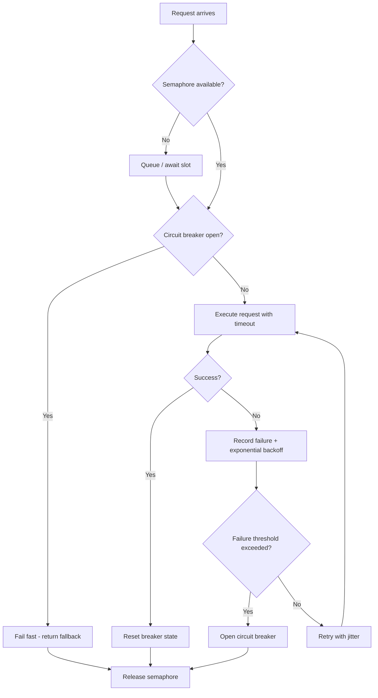

| Difficulty | Channel | Tags |
|---|---|---|
| advanced | backend | asyncio, aiohttp, concurrency |

Netflix's API handled over 1 billion incoming calls per day, fanning out roughly 1:6 into several billion outgoing requests across dozens of backend subsystems — peaking above 100,000 dependency requests per second on thousands of EC2 instances [1]. With every user request depending on many services, a single sluggish dependency could block threads and cascade into a full API outage within seconds [1]. This is the terrifying reality of high-volume distributed systems, and it is exactly why a naive `aiohttp` connection pool will eventually take your service down with it. Here is how you build one that degrades gracefully instead of collapsing under load.

---

> ### Real-World Case — Netflix
>
> Netflix's API handled more than 1 billion incoming calls per day, fanning out roughly 1:6 to several billion outgoing calls across dozens of backend subsystems, with peaks above 100,000 dependency requests per second on thousands of EC2 instances. Because every user request depended on many services, a single latent dependency could block request threads and cascade into a full API outage within seconds.
>
> | | |
> |---|---|
> | **Challenge** | Keep the API available and degrade gracefully when individual dependencies became slow or failed, instead of letting one bad dependency exhaust shared threads and take down the entire service. |
> | **Solution** | Netflix built the DependencyCommand layer, later open-sourced as Hystrix, combining network timeouts and retries, per-dependency thread pools, non-blocking semaphores via tryAcquire, circuit breakers, and fallbacks. Circuit breakers tripped at thresholds such as a 50% error rate over a 10-second window and rejected calls until health checks passed, while fallbacks served cached, queued, stubbed, or empty responses. |
> | **Outcome** | The design protected a system handling over 1 billion calls per day and peaks above 100,000 dependency requests per second, and Netflix reported a dramatic improvement in uptime and resilience. The post also quantified the stakes: 30 dependencies each at 99.99% availability yield only 99.7% overall, or more than 2 hours of downtime per month. |
> | **Lesson** | Fault tolerance is a requirement, not a feature. Isolate each dependency, bound concurrency with semaphores or thread pools, fail fast with circuit breakers, and always provide a fallback, otherwise one slow dependency becomes a system-wide outage. |

---

## Hook — When the Fan-Out Becomes the Fallout

Imagine a single user hits your API endpoint. That one request fans out to six downstream services. Now multiply that by a traffic spike, and suddenly thousands of coroutines are simultaneously waiting on connections that may never come back. Your event loop is not blocked — that is the cruel part. It is happily scheduling more requests into a dependency that is quietly dying, and the backlog grows faster than you can shed it. Netflix learned this lesson at scale: with 30 dependencies each running at 99.99% availability, your combined availability math collapses to just 99.7% — more than two hours of downtime every single month [1]. Sound familiar? That math is not a warning. It is a countdown. The question is not whether your pool will face a slow dependency, but when — and whether it survives the encounter.

## Problem — Why Naive Pools Fail Under Pressure

Most developers reach for `aiohttp.ClientSession` and call it a connection pool. It works beautifully in staging, then melts in production. The core pain point is that a pool is really three problems wearing one trench coat: concurrency control, failure isolation, and lifecycle management. Without a concurrency cap, a traffic spike spawns unbounded coroutines, exhausting file descriptors and memory. Without failure isolation, one slow service turns every waiting coroutine into a hostage, and you get the classic cascade failure. Without lifecycle management, connections leak, sockets stay half-open, and shutdown hangs. The stakes are brutal. A single dependency with a 10-second timeout and no backoff can multiply into thousands of wasted connections per minute, and — as Netflix quantified — the compounding math of dependencies means your availability is only as strong as your weakest link [1]. Developers often fixate on making the happy path fast, but the unhappy path is what pages you at 3am.

## Real-World Case — Netflix

Netflix's platform is the canonical case study for this exact problem. Their API handled more than 1 billion incoming calls per day, fanning out roughly 1:6 to several billion outgoing calls across dozens of backend subsystems, with peaks above 100,000 dependency requests per second spread across thousands of EC2 instances [1]. Because every user request depended on many services, a single latent dependency could block request threads and cascade into a full API outage within seconds [1]. Their engineering teams responded by building fault tolerance directly into the client layer: bounded concurrency, timeouts, fallbacks, and isolation so that one bad dependency could never take down the whole surface. The impact was dramatic — a system handling over a billion calls per day stayed up through dependency failures that would have flattened a naive design, and Netflix reported a dramatic improvement in uptime and resilience [1]. The lesson is stark: at scale, graceful degradation is not a nice-to-have feature. It is the product.

## Deep Dive — The Three Pillars of a Resilient Pool

Building on Netflix's fan-out problem, you need three interlocking mechanisms that work together, not in isolation. First, a semaphore bounds concurrency so the pool never over-subscribes; it is the difference between a controlled queue and a stampede. Second, exponential backoff with jitter prevents retry storms that hammer an already-wounded dependency [2] — this is the same pattern described in AWS's well-documented backoff strategy, which recommends capping retries and randomizing delays [3]. Third, a circuit breaker stops sending traffic to a failing dependency entirely, giving it room to recover while your service returns fast, cheap failures instead of slow, expensive ones [4]. Here is the counterintuitive twist many developers miss: more connections is not always better. A pool of 500 connections against a struggling dependency can be worse than a pool of 50, because you are amplifying load on something already on its knees. Consider the trade-offs below:

| Strategy | Protects Against | Risk If Misused |
|---|---|---|
| Semaphore cap | Resource exhaustion | Too low = latency, too high = cascade |
| Exponential backoff | Retry storms | Too aggressive = slow recovery |
| Circuit breaker | Dependency death spiral | Too sensitive = unnecessary fallbacks |

The art is in tuning these against your actual latency budget, not copying defaults from a blog post.

## Workflow — From Request to Graceful Degradation

This leads to the practical flow you should implement. Instead of firing requests blindly, every call travels through a sequence of guarded stages, visualized in the diagram below. It starts with a concurrency slot, passes a circuit-breaker check, executes with a timeout, and branches into success or failure handling — where failure triggers backoff and health tracking.



Specifically, the semaphore acts as the front-door bouncer, while the circuit breaker acts as the emergency shutoff. The timeout protects you from the silent killer: a connection that hangs forever. Once the breaker opens, subsequent requests skip the doomed dependency and return immediately — that is the moment graceful degradation stops being a buzzword and becomes observable behavior.

## Code Example — A Production-Grade aiohttp Pool

Now, here is the implementation that ties the three pillars together. Note how each concern lives in its own method, and how the breaker state is tracked with timestamps so it can auto-recover rather than staying stuck open forever.

```python
import asyncio
import time
import random
import aiohttp
from asyncio import Semaphore
from typing import Optional

class ConnectionPoolManager:
    def __init__(self, max_connections: int = 100,
                 failure_threshold: int = 5,
                 recovery_time: float = 60.0):
        # Bound concurrency so the pool never over-subscribes
        self.semaphore = Semaphore(max_connections)
        self.session: Optional[aiohttp.ClientSession] = None
        self.timeout = aiohttp.ClientTimeout(total=30, connect=5)
        self.failure_threshold = failure_threshold
        self.recovery_time = recovery_time
        self._failures = 0
        self._opened_at = 0.0

    async def start(self) -> None:
        # One shared session reuses TCP connections via keepalive
        connector = aiohttp.TCPConnector(limit=100, ttl_dns_cache=300)
        self.session = aiohttp.ClientSession(connector=connector,
                                             timeout=self.timeout)

    async def close(self) -> None:
        # Always clean up on shutdown to avoid leaked sockets
        if self.session:
            await self.session.close()

    def _circuit_open(self) -> bool:
        # Breaker is open only during the recovery window
        if self._failures < self.failure_threshold:
            return False
        return (time.monotonic() - self._opened_at) < self.recovery_time

    async def make_request(self, url: str) -> Optional[str]:
        # Fail fast when the breaker is open
        if self._circuit_open():
            return None

        async with self.semaphore:  # Concurrency gate
            for attempt in range(3):
                try:
                    async with self.session.get(url) as response:
                        response.raise_for_status()
                        self._failures = 0  # Reset on success
                        return await response.text()
                except (asyncio.TimeoutError, aiohttp.ClientError):
                    self._failures += 1
                    self._opened_at = time.monotonic()
                    # Exponential backoff with jitter to avoid retry storms
                    delay = min(2 ** attempt + random.uniform(0, 0.5), 10)
                    await asyncio.sleep(delay)
            return None  # Graceful degradation after retries exhausted
```

This code does three critical things. It bounds concurrency with a semaphore so a spike cannot spawn infinite coroutines. It uses a circuit breaker with a monotonic clock — crucially, `time.monotonic()` rather than wall-clock time, because clock changes can corrupt your breaker logic. And it adds jitter to the backoff so that thousands of clients do not retry in synchronized waves, which is the exact retry-storm behavior AWS warns against [3]. When everything fails, it returns `None` instead of raising — a deliberate choice that lets callers degrade gracefully rather than propagate an exception through the async stack.

## Lessons Learned — What to Do Differently Tomorrow

Reflecting on Netflix's billion-call journey [1], the biggest lesson is that resilience is a design property, not a patch you add after the first outage. Here are the battle scars worth remembering. Never let unbounded concurrency into production — a semaphore is your cheapest insurance policy. Always use monotonic time for breaker logic, or you will debug a ghost failure at 2am. Treat retries as a weapon that cuts both ways: without backoff and jitter, you are the DDoS [2][3]. Configure two timeouts, not one — a short connect timeout and a longer read timeout catch the silent hangs that a single `total` timeout misses. Clean up your session on shutdown, because leaked connections are a slow-motion outage. And remember the sobering dependency math: your availability is the product of every service you depend on, so bounding blast radius matters more than any single optimization [1]. If this feels overwhelming, you are not alone — even Netflix had to build this layer deliberately over years. Start with a semaphore, add a breaker next sprint, then measure. The transformation does not happen all at once; it happens one guarded request at a time. So tomorrow, before you ship that next outbound call, ask one question: what happens when this dependency dies?

---

## Resilient Request Flow


<details>
<summary><strong>Original Interview Question</strong></summary>

**Q:** How would you implement a connection pool manager for aiohttp that handles graceful degradation under high load and connection timeouts?

**A:** Implement a connection pool manager for aiohttp using a semaphore to limit concurrent connections, exponential backoff for retrying failed requests, and circuit breaker pattern to gracefully degrade under high load and connection timeouts.

</details>

## Conclusion

The story of Netflix's billion-call API is not really about Netflix — it is a preview of what happens to any service that ignores fan-out math and lets dependencies multiply unchecked [1]. The good news is that graceful degradation is entirely within reach: a semaphore, a circuit breaker using monotonic time, and jittered backoff together turn a fragile client into a resilient one [2][4]. Do not wait for the outage to teach you this. Add a concurrency cap this week, a breaker next sprint, and measure your real latency budget before the next traffic spike. Your future self — the one not being paged at 3am — will thank you. The most memorable insight to share with your team: your system's availability is the product of every dependency you trust, so design as if any one of them will fail today, because eventually one will.

---

## References

1. [Netflix incident report](https://netflixtechblog.com/fault-tolerance-in-a-high-volume-distributed-system-91ab4faae74a) — article
2. [Exponential backoff - Wikipedia](https://en.wikipedia.org/wiki/Exponential_backoff) — article
3. [Timeouts, retries, and backoff with jitter - AWS Architecture Blog](https://aws.amazon.com/builders-library/timeouts-retries-and-backoff-with-jitter/) — blog
4. [Circuit breaker design pattern - Wikipedia](https://en.wikipedia.org/wiki/Circuit_breaker_design_pattern) — article
5. [aiohttp Client Quickstart and Session documentation](https://docs.aiohttp.org/en/stable/client_quickstart.html) — documentation
6. [Python asyncio synchronisation primitives (Semaphore)](https://docs.python.org/3/library/asyncio-sync.html) — documentation
7. [Python time.monotonic documentation](https://docs.python.org/3/library/time.html#time.monotonic) — documentation
8. [AWS Well-Architected Framework - Reliability Pillar](https://docs.aws.amazon.com/wellarchitected/latest/reliability-pillar/welcome.html) — documentation
9. [release-it/retry - Retry library for asyncio (GitHub)](https://github.com/Julien-Sauvage/retrying-async) — documentation

---

**Author:** Satishkumar Dhule — [GitHub](https://github.com/satishkumar-dhule) · [LinkedIn](https://linkedin.com/in/satishkumar-dhule) · [Website](https://satishkumar-dhule.github.io)
