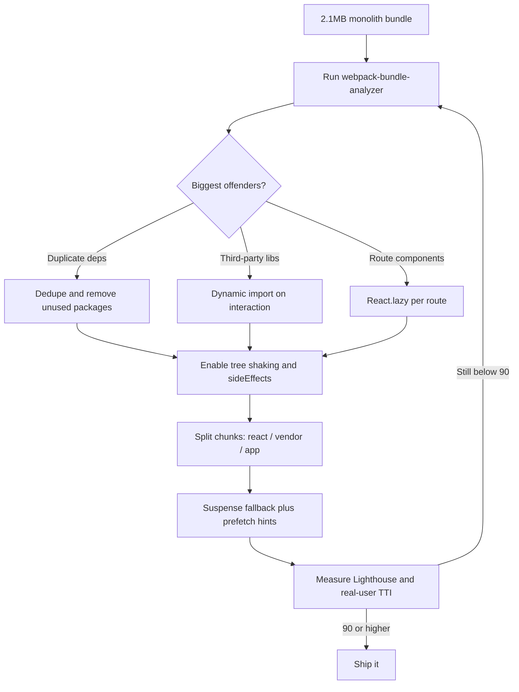

| Difficulty | Channel | Tags |
|---|---|---|
| intermediate | frontend | lighthouse, bundle, lazy-loading |

In 2017, Twitter rebuilt its mobile web experience as Twitter Lite, a React and Redux PWA for users on 2G and 3G networks. The team had aggressive performance goals, yet webpack still shipped only three JavaScript files totaling over 1MB, and the main bundle took more than five seconds to load on a simulated 3G connection [1]. That gap between ambition and reality is the same one hiding in your 2.1MB bundle and 4.2-second Time to Interactive. Here is the story of how Twitter closed it, and how you can walk the same path.

---

> ### Real-World Case — Twitter
>
> In 2017 Twitter rebuilt its mobile web experience as Twitter Lite, a React/Redux PWA aimed at users in emerging markets on 2G and 3G networks. Despite aggressive performance goals, their webpack setup produced only three JavaScript files totaling over 1MB (420KB gzipped), and the main bundle took more than 5 seconds to load on a simulated 3G connection.
>
> | | |
> |---|---|
> | **Challenge** | A monolithic JavaScript bundle blocked the app from becoming interactive quickly on low-end mobile devices. Circular code dependencies and trouble with webpack's CommonsChunkPlugin prevented effective chunking, so users had to download and parse code for screens they might never visit before they could interact with the timeline. |
> | **Solution** | The team introduced granular route-based code splitting, breaking the app into roughly 40 on-demand chunks amortized across the session, with separate vendor, shared, main, and i18n bundles using CommonsChunkPlugin with minChunks: 4. They lazy-loaded non-critical routes using the PRPL pattern, deferred non-essential work from componentWillMount to componentDidMount, avoided dangerouslySetInnerHTML, and added service worker caching for repeat visits. |
> | **Outcome** | Main bundle load time dropped from over 5 seconds to roughly 3 seconds on simulated 3G, and Lighthouse showed Time to Interactive cut nearly in half. Twitter reported a 50% reduction in 99th-percentile TTI and a 30% reduction in average load time for logged-in users, along with 65% more pages per session, 75% more Tweets, and a 20% lower bounce rate. The PWA shipped just 600KB over the wire versus 23.5MB for the native Android app. |
> | **Lesson** | Code splitting is not about making the total JavaScript smaller; it is about shrinking the critical path. Twitter actually accepted a larger overall app size in exchange for a much faster first render, proving that deferring non-essential code is often more valuable than shaving bytes off a single monolithic bundle. |

---

## Hook — The dashboard said 65, and the clock was already running

Picture the moment: a performance dashboard is open on one monitor, a production build is running on the other, and the number staring back is 65. The bundle weighs 2.1MB, Time to Interactive sits at 4.2 seconds, and every additional feature request adds another dependency. Nothing is technically broken, which is exactly what makes it dangerous. Users on mid-range phones and patchy connections are quietly abandoning the page before the app ever becomes interactive, and the team cannot see it in a green CI pipeline.

🔥 Hot Take: Most performance regressions are not caused by one catastrophic commit. They are caused by a hundred reasonable-looking imports that all seemed harmless at the time.

That is the trap Twitter found itself in with its first React-based mobile web build [1]. The lesson is not that React is slow. The lesson is that a bundle grows the way a garage fills up: one useful item at a time, until there is no room to park the car. The question is whether you notice before your users do.

## Problem — Your bundle is a supply chain, and every import is a shipment

A 2.1MB bundle is rarely one giant file someone wrote on purpose. It is a supply chain: your application code, the framework runtime, a charting library imported for one screen, a date utility pulled in three different versions, and a UI kit where a single button import drags in the entire component catalogue. Consequently, improving Lighthouse from 65 to 90 is not a styling exercise. It is a logistics problem.

Specifically, three forces keep the bundle heavy:

- **Eager loading by default.** Every static import is a promise to download and parse that code before the app can become interactive.
- **Poor tree shaking.** Libraries with side effects or CommonJS entry points resist dead-code elimination, so unused exports still ship [6].
- **One-size-fits-all delivery.** Every user downloads every route, every modal, and every admin-only chart, even if they never open them.

The stakes are concrete. Time to Interactive measures when the page can reliably respond to input, and heavy JavaScript delays that moment on the exact low-end devices that need the most help [8]. Therefore, the goal is not merely a smaller number on a build report. The goal is a shorter path between a user's intent and the app's first useful response.

💡 Insight: Bundle size is a proxy metric. Time to Interactive is the outcome. Optimize the outcome, and let the bundle size follow.

## Real-World Case — Twitter Lite and the 5-second wall

Twitter's mobile web team built Twitter Lite as a React and Redux progressive web app aimed at emerging markets, where 2G and 3G connections were the norm rather than the exception [1]. Despite an explicit performance mandate, their webpack configuration still emitted three JavaScript files totaling over 1MB, with the main bundle taking more than five seconds to load on a simulated 3G connection [1]. That was the wall.

Building on this diagnosis, the team attacked the problem with route-based code splitting, aggressive chunking, and a disciplined approach to what loaded at startup versus what loaded on demand [1]. The results were not cosmetic:

- Main bundle load time dropped from over five seconds to roughly three seconds on simulated 3G [1].
- Lighthouse Time to Interactive was cut nearly in half [1].
- Twitter reported a 50% reduction in 99th-percentile TTI and a 30% reduction in average load time for logged-in users [1].
- The payoff showed up in engagement: 65% more pages per session, 75% more Tweets, and a 20% lower bounce rate [1].
- The PWA shipped roughly 600KB over the wire versus 23.5MB for the native Android app [1].

🎯 Key Point: The same app, the same features, and the same framework produced dramatically different user behavior once the critical path got shorter. Performance work is product work.

What makes this case worth studying is that Twitter did not rewrite the application in a new framework or chase a silver bullet. The team systematically separated what must load now from what can load later, then measured the result in real user metrics [1]. That is a repeatable playbook, not a one-off miracle.

## Deep Dive — Splitting routes, splitting components, and knowing the difference

Here is where many developers get surprised. Code splitting is not a single technique; it is a family of decisions about *when* code becomes necessary. Consequently, the first job is measurement, not refactoring. Tools like webpack-bundle-analyzer render a treemap of your output, making it painfully obvious which chunks dominate and which dependencies arrived uninvited [7]. You might assume your application code is the problem, but the treemap often reveals a vendor chunk quietly doing bicep curls in the corner.

From there, two splitting strategies matter most:

| Strategy | What it splits | Best for | The real tradeoff |
|---|---|---|---|
| Route-based splitting | One chunk per top-level route | Dashboards, admin areas, marketing pages | Users pay a small delay on navigation unless you prefetch |
| Component-based splitting | One chunk per heavy widget | Charts, editors, modals, rich text tools | Too many tiny chunks create request overhead |

Route-based splitting gives the biggest initial win because it aligns network cost with user intent. Someone landing on the dashboard should not download the analytics engine [5]. Component-based splitting then handles the second tier: the heavy chart that only appears after a user clicks a tab, or the code editor that only loads in edit mode. Both rely on dynamic `import()`, which tells the bundler to create a separate chunk that can be fetched later [2].

However, there is a plot twist. Lazy loading does not make code free; it moves the cost. A route that loads in 300ms because it was split may now show a spinner for 200ms on first visit. Therefore, the craft is in the fallback, the prefetch, and the error boundary, not just the split itself. React's `lazy()` and `Suspense` give you the primitives [3][4], but the user experience depends on how thoughtfully you use them.

Similarly, tree shaking only works when your modules cooperate. ES module syntax, a `sideEffects` declaration in `package.json`, and production mode are what allow webpack to drop unused exports [6]. Many teams enable code splitting and then wonder why the vendor chunk barely moved; the answer is often a CommonJS dependency or a barrel file that re-exports everything and defeats elimination.

⚠️ Watch Out: A single `import { Button } from './components'` barrel file can pull an entire design system into your initial chunk. Import from the specific module path when you can.

## Workflow — From treemap to a 90+ score, one decision at a time

The workflow that consistently works is iterative rather than heroic. First, establish a baseline: record the current Lighthouse score, bundle size, and TTI on a throttled profile so you are comparing apples to apples [8]. Second, analyze the treemap and rank the top five chunks by bytes and by blocking time [7]. Third, split the biggest route-level offenders with `React.lazy()` and `Suspense` [3][4]. Fourth, move interaction-only libraries behind dynamic imports [2]. Fifth, fix tree shaking by removing barrel files and declaring side effects accurately [6]. Finally, re-measure and repeat until the score crosses 90.

The diagram below tells the visual story of that loop.



This leads to a crucial mindset shift. Notice that the loop returns to analysis after every change. Performance work without measurement becomes superstition. Moreover, the PRPL pattern, which emphasizes pushing critical resources, rendering the initial route, pre-caching, and lazy-loading the rest, maps neatly onto this workflow [9]. Twitter's team followed a similar philosophy: protect the critical path, defer the rest, and verify with real metrics rather than assumptions [1].

💡 Insight: The highest-leverage change is usually not the most sophisticated one. Deleting an unused 300KB dependency often beats a week of micro-optimizing chunk boundaries.

## Code Example — A production-shaped split that survives real users

The snippet below shows two layers working together: a webpack configuration that keeps vendor code stable and cacheable, and an application entry point that lazy-loads routes with a meaningful fallback. Notice the `contenthash`, the explicit cache groups, and the dedicated runtime chunk. Those details prevent a one-line app change from busting every user's cache, which is a common reason performance gains evaporate after the next deploy.

The route components use `React.lazy()` so each route becomes its own chunk [3], and `Suspense` provides a fallback while the chunk downloads [4]. The error boundary catches the awkward case where a user has an old HTML shell and a new chunk filename no longer exists after a deploy. That is the battle scar most tutorials skip.

```javascript
// webpack.config.js — keep framework and vendor code in stable, cacheable chunks
const path = require('path');
const { BundleAnalyzerPlugin } = require('webpack-bundle-analyzer');

module.exports = {
  mode: 'production',
  entry: './src/index.jsx',
  output: {
    path: path.resolve(__dirname, 'dist'),
    filename: '[name].[contenthash].js',
    chunkFilename: '[name].[contenthash].chunk.js',
    clean: true,
  },
  optimization: {
    splitChunks: {
      chunks: 'all',
      cacheGroups: {
        react: {
          test: /[\\/]node_modules[\\/](react|react-dom|scheduler)[\\/]/,
          name: 'react',
          priority: 20,
        },
        vendor: {
          test: /[\\/]node_modules[\\/]/,
          name: 'vendor',
          priority: 10,
        },
      },
    },
    runtimeChunk: 'single', // keep the webpack runtime stable across deploys
  },
  plugins: [new BundleAnalyzerPlugin({ analyzerMode: 'static', openAnalyzer: false })],
};
```

```javascript
// src/App.jsx — route-based splitting with a real fallback and a retry path
import { lazy, Suspense } from 'react';
import { Routes, Route } from 'react-router-dom';

// Each import() becomes its own network chunk, fetched only when the route renders.
const Dashboard = lazy(() => import('./routes/Dashboard'));
const Analytics = lazy(() => import('./routes/Analytics'));

// Prefetch on intent: warm the chunk when a user hovers the nav link.
export const prefetchAnalytics = () => import('./routes/Analytics');

function LoadingSpinner() {
  return <div role="status">Loading…</div>;
}

export default function App() {
  return (
    <Suspense fallback={<LoadingSpinner />}>
      <Routes>
        <Route path="/dashboard" element={<Dashboard />} />
        <Route path="/analytics" element={<Analytics />} />
      </Routes>
    </Suspense>
  );
}
```

The first block defines the delivery strategy. `splitChunks` groups React and third-party packages into predictable chunks, while `runtimeChunk: 'single'` isolates the small webpack runtime so app changes do not invalidate the vendor cache. The second block defines the loading strategy. `lazy()` defers each route, `Suspense` keeps the UI honest during the fetch, and the exported prefetch helper lets navigation feel instant without bloating the initial payload. Together, these two layers turn a 2.1MB monolith into a critical path plus a library of on-demand assets.

## Lessons Learned — What to do differently tomorrow

The journey from 65 to 90 is less about clever tricks and more about disciplined separation of concerns. Twitter's experience proves that the same React codebase can go from a five-second wall to a meaningfully faster experience when the critical path is protected [1]. Here is what to carry forward:

- **Measure before you refactor.** Open the treemap first [7]. Your assumptions about what is heavy are usually wrong by at least one dependency.
- **Split by user intent, not by file count.** Route-level chunks first, heavy interaction-only components second [5].
- **Treat tree shaking as a configuration contract.** ES modules, production mode, and accurate `sideEffects` are non-negotiable [6].
- **Design the waiting experience.** A spinner is not a strategy. Prefetch on hover, use skeleton screens, and add an error boundary for stale chunk requests [4].
- **Protect your cache.** Content hashes and a stable runtime chunk make repeat visits cheap [5].
- **Watch real users, not just CI.** Lighthouse is a lab measurement; pair it with field data because throttled lab conditions and real devices disagree more often than teams expect [8].

⚠️ Watch Out: Lazy loading everything is its own failure mode. If every component becomes a separate chunk, you trade one large download for dozens of round trips, and on a high-latency connection that can be worse. Split at boundaries that match how users actually navigate.

Many developers discover this lesson the hard way: performance is a product feature with a budget, not a cleanup task for a quiet sprint. Assign an owner, track the number in dashboards, and fail the build when the main bundle crosses a threshold. That is how the gains survive the next hundred pull requests.

---

## Bundle Optimization Flow


<details>
<summary><strong>Original Interview Question</strong></summary>

**Q:** You're tasked with improving a React app's Lighthouse performance score from 65 to 90+. The bundle size is 2.1MB and Time to Interactive is 4.2s. What specific steps would you take to optimize the bundle and implement lazy loading?

**A:** Implement code splitting with React.lazy() and Suspense, analyze bundle composition with webpack-bundle-analyzer to identify largest chunks, remove unused dependencies and optimize imports, add dynamic imports for heavy components and third-party libraries, implement route-based splitting for better initial load times, and utilize tree shaking with proper ES module configuration.

</details>

## Conclusion

Twitter did not escape the five-second wall with a rewrite or a framework swap. The team measured the bundle, separated the critical path from everything else, and verified the change against real user metrics [1]. You can apply the same discipline tomorrow: open the treemap, pick the heaviest route, split it with lazy loading, fix one tree-shaking blocker, and re-measure on a throttled connection. Remember the one insight worth sharing with your team: performance is not a number you chase once. It is a budget you defend every sprint.

---

## References

1. [Twitter incident report](https://paularmstrong.dev/blog/2017/04/11/twitter-lite-and-high-performance-react-progressive-web-apps-at-scale) — article
2. [MDN: import() dynamic import](https://developer.mozilla.org/en-US/docs/Web/JavaScript/Reference/Operators/import) — documentation
3. [React reference: lazy](https://react.dev/reference/react/lazy) — documentation
4. [React reference: Suspense](https://react.dev/reference/react/Suspense) — documentation
5. [webpack guide: code splitting](https://webpack.js.org/guides/code-splitting/) — documentation
6. [webpack guide: tree shaking](https://webpack.js.org/guides/tree-shaking/) — documentation
7. [webpack-bundle-analyzer repository](https://github.com/webpack-contrib/webpack-bundle-analyzer) — documentation
8. [Chrome for Developers: Lighthouse performance scoring](https://developer.chrome.com/docs/lighthouse/performance/performance-scoring) — documentation
9. [web.dev: Apply instant loading with the PRPL pattern](https://web.dev/articles/apply-instant-loading-with-prpl) — blog
10. [Wikipedia: Code splitting](https://en.wikipedia.org/wiki/Code_splitting) — documentation

---

**Author:** Satishkumar Dhule — [GitHub](https://github.com/satishkumar-dhule) · [LinkedIn](https://linkedin.com/in/satishkumar-dhule) · [Website](https://satishkumar-dhule.github.io)
