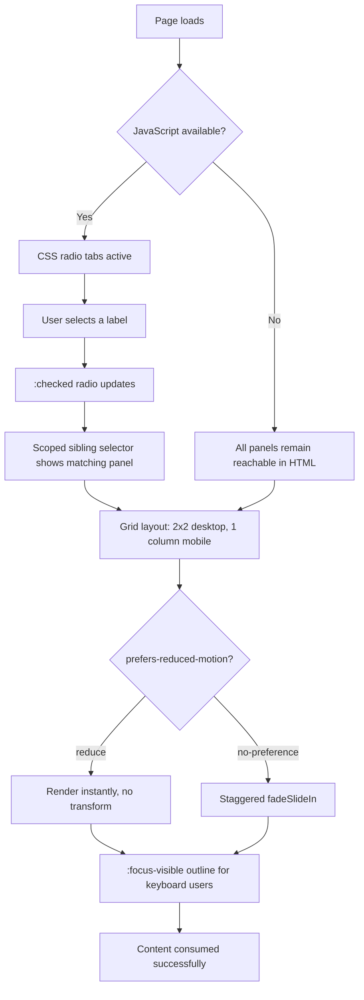

| Difficulty | Channel | Tags |
|---|---|---|
| beginner | frontend | css, flexbox, grid, animations |

A civil servant opens a government service page on a locked-down corporate laptop. JavaScript is blocked by policy. The tabbed interface that works perfectly in every demo renders as dead labels and an empty screen. That scenario is not hypothetical: GOV.UK measured that 0.9% of visits had no JavaScript available and had not chosen to turn it off — roughly 1 in 111 people [1]. This is the story of how to build tab panels that survive that reality, using nothing but radio inputs, labels, and a little CSS discipline.

---

> ### Real-World Case — GOV.UK (Government Digital Service)
>
> GOV.UK serves the entire UK public, including people on locked-down government and corporate networks, old browsers, and proxied connections where JavaScript fails or is blocked. GDS measured that 0.9% of GOV.UK visits had no JavaScript available and had not chosen to turn it off.
>
> | | |
> |---|---|
> | **Challenge** | Build interactive components like tab panels so citizens can still read content and complete tasks when JavaScript or CSS is unavailable, without breaking accessibility for screen-reader and keyboard users. |
> | **Solution** | GDS uses progressive enhancement: semantic HTML first, CSS for presentation, and JavaScript only as an optional enhancement. The Design System's Tabs component uses JavaScript for switching, but without JavaScript it renders every panel in order with a table of contents linking to each section; pure-CSS radio 'tabs' were avoided because they expose a radio group rather than a tab widget. The team also removed up/down arrow-key bindings from the tabs because the standard tab keyboard model interfered with screen-reader navigation. |
> | **Outcome** | The HTML-first baseline stays usable for the 0.9% of visits without JavaScript (about 1 in 111), and the same all-panels-visible behavior is used on small screens. The tabs pattern is used across DWP, HMCTS, Defra and other government services, and the design system targets WCAG 2.2 AA. |
> | **Lesson** | No-JS is not a hypothetical edge case at public scale, but CSS-only tabs are not a free lunch either: they can misrepresent semantics to assistive tech. Ship a usable HTML fallback (show all panels), treat CSS and JS as enhancements, respect reduced-motion, and test keyboard/focus behavior with real screen readers rather than trusting the ARIA spec alone. |

---

## Hook — The 1-in-111 Problem Hiding in Your Analytics

Picture the dashboard. Your tab component looks flawless: smooth transitions, precise layout, a nice little entrance animation. Then someone visits from a hospital terminal, a bank workstation, or an older browser behind a proxy that strips scripts. Your tabs are not slow. They are not degraded. They are simply gone.

GOV.UK treats this as a first-class design constraint rather than an edge case. The Government Digital Service reported that 0.9% of visits had no JavaScript available and had not chosen to turn it off [1]. That is about one in every 111 sessions. At government scale, that is not a rounding error — it is a city's worth of people trying to renew a licence, check a benefit, or file a tax return.

The uncomfortable question follows immediately: if your tabs depend on JavaScript to show content, what exactly is a no-JS visitor supposed to do? Most teams never ask, because every developer machine has JavaScript switched on. 🎯 Key Point: the users who break your component are usually the ones least able to route around it.

## Problem — Why Teams Reach for JavaScript First

The default mental model for tabs is stateful: an array of panels, an active index, a click handler, a re-render. That model is comfortable, but it quietly imports a hard dependency. If the script fails to load, throws early, or is blocked by a content security policy, the UI has no fallback path.

There is also a subtler trap. Many CSS-only tab tutorials use the general sibling combinator with a single selector like `.tabs input:not(:checked) ~ .panel { display: none; }`. It looks clever and works in the demo. Then a developer adds a third tab, and panels start disappearing for reasons nobody can explain. The selector hides every panel that follows *any* unchecked radio — including the panel belonging to the checked one. That is the classic battle scar of this pattern.

So the real problem has four parts:

- **Resilience:** the content must remain reachable when scripts do not run.
- **Correctness:** the visibility rule must map each radio to exactly one panel.
- **Accessibility:** keyboard focus must stay visible, and motion must respect user preferences.
- **Responsiveness:** a 2×2 card grid on desktop must collapse cleanly to one column on mobile.

The good news: all four are solvable with markup order, scoped selectors, and modern CSS. The catch is that you have to design the HTML before you design the CSS — and that is where most implementations go wrong.

## Real-World Case — GOV.UK and the HTML-First Baseline

GOV.UK serves the entire UK public, including people on locked-down government and corporate networks, old browsers, and proxied connections where JavaScript fails or is blocked. The Government Digital Service measured that 0.9% of GOV.UK visits — about 1 in 111 — had no JavaScript available and had not chosen to turn it off [1].

The response was not a polyfill or a clever loader. It was progressive enhancement: ship working HTML first, then layer interactivity on top where the environment allows it [8]. In practice, the tabs pattern keeps every panel's content available in the HTML baseline, and the same all-panels-visible behavior is used on small screens. The pattern appears across DWP, HMCTS, Defra, and other government services.

Crucially, this is not an argument against JavaScript. Enhanced tabs add arrow-key navigation, proper `aria-selected` updates, and a tighter visual experience. The baseline is the floor, not the ceiling. GOV.UK's design system targets WCAG 2.2 AA [7], and that commitment applies whether or not scripts execute [9].

⚠️ Watch Out: a CSS-only tab panel is genuinely more resilient, but it is not a full substitute for an ARIA tabs implementation. Honest teams state that trade-off instead of pretending the CSS pattern is free.

## Deep Dive — Radio Inputs, Scoped Selectors, and Motion Etiquette

The mechanism is almost embarrassingly simple. A set of radio inputs shares one `name`, so the browser enforces single selection for you. Each radio has a matching ``, which becomes a large, clickable tab target. The `:checked` pseudo-class then drives visibility [3].

The plot twist is selector scope. Adjacent and general sibling combinators only see elements that follow in the same parent. Therefore every input and label must appear **before** the panels they control. Once that order is fixed, scope each rule to a specific pair:

```css
#tab-overview:not(:checked) ~ #panel-overview { display: none; }
```

That single line is immune to the third-tab bug, because it only ever hides the panel it names. No cross-talk, no mystery.

Layout is where CSS Grid earns its keep [2]. `grid-template-columns: repeat(2, 1fr)` gives the 2×2 desktop arrangement, and a single media query drops it to `1fr` for mobile. Cards use `aspect-ratio: 16 / 9` so the image box holds its shape before any media loads — a small detail that prevents layout shift [6].

Motion needs the same care as layout. Wrapping the animation inside `@media (prefers-reduced-motion: no-preference)` means the default is calm, and only users who have not asked for reduced motion receive the stagger [5]. Focus rings come from `:focus-visible`, which targets keyboard navigation without painting outlines on every mouse click [4].

Here is the trade-off table that most tutorials skip:

| Approach | No-JS behavior | Full ARIA semantics | Complexity |
|---|---|---|---|
| JS tabs | Broken without fallback | Yes, when implemented | Medium |
| CSS radio tabs | Content reachable | Partial | Low |
| `` / `` | Content reachable | Native, but accordion-like | Very low |

💡 Insight: the winning move is often hybrid. Ship CSS radio tabs as the baseline, then enhance with JavaScript for arrow-key navigation and live `aria-selected` state.

## Workflow — From Markup Order to Motion Guardrails

Building this reliably is a sequence, not a single stylesheet. The diagram below shows how a page load flows through the decision points, including the no-JS path and the reduced-motion branch.

1. **Choose one `name`.** All radios share it, so the browser guarantees one active tab.
2. **Order the DOM deliberately.** Inputs and labels first, panels after. Sibling selectors depend on it.
3. **Pair selectors by ID.** `#tab-x:not(:checked) ~ #panel-x` prevents cross-panel interference.
4. **Lay out the panel with Grid.** Two columns on desktop, one on mobile via `max-width: 768px`.
5. **Reserve image space.** Apply `aspect-ratio: 16 / 9` to the image wrapper, not the image itself.
6. **Gate the animation.** Put the stagger inside `prefers-reduced-motion: no-preference`.
7. **Verify keyboard flow.** Tab to each label, confirm a visible `:focus-visible` outline, and confirm the checked state follows.

The flow is intentionally linear because each step constrains the next. Skip step two and step three cannot save you. Skip step six and you have shipped motion to people who explicitly opted out.

## Code Example — The Baseline Markup and Styles

The snippet below uses template literals so the exact HTML and CSS can be exported from a single module used by a docs build. Every rule maps back to a step in the workflow.

```javascript
export const tabsMarkup = `
<div class="tabs">
  <!-- All inputs and labels come first so sibling selectors can reach the panels -->
  <input type="radio" id="tab-overview" name="tabs" checked>
  <label for="tab-overview">Overview</label>

  <input type="radio" id="tab-usage" name="tabs">
  <label for="tab-usage">Usage</label>

  <!-- Panels are siblings that FOLLOW the controls -->
  <section class="panel" id="panel-overview" aria-labelledby="tab-overview">
    <article class="card">
      <div class="card__image"></div>
      <h3 class="card__title">Card Title</h3>
      <p class="card__meta">Meta information</p>
    </article>
    <article class="card">
      <div class="card__image"></div>
      <h3 class="card__title">Second Card</h3>
      <p class="card__meta">Meta information</p>
    </article>
  </section>

  <section class="panel" id="panel-usage" aria-labelledby="tab-usage">
    <article class="card">
      <div class="card__image"></div>
      <h3 class="card__title">Usage Title</h3>
      <p class="card__meta">Meta information</p>
    </article>
  </section>
</div>
`;

export const tabsStyles = `
.tabs > .panel {
  display: grid;
  grid-template-columns: repeat(2, 1fr); /* 2x2 desktop card grid */
  gap: 1.5rem;
}

@media (max-width: 768px) {
  .tabs > .panel { grid-template-columns: 1fr; } /* single column on mobile */
}

/* Scope each hide rule to its own panel to avoid the third-tab bug */
#tab-overview:not(:checked) ~ #panel-overview,
#tab-usage:not(:checked) ~ #panel-usage { display: none; }

.card__image {
  aspect-ratio: 16 / 9; /* reserve space before the image loads */
  background: #eee;
  border-radius: 8px;
}

/* Only animate when the user has not requested reduced motion */
@media (prefers-reduced-motion: no-preference) {
  .card { animation: fadeSlideIn 0.3s ease-out backwards; }
  .card:nth-child(2) { animation-delay: 0.1s; }
  .card:nth-child(3) { animation-delay: 0.2s; }
  .card:nth-child(4) { animation-delay: 0.3s; }
}

@keyframes fadeSlideIn {
  from { opacity: 0; transform: translateY(10px); }
  to   { opacity: 1; transform: translateY(0); }
}

.tabs input:focus-visible + label {
  outline: 2px solid currentColor; /* keyboard-only focus ring */
  outline-offset: 2px;
}
`;
```

The markup section establishes the shared `name` and the strict ordering that sibling selectors require. The styles section then does four jobs: it defines the Grid layout, scopes each hiding rule to one panel, reserves the 16:9 image area, and gates the stagger behind the reduced-motion query [5]. Because the animation uses `backwards` fill mode, cards hold their starting opacity during the delay instead of flashing into place. Finally, the `:focus-visible` rule targets only keyboard focus, keeping mouse interactions clean [4].

## Lessons Learned — What to Carry Into the Next Component

The GOV.UK case is not a nostalgic argument for avoiding JavaScript. It is a reminder that the HTML baseline is a product decision with measurable reach [1]. Roughly 1 in 111 visits is enough to justify designing for it, and WCAG 2.2 AA obligations apply regardless of the visitor's network [7].

- **Design the DOM first.** Sibling selectors are a contract about document order. Violate it and no amount of CSS cleverness saves you.
- **Scope every rule.** Pairing `#tab-x` with `#panel-x` eliminates the most common hidden failure mode.
- **Respect motion by default.** Wrap stagger animations in `prefers-reduced-motion: no-preference` so calm is the fallback, not the exception [5].
- **Keep focus visible.** `:focus-visible` gives keyboard users a clear path without penalizing pointer users [4].
- **Reserve space early.** `aspect-ratio` prevents the layout jump that makes polished docs feel cheap [6].
- **Be honest about limits.** CSS tabs do not provide arrow-key navigation or live ARIA state. Enhance with JavaScript when the environment allows it [9].

🔥 Hot Take: if a component cannot render its content without JavaScript, it is not a component — it is a conditional privilege. Treat the no-script path as a real user journey, not a checkbox in a QA document.

---

## CSS-Only Tabs Decision Flow



<details>
<summary><strong>Original Interview Question</strong></summary>

**Q:** Build a CSS-only tab panel for a design-system docs page. Use radio inputs to switch tabs (no JavaScript). Desktop: a 2x2 grid of cards under each tab; mobile: single column. Each card has a fixed 16:9 image area, a title, and a short meta line. Add a subtle entrance animation with a stagger and keep focus-visible outlines; ensure prefers-reduced-motion is respected?

**A:** Use a set of radio inputs with a shared `name` attribute and corresponding `` elements for each tab section. The `:checked` state of each radio controls visibility of its associated panel via adjacent sibling selectors. Each panel renders a 2×2 card grid on desktop and collapses to a single column on mobile. Cards use `aspect-ratio: 16/9` for fixed image containers, with a title and meta line below.

</details>

## Conclusion

The next time a tab component lands in review, ask one question before debating animation curves: what does this look like with JavaScript switched off? GOV.UK's answer was to keep the content in the HTML and enhance from there, because 0.9% of visits is a real population, not an edge case [1]. You do not need permission to do the same. Order the DOM deliberately, scope every selector, gate the motion, and keep focus visible. Then ship the JavaScript enhancement on top — not underneath. The memorable version to share with your team: progressive enhancement is not a performance trick; it is a promise that the content still exists when the environment says no.

---

## References

1. [GOV.UK (Government Digital Service) incident report](https://technology.blog.gov.uk/2016/09/19/why-we-use-progressive-enhancement-to-build-gov-uk) — article
2. [MDN: CSS Grid Layout](https://developer.mozilla.org/en-US/docs/Web/CSS/CSS_grid_layout) — documentation
3. [MDN: :checked pseudo-class](https://developer.mozilla.org/en-US/docs/Web/CSS/:checked) — documentation
4. [MDN: :focus-visible pseudo-class](https://developer.mozilla.org/en-US/docs/Web/CSS/:focus-visible) — documentation
5. [MDN: prefers-reduced-motion](https://developer.mozilla.org/en-US/docs/Web/CSS/@media/prefers-reduced-motion) — documentation
6. [MDN: aspect-ratio](https://developer.mozilla.org/en-US/docs/Web/CSS/aspect-ratio) — documentation
7. [W3C: Web Content Accessibility Guidelines (WCAG) 2.2](https://www.w3.org/TR/WCAG22/) — documentation
8. [Wikipedia: Progressive enhancement](https://en.wikipedia.org/wiki/Progressive_enhancement) — article
9. [GOV.UK Design System: Tabs component](https://design-system.service.gov.uk/components/tabs/) — documentation
10. [MDN: Using CSS animations](https://developer.mozilla.org/en-US/docs/Web/CSS/CSS_animations/Using_CSS_animations) — documentation

---

**Author:** Satishkumar Dhule — [GitHub](https://github.com/satishkumar-dhule) · [LinkedIn](https://linkedin.com/in/satishkumar-dhule) · [Website](https://satishkumar-dhule.github.io)
