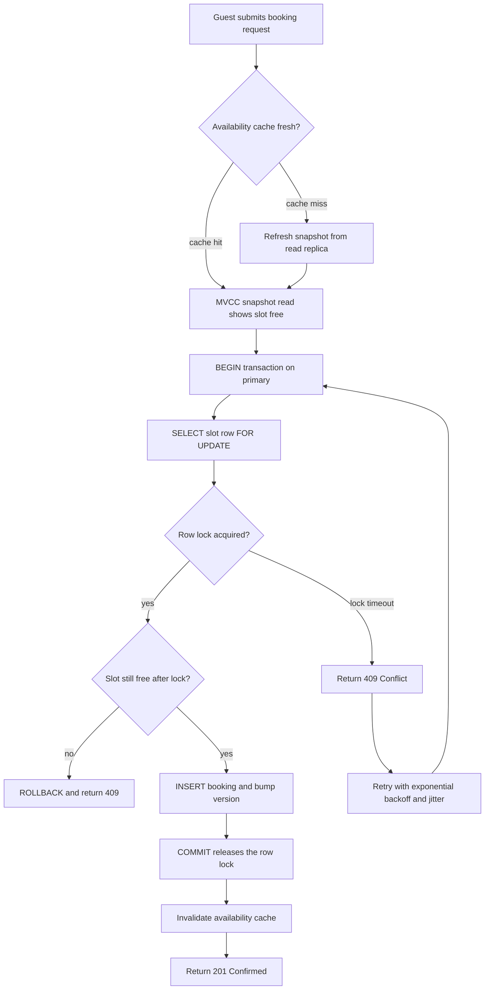

| Difficulty | Channel | Tags |
|---|---|---|
| intermediate | database | acid, isolation-levels, mvcc |

Ten concurrent requests hit Cal.com's booking endpoint for the same host and the same time slot — and 165 of 180 automated attempts (91.7%) walked away with a confirmed booking [1]. No errors. No warnings. Just a scheduling platform quietly promising one host to two meetings at once, on a path rated S1 Critical for enterprise clients including Udemy [1]. This is the story of the check-then-act race that silently breaks booking systems at scale, and of the row-level locks, MVCC snapshots, and database constraints that turn 'yes to everyone' into 'yes to exactly one' [1].

---

> ### Real-World Case — Cal.com
>
> Cal.com, the open-source scheduling platform used by teams and enterprise customers, had a booking endpoint where two users could select the same host and time slot simultaneously. Both requests passed the availability check before either wrote a booking, so the platform confirmed overlapping meetings for the same host.
>
> | | |
> |---|---|
> | **Challenge** | The booking path was a classic check-then-act race: availability was queried, then the booking was inserted as a separate operation, with no database or application-level lock and no transaction. Under concurrent requests, both users saw the slot as free and both inserted, creating double bookings. The gap between the availability check and the insert spanned roughly 850 lines of code, and PENDING bookings were invisible to the availability calculation. |
> | **Solution** | Cal.com moved the decision into the database. The fix added SELECT ... FOR UPDATE inside the existing Prisma transaction before creating the booking, locking overlapping bookings for the same host so a second request re-checks after the first commits and returns 409 instead of inserting. The team also explored a PostgreSQL exclusion constraint (EXCLUDE USING gist on userId plus a tsrange with &&, limited to accepted bookings) so the database itself rejects overlapping rows, and used advisory locks or compare-and-swap for the pending-to-accepted confirmation path. |
> | **Outcome** | The race was reproduced by firing 10 concurrent requests at /api/book/event: multiple bookings were created for the exact same time. Related double-booking issues were rated S1 Critical and affected enterprise clients including Udemy. With the row-level lock and database constraint, only one concurrent request can commit and the rest return 409; a later automated concurrency suite on the same booking path measured 165 of 180 trials (91.7%) double-booked before the database guard. |
> | **Lesson** | A transaction by itself is not a fix. The invariant 'no two overlapping bookings for the same host' has to be enforced by the database, via a row lock or an exclusion/unique constraint, because any application-level check leaves a window where two requests can both win. |

---

## Hook — The Deploy Looked Fine, and That Is Exactly the Problem

Picture this: staging is quiet, the test suite is green, and a developer fires 10 concurrent requests at a booking endpoint as a routine sanity check before release [1]. Moments later, the database has confirmed the same host for the same time slot — several times over. Every request returned 200. Every availability check passed. By the system's own definition of success, nothing failed at all.

That is what makes race conditions so dangerous: they do not throw errors. A 500 gets paged within minutes; a double booking gets discovered by an angry customer — or worse, by the account team of an enterprise client like Udemy [1]. And this was no exotic edge case in Cal.com's code. It was the plain, unmodified booking flow that thousands of applications ship every year: read availability, write booking, confirm.

So here is the uncomfortable question: if every step succeeded, what exactly broke? The answer sits at the intersection of two very reasonable engineering decisions — fast non-blocking reads, and a safety check that lives in the wrong layer. Understanding that intersection changes how every booking flow gets designed from now on.

## Problem — Check, Then Act: The Two-Step Dance That Breaks Under Load

Nearly every booking system — Airbnb-style property reservations, calendar scheduling, ticketing — implements the same two-step dance: check availability, then write the booking. In isolation, each step is flawless. Under concurrency, the gap between them becomes a fault line.

Here is the mechanism. Request A reads the availability table and sees the slot is free. Request B reads the same table a millisecond later and also sees it free, because A has not committed anything yet. Both requests then write their bookings, and the database — being a dutiful optimist — accepts both. This is the classic time-of-check to time-of-use (TOCTOU) problem, and it is invisible to every single-request test ever written.

Modern databases make it sneakier, not safer. PostgreSQL's multiversion concurrency control gives every transaction its own consistent snapshot of the data: reads do not block writes and writes do not block reads [4]. That is brilliant for throughput — availability checks stay fast even under heavy write load. It also means request B's snapshot was taken before A's write ever existed, so the check was correct and stale at the same time.

💡 Insight: A passing availability check proves the slot *was* free — not that it *will be* free when the INSERT lands.

Consequently, the real challenge is not just fixing the race; it is fixing it without sacrificing availability. Lock everything aggressively and the whole system serializes, melting latency for every guest. Lock nothing and the same room sells twice. The rest of this story walks the narrow path between those two cliffs.

## Real-World Case — Cal.com: When Ten Requests All Agree With Each Other

Cal.com, the open-source scheduling platform used by teams and enterprise customers, shipped exactly this pattern — and lived to document it publicly [1]. The booking endpoint at /api/book/event let two users select the same host and time slot simultaneously. Both requests passed the availability check before either one wrote a booking, so the platform confirmed overlapping meetings for the same host.

When engineers reproduced the race by firing 10 concurrent requests at the endpoint, multiple bookings were created for the exact same time. Related double-booking issues were classified as S1 Critical — the severity tier reserved for production-impacting failures — and they affected enterprise clients, including Udemy [1]. Later, an automated concurrency suite hammered the same booking path and measured the damage with brutal precision: 165 of 180 trials (91.7%) produced a double booking before the database guard existed [1].

The fix deserves particular attention, because it was not a clever application-level workaround. Cal.com added a row-level lock plus a database-level constraint, so that only one concurrent request can commit — every other request receives a 409 Conflict [1]. The losers get a clean, honest rejection instead of a broken promise. Hold onto that ratio, 91.7% down to zero: it is the entire difference a guardrail makes.

## Deep Dive — Four Ways to Serialize a Booking, and What Each One Costs

Building on Cal.com's fix, there are four mainstream strategies for guaranteeing that exactly one booking wins a race — and each pays in a different currency: throughput, latency, or operational discipline.

| Strategy | What it guarantees | What it costs | Best fit |
|---|---|---|---|
| SERIALIZABLE isolation [2] | Transactions behave as if executed one at a time | Serialization failures and retries under load; throughput drops on hot rows | Complex invariants spanning many rows |
| SELECT ... FOR UPDATE [3] | Exactly one writer per locked row | Wait time when rows get hot; lock queues | Single hot row per transaction — bookings are perfect |
| Optimistic version columns [5] | Lost updates rejected at write time | Wasted work and retry UX on conflict | Read-heavy workloads with rare writes |
| Database exclusion constraint [6] | Overlaps rejected by the storage engine itself | Migration discipline; small write overhead | The final backstop — always worth it |

You might think SERIALIZABLE is the obvious answer: maximum safety, enforced by the database itself. However, it is a sledgehammer. Every conflicting transaction pattern risks a serialization failure and a full restart, which is why PostgreSQL's documentation says applications using it must be prepared to retry transactions [2].

🔥 Hot Take: Reaching for SERIALIZABLE everywhere often signals that the invariants have not been modeled in the data itself. A booking is a claim on one row — lock that row.

For a booking system, SELECT ... FOR UPDATE is usually the sharper tool. It serializes exactly one row — the slot being claimed — instead of reasoning about a transaction's entire read set, so every other slot books in parallel, untouched. Moreover, the pattern composes naturally with optimistic concurrency control: bump a version column on write, and any lost update becomes detectable at commit time [5].

But the deepest lesson from Cal.com is architectural. An application-level availability check cannot be atomic across two processes — no amount of careful coding fixes that. The guarantee has to live where the writes land: in the database. Amazon followed the same principle in DynamoDB, where conditional writes and transactional APIs reject conflicting updates at the storage layer [8]. Cal.com's exclusion constraint does the same job for PostgreSQL [6].

⚠️ Watch Out: Hot properties create lock queues. A viral listing can turn one row lock into a pileup, so monitor lock wait times, keep critical sections down to a handful of statements, and add circuit breakers for the hottest slots.

## Workflow — The Booking Pipeline, One Guard at a Time

This leads to the practical part: how a request actually flows through a defended booking system. The diagram below — Double-Booking Guard Flow — traces the full journey from click to confirmation, including where rivals get stopped and how retries re-enter the race.

1. **Fast availability check** — serve it from cache or a read replica using an MVCC snapshot [4]. This is UX sugar: it stops doomed requests early without ever touching the write path (a pattern that matters even more as systems shard and scale [9]).
2. **BEGIN the transaction** on the primary database.
3. **SELECT ... FOR UPDATE** on the exact slot row [3]. This is the airlock — every rival request now queues on this lock.
4. **Re-check availability inside the critical section.** With the lock granted, the row reflects the latest committed truth, not a stale snapshot.
5. **INSERT the booking and bump the slot's version counter** — the optimistic concurrency marker [5].
6. **COMMIT**, which releases the lock and lets the next queued request proceed.
7. **Invalidate the availability cache** so subsequent readers immediately see the new truth.
8. **Respond**: 201 for the winner, 409 Conflict for every loser [7].

🎯 Key Point: The snapshot read answers 'is it worth trying?' The row lock answers 'is it still mine?' The exclusion constraint answers 'did anything slip through anyway?' [6] Three questions, three layers, one guarantee.

Retries deserve special mention. When a transaction fails on a serialization error or lock timeout, retry with exponential backoff and jitter — otherwise synchronized retries stampede the same hot row all over again, recreating the pileup that was just escaped.

## Code Example — The Guard in Forty Lines of Python

All of that theory collapses into a surprisingly small function. The implementation below uses psycopg2 against PostgreSQL and packages every lesson from Cal.com's fix into one code path: a lock-free snapshot pre-check, a row-level lock, a version bump for optimistic concurrency, and retries with exponential backoff. The DDL at the top is the backstop — an exclusion constraint that teaches the database itself to refuse overlapping confirmed bookings, the same class of guard Cal.com installed [6].

Walk through it in order. The first SELECT is the cheap MVCC snapshot read — fast, lock-free, and advisory only. The second SELECT appends FOR UPDATE, and that single keyword is where concurrency actually gets serialized. The re-check that follows runs after the lock is held, so it sees committed truth rather than a stale snapshot — closing the exact gap that double-booked Cal.com's endpoint. The INSERT and the version bump run inside the same transaction, so the claim and the availability flip succeed or fail as one atomic unit [5]. Finally, the except branches translate database outcomes into honest HTTP semantics: a UniqueViolation from the constraint becomes a 409 [7], while a SerializationFailure triggers the backoff-and-retry loop.

## Lessons Learned — What a 91.7% Failure Rate Teaches

Cal.com's story compresses into a handful of durable lessons — the kind usually purchased at 3am with a pager in hand:

- **Application-level checks are UX, not safety.** If two processes can pass the same check, the check is in the wrong place; move the guarantee into the database [1].
- **Defense in depth wins.** Cal.com paired a row-level lock (fast-path serialization) with a database constraint (an unbypassable backstop) [6]. Either one alone leaves a failure mode open.
- **Test concurrency in CI, not in production.** The automated suite that measured 165 of 180 double bookings is also what proved the fix worked [1]. Single-request tests will never catch a race.
- **A 409 is not a failure — it is the system keeping its promise.** Losing a race cleanly beats winning it dishonestly [7].
- **Watch the hot rows.** Locks serialize contention as well as correctness: monitor lock wait times, keep critical sections tiny, and circuit-break viral slots [3].
- **Retry like an adult:** exponential backoff, jitter, and a finite retry budget — then surface an honest failure.

Many developers discover, usually the hard way, that distributed correctness is less about clever algorithms and more about putting guarantees in the one place every request must pass through. The database is that place. Consequently, the highest-leverage afternoon a team can spend this week is auditing its booking path for a check-then-act gap — and shipping the constraint that closes it.

---

## Double-Booking Guard Flow

<strong>Original Interview Question</strong>

**Q:** You're building a booking system for Airbnb where multiple users can reserve the same property simultaneously. How would you design the transaction handling to prevent double bookings while maintaining high availability?

**A:** Use SERIALIZABLE isolation with optimistic concurrency control. Implement row-level locks on property availability tables, use MVCC snapshot reads for checking availability, and apply application-level validation to ensure atomic booking operations.

## Conclusion

The deploy will always look fine — that is the nature of a race condition. Every request succeeds, every check passes, and the only artifact is a host double-booked at 3pm on a Tuesday. Cal.com's 91.7% double-booking rate was never caused by a bad database; it was caused by trusting a check that lived in the wrong layer, and one row-level lock plus one exclusion constraint took that number to zero [1].

So here is the one-liner worth sharing with your team: if two requests can pass the same availability check, the check is decoration — the real contract lives in the row lock and the constraint behind it. Tomorrow, open your booking endpoint, fire 10 concurrent requests at the same slot, and count the 201s. If you count more than one, you already know exactly what to build.

---

## References

1. [Cal.com incident report](https://github.com/calcom/cal.com/issues/13397) — article
2. [PostgreSQL Documentation: Transaction Isolation](https://www.postgresql.org/docs/current/transaction-iso.html) — documentation
3. [PostgreSQL Documentation: Explicit Locking](https://www.postgresql.org/docs/current/explicit-locking.html) — documentation
4. [Multiversion Concurrency Control (MVCC)](https://en.wikipedia.org/wiki/Multiversion_concurrency_control) — documentation
5. [Optimistic Concurrency Control](https://en.wikipedia.org/wiki/Optimistic_concurrency_control) — documentation
6. [PostgreSQL Documentation: Constraints (EXCLUDE)](https://www.postgresql.org/docs/current/ddl-constraints.html) — documentation
7. [MDN Web Docs: HTTP 409 Conflict](https://developer.mozilla.org/en-US/docs/Web/HTTP/Status/409) — documentation
8. [AWS Documentation: Amazon DynamoDB Transactions](https://docs.aws.amazon.com/amazondynamodb/latest/developerguide/transactions.html) — documentation
9. [DigitalOcean: Understanding Database Sharding](https://www.digitalocean.com/community/tutorials/understanding-database-sharding) — blog

---

**Author:** Satishkumar Dhule — [GitHub](https://github.com/satishkumar-dhule) · [LinkedIn](https://linkedin.com/in/satishkumar-dhule) · [Website](https://satishkumar-dhule.github.io)
