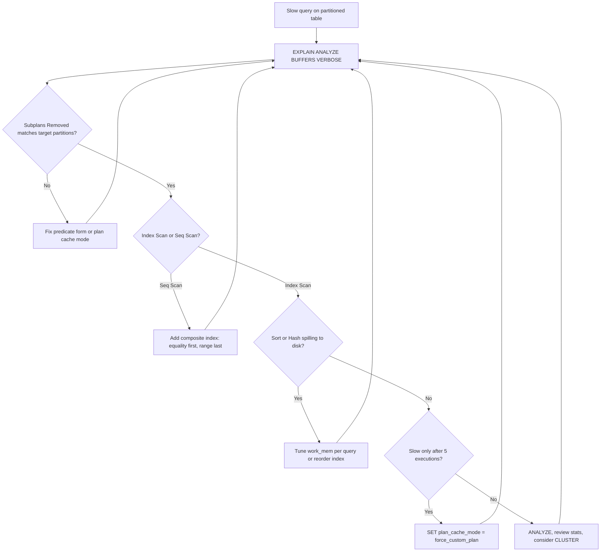

| Difficulty | Channel | Tags |
|---|---|---|
| intermediate | database | explain, query-plan, partitioning |

Your events table is partitioned by date, the query hits a single month, and yet the dashboard still spins. You add an index, you re-run ANALYZE, and nothing changes — until someone notices the query is fine the first five times and hangs on the sixth. In 2023, Prefect hit exactly this wall at 400 million rows and climbing toward a billion, and the fix turned out to be one connection setting rather than more hardware [1]. Here is how to read the EXPLAIN plan like a detective, find the real bottleneck, and avoid the trap that cost a production team months of sleep.

---

> ### Real-World Case — Prefect
>
> Prefect Cloud was doubling traffic roughly every two months, and its fastest-growing events table had reached 400 million rows and was heading past 1 billion. The team partitioned its largest tables to improve query performance and keep indexes and statistics manageable, but queries against the partitioned events table remained slow—and the same prepared statement would hang on its sixth execution.
>
> | | |
> |---|---|
> | **Challenge** | Even after partitioning, Postgres was not effectively pruning partitions for application queries. The database suffered repeated out-of-memory restarts, with memory utilization hitting 90%, and the team could not explain why adding more RAM and partitioning tables had not fixed the problem. |
> | **Solution** | The root cause was Postgres's prepared-statement plan cache: after five executions of the same statement, Postgres could switch to a generic plan that ignores parameter values, which is especially costly for partitioned tables because it cannot prune partitions at plan time. The team set plan_cache_mode=force_custom_plan on connections to the primary database so Postgres always replanned with the actual parameter values, restoring effective partition pruning. |
> | **Outcome** | Memory utilization dropped from roughly 60–80% to 20–25%, the OOM restarts stopped, and API latency improved. The fix was a single connection setting rather than more hardware or a schema change. |
> | **Lesson** | Partitioning does not guarantee partition pruning. Before adding composite indexes or reclustering, check EXPLAIN for an Append over every partition, and verify whether prepared statements have switched to a generic plan; plan_cache_mode=force_custom_plan can be the difference between scanning one partition and scanning all of them. |

---

## Hook — The Query That Only Breaks on the Sixth Try

It is 3 a.m., the pager fires, and the database has restarted itself for the second time in a week. Memory is pinned near 90%, API latency is climbing, and the fastest-growing table just crossed 400 million rows. The team did the responsible thing months earlier: they partitioned the biggest tables by date so indexes and statistics would stay manageable. Queries should be faster. Instead, one prepared statement behaves like a polite guest for five executions and then locks the door on the sixth [1].

That detail — the sixth execution — is the kind of clue that separates a lucky fix from a real diagnosis. Many developers assume a slow partitioned query means missing indexes or bad hardware. Sometimes it does. But sometimes the planner is handing you a cached plan that ignores the very parameter that makes partition pruning possible, and no amount of hardware will save you [1].

💡 **Insight:** If a query is fast at first and slow later, you are not debugging a query — you are debugging a plan cache.

## Problem — Partitioning Is Not a Performance Button

Partitioning splits one enormous table into smaller physical tables, which lets the planner skip irrelevant chunks and keeps per-table indexes and statistics sane [3]. That is the promise. The catch is that the promise only holds when the planner can prove which partitions are irrelevant *for the specific values in your query*.

When that proof fails, three things tend to go wrong at once:

- **Pruning collapses.** The plan scans every partition, so you pay the overhead of partitioning without the benefit.
- **Indexes stop being selective.** A scan over 100 million rows across dozens of partitions can look cheaper to the planner than a narrow index walk, especially with stale statistics.
- **Sorts and aggregates spill.** A wide scan feeds an oversized Sort or HashAggregate, and `work_mem` is exceeded, pushing work to disk [7].

The stakes are not abstract. A single bad plan on a hot endpoint can pin memory, inflate connection counts, and trigger the kind of restart loop that wakes people up at night. Prefect's own write-up describes exactly that cascade: memory correlated with active connections, the team scaled services down to buy headroom, and latency got worse as a result [1]. Sound familiar?

⚠️ **Watch Out:** Adding an index to a partitioned table creates a *local* index on every partition. If pruning is broken, you just built dozens of indexes the planner may never use.

## Real-World Case — Prefect Cloud's 400 Million Row Wake-Up Call

In March 2023, Prefect Cloud was roughly doubling traffic every two months. To get ahead of it, the team vertically scaled a Postgres 14 instance on CloudSQL and then partitioned its heaviest tables — including an events table at 400 million rows that was expected to pass 1 billion during the rollout [1].

The performance gains did not arrive. Memory stayed high. On April 28, 2023, during a burst of traffic, the database hit 90% memory utilization and restarted with an out-of-memory event. It happened again on May 1 [1].

The first fix looked unrelated: recycle connection pools every 10 minutes instead of every 2 hours, and enable SQLAlchemy instrumentation across all engines. Memory dropped, latency improved, and everyone exhaled. Then the twist arrived. When the team disabled the tracing comments that instrumentation added to every query, memory climbed right back [1].

The comments were acting as a cache buster. Postgres keys its generic plan cache on the raw query text, and a unique trace ID changed that text every time. The real cause: asyncpg prepares every statement, and after five executions Postgres switches to a generic plan that ignores parameter values — which is catastrophic for queries over partitioned tables, because a generic plan cannot prune partitions using the runtime date range [1]. Setting `plan_cache_mode = force_custom_plan` on each connection ended the incident. Memory utilization fell from roughly 60–80% to 20–25%, the OOM restarts stopped, and API latency improved — all from a single setting rather than more hardware or a schema change [1].

## Deep Dive — Reading the Plan Like a Detective

EXPLAIN is not a pass/fail report; it is a sequence of decisions the planner made and the evidence behind them. Start with `EXPLAIN (ANALYZE, BUFFERS, VERBOSE)` so you see actual row counts, actual timings, and cache behavior rather than guesses [2][8].

**1. Did pruning actually happen?**
Look at the Append node. In modern Postgres, `Subplans Removed` tells you how many partitions the planner discarded at plan time [3]. If that number is zero and you filtered on a single month, pruning failed. Common causes: a function wrapping the partition key, a cast that hides the literal, a parameter whose value is unknown at plan time, or — the Prefect case — a generic plan that deliberately ignores the value [1].

**2. Is the access path sane?**
A Seq Scan is not automatically evil, but a Seq Scan on one partition returning a handful of rows is a red flag. Compare `rows=` estimates to `actual rows=`; a large gap means statistics are stale or the correlation is off [7]. Also read `Rows Removed by Filter` — high numbers mean the index (or scan) is fetching far more than it keeps.

**3. Where is the time going?**
Sorts and hash aggregates are where memory pressure shows up. `Sort Method: external merge Disk: ...` means `work_mem` was too small and the sort spilled. `HashAggregate ... Batches: > 1` means the hash table spilled too [7]. Raising `work_mem` can help one query and hurt the server if it is set globally and many connections use it at once.

| Symptom in EXPLAIN | Likely cause | First move |
|---|---|---|
| Append with `Subplans Removed: 0` | Pruning failed | Check predicate form and plan cache mode [3][6] |
| Seq Scan + huge `Rows Removed by Filter` | Missing or wrong index | Composite index on filter columns [4] |
| `external merge Disk` | `work_mem` too low | Tune per-query, not globally [7] |
| Fast 1st–5th run, slow 6th | Generic plan cached | `plan_cache_mode = force_custom_plan` [1][6] |

**4. The index order plot twist.**
Many developers create `(date, filtered_columns)` because the partition key feels like the star. But inside a single partition, an equality predicate on `status` is usually more selective than a date range, so `(status, event_date)` often produces a tighter index scan. Put equality columns first and range columns last unless you specifically need date-ordered retrieval [4].

**5. Clustering is a one-time gift, not a habit.**
`CLUSTER` physically rewrites the table to match an index, which can dramatically reduce random I/O for range queries [5]. But it takes an exclusive lock and does not stay clustered as new rows arrive. Treat it as a deliberate maintenance operation, or use partition-level rewrites and `pg_repack` style tooling instead of clustering the parent on a schedule.

🔥 **Hot Take:** A composite index is not a fix for bad pruning. If the planner scans all partitions, your beautiful index just gets built 60 times and used zero times.

## Workflow — A Triage Loop That Finds the Real Bottleneck

Diagnosis works best as a loop, not a checklist you run once. The diagram below shows the path: measure, inspect pruning, inspect access paths, inspect memory-heavy operators, then check whether the statement is being re-planned or served from cache.



Run the loop in this order:

1. **Capture the real plan.** Use `EXPLAIN (ANALYZE, BUFFERS, VERBOSE)` on the exact query shape your application sends, with real parameter values [2].
2. **Verify pruning.** Confirm the Append node removed everything outside your date range [3].
3. **Check the access path.** Compare estimated versus actual rows and inspect `Rows Removed by Filter` [8].
4. **Inspect memory operators.** Look for disk spills in Sort and HashAggregate nodes [7].
5. **Test repetition.** Run the same prepared statement six or more times. If performance falls off a cliff, suspect generic plans [6].
6. **Fix the smallest thing.** A setting change beats a schema migration; a composite index beats a hardware upgrade [4].
7. **Re-measure.** If the plan did not change, the hypothesis was wrong. Go back to step 1.

🎯 **Key Point:** Always diagnose with the query text the driver actually sends. ORMs and drivers add prepared statements, casts, and comments that change planning behavior [1][6].

## Code Example — From Diagnosis to Fix in Six psql Steps

The script below walks the same loop against a partitioned `events` table. It is intentionally boring: measure first, then change one thing at a time.

```bash
# 1. Capture the real plan for the exact query shape your app sends
psql "$DATABASE_URL" <<'SQL'
EXPLAIN (ANALYZE, BUFFERS, VERBOSE)
SELECT id, event_date, status
FROM events
WHERE event_date >= '2024-01-01'
  AND event_date <  '2024-02-01'
  AND status = 'completed';
SQL

# 2. List the partitions so you know how many should have been pruned
psql "$DATABASE_URL" -c "
SELECT inhrelid::regclass AS partition
FROM pg_inherits
WHERE inhparent = 'events'::regclass
ORDER BY 1;"

# 3. Add a composite index: equality column first, range column last
psql "$DATABASE_URL" -c "
CREATE INDEX CONCURRENTLY IF NOT EXISTS idx_events_status_date
ON events (status, event_date);"

# 4. Refresh statistics so the planner stops guessing
psql "$DATABASE_URL" -c "ANALYZE events;"

# 5. Disable generic plans on this connection to protect partition pruning
psql "$DATABASE_URL" -c "SET plan_cache_mode = force_custom_plan;"

# 6. Optionally rewrite one partition to match the index order
#    (CLUSTER takes an ACCESS EXCLUSIVE lock; do it in a maintenance window)
psql "$DATABASE_URL" -c "CLUSTER events_part_2024_01 USING idx_events_status_date;"
```

**What each step is doing and why:**

- **Step 1** uses `ANALYZE` plus `BUFFERS` so you see actual time, actual rows, and whether pages came from cache or disk [2]. The `VERBOSE` flag exposes which partitions were touched.
- **Step 2** gives you the denominator. If you have 60 partitions and the plan scans 60, pruning is broken [3].
- **Step 3** creates the index with `CONCURRENTLY` so writes are not blocked. The column order is deliberate: `status` equality narrows the slice, `event_date` range orders what remains [4].
- **Step 4** refreshes statistics, which is often the difference between a generic estimate and a good one [7].
- **Step 5** is the Prefect fix. `force_custom_plan` stops Postgres from caching a parameter-blind generic plan after five executions [1][6].
- **Step 6** is optional and version-dependent. Clustering a single partition aligns physical row order with the index, which helps range-heavy reads [5]. Never cluster the partitioned parent in a hot path.

⚠️ **Watch Out:** `CREATE INDEX CONCURRENTLY` cannot run inside an explicit transaction block. Run it as its own statement, and check for invalid indexes afterward if it fails.

## Lessons Learned — What to Change Tomorrow

The Prefect incident is memorable because the resolution was tiny and the investigation was enormous. That ratio is common in production databases. Here is what to carry into your next slow-query ticket:

- **Measure the plan, not the vibes.** `EXPLAIN (ANALYZE, BUFFERS)` before and after every change. If the plan did not change, the fix did not happen [2][8].
- **Prove pruning with numbers.** `Subplans Removed` and the partition list tell you whether partitioning is helping or just adding overhead [3].
- **Suspect plan caching when timing is suspicious.** Fast first runs followed by a slow sixth execution is a signature, not a coincidence [1][6].
- **Order composite indexes by selectivity, not by habit.** Equality predicates first, range predicates last, unless retrieval order demands otherwise [4].
- **Treat clustering as a maintenance event.** It is powerful, it is a rewrite, and it does not persist as data changes [5].
- **Keep statistics fresh.** Stale stats turn good indexes into ignored indexes [7].

**Battle scars worth avoiding:**

1. Adding an index before confirming that pruning works — you multiply the maintenance cost without fixing the scan.
2. Setting `work_mem` globally to a large value to silence one sort, then discovering that hundreds of connections now reserve that memory.
3. Testing with a hand-written literal while production sends a prepared statement with a parameter.
4. Assuming `CLUSTER` is a permanent fix and being surprised when performance drifts back weeks later.

The memorable insight to share with your team: **a slow partitioned query is often a planning problem wearing an indexing costume.** Check what the planner *knew* before you check what the table *has* [1][9][10].

If this feels overwhelming, you are not alone. Start with one query, one plan, and one hypothesis at a time. The loop works.

---

## Query Triage Flow


<details>
<summary><strong>Original Interview Question</strong></summary>

**Q:** You have a PostgreSQL table with 100M rows partitioned by date. A query filtering on a specific date range is still slow. What would you check in the EXPLAIN plan and how would you optimize it?

**A:** Check partition pruning effectiveness, index utilization patterns, and expensive sort operations. Create composite indexes on (date, filtered_columns) and evaluate clustering strategies for optimal data access.

</details>

## Conclusion

Prefect's incident did not end with a bigger instance or a schema rewrite. It ended when the team understood that the planner was being handed a plan that could not see the date parameter — the sixth execution was the tell [1]. Tomorrow, before adding another index to a slow partitioned table, run EXPLAIN with ANALYZE and BUFFERS, confirm that pruning actually happened, and check whether the statement is being re-planned or served from cache [2][6]. Then change one thing and measure again. The moral is simple: partitioning changes where the data lives, but query performance still depends on what the planner knows when it decides.

---

## References

1. [Prefect incident report](https://www.prefect.io/blog/more-memory-more-problems) — article
2. [PostgreSQL Documentation: EXPLAIN](https://www.postgresql.org/docs/current/sql-explain.html) — documentation
3. [PostgreSQL Documentation: Table Partitioning](https://www.postgresql.org/docs/current/ddl-partitioning.html) — documentation
4. [PostgreSQL Documentation: CREATE INDEX](https://www.postgresql.org/docs/current/sql-createindex.html) — documentation
5. [PostgreSQL Documentation: CLUSTER](https://www.postgresql.org/docs/current/sql-cluster.html) — documentation
6. [PostgreSQL Documentation: PREPARE and plan_cache_mode](https://www.postgresql.org/docs/current/sql-prepare.html) — documentation
7. [PostgreSQL Documentation: Query Planning Configuration](https://www.postgresql.org/docs/current/runtime-config-query.html) — documentation
8. [PostgreSQL Documentation: Using EXPLAIN](https://www.postgresql.org/docs/current/using-explain.html) — documentation
9. [Wikipedia: Query plan](https://en.wikipedia.org/wiki/Query_plan) — article
10. [Wikipedia: Database index](https://en.wikipedia.org/wiki/Database_index) — article

---

**Author:** Satishkumar Dhule — [GitHub](https://github.com/satishkumar-dhule) · [LinkedIn](https://linkedin.com/in/satishkumar-dhule) · [Website](https://satishkumar-dhule.github.io)
