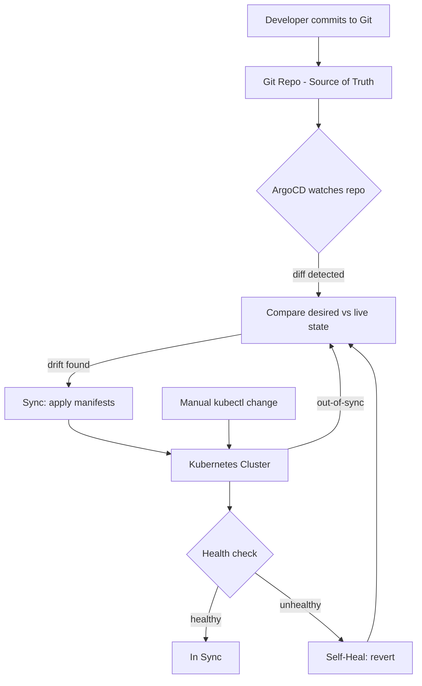

| Difficulty | Channel | Tags |
|---|---|---|
| beginner | devops | argocd, flux, declarative |

Imagine a release that takes weeks to ship — and a rollback that keeps you refreshing a terminal for 45 agonizing minutes while customers wait. That was the reality for teams moving workloads to Kubernetes, until a shift to declarative GitOps rewrote the rules [1]. At Intuit, this exact transformation cut service creation from days to under 10 minutes and slashed mean time to recovery from 45 minutes to under 5 [1]. Here is how you can apply the same playbook with ArgoCD.

---

> ### Real-World Case — Intuit
>
> Intuit was moving its applications out of data centers to the public cloud, but its deployment process was still largely imperative and manual. Teams were taking days—and in some cases weeks—to create and deploy new software releases, with rollbacks and drift across a growing fleet of Kubernetes clusters.
>
> | | |
> |---|---|
> | **Challenge** | Intuit needed an enterprise-ready, declarative continuous delivery system for Kubernetes, but no suitable off-the-shelf tool existed. Manual kubectl-style changes and queue-based deployments made releases slow, error-prone, and hard to audit across 150+ clusters. |
> | **Solution** | Intuit acquired Applatix in early 2018 and incubated Argo CD, making Git the single source of truth. Argo CD Application CRDs pointed at Git repositories containing manifests and Helm charts, while continuous reconciliation and self-healing kept live clusters aligned with the declared desired state. Argo Rollouts later added progressive delivery for safer production changes. |
> | **Outcome** | Creating or upgrading a service dropped to under 10 minutes, including automated build and deployment pipelines. QuickBooks deployment cycles went from days to minutes, and MTTR fell from 45 minutes to under 5 minutes for rollback or roll-forward. Argo CD went on to deploy all Intuit applications across 150+ clusters, and by 2021 was managing thousands of applications across nearly 400 clusters. |
> | **Lesson** | The real unlock was not just automation but making the desired state declarative, versioned, and continuously reconciled—turning deployment from a scarce manual event into a repeatable, auditable, self-correcting process. Intuit's internal necessity became the open-source Argo CD project used across the industry. |

---

## Hook — The Deploy That Took Three Weeks

Picture this: a product team ships a small configuration change, and the release pipeline grinds through days of manual handoffs before anyone sees it in production. Sound familiar? For many teams escaping data centers, the cloud promised speed but the deployment process was still stuck in the dark ages. Every environment was a snowflake, every rollback was a prayer, and configuration drift quietly accumulated across a growing fleet of Kubernetes clusters. The real pain was not writing the YAML — it was that nobody could agree on what the cluster *should* look like. Sound like your team? You are not alone.

## Problem — When Your Cluster and Your Repo Disagree

The core challenge is configuration drift. Developers run `kubectl apply` or `kubectl edit` to make a quick fix, and suddenly the live cluster no longer matches the manifests sitting in Git. Kubernetes itself is a declarative system — you describe the desired state, and controllers work to make reality match [9]. However, when humans patch things imperatively, you lose the paper trail. Rollbacks become archaeology projects, collaboration breaks down because nobody knows the true source of truth, and the blast radius of a mistake grows with every cluster you add. The stakes are high: drift means slower releases, longer incidents, and a growing fear of touching production at all.

## Real-World Case — Intuit's Journey from Data Center to 400 Clusters

Intuit was moving its applications out of data centers to the public cloud, but its deployment process was still largely imperative and manual. Teams were taking days — and in some cases weeks — to create and deploy new software releases, with rollbacks and drift spreading across a growing fleet of Kubernetes clusters [1]. Consequently, the organization adopted a GitOps model powered by Argo CD. The results were dramatic: creating or upgrading a service dropped to under 10 minutes, including automated build and deployment pipelines; QuickBooks deployment cycles went from days to minutes; and MTTR for rollback or roll-forward fell from 45 minutes to under 5 minutes [1]. Moreover, Argo CD went on to deploy all Intuit applications across 150+ clusters, and by 2021 was managing thousands of applications across nearly 400 clusters [1]. That is not a marketing claim — that is a war story with numbers attached.

## Deep Dive — Declarative vs. Imperative, and Why ArgoCD Wins

This leads to the central technical fork in the road. The imperative approach means running direct commands like `kubectl apply` or `kubectl delete` against a live cluster [6]. It is fast and intuitive for one-off fixes, but every change bypasses version control, making tracking and collaboration difficult and inviting drift across environments. The declarative approach, in contrast, defines the complete desired state in Git using YAML manifests, Helm charts, or Kustomize overlays [5]. ArgoCD then continuously reconciles the actual cluster state with that declared state [3]. The trade-off table below is the one many developers wish they had seen earlier:

| Dimension | Imperative (kubectl) | Declarative (GitOps + ArgoCD) |
| --- | --- | --- |
| Source of truth | The terminal / whoever ran it | Git repository [3] |
| Auditability | Weak — no commit history | Strong — every change is a commit |
| Rollback | Manual, error-prone | Git revert / redeploy |
| Drift handling | Invisible | Auto-detected and reverted |
| Collaboration | Tribal knowledge | Pull requests and reviews |

💡 Insight: GitOps is less about the tool and more about a contract — Git is the single source of truth, and the cluster must obey it [2]. 🔥 Hot Take: If a change is not in Git, it does not exist. Many teams discover this the hard way during an incident when the live cluster differs from the repo.

## Workflow — Wiring ArgoCD to Auto-Sync and Self-Heal

Building on the declarative model, the workflow has a clear rhythm. First, store your manifests, Helm charts, or Kustomize overlays in a Git repository — this becomes your source of truth [3]. Second, create an ArgoCD Application CRD that points to that repository and specifies the target cluster and namespace [8]. Third, enable auto-sync so ArgoCD applies changes automatically, with a health check interval typically between 1 and 5 minutes (a 3-minute interval is a common starting point) [3]. Fourth, turn on self-healing so ArgoCD reverts unauthorized manual changes back to the desired state [3]. The loop below shows how desired state and live state are continuously compared and reconciled:

🎯 Key Point: Auto-sync closes the loop, but self-healing is what protects you from the inevitable 2am hotfix. ⚠️ Watch Out: Enabling auto-sync without a health check interval and proper rollback testing can turn a bad commit into a fast, automated outage.

## Code Example — Defining an ArgoCD Application That Heals Itself

Now the rubber meets the road. The snippet below declares an ArgoCD Application, enables automated sync with pruning and self-healing, and applies it to the cluster. Notice how every behavior — including the reconciliation window — is expressed as configuration rather than a manual command.

## Lessons Learned — From Weeks to Minutes, and What to Do Tomorrow

The moral of Intuit's story is simple: GitOps is not just automation, it is a discipline that makes your desired state auditable, reviewable, and reversible [1]. Consequently, start small — pick one service, put its manifests in Git, and let ArgoCD reconcile it before you scale to hundreds of clusters. Moreover, treat self-healing as a safety net, not a license to skip testing: a bad commit synced automatically is still a bad commit. Finally, remember the three pillars: declarative manifests in Git [5], continuous reconciliation by ArgoCD [3], and a culture where the cluster must always obey the repository [2]. Do that, and the 45-minute rollback becomes a footnote instead of a ritual.

---

## GitOps Reconciliation Flow

<strong>Original Interview Question</strong>

**Q:** You're setting up GitOps for a microservices deployment. How would you configure ArgoCD to automatically sync changes from your Git repository to Kubernetes, and what's the difference between declarative and imperative approaches in this context?

**A:** I'd configure ArgoCD by setting up a Git repository containing Kubernetes manifests or Helm charts, creating an Application CRD that points to the Git repository, enabling auto-sync with a health check interval of 3 minutes, and implementing self-healing to automatically revert any manual changes. The declarative approach involves defining the desired state in Git through YAML manifests, Helm charts, or Kustomize configurations, where ArgoCD continuously reconciles the actual state with the desired state. In contrast, the imperative approach uses kubectl commands to make direct changes to the cluster, bypassing the Git repository as the single source of truth.

## Conclusion

Intuit proved that GitOps is not a buzzword — it is a measurable leap from weeks-long releases to sub-10-minute deployments and sub-5-minute recovery [1]. The so-what for your team is this: stop treating the cluster as the source of truth and start treating Git as the contract. Tomorrow, take one service, move its manifests into a repository, create an ArgoCD Application, and turn on auto-sync with self-healing. The one insight worth sharing with your team: if a change is not in Git, it does not exist — and ArgoCD will make sure the cluster agrees.

---

## References

1. [Intuit incident report](https://www.cncf.io/case-studies/intuit) — article
2. [GitOps — Wikipedia](https://en.wikipedia.org/wiki/GitOps) — documentation
3. [Argo CD Documentation](https://argo-cd.readthedocs.io/en/stable/) — documentation
4. [Kubernetes Overview](https://kubernetes.io/docs/concepts/overview/) — documentation
5. [Declarative Management of Kubernetes Objects](https://kubernetes.io/docs/tasks/manage-kubernetes-objects/declarative-config/) — documentation
6. [kubectl Reference](https://kubernetes.io/docs/reference/kubectl/) — documentation
7. [argo-cd GitHub Repository](https://github.com/argoproj/argo-cd) — documentation
8. [Argo CD Declarative Setup](https://argo-cd.readthedocs.io/en/stable/operator-manual/declarative-setup/) — documentation
9. [Kubernetes — Wikipedia](https://en.wikipedia.org/wiki/Kubernetes) — documentation

---

**Author:** Satishkumar Dhule — [GitHub](https://github.com/satishkumar-dhule) · [LinkedIn](https://linkedin.com/in/satishkumar-dhule) · [Website](https://satishkumar-dhule.github.io)
