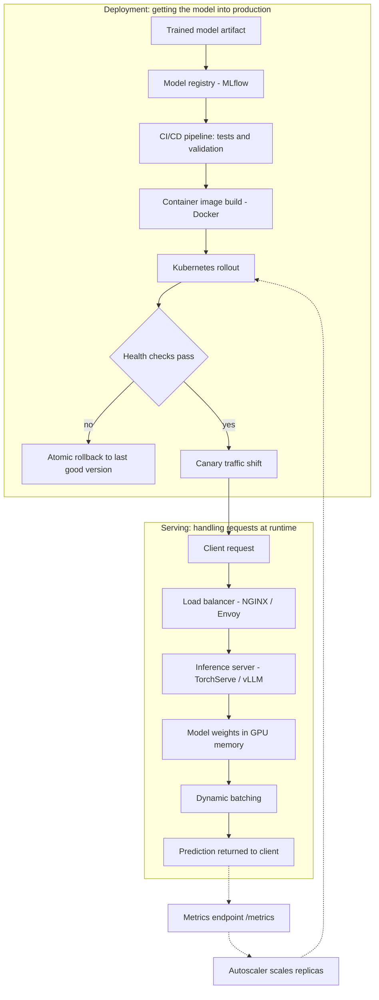

| Difficulty | Channel | Tags |
|---|---|---|
| beginner | devops | mlops, deployment |

Most companies consume LLMs through hosted APIs and call it a strategy. Netflix's AI Platform team took the other road — running the entire inference stack in-house, GPUs and all, to buy low latency, deep customization, and tight integration with the Model Scoring Service that already powered production [1]. Along the way, they drew a line that most teams still blur: deploying a model and serving a model are two entirely different jobs. Mix them up — in production or in an interview — and things break in expensive, pager-waking ways.

---

> ### Real-World Case — Netflix
>
> Most companies consume LLMs through hosted APIs, but Netflix's AI Platform team chose to run the full inference stack in-house to get low latency, deep customization, and tight integration with its existing Model Scoring Service. The platform had to deploy GPU-backed models and serve a diverse mix of workloads—embeddings, prefill-only ranking, autoregressive decoding, and custom constrained-decoding logic—inside Netflix's existing production environment.
>
> | | |
> |---|---|
> | **Challenge** | Deployment and serving were coupled in ways that only surfaced at scale: GPU model startup was slow, Triton/vLLM version mismatches could break backends, Red-Black rollouts failed when a new model changed its I/O schema, and the first constrained-decoding implementation used per-request Python logits processing that became CPU-bound under real batch concurrency. |
> | **Solution** | Netflix separated the deployment control plane from the serving data plane. A Java control plane handled packaging, versioning, health checks, autoscaling, and multi-region rollout; Triton plus vLLM handled model loading, batching, GPU scheduling, and inference, exposed through gRPC and an OpenAI-compatible API. They used Red-Black deployments for stable interfaces and versioned deployments for breaking schema changes, pre-materialized models on Amazon FSx to cut cold starts, and rewrote constrained decoding as batch-level C++ processing on vLLM V1. |
> | **Outcome** | Logits-processing time stayed flat as batch size grew instead of rising linearly and spiking tail latency; GPU rollouts became zero-downtime with atomic rollback, and versioned deployments eliminated the window where old requests hit a new model schema. Netflix also unified 40+ vLLM metrics with Triton's server metrics behind one /metrics endpoint, and migrated production constrained decoding from vLLM V0 to V1 in Q4 2025. |
> | **Lesson** | Deployment is the control plane—packaging, versioning, rollout, rollback—while serving is the data plane—batching, scheduling, decoding, and latency. Treating them as one layer hides runtime bottlenecks and makes rollouts fragile; the best production pattern is a stable serving interface with deployment strategies designed around the serving runtime's real constraints. |

---

## Hook — The Deploy Went Green. Then the First Request Arrived.

The deployment looked perfect. Pipeline green, pods healthy, dashboards smiling. Then real traffic hit — and the first request sat there for eleven seconds while a 4GB model loaded from disk into GPU memory, one cold start at a time, while clients timed out upstream. Sound familiar? Every developer who has moved a model from a notebook into production carries some version of this scar.

It happens because of one sneaky assumption: that getting a model onto a server is the same as making it answer requests. It isn't. Deployment is the discipline of shipping infrastructure — CI/CD, containers, rollback strategies. Serving is the discipline of answering requests — routing, model loading, batching, latency budgets. Netflix felt the full weight of this boundary when they chose to run their entire LLM inference stack in-house rather than call a hosted API [1]. And that exact distinction — deployment versus serving — has quietly become a favorite interview question for MLOps and platform roles, because it separates people who have read about production ML from people who have actually run it.

So which half breaks first, and why?

## Problem — One Word Doing Two Jobs

Here's where it gets messy: most teams use the word 'deploy' for both halves of the pipeline, and that vocabulary leak causes real damage. When deployment and serving get tangled together, four failure modes show up again and again: cold starts that torch latency SLOs; version skew, where in-flight requests hit a model whose schema just changed underneath them; throughput collapse when a model server cannot batch; and 'rollbacks' that take twenty minutes because rollback was never designed — it was an afterthought.

The research has been warning about this for a decade. Google's influential 'Hidden Technical Debt in Machine Learning Systems' paper showed that the actual ML code is a tiny box in the middle of an enormous scaffolding of data pipelines, infrastructure, and monitoring [2]. Serving is that tiny box running at request time; deployment is everything built around it.

You might think this is an academic distinction. In practice, it decides whether your system survives 10 requests per second or 10,000 — and whether a bad model release means a graceful canary or a full-blown outage. Many developers discover this only after their first 3am page; if that sounds familiar, you are in good company. What follows is how Netflix made the split work at production scale — and what it means for the systems you build tomorrow.

## Real-World Case — Netflix

Netflix's AI Platform team faced a choice more companies face every quarter: consume LLMs through hosted APIs, or run the full inference stack in-house. They chose in-house — deliberately — to get low latency, deep customization, and tight integration with their existing Model Scoring Service [1]. And 'in-house' was not one tidy workload. It was a heterogeneous mix: embedding generation, prefill-only ranking, autoregressive decoding, and custom constrained-decoding logic, all GPU-backed and all living inside Netflix's existing production environment.

That diversity is precisely what makes the deployment/serving split real. Every workload has different latency and batching behavior, yet all of them have to roll out through the same machinery. The results speak to both disciplines. On the serving side, careful runtime engineering kept logits-processing time flat as batch size grew — instead of the linear climb and tail-latency spikes teams naively expect from engines like vLLM [9]. On the deployment side, GPU rollouts became zero-downtime with atomic rollback, and versioned deployments eliminated the window where old requests could hit a new model schema [1].

Observability got unified too: 40+ vLLM metrics were merged with Triton's server metrics behind a single /metrics endpoint [10] — one pane of glass covering both halves of the system. By Q4 2025, they had migrated production constrained decoding from vLLM's V0 engine to V1 without the schema-mismatch fireworks that usually accompany such a swap.

💡 Insight: Netflix did not succeed because they had better models. They succeeded because they treated deployment and serving as separate, first-class engineering disciplines — then engineered the seam between them.

## Deep Dive — Two Halves of One Machine

Building on the Netflix story, it helps to get precise about the boundary. Think of it this way: deployment is a software-delivery problem; serving is a physics problem — memory bandwidth, GPU allocation, and the clock.

Deployment owns everything between 'model artifact exists' and 'model is safely live in production.' That means containerization, orchestration through Kubernetes Deployments [3], declarative infrastructure with Terraform, model registries like MLflow for lineage and versioning [5], managed alternatives like SageMaker [11], CI/CD pipelines that run validation gates before rollout, monitoring hooks, and — crucially — a rollback strategy that has actually been tested.

Serving owns everything between 'request arrives' and 'response leaves.' That means inference servers like TorchServe [6] and TensorFlow Serving [7], frameworks like BentoML that package the whole dependency graph [8], API layers built on FastAPI or gRPC, load balancers like NGINX or Envoy for request routing, dynamic batching, and autoscaling that reacts to real traffic.

Here's the comparison that matters:

| Dimension | Deployment | Serving |
| --- | --- | --- |
| Core question | Is the right version safely live? | Can it answer this request fast? |
| Typical tools | Kubernetes, Terraform, MLflow, SageMaker, CI/CD | TorchServe, TF Serving, BentoML, FastAPI, gRPC, NGINX |
| Failure mode | Bad rollout, version skew | Cold starts, latency spikes, queueing collapse |
| Key metrics | Rollout success, rollback time | p99 latency, QPS, GPU utilization |
| Time horizon | Minutes to hours | Milliseconds |

The interesting trade-offs live at the intersection. Latency versus throughput: dynamic batching raises throughput but inflates tail latency — the exact tension Netflix flattened by keeping logits-processing constant as batch size grew [1]. Dynamic batching is the difference between a barista pulling one espresso at a time during the morning rush and pulling eight. Batch versus real-time: batch jobs tolerate sub-second budgets, while real-time serving usually demands under 100ms end to end. Scaling splits in two as well: horizontal scaling adds pod replicas behind a load balancer [4], while vertical scaling throws bigger GPUs and more memory at each replica — useful when the model itself will not shard. And A/B testing lives across both worlds: traffic splitting and gradual rollouts are deployment decisions whose cost gets paid in serving latency.

⚠️ Watch Out: cold starts are the classic trap. Your autoscaler happily adds pods when load rises — but each new pod spends its first seconds loading weights, which means scaling events can briefly worsen latency instead of helping.

🔥 Hot Take: an autoscaler that scales pods is not a system that scales inference. If loading the model takes 30 seconds, horizontal scaling has a built-in latency floor at time zero that no number of replicas fixes.

🎯 Key Point: pin the model version inside the serving layer. When the version is explicit, rollback becomes a configuration change instead of a redeploy — the same principle behind Netflix's atomic rollback story.

## Workflow — From Artifact to Answer

So how does a request actually traverse both halves? The diagram below traces the full journey — from trained artifact through deployment machinery into the serving path, and back out as a prediction:

Step 1 — Register the model. Training produces an artifact; a registry like MLflow stamps it with a version and lineage [5]. No version means no rollback — just archaeology.

Step 2 — Run the CI/CD gauntlet. Validation tests, data-drift checks, and schema-compatibility gates decide whether this version is allowed anywhere near production.

Step 3 — Package everything. Docker bakes the model, runtime, and dependencies into one immutable image — the unit that makes atomic rollback possible at all.

Step 4 — Roll out gradually. Kubernetes progressively replaces old pods with new ones [3], and health checks decide whether traffic follows.

Step 5 — Gate on health, not hope. No traffic until weights are resident in memory — this is how Netflix eliminated the window where old requests hit a new schema [1].

Step 6 — Balance and route. NGINX or Envoy spreads requests across replicas; routing rules can split traffic for A/B tests and gradual exposure.

Step 7 — Serve with intent. The inference server loads weights once, batches compatible requests, and answers within its latency budget.

Step 8 — Observe and react. Metrics flow to dashboards and the autoscaler; under load, the Horizontal Pod Autoscaler adds replicas [4]; under failure, traffic snaps back to the last good version.

💡 Insight: the handoff point between deployment and serving — the moment traffic is allowed — is the most important seam in the entire system. Most production incidents are born on that seam. Design it first, test it often.

## Code Example — A Serving Layer That Respects the Boundary

Now for the practical part: what the serving half actually looks like in code. Below is a FastAPI-based ranking service that implements three production patterns from this article — a pinned model version, cold-start-aware startup, and health-gated traffic. It is the kind of code that lives inside the container your deployment pipeline ships; see the full implementation in the code block.

The design decisions map directly to the concepts above. The lifespan handler loads weights exactly once at startup, off the request path — the cold-start fix that separates a service from a script. MODEL_VERSION is pinned explicitly, which turns rollback into a config change rather than a redeploy — the same principle behind Netflix's atomic rollouts [1]. The /predict handler runs inference in a worker thread so a slow GPU call never blocks other requests in the event loop — a miniature version of the decoupling that load balancers and model servers provide at production scale [7]. And the /health endpoint is the contract Kubernetes leans on: the pod reports not-ready until weights are resident, so the deployment controller never routes traffic to a cold model [3]. Swap the stubbed _load_weights for an MLflow registry pull [5], put NGINX in front, and this becomes the skeleton of a production serving layer.

## Lessons Learned — Scars, Patterns, and Interview Ammo

If this journey had a moral, it would fit on a sticky note: deployment is how a model reaches production; serving is how it earns its keep there. Here's what you need to know:

- **Draw the boundary on purpose.** Teams that explicitly split rollout machinery from inference runtime recover from bad versions in seconds; teams that don't redeploy their whole stack in a panic.
- **Version ruthlessly.** Pin the model version in the serving layer and treat every rollout as an atomic, reversible transaction — the pattern that made Netflix's GPU rollouts zero-downtime [1].
- **Health-gate your traffic.** No request should ever reach a pod whose weights aren't in memory. One check eliminates an entire class of cold-start incidents.
- **Watch the tail, not the average.** Netflix kept logits-processing flat as batch size grew precisely because linear growth shows up first at p99 [9].
- **Unify metrics early.** One /metrics endpoint covering model and server behavior — 40+ vLLM signals merged with Triton's — keeps the stack observable without tab-switching [10].
- **Treat batch size as a latency decision.** Every batching choice trades throughput against tail latency; make it consciously, per workload.

And the battle scars worth remembering: autoscaling is not cold-start protection, averages hide the tail, and an untested rollback is a rumor, not a strategy.

The interview follow-ups worth rehearsing: How would you design for 10K QPS at sub-50ms latency? (Replicas, batching, and pre-warmed weights — not a bigger box.) Which metrics matter in production? (p99 latency, GPU utilization, error rate, model-version skew.) How does versioning enable rollback? (Registry pinning plus immutable images.)

Tomorrow, do this: open your architecture diagram and draw one line between 'how models get to production' and 'how requests get answered.' If you can't draw that line cleanly, you've just found your next engineering project.

---

## Deployment vs Serving Pipeline

<strong>Original Interview Question</strong>

**Q:** Explain the key differences between model serving and model deployment in ML systems, including specific technologies, scaling considerations, and real-world implementation patterns?

**A:** Deployment encompasses CI/CD pipelines, infrastructure setup, and monitoring using tools like Kubernetes, MLflow, and SageMaker. Serving focuses on runtime inference APIs with frameworks like TensorFlow Serving, TorchServe, or BentoML, handling request routing, model versioning, and autoscaling. Key trade-offs include latency vs throughput, batch vs real-time inference, and cold start optimization.

## Conclusion

Netflix ran the whole inference stack in-house and made it look boring — flat logits-processing under growing batch sizes, zero-downtime GPU rollouts, atomic rollback, one metrics endpoint — not because they had magic models, but because they refused to blur two jobs into one word [1]. Deployment ships the machine; serving makes it answer. The next time someone says 'the model is deployed,' ask the question that separates practitioners from tourists: 'Great — how fast does it answer?' That question has a way of surfacing cold starts, version skew, and untested rollbacks before your users do it for you.

---

## References

1. [Netflix incident report](https://netflixtechblog.com/in-house-llm-serving-at-netflix-a5a8e799ea2c) — article
2. [Hidden Technical Debt in Machine Learning Systems](https://arxiv.org/abs/1701.05149) — paper
3. [Kubernetes Deployments](https://kubernetes.io/docs/concepts/workloads/controllers/deployment/) — documentation
4. [Kubernetes Horizontal Pod Autoscaler](https://kubernetes.io/docs/tasks/run-application/horizontal-pod-autoscale/) — documentation
5. [MLflow: An Open Source Platform for the Machine Learning Lifecycle](https://github.com/mlflow/mlflow) — documentation
6. [TorchServe: Model Serving for PyTorch](https://github.com/pytorch/serve) — documentation
7. [TensorFlow Serving](https://github.com/tensorflow/serving) — documentation
8. [BentoML](https://github.com/bentoml/BentoML) — documentation
9. [vLLM: High-Throughput LLM Inference and Serving](https://github.com/vllm-project/vllm) — documentation
10. [NVIDIA Triton Inference Server](https://github.com/triton-inference-server/server) — documentation
11. [Amazon SageMaker Developer Guide](https://docs.aws.amazon.com/sagemaker/latest/dg/whatis.html) — documentation

---

**Author:** Satishkumar Dhule — [GitHub](https://github.com/satishkumar-dhule) · [LinkedIn](https://linkedin.com/in/satishkumar-dhule) · [Website](https://satishkumar-dhule.github.io)
