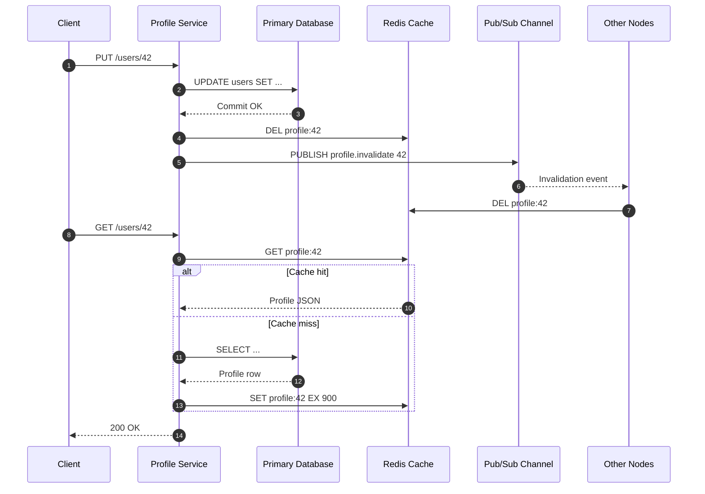

| Difficulty | Channel | Tags |
|---|---|---|
| beginner | backend | redis, memcached, cache-invalidation |

At Facebook's peak, a single profile edit could trigger deletes across thousands of memcached servers in multiple regions — and yet engineers found that only about 4% of those deletes actually removed anything [1]. The rest were no-ops, flying through a fleet holding trillions of items for over a billion users. That counterintuitive stat is the key to understanding cache invalidation: the hard part is not deleting data, it is coordinating a distributed system so that stale copies never survive long enough to matter. This is the story of how that lesson shaped one of the most demanding caches ever built, and how you can apply it to a user-profile service.

---

> ### Real-World Case — Facebook (Meta)
>
> Facebook's read-heavy social graph and user-profile traffic overwhelmed its MySQL tier, so engineers built Memcache: a distributed memcached layer spanning thousands of servers, multiple front-end clusters, and multiple regions. Every profile or social-graph update then had to invalidate cached copies scattered across that entire fleet.
>
> | | |
> |---|---|
> | **Challenge** | After a database write, the same key could be cached in many clusters and regions. Concurrent readers could reinsert an old value after a delete had already happened, leaving the cache permanently stale (the 'stale set' problem), while mass cache misses could stampede MySQL (the 'thundering herd' problem). |
> | **Solution** | Facebook used a look-aside cache and, on updates, wrote to MySQL then deleted the cache key instead of setting it, because deletes are idempotent and safe even if invalidations arrive out of order. They tailed the MySQL commit log to broadcast invalidations to every cluster and region. They also extended memcached with 'leases': a cache miss returns a 64-bit token, and a delete invalidates outstanding tokens, so a slow reader cannot write back stale data; the same mechanism rate-limits refreshes to suppress thundering herds. |
> | **Outcome** | The system handles billions of requests per second and holds trillions of cached items for over a billion users. A counterintuitive finding: only about 4% of issued deletes actually invalidate cached data, so most invalidation traffic is cheap no-op work. Leases addressed both stale sets and thundering herds, protecting MySQL from refresh storms. |
> | **Lesson** | Cache invalidation is a distributed coordination problem, not a single DEL call. Prefer idempotent deletes over updates, assume concurrent readers can resurrect stale data, and design an explicit invalidation protocol such as log tailing, leases, or versioning rather than relying on TTL alone. The cache technology matters less than the protocol built around it. |

---

## Hook — The Delete That Did Nothing

The pager does not care about your cache hit rate. It cares about the one stale key you missed. Imagine a single profile edit — a user changes their display name — landing on one of many front-end clusters, writing to a sharded MySQL database, and then needing to erase every cached copy scattered across thousands of memcached servers in multiple regions. At Facebook's scale, that fleet held trillions of cached items and served billions of requests per second [1]. Leave one stale copy alive and users see the wrong name, the wrong privacy setting, or the wrong friend count. Delete too aggressively and MySQL gets hammered by a refresh storm. Here is the twist: only about 4% of issued deletes actually invalidate cached data [1]. Most invalidation traffic is cheap no-op work. That gap between what you think is happening and what is actually happening is where cache invalidation gets interesting.

## Problem — When One Update Becomes a Thousand Copies

Building on that image, the core challenge is easy to state and hard to solve: a cache turns one authoritative copy into many copies, and every copy can drift. User-profile traffic is read-heavy, so teams put Redis or Memcached in front of the database to cut latency and protect the primary. However, the moment a profile update lands, every cached copy becomes a liability. You can write through to the cache, delete the key, or let a TTL expire, and each choice trades freshness against throughput and complexity [4].

Many developers reach for a long TTL and call it done. Then a user updates their avatar, sees the old one for 30 minutes, and support tickets arrive. Others delete the key on every write but forget that a concurrent read can repopulate the cache with the old value — the classic stale-set race. A third group adds a distributed lock and accidentally creates a thundering herd when the lock expires under load [5].

⚠️ Watch Out: The dangerous case is not a cache miss. It is a cache hit on data that is no longer true. The question is not whether to invalidate, but how to make invalidation cheap, correct, and observable across a fleet. That question gets much sharper when you look at a system that had to answer it at planetary scale.

## Real-World Case — Facebook (Meta) and the Memcache Fleet

In 2013, engineers from Facebook published 'Scaling Memcache at Facebook,' a paper describing how the company built a distributed memcached layer across thousands of servers, multiple front-end clusters, and multiple regions [1]. The read-heavy social graph and profile traffic were overwhelming the MySQL tier, so the cache became a first-class part of the architecture, not a sidecar. The fleet held trillions of items for more than a billion users and handled billions of requests per second [1]. Every profile or social-graph update then had to invalidate cached copies across that entire fleet.

Here is the plot twist: only about 4% of issued deletes actually invalidated cached data [1]. The other 96% were no-ops — keys that had already been evicted, never cached, or invalidated by another path. That sounds wasteful until you consider the alternative: a delete that assumes every key exists must coordinate with every node, which is far more expensive than a cheap miss.

The paper also describes leases, a mechanism that addressed both stale sets and thundering herds by giving one client permission to refresh a hot key while others wait briefly or serve stale data [1][5]. In other words, Facebook did not eliminate invalidation traffic. It made the common case cheap and the rare storm survivable.

## Deep Dive — Redis vs Memcached: The Real Trade-off

Therefore, the Redis-versus-Memcached decision is not a religious war; it is a trade-off between coordination features and operational simplicity. Both store key-value data in memory, both support TTL expiration [2][3], and HTTP caching teaches the same freshness trade-off at the protocol layer [8]. The differences show up when invalidation becomes distributed and when durability matters.

| Dimension | Redis | Memcached |
|---|---|---|
| Data model | Strings, hashes, lists, sets, sorted sets, streams | Simple key-value blobs |
| Invalidation fan-out | Pub/Sub and keyspace notifications built in [9] | Manual coordination across nodes |
| Persistence | RDB snapshots and AOF | None; memory only |
| Scaling style | Cluster, Sentinel, replication | Simple multithreaded horizontal scaling |
| Memory overhead | Higher per key due to richer structures | Lower for pure caching |
| Best fit | Complex invalidation, durability, data structures | Straightforward, high-throughput caching |

💡 Insight: If your invalidation strategy needs a message bus, Redis gives you one in the same process. If your strategy is 'set it and forget it until TTL,' Memcached's simplicity is a feature, not a limitation [6].

However, pub/sub is not a magic consistency layer. Redis Pub/Sub is fire-and-forget: a node that is disconnected when the message is published will miss it [9]. That is why production systems pair pub/sub with a TTL backstop and an idempotent delete on read or write. For profile data, a TTL of 5 to 30 minutes is a common safety net, not a primary strategy [7].

🔥 Hot Take: Most teams do not need a distributed lock for every cache miss. They need a short TTL, a delete on write, and a lease for the handful of keys that actually go viral.

## Workflow — From Profile Update to Cache Coherence

With the trade-offs clear, here is how a profile service can turn theory into a repeatable workflow. The sequence diagram below tells the story: the database commits first, the cache key is deleted, and an invalidation event fans out to other nodes.

1. Commit the profile update to the primary database. The database remains the source of truth.
2. Delete the cache key instead of overwriting it. A delete is idempotent and avoids racing a concurrent read that still holds the old value.
3. Publish an invalidation event so other service nodes can drop their local or regional copies [9].
4. On a read miss, use cache-aside: load from the database, then set the key with a TTL and a small jitter to avoid synchronized expiration [7].
5. For hot keys, add a lease-like lock so only one request rebuilds the value while others wait briefly or serve stale data [1][5].
6. Monitor hit rate, delete-to-set ratio, stale-read reports, and database load during invalidation bursts.

The order matters. Writing the cache before the database can leave a new value that the database never accepted. Deleting the cache before the database commits can let a reader repopulate the old value. Commit first, invalidate second, and let TTL handle the rare message that gets lost.

## Code Example — A Production-Shaped Invalidation Path

The following Python example uses Redis, but the shape applies to Memcached with a small manual-coordination layer. It implements delete-on-write, pub/sub fan-out, a TTL backstop, and a lease-like lock for hot keys. The code is illustrative, so swap the db object for your repository or ORM.

## Lessons Learned — What to Do Differently Tomorrow

The journey starts and ends with the same insight: cache invalidation is a coordination problem disguised as a delete call. Facebook's fleet showed that most deletes are no-ops, and that is fine — the goal is not to make every delete hit, but to make the system correct when the rare delete matters [1].

- **Delete, do not overwrite, on update.** A delete is idempotent and avoids stale-set races. Overwriting can lose a race with a concurrent reader.
- **Commit the database first.** The cache is a derived view. If the database write fails, the cache must not advertise success.
- **Use TTL as a backstop, not a strategy.** A 5-to-30-minute TTL protects you from lost invalidation messages, but it is not a freshness guarantee [7].
- **Add jitter to expiration.** Uniform TTLs create synchronized misses and thundering herds [5].
- **Choose Redis when invalidation needs coordination.** Pub/Sub, persistence, and richer data structures justify the overhead for complex profile and social-graph workloads [3][9].
- **Choose Memcached when simplicity wins.** For pure high-throughput caching with manual invalidation, Memcached's lower overhead and straightforward scaling are hard to beat [2][6].
- **Measure the no-op rate.** A high delete-to-hit ratio is not automatically a bug; it may be the price of safe invalidation.

⚠️ Battle scar: Teams often add a distributed lock to every miss, then wonder why p99 latency spikes when a popular profile expires. Leases should be rare, short, and monitored.

The next time a profile update triggers a delete, ask a better question than 'did the delete work?' Ask 'what happens if it did not?' That is the question Facebook's engineers designed around, and it is the question that will keep your cache from becoming a source of truth.

---

## Profile Update and Cache Invalidation Flow

<strong>Original Interview Question</strong>

**Q:** You're building a user profile service that caches frequently accessed profiles. How would you implement cache invalidation when a user updates their profile, and what trade-offs would you consider between Redis and Memcached?

**A:** Implement write-through caching with TTL-based expiration. On profile update, invalidate the cache by deleting the key and writing new data to both the database and cache. Redis offers pub/sub for automatic distributed invalidation, while Memcached requires manual coordination across nodes.

## Conclusion

The moral of the story is that cache invalidation is a distributed-systems problem wearing a CRUD costume. Facebook's memcache fleet handled trillions of items for over a billion users, yet only about 4% of deletes did real work [1]. The win was not a perfect delete; it was a design that made the common no-op cheap and the rare storm survivable with leases, TTLs, and careful ordering.

So what should you do differently tomorrow? Commit the database first, delete the cache key instead of overwriting it, publish an invalidation event if your cache supports it, add TTL jitter, and measure stale reads instead of just hit rate. If you need coordination, Redis earns its overhead. If you need raw simplicity, Memcached still shines. Either way, remember the memorable insight you can share with your team: a cache is a copy, not a source of truth — design every invalidation path as if the delete will fail, because sometimes it will.

---

## References

1. [Facebook (Meta) incident report](https://www.usenix.org/conference/nsdi13/technical-sessions/presentation/nishtala) — article
2. [Memcached](https://en.wikipedia.org/wiki/Memcached) — documentation
3. [Redis](https://en.wikipedia.org/wiki/Redis) — documentation
4. [Cache invalidation](https://en.wikipedia.org/wiki/Cache_invalidation) — documentation
5. [Thundering herd problem](https://en.wikipedia.org/wiki/Thundering_herd_problem) — documentation
6. [Amazon ElastiCache for Memcached](https://docs.aws.amazon.com/AmazonElastiCache/latest/mem-ug/WhatIs.html) — documentation
7. [Caching strategies and best practices](https://docs.aws.amazon.com/AmazonElastiCache/latest/red-ug/Strategies.html) — documentation
8. [HTTP caching](https://developer.mozilla.org/en-US/docs/Web/HTTP/Guides/Caching) — documentation
9. [Redis Pub/Sub](https://redis.io/docs/latest/develop/pubsub/) — documentation

---

**Author:** Satishkumar Dhule — [GitHub](https://github.com/satishkumar-dhule) · [LinkedIn](https://linkedin.com/in/satishkumar-dhule) · [Website](https://satishkumar-dhule.github.io)
