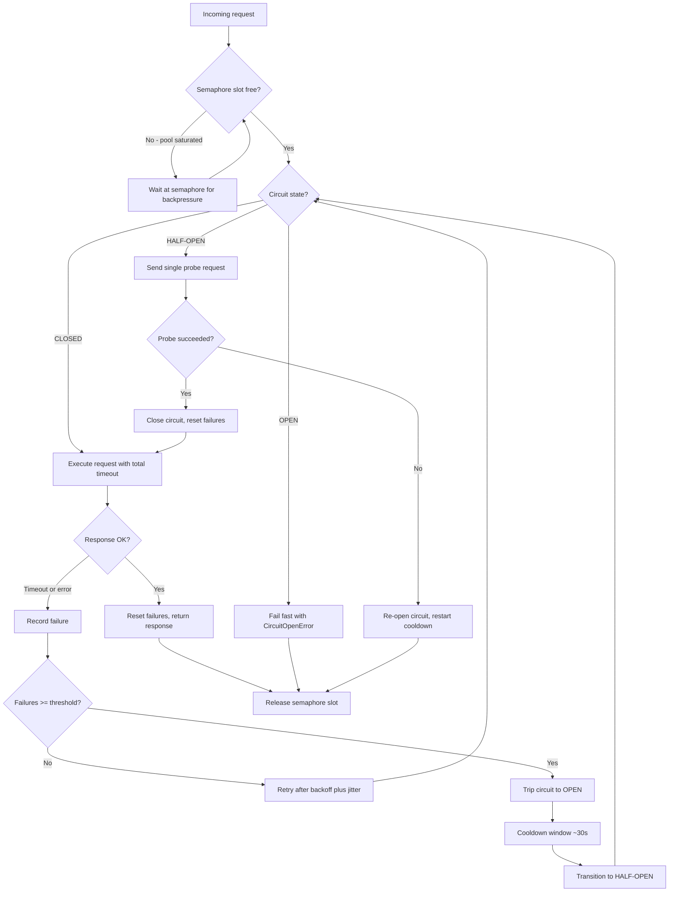

| Difficulty | Channel | Tags |
|---|---|---|
| advanced | backend | asyncio, aiohttp, concurrency |

In 2012, Netflix's API absorbed more than 1 billion incoming calls per day and fanned them out into several billion downstream dependency calls across dozens of backend services [1]. When a single dependency slowed down, threads blocked, connection pools filled, and the failure threatened to cascade across the entire API for every Netflix member [1]. This is the story of how graceful degradation saved Netflix — and how to build the same resilience into aiohttp with semaphores, exponential backoff, and a circuit breaker.

---

> ### Real-World Case — Netflix
>
> The Netflix API fronted a service-oriented architecture handling more than 1 billion incoming calls per day, fanning out to several billion downstream dependency calls (a 1:6 ratio) across dozens of backend services. When any single dependency became slow or failed, threads blocked, connection pools filled, and the failure threatened to cascade and take down the entire API for every Netflix member.
>
> | | |
> |---|---|
> | **Challenge** | Prevent slow or failing downstream dependencies from exhausting connection pools and thread pools and cascading into a full-site outage, while still letting members keep streaming through partial failures. |
> | **Solution** | Netflix built the DependencyCommand layer that became Hystrix: aggressive network timeouts, bounded concurrency via per-dependency thread pools and non-blocking semaphores (tryAcquire), circuit breakers that trip when a dependency's error rate crosses a threshold over a rolling 10-second window, and fallbacks that serve cached or degraded data instead of waiting on the failing service. |
> | **Outcome** | In a real production database outage, circuits tripped automatically and fallbacks served results from a local query cache with no user-visible downtime. By late 2012, tens of billions of thread-isolated and hundreds of billions of semaphore-isolated calls executed through Hystrix per day at Netflix, with what the team described as a dramatic improvement in uptime and resilience. |
> | **Lesson** | Waiting and retrying against a failing dependency makes things worse — retries hold thousands of connections open against a struggling backend. The counterintuitive fix is to fail fast, shed load, and deliberately degrade the experience rather than queue; graceful degradation is a requirement, not a feature. |

---

## Hook — 2:47 a.m., and the Deploy Was Fine

It is 2:47 a.m. and the deploy went out clean — dashboards green, latency flat, everyone asleep. Then, three services downstream, a database that normally answers in 30 milliseconds starts answering in 30 seconds.

Your code is innocent. Your service is healthy. Your connection pool, however, is about to become a hostage negotiation: every request grabs a slot, waits, holds, and waits some more. Within minutes, all 100 slots are jammed with dying requests, healthy traffic queues behind them, and someone else's slow database becomes your pager's problem.

Sound familiar? It should — this exact scenario played out at planetary scale inside Netflix's API, and the fix became one of the most copied resilience patterns in distributed systems [1]. The stack has since moved from Java threads to Python coroutines, but the physics of pool exhaustion have not changed one bit. If you run async Python services with aiohttp, those physics are your problem too.

Here is the uncomfortable part: asyncio makes this worse before it makes it better. Coroutines never block a thread, so nothing screams — the pool just quietly fills while everything looks 'fine' [4]. The question is not whether your pool saturates when a dependency degrades. It is whether it saturates gracefully. That difference is the entire game, and the next section shows exactly what is at stake.

## Problem — Pool Exhaustion Is Arithmetic Before It Is Drama

Pool exhaustion is arithmetic before it is drama. A pool of 100 connections with a healthy downstream answering in 200 ms sustains roughly 500 requests per second. Degrade that dependency to 30 seconds per call — still technically working, just slow — and the same pool delivers about 3 requests per second. One misbehaving service, a 150x throughput collapse.

What follows is a cascade with grim predictability:

- Connection hold times balloon and the pool saturates
- Waiting requests pile up, so latency compounds while the queue grows
- Timeouts fire and retries kick in, amplifying load on an already-sick service
- Health checks time out, the orchestrator kills and restarts pods, and every replica hammers the downstream at once — the thundering herd [7]
- Your callers hit their own pool limits, and the outage propagates upward

The brutal twist is that every actor in that chain behaves rationally. Retrying on timeout seems sensible. Restarting a sick pod seems sensible. Individually reasonable decisions compose into a system-wide meltdown — which is why the fix can never be 'add more connections.' More connections to a dying service is just more rope.

Therefore the real requirement is graceful degradation: bounded concurrency, recovery-friendly retries, and a mechanism to stop sending requests to a service that is demonstrably broken [5]. Netflix faced exactly this at a billion calls a day — and answered it in public, with numbers.

## Real-World Case — Netflix

By late 2012, Netflix's API fronted a service-oriented architecture handling more than 1 billion incoming calls per day, fanning out at roughly a 1:6 ratio into several billion downstream dependency calls across dozens of backend services [1]. That fan-out ratio is the villain of the story: one page request for a single member could touch a dozen dependencies, so one slow backing store could stall traffic for everyone.

The team described the stakes bluntly: when any single dependency became slow or failed, threads blocked, connection pools filled, and the failure threatened to cascade and take down the entire API for every Netflix member [1].

Their answer was Hystrix — bulkhead isolation with thread pools and semaphores, circuit breakers around every dependency, and fallbacks for when things broke [1]. The payoff arrived during a real production database outage: circuits tripped automatically and fallbacks served results from a local query cache, with no user-visible downtime [1]. By late 2012, tens of billions of thread-isolated calls and hundreds of billions of semaphore-isolated calls flowed through Hystrix every single day, with what the team described as a dramatic improvement in uptime and resilience [1].

Now notice the detail hiding inside those numbers: semaphores isolated far more calls than threads, because semaphores are the cheap, lightweight layer. Consequently, the Netflix pattern maps onto asyncio almost perfectly — Python coroutines are already cheap to park, and asyncio.Semaphore sits in the standard library waiting to be used [3]. What Hystrix did with threads and semaphores in Java, you can do with aiohttp and roughly 80 lines of Python.

## Deep Dive — The Three Mechanisms That Fail Gracefully

Building on the Netflix blueprint, a resilient aiohttp pool needs three cooperating mechanisms — and here is the key insight: each one exists because the other two fail without it.

**1. The semaphore: backpressure instead of hope.** `asyncio.Semaphore(max_connections)` caps concurrent in-flight requests [3]. When the pool saturates, new callers wait at the semaphore instead of flooding the downstream. That is backpressure: converting unbounded queue growth into bounded waiting.

⚠️ Watch Out: aiohttp's TCPConnector ships with its own default connection limit of 100 [2], so when you add a semaphore, keep the two numbers coherent — two limiters that disagree produce genuinely confusing behavior.

**2. Exponential backoff — with jitter.** Retrying after 0.5 s, then 1 s, then 2 s gives a recovering service breathing room [6]. However, deterministic schedules create a synchronized stampede: thousands of coroutines retry at the same instant — the thundering herd problem [7]. Jitter, a small random delay, breaks the sync. You might think retry logic alone is enough; without jitter it is a distributed denial-of-service aimed at your own backend.

**3. The circuit breaker: the fail-fast reflex.** The breaker tracks consecutive failures across three states — CLOSED (normal traffic), OPEN (fail fast, send nothing), and HALF-OPEN (one probe to test recovery) [5].

💡 Insight: a hanging request and an instant rejection feel identical to the downstream service, but they are opposites for your pool — the rejection frees the slot in microseconds.

| Protection | Latency while downstream is slow | Downstream shielded? | Complexity |
| --- | --- | --- | --- |
| Naive pool | Hangs until timeout | No — retries amplify load | Trivial |
| + Semaphore | Bounded waiting | Partially | Low |
| + Backoff with jitter | Recovery-friendly retries | Mostly | Medium |
| + Circuit breaker | Milliseconds (fail fast) | Yes | Medium |

🔥 Hot Take: the cheapest request is the one you never send. An open circuit rejects in microseconds what a 30-second timeout would waste discovering. Meanwhile, keepalive keeps the healthy path cheap — persistent connections skip per-request TCP handshakes, the same trick HTTP keep-alive headers play at the protocol layer [8][9].

## Workflow — How One Request Survives the Pool

Putting the three mechanisms together, here is the path a single request takes through the pool — the same decision path Netflix engineered at billion-call scale, compressed into one Python class:

1. **Acquire a semaphore slot.** The request proceeds immediately or waits at the semaphore — backpressure, not queue explosion [3].
2. **Check the circuit.** If OPEN and still cooling down, raise immediately and skip the network entirely. If the cooldown has elapsed, promote to HALF-OPEN and let exactly one probe through [5].
3. **Execute with a total timeout.** `aiohttp.ClientTimeout(total=10)` bounds connect, read, and body — no stage can hang forever [2].
4. **On success**, reset the failure count; a healthy half-open probe closes the circuit again.
5. **On failure**, increment the count — past the threshold, trip to OPEN and start the cooldown clock.
6. **Retry with exponential backoff plus jitter** between attempts [6][7].
7. **Release the semaphore slot no matter what.** A saturated pool must never leak slots.

The Connection Pool Request Lifecycle diagram traces every branch of this flow — including the cooldown path back to HALF-OPEN, which is the part most homegrown implementations forget.

A sensible starting configuration, before metrics teach you otherwise: 100 max connections, 10 s total timeout, a circuit threshold of 5 failures, 30 s cooldown, 0.5 s base retry delay, 3 retries. Treat these as dials to turn with data, not gospel.

## Code Example — 80 Lines That Refuse to Drown

Here is the full implementation — a semaphore-limited pool with a three-state circuit breaker and jittered exponential backoff, in roughly 80 lines of production-shaped Python. The design decisions matter more than the line count:

- **One shared ClientSession** for the application lifetime — this is what enables connection keepalive and reuse [2]. Creating a session per request is the classic aiohttp anti-pattern that quietly multiplies TCP handshakes.
- **The body is read inside the `async with` block.** The original interview snippet returned the response object after its context manager exited — which releases the connection back to the pool and hands the caller a closed response. That bug leaks pool capacity in exactly the way that saturates pools.
- **`get_running_loop()` instead of `get_event_loop()`** — the latter is deprecated outside async contexts and raises in modern Python [4].
- **`CircuitOpenError` subclasses `aiohttp.ClientError`** so callers handle an open circuit with the same except clause as any other client failure.
- **Jitter in the retry delay** keeps a fleet of workers from retrying in lockstep [7].

Step through the numbered comments in `request()` — they map one-to-one onto the seven workflow steps above.

## Lessons Learned — Battle Scars and Tomorrow Morning

Every pattern here was learned somewhere the hard way. These are the battle scars worth avoiding:

- **Leaking sessions on shutdown.** Forgetting `close()` strands sockets and SSL contexts behind 'Unclosed client session' warnings. Wire startup and shutdown into your framework's lifecycle hooks — always.
- **Reading the body outside the context manager.** Returns a closed response while the connection is recycled mid-read. Read inside the block.
- **Retries without jitter.** A synchronized retry stampede can out-DOS the original outage [7].
- **One timeout to rule everything.** aiohttp accepts connect, sock_read, and total separately — a 10 s total with a 2 s connect timeout fails fast on unreachable hosts instead of waiting the full window [2].
- **Two limiters that disagree.** A TCPConnector limit and a semaphore fighting each other looks like a bug and profiles like a mystery.
- **No metrics on breaker trips and semaphore wait time.** If you cannot see the circuit open, you will debug symptoms for an hour before someone checks the logs.

🎯 Key Point: resilience is not about preventing failure — it is about deciding, in advance, exactly how your system fails.

So what changes tomorrow morning? Review your pool configuration and ask one question per dial: what happens when the downstream takes 30 seconds instead of 30 milliseconds? If the answer involves unbounded waiting, add the semaphore. If it involves hammering the downstream, add backoff with jitter. If it involves your whole pool held hostage by one sick dependency, add the circuit breaker. Then chaos-test it — kill a downstream in staging and watch your dashboards stay boring. That is the whole discipline.

---

## Connection Pool Request Lifecycle

<strong>Original Interview Question</strong>

**Q:** How would you implement a connection pool manager for aiohttp that handles graceful degradation under high load and connection timeouts?

**A:** Implement a connection pool manager for aiohttp using a semaphore to limit concurrent connections, exponential backoff for retrying failed requests, and circuit breaker pattern to gracefully degrade under high load and connection timeouts.

## Conclusion

Netflix turned a billion-calls-per-day fan-out into a system that survived a full database outage with zero user-visible downtime — not by preventing failures, but by designing exactly how each one would be absorbed: isolate, back off, trip, fall back [1]. The same physics governs your aiohttp services, and the same solution fits in one Python class: a semaphore for backpressure, jittered backoff for recovery, and a circuit breaker for the fail-fast reflex. Here is the line worth repeating to your team: a connection pool is not finished when it works — it is finished when it fails, quickly and quietly, on purpose.

---

## References

1. [Netflix incident report](https://netflixtechblog.com/fault-tolerance-in-a-high-volume-distributed-system-91ab4faae74a) — blog
2. [aio-libs/aiohttp: Asynchronous HTTP client/server framework for asyncio and Python](https://github.com/aio-libs/aiohttp) — documentation
3. [asyncio synchronization primitives — Semaphore](https://docs.python.org/3/library/asyncio-sync.html) — documentation
4. [asyncio — Asynchronous I/O in Python](https://docs.python.org/3/library/asyncio.html) — documentation
5. [Circuit breaker design pattern](https://en.wikipedia.org/wiki/Circuit_breaker_design_pattern) — documentation
6. [Exponential backoff](https://en.wikipedia.org/wiki/Exponential_backoff) — documentation
7. [Thundering herd problem](https://en.wikipedia.org/wiki/Thundering_herd_problem) — documentation
8. [RFC 1122 — Requirements for Internet Hosts (TCP keepalive)](https://datatracker.ietf.org/doc/html/rfc1122) — documentation
9. [MDN Web Docs — HTTP Keep-Alive header](https://developer.mozilla.org/en-US/docs/Web/HTTP/Headers/Keep-Alive) — documentation

---

**Author:** Satishkumar Dhule — [GitHub](https://github.com/satishkumar-dhule) · [LinkedIn](https://linkedin.com/in/satishkumar-dhule) · [Website](https://satishkumar-dhule.github.io)
