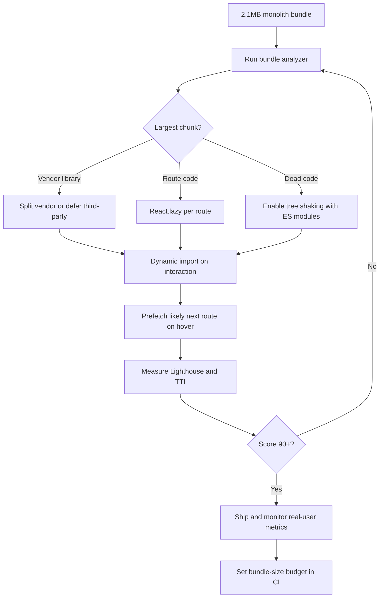

| Difficulty | Channel | Tags |
|---|---|---|
| intermediate | frontend | lighthouse, bundle, lazy-loading |

In 2017, Pinterest's mobile web app made users wait 23 seconds before it became interactive — an eternity on a phone, and a quiet death sentence for engagement [1]. The app was shipping roughly 2.5MB of JavaScript, and every extra kilobyte delayed the moment a user could scroll, tap, or buy. What Pinterest did next became one of the most cited performance turnarounds in frontend history, and it started with a question every React team eventually faces: what is actually inside your bundle? The answer turned a 650KB core into 150KB and cut Time to Interactive to 5.6 seconds [1].

---

> ### Real-World Case — Pinterest
>
> Pinterest's mobile web app was shipping over 2.5MB of JavaScript (roughly a 1.5MB main bundle plus 1MB lazily loaded), and Time to Interactive on mobile was measured at 23 seconds. The company rebuilt the experience as a React, Redux, and webpack Progressive Web App over three months to win back users on low-bandwidth mobile connections.
>
> | | |
> |---|---|
> | **Challenge** | A monolithic React JavaScript bundle had to be downloaded, parsed, and executed before the app became usable, crushing mobile engagement. Pinterest needed to make the app interactive quickly without dropping features or breaking client-side routing. |
> | **Solution** | They implemented route-based code splitting with React Router and webpack, splitting the app into a vendor chunk (~73KB with React/Redux), an entry chunk (~72KB for the app shell and store), and async route chunks (~13–18KB each). They used webpack-bundle-analyzer to find duplicated code across chunks and made the counterintuitive call to move shared duplicate code into the main entry chunk, increasing it by 20% while shrinking every lazy chunk by up to 90%. They also added babel-preset-env, long-term chunk hashing, a route-preloading system, and service workers for caching. |
> | **Outcome** | The core bundle dropped from 650KB to 150KB and total JavaScript went from ~2.5MB to under 200KB. Time to Interactive fell from 23s to 5.6s. Pinterest reported 44% higher revenue, 753% more sign-ups, 103% growth in weekly active mobile web users, and 40% more time spent compared with the old mobile web experience. |
> | **Lesson** | Code splitting is not a one-time project but an ongoing discipline: a year later Pinterest had ~600 JavaScript files, and a single careless import could re-bloat the bundle. They had to add CI bundle-size alerts and a custom ESLint rule banning dependency-heavy imports. The deeper insight is that bundle optimization requires measurement, not intuition — moving shared code into the main chunk looked like a regression but cut lazy-loaded chunks by up to 90%. |

---

## Hook — 23 Seconds Is Not Slow, It Is a Lost User

Imagine a commuter on a crowded train, thumb hovering over a Pinterest link. The page loads, sort of. The spinner spins. The images are there, but tapping anything does nothing for 23 seconds. Most people do not wait. They close the tab, open Instagram, and never come back. That is the brutal math of frontend performance: a slow first interaction is not a metric on a dashboard, it is a user deciding your product is broken [1].

Now scale that moment across millions of sessions on low-bandwidth mobile connections. Pinterest was not fighting a server outage or a database bottleneck. It was fighting its own JavaScript. The browser had to download, parse, compile, and execute megabytes of code before the main thread could respond to a single tap. The stakes were not abstract — they were revenue, sign-ups, and retention.

The uncomfortable question is the one most React teams avoid: if your app takes 4.2 seconds to become interactive at a Lighthouse score of 65, do you actually know which dependency is responsible? Pinterest did not guess. It rebuilt the experience around a smaller first load, and the results were almost absurd. But before the happy ending, it is worth understanding why the problem is so easy to create and so hard to see.

## Problem — The 2.1MB Tax on Every First Visit

A 2.1MB bundle does not feel heavy when you build it. Each dependency seems reasonable in isolation: a charting library here, an analytics SDK there, a UI kit that promised to save months of work. Then the bill arrives on a mid-range Android phone over a congested network. Time to Interactive measures how long it takes for the page to become reliably responsive to input, and that clock is dominated by main-thread work, not just download time [2].

The browser must parse and compile all that JavaScript before it can run it, and React then has to hydrate the tree. Lighthouse rolls these costs into a score, and a 65 is a warning that users are waiting longer than they should [3]. The trap is that teams often reach for infrastructure first — a bigger server, a faster CDN, more aggressive caching. Those help with bytes over the wire, but they do nothing for the CPU-bound work of parsing and executing JavaScript on the device.

⚠️ Watch Out: A fast server can make a slow app look fine in the office and terrible in the real world. If the main thread is saturated, no amount of edge caching will make a tap respond faster.

The real challenge is not "make the bundle smaller" in the abstract. It is deciding what the user needs in the first second versus what can arrive later. That is a product and routing question disguised as a build-tool question. Consequently, the most effective fixes tend to be architectural: split the app so the browser only pays for the screen the user is actually looking at.

## Real-World Case — Pinterest's 23-Second Mobile Web

Pinterest is the canonical example because the numbers are so stark. Its mobile web app was shipping over 2.5MB of JavaScript — roughly a 1.5MB main bundle plus 1MB that was lazily loaded — and Time to Interactive on mobile was measured at 23 seconds [1]. On low-bandwidth connections, the experience was effectively unusable, and users were leaving for faster competitors.

Over three months, Pinterest rebuilt the experience as a React, Redux, and webpack Progressive Web App [1]. The goal was not a cosmetic redesign; it was a fundamental change in what the browser had to load before the app could respond. The results read like a fantasy benchmark:

- Core bundle dropped from 650KB to 150KB
- Total JavaScript fell from ~2.5MB to under 200KB
- Time to Interactive fell from 23 seconds to 5.6 seconds
- 44% higher revenue
- 753% more sign-ups
- 103% growth in weekly active mobile web users
- 40% more time spent compared with the old experience [1]

🔥 Hot Take: The biggest performance win was not a clever micro-optimization. It was deciding that most of the code did not need to be on the critical path at all.

That is the lesson worth tattooing on the wall: Pinterest did not make JavaScript faster. It made less JavaScript necessary for the first interaction. The remaining code loaded when the user navigated to a feature that needed it. This is the difference between optimizing a bundle and redesigning its delivery.

## Deep Dive — Code Splitting Is a Routing Decision, Not a Refactor

Code splitting sounds like a build configuration trick, but it is really a decision about boundaries. The browser supports dynamic import(), which returns a promise for a module and lets bundlers emit that module as a separate chunk [4]. React wraps this pattern with React.lazy() for components and Suspense for the loading state [5][6]. The bundler — webpack, Vite, or otherwise — then creates a graph of chunks instead of one monolith [7].

The first boundary to draw is usually the route. A user landing on the dashboard does not need the analytics editor, the settings screen, or the billing portal. Route-based splitting gives each page its own chunk and keeps the initial payload focused on what is visible. Component-based splitting goes finer: a heavy chart, a rich text editor, or a modal can load on demand. Here is the real trade-off:

| Strategy | What it splits | Best for | Trade-off |
|---|---|---|---|
| Route-based | One chunk per page | Most apps and fast first paint | Navigation can pause on slow networks |
| Component-based | Heavy widgets below the fold | Charts, editors, modals | Too many chunks add request overhead |
| Vendor splitting | Third-party libraries | Long-term caching across deploys | Cache invalidation needs care |
| Import on intent | Features loaded after click or hover | Secondary flows and settings | Needs a thoughtful fallback |

💡 Insight: Split by user intent, not by folder structure. The question is not "which files belong together?" but "what does this screen need right now?"

Splitting alone is not enough. Tree shaking removes unused exports, but it depends on static ES module syntax so the bundler can prove an export is never referenced [8]. If a library ships CommonJS or has side effects, dead code can survive the build. That is why bundle analysis matters: it turns a vague suspicion into a ranked list of culprits. Moreover, lazy loading images and other media keeps the network quiet while the user reads, which compounds the gains from smaller JavaScript chunks [10].

Many developers discover that their largest chunk is not application code at all — it is a vendor dependency imported in a shared layout. The fix is not always to remove it. Sometimes it is to defer it, prefetch it on hover, or replace it with a smaller alternative. The point is to make the decision deliberately rather than inheriting it from an import statement.

## Workflow — The Six-Step Bundle Diet

The workflow below is the loop that takes an app from Lighthouse 65 to 90+ without turning the codebase into a maze of dynamic imports. The Mermaid diagram traces the decision path from a 2.1MB monolith to a measured, monitored release.

1. Measure before touching code. Record the current Lighthouse score, Time to Interactive, and total transferred JavaScript. Use real-user monitoring, not just lab data, because lab conditions hide device and network variance [3].
2. Visualize the bundle. Run webpack-bundle-analyzer to see which chunks and packages dominate [11]. This is the step that replaces opinions with evidence.
3. Remove dead weight. Delete unused dependencies, deduplicate libraries, and replace barrel imports that accidentally pull entire packages into a chunk. Confirm tree shaking is working by inspecting the production build [8].
4. Split by route first. Wrap route components in React.lazy() and a Suspense boundary. Keep the shell, navigation, and critical UI eager so the first paint is not blank [5][6].
5. Defer heavy widgets and third parties. Move charts, editors, chat widgets, and analytics behind dynamic imports triggered by interaction or visibility [4].
6. Verify and monitor. Re-run Lighthouse, compare real-user metrics, and add a bundle-size budget to CI so the problem does not creep back.

🎯 Key Point: The diagram is a loop, not a checklist. If the score stalls, go back to the analyzer. Performance work is empirical, and the bundle changes with every dependency a team adds.

## Code Example — Lazy Routes Without the Blank Screen

The code below shows the pattern that makes lazy routes feel intentional instead of fragile. It combines route-level splitting, a nested Suspense boundary for a heavy widget, an error boundary for chunk-load failures, and prefetching on hover. The prefetch is the subtle part: it warms the next chunk when the user shows intent, so navigation feels instant even though the code was not in the initial bundle.

Notice the nested Suspense boundary around the dashboard. If the heavy chart is slow, the page shell and route content can still render while the widget catches up. That is how you avoid replacing one blank screen with another.

## Lessons Learned — What Separates a Fast App From a Fast Build

The Pinterest story is dramatic, but the underlying lessons apply to any React app with a bundle problem. Here is what to take into the next sprint:

- **Measure the real user, not just the build.** A green build says nothing about a mid-range phone on a slow network. Track Time to Interactive and interaction latency in production [2][3].
- **Split by route before splitting by component.** Route boundaries are natural, stable, and easy to reason about. Finer splits can come later if the analyzer justifies them.
- **Treat every dependency as a budget decision.** A library that saves a week of work can still cost every user a second of load time. Make that trade-off explicit.
- **Always pair lazy loading with a fallback and an error boundary.** Chunk requests fail on flaky mobile networks. A retry button is cheaper than a support ticket.
- **Do not over-split.** Twenty tiny chunks can be slower than three well-sized ones because of request overhead and connection limits.

⚠️ Watch Out: Tree shaking is not automatic magic. CommonJS dependencies, side-effectful imports, and barrel files can quietly defeat it, leaving dead code in the production bundle [8].

Sound familiar? Most teams have a 2.1MB bundle hiding in plain sight. The good news is that the fix is usually not a rewrite. It is a sequence of deliberate boundaries: what loads now, what loads on navigation, and what loads only when the user asks for it.

---

## Bundle Optimization Workflow

<strong>Original Interview Question</strong>

**Q:** You're tasked with improving a React app's Lighthouse performance score from 65 to 90+. The bundle size is 2.1MB and Time to Interactive is 4.2s. What specific steps would you take to optimize the bundle and implement lazy loading?

**A:** Implement code splitting with React.lazy() and Suspense, analyze bundle composition with webpack-bundle-analyzer to identify largest chunks, remove unused dependencies and optimize imports, add dynamic imports for heavy components and third-party libraries, implement route-based splitting for better initial load times, and utilize tree shaking with proper ES module configuration.

## Conclusion

Pinterest's turnaround is a reminder that performance is a product decision disguised as an engineering task. The team did not shave milliseconds off a render function; it changed what the browser had to download and execute before the first tap could register [1]. Start tomorrow by opening the bundle analyzer and naming the three largest chunks out loud. Then ask the only question that matters: does the user need this code on the first screen, or can it wait until they navigate, hover, or click? Answer that honestly, add a bundle-size budget to CI, and you will spend far less time chasing a Lighthouse score — because the score will follow the architecture.

---

## References

1. [Pinterest incident report](https://medium.com/dev-channel/a-pinterest-progressive-web-app-performance-case-study-3bd6ed2e6154) — article
2. [web.dev — Time to Interactive (TTI)](https://web.dev/articles/tti) — documentation
3. [Chrome for Developers — Lighthouse overview](https://developer.chrome.com/docs/lighthouse/overview) — documentation
4. [MDN — import() dynamic import](https://developer.mozilla.org/en-US/docs/Web/JavaScript/Reference/Operators/import) — documentation
5. [React — lazy](https://react.dev/reference/react/lazy) — documentation
6. [React — Suspense](https://react.dev/reference/react/Suspense) — documentation
7. [webpack — Code Splitting](https://webpack.js.org/guides/code-splitting/) — documentation
8. [webpack — Tree Shaking](https://webpack.js.org/guides/tree-shaking/) — documentation
9. [Wikipedia — Code splitting](https://en.wikipedia.org/wiki/Code_splitting) — documentation
10. [MDN — Lazy loading](https://developer.mozilla.org/en-US/docs/Web/Performance/Lazy_loading) — documentation
11. [webpack-bundle-analyzer — GitHub repository](https://github.com/webpack-contrib/webpack-bundle-analyzer) — documentation

---

**Author:** Satishkumar Dhule — [GitHub](https://github.com/satishkumar-dhule) · [LinkedIn](https://linkedin.com/in/satishkumar-dhule) · [Website](https://satishkumar-dhule.github.io)
