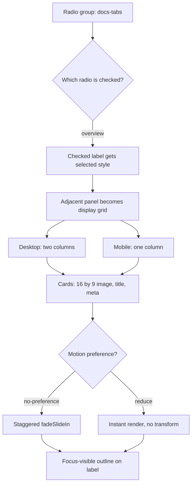

| Difficulty | Channel | Tags |
|---|---|---|
| beginner | frontend | css, flexbox, grid, animations |

Microsoft's Atlas design system powers a large documentation platform, and its team made a deliberate bet: keep as much interactivity as possible in HTML and CSS [1]. That bet works beautifully—until tabs enter the room. A tab panel needs selected state, keyboard arrow navigation, visible focus, responsive cards, and motion that respects user settings. Get one selector wrong and the whole experience collapses.

---

> ### Real-World Case — Microsoft
>
> Microsoft Learn's design system, Atlas, is a CSS-first framework that powers a large documentation platform. The team wanted to keep as much interactivity as possible in HTML and CSS, but its tab-like segmented controls still needed reliable selected state, arrow-key navigation, and focus management for keyboard and screen-reader users.
>
> | | |
> |---|---|
> | **Challenge** | Build tab and segmented-control components in a CSS-first design system without pulling in a JavaScript framework, while still meeting Microsoft's Grade B accessibility bar. Pure CSS radio-input tabs can show and hide panels, but they cannot keep ARIA tab semantics, roving focus, and selected state in sync. |
> | **Solution** | Atlas keeps layout, theming, aspect-ratio, and responsive grid behavior in CSS, but implements tabs with a zero-dependency  custom element. The markup uses real buttons with role=tab, aria-selected, and role=tabpanel, while a small script handles clicks, left/right arrow keys, and hiding inactive panels instead of abusing radio inputs as tabs. |
> | **Outcome** | Atlas powers Microsoft Learn, which the team describes as one of the very few large Grade B accessible websites. The design system ships 30+ components, 3 themes, and 5 layouts, and its interactive components are tested in CI with Playwright. |
> | **Lesson** | CSS-first is not the same as CSS-only. Use CSS for layout, visuals, and motion, but do not force form controls to imitate ARIA widgets; a tiny amount of JavaScript is cheaper than an inaccessible tab interface. |

---

## Hook — The Tab That Looked Finished Until Someone Pressed Tab

Picture a polished design-system docs page. Four cards sit in a tidy 2×2 grid, the active tab is pill-shaped and confident, and the whole component ships with zero JavaScript. It looks finished. Then a keyboard user presses Tab. The focus ring never appears. They press the arrow keys. Nothing moves. They click the second tab, and the panel goes blank because one selector quietly hid every panel on the page. The demo was a lie, and the docs page lost trust in five seconds. That is the gap between a CSS trick and a production component.

## Problem — The Selector That Works Until It Doesn't

At first glance, CSS-only tabs sound like a party trick: a set of radio inputs sharing a name, a matching label for each tab, and a sibling selector to show the right panel. The naive version usually looks like this: hide every panel with `.tabs input:not(:checked) ~ .panel { display: none; }`. It demos perfectly with one tab. It fails with two. Why? Because every panel is a later sibling of every unchecked radio, so a single unchecked input hides all panels—including the one that is selected. Many developers discover this at the worst possible moment: after the component has shipped. The problem gets worse when you add accessibility. Hiding the radios with `display: none` removes them from the tab order, which kills native arrow-key navigation. Adding `role='tab'` to labels without the full ARIA keyboard contract can confuse screen readers. Then there is layout: the cards need a fixed 16:9 image area, a two-column grid on desktop, a single column on mobile, a staggered entrance, and a focus-visible outline that survives all of it. Each requirement is simple alone. Together, they punish any weak link in the DOM structure.

## Real-World Case — Microsoft's Atlas Design System

Microsoft's Atlas design system is a CSS-first framework built for a large documentation platform, and the team wanted to keep interactivity in HTML and CSS wherever practical [1]. Its tab-like segmented controls still needed reliable selected state, arrow-key navigation, and focus management for keyboard and screen-reader users. That is not a small detail at Microsoft's scale: Atlas powers Microsoft Learn, which the team describes as one of the very few large Grade B accessible websites. The system ships 30+ components, 3 themes, and 5 layouts, and its interactive components are tested in CI with Playwright [1][9]. The lesson is blunt: CSS-first does not mean accessibility-later. A single missing focus state can block a screen-reader user across an entire documentation surface. That is why the DOM contract matters more than the visual polish.

## Deep Dive — Radio State, Sibling Order, and the Accessibility Contract

Start with the native behavior you get for free. A group of radio inputs with the same `name` is a single selection model, and browsers provide arrow-key navigation inside that group [3]. Clicking a label activates its radio, so the label becomes the visible control while the radio holds the state. The `:checked` pseudo-class exposes that state to CSS [3]. The missing piece is the relationship between state and panel. The adjacent sibling combinator (`+`) is the safest bridge: if the DOM order is input, label, panel, then `input:checked + label + .panel` reveals exactly one panel [7]. That ordering is the plot twist. Most broken implementations group all inputs first, then all labels, then all panels; the general sibling combinator (`~`) then forces you to reason about every input at once. Interleaving the three elements per tab makes the selector local, predictable, and easy to test. There is a second trap: `display: none` on the radio removes keyboard focus. Use a visually hidden radio that stays focusable, then draw the focus ring on the label with `input:focus-visible + label` [5]. WCAG 2.2's focus appearance guidance exists because keyboard users need to see where they are [8]. For layout, CSS Grid gives you `repeat(2, minmax(0, 1fr))` on desktop and `1fr` below 768px [6]. The `minmax(0, 1fr)` detail prevents long card titles from blowing out the grid. Each image container uses `aspect-ratio: 16 / 9`, which reserves space before the image loads and avoids layout shift [2]. Finally, motion belongs behind `@media (prefers-reduced-motion: no-preference)`, not in the default stylesheet [4][11]. If you need conditional styling based on a checked radio elsewhere, `:has()` is now an option [10], but the adjacent-sibling pattern remains the most portable choice for a design system that supports older browsers.

| Choice | What it buys you | What it costs |
| --- | --- | --- |
| `display: none` on radios | Clean visual result | Kills keyboard focus and arrow keys |
| Visually hidden radios | Native keyboard behavior | Needs careful focus styling on labels |
| All radios first with `~` | Simple markup at first glance | Fragile multi-panel selectors |
| Interleaved input + label + panel | Local, predictable CSS | Slightly more markup per tab |
| Fake ARIA tabs on labels | Looks semantic in DevTools | Requires a full keyboard contract or it misleads |

## Workflow — From Data Model to Tested Component

Treat the component as a build-time contract, not a pile of CSS. The workflow below keeps every requirement visible and testable.

1. Model each tab as an object with an id, a label, and four cards.
2. Emit the DOM in interleaved order: radio, label, panel, then repeat. Mark only the first radio as checked.
3. Hide panels by default and reveal only `input:checked + label + .panel`.
4. Visually hide the radio while keeping it focusable, then move the focus ring to the label with `:focus-visible`.
5. Style the selected label with `input:checked + label` so the visual state and the accessible state cannot drift apart.
6. Use a two-column grid on desktop and a single column at 768px and below.
7. Give every image container `aspect-ratio: 16 / 9` so the card height is stable before assets load.
8. Put the staggered `fadeSlideIn` animation behind `prefers-reduced-motion: no-preference`.
9. Test keyboard order, arrow keys, focus visibility, and reduced motion in CI with Playwright [9].

The Mermaid diagram below maps the state flow from radio selection to panel reveal, responsive grid, motion preference, and focus treatment.

## Code Example — Build-Time Generator for a JS-Free Tab Panel

The code below is a small build-time generator. It produces static HTML and CSS, so the shipped page still has zero JavaScript at runtime. That is a useful production pattern for docs platforms: use JavaScript to generate the files, not to power the interaction.

The generator emits the interleaved DOM order, escapes card text, and keeps the CSS selectors local. The key line is `.tabs > .tabs__radio:checked + .tabs__label + .panel { display: grid; }`. It reveals exactly one panel because the checked radio is immediately followed by its label and that label is immediately followed by its panel. The focus rule targets the label, not the hidden radio, so keyboard users see a clear outline [5]. The grid uses `minmax(0, 1fr)` to prevent overflow [6], and the image area uses `aspect-ratio: 16 / 9` [2]. The animation only runs when the user has not asked for reduced motion [4].

## Lessons Learned — What to Ship, What to Avoid, and When to Use JavaScript

Here is what separates a demo from a component you can ship.

- **Interleave the DOM.** Input, label, panel, repeat. The adjacent sibling combinator is your friend; the general sibling combinator is where multi-panel bugs hide [7].
- **Never `display: none` a radio you need for keyboard access.** Visually hide it, keep it focusable, and style `input:focus-visible + label` [5][8].
- **Prefer native radio semantics over fake ARIA tabs.** A radio group already gives you arrow keys and a single-selection model [3]. If you add `role='tab'`, you owe users the full ARIA keyboard contract.
- **Use `minmax(0, 1fr)` in grid tracks.** Long titles and meta lines will otherwise push the grid wider than the viewport [6].
- **Reserve image space with `aspect-ratio`.** A fixed 16:9 box prevents layout shift and keeps the 2×2 rhythm stable [2].
- **Gate motion behind `no-preference`.** Reduced motion is a user setting, not a suggestion [4][11].
- **Test the keyboard path in CI.** Playwright can assert focus visibility, arrow-key changes, and reduced-motion behavior before a regression reaches production [9].

Battle scars to watch for: animation replaying on every tab switch is usually fine, but animation replaying on page load for hidden panels is not; fix it by scoping the animation to the checked panel. A missing `minmax(0, 1fr)` shows up as horizontal scroll on mobile. A focus ring on the hidden radio instead of the label looks like no focus at all. And a label with `role='tab'` but no `aria-selected` update is worse than no role at all. When would you actually use this? Documentation tabs, FAQ categories, pricing toggles, and settings panels with a small fixed set of sections. When should you reach for JavaScript? When tabs need deep linking, async content, analytics, or complex focus management across dynamic panels.

---

## CSS-Only Tab State Flow

<strong>Original Interview Question</strong>

**Q:** Build a CSS-only tab panel for a design-system docs page. Use radio inputs to switch tabs (no JavaScript). Desktop: a 2x2 grid of cards under each tab; mobile: single column. Each card has a fixed 16:9 image area, a title, and a short meta line. Add a subtle entrance animation with a stagger and keep focus-visible outlines; ensure prefers-reduced-motion is respected?

**A:** Use a set of radio inputs with a shared `name` attribute and corresponding `` elements for each tab section. The `:checked` state of each radio controls visibility of its associated panel via adjacent sibling selectors. Each panel renders a 2×2 card grid on desktop and collapses to a single column on mobile. Cards use `aspect-ratio: 16/9` for fixed image containers, with a title and meta line below.

## Conclusion

Microsoft's Atlas proves that a CSS-first design system can be accessible at scale, but only when the DOM contract is right [1]. The visual polish is the easy part; the real work is the order of the elements, the focus target, the grid track, and the motion guard. Tomorrow, audit one tab component: tab through it, press the arrow keys, check the focus ring, switch to mobile width, and turn on reduced motion. If any of those steps fails, the demo is still a demo. Fix the contract, and the CSS-only tab panel stops being a trick and becomes infrastructure.

---

## References

1. [Microsoft incident report](https://github.com/microsoft/atlas-design) — article
2. [MDN: aspect-ratio](https://developer.mozilla.org/en-US/docs/Web/CSS/aspect-ratio) — documentation
3. [MDN: :checked](https://developer.mozilla.org/en-US/docs/Web/CSS/:checked) — documentation
4. [MDN: prefers-reduced-motion](https://developer.mozilla.org/en-US/docs/Web/CSS/@media/prefers-reduced-motion) — documentation
5. [MDN: :focus-visible](https://developer.mozilla.org/en-US/docs/Web/CSS/:focus-visible) — documentation
6. [MDN: CSS Grid Layout](https://developer.mozilla.org/en-US/docs/Web/CSS/CSS_grid_layout) — documentation
7. [MDN: Adjacent sibling combinator](https://developer.mozilla.org/en-US/docs/Web/CSS/Adjacent_sibling_combinator) — documentation
8. [W3C: Understanding Focus Visible](https://www.w3.org/WAI/WCAG22/Understanding/focus-visible.html) — documentation
9. [Microsoft Playwright](https://github.com/microsoft/playwright) — documentation
10. [MDN: :has()](https://developer.mozilla.org/en-US/docs/Web/CSS/:has) — documentation
11. [web.dev: prefers-reduced-motion](https://web.dev/articles/prefers-reduced-motion) — blog

---

**Author:** Satishkumar Dhule — [GitHub](https://github.com/satishkumar-dhule) · [LinkedIn](https://linkedin.com/in/satishkumar-dhule) · [Website](https://satishkumar-dhule.github.io)
